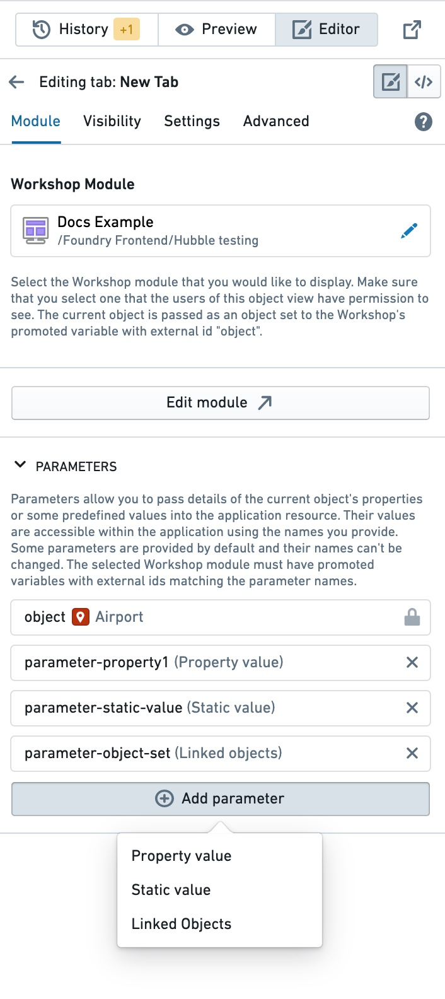

:::callout{theme="warning"}
注意：以下翻译的准确性尚未经过验证。这是使用 [AIP ↗](https://www.palantir.com/platforms/aip/) 从原始英文文本进行的机器翻译。
:::

# 配置 Workshop 标签页

Workshop 标签页使您能够使用[Workshop](https://www.palantir.com/docs/foundry/workshop/overview/)创建具有高级功能和特性的 Object 视图标签页。您可能希望使用 Workshop 标签页来：

* 完全灵活地控制标签页的[设计](https://www.palantir.com/docs/foundry/workshop/concepts-layouts/)。
* 使用 Workshop [变量](https://www.palantir.com/docs/foundry/workshop/concepts-variables/)灵活动态地加载信息。
* 使用[场景](https://www.palantir.com/docs/foundry/workshop/scenarios-overview/)显示模拟或模型支持的结果。

## 创建新的 Workshop 标签页

有两种方法可以将新的 Workshop 标签页添加到您的 Object 视图中：在 Workshop 中搭建新的托管模块标签，或嵌入现有模块。

* **添加新标签页：** 如果您选择添加新标签页，将会在标签页中创建并显示一个新的托管 Workshop 模块。该模块的权限将与 Object 视图保持同步，但该模块不能在 Object 视图之外重复使用。
* **嵌入现有 Workshop 模块：** 如果您想在新标签页中使用现有的 Workshop 模块，您必须首先将新模块保存到正确的项目文件夹中以定义默认权限。保存模块后，在可用资源中找到它并将其添加到您的 Object 视图中。

一旦您保存了新的 Workshop 标签页，它将包含一个默认的 **属性微件**（在 Workshop 中搭建）以用于该 Object。

## 编辑 Workshop 标签页

要编辑 Workshop 标签页，请在配置侧边栏中选择**编辑模块**。这将会在一个单独的浏览器标签页中打开 Workshop 编辑器，并显示您的新模块。

[官方图片已失效：在 Object 视图中编辑新的 Workshop 模块](https://www.palantir.com/docs/resources/foundry/object-views/edit-workshop-module.png)

保存并发布您的 Workshop 编辑后，刷新 Object 视图或切换到预览模式以查看更改。

如果您正在编辑托管模块，可以直接在 Workshop 标题中保存模块并发布 Object 视图，然后使用预览按钮返回到 Object 视图编辑器。

[官方图片已失效：从 Workshop 保存模块并发布 Object 视图](https://www.palantir.com/docs/resources/foundry/object-views/publish-ov-from-workshop.png)

## 配置参数

Workshop 标签页支持在嵌入的 Workshop 模块中使用传递参数作为变量。

在 Object 视图中添加新的 Workshop 标签页时，当前对象会作为对象集参数传递给 Workshop 的模块接口变量，外部 ID 为 `object`。在 Workshop 中，您必须使用模块接口变量以使用 Object ID。

此外，视图编辑器可以配置其他参数以传递给嵌入的 Workshop 模块：

* 当前对象的**属性**。
* \*\*静态值，\*\*一个自由文本字段，在 Workshop 中被解析为字符串/数字/等。
* \*\*链接对象，\*\*一个对象集，包含链接到当前对象实例的对象。

要在嵌入的 Workshop 模块中将这些参数用作变量，必须首先在 Workshop 的变量面板中定义它们。然后，在变量**设置**面板中，添加一个与参数名称匹配的外部 ID，并确保变量在模块接口中被启用。

## 权限

您必须拥有底层 Workshop 模块的权限才能将其视为一个标签页。如果您没有适当的权限，您将看到一条消息显示该模块不可供您访问。

为确保您拥有模块的正确权限，我们建议将底层 Workshop 模块保存到您有访问权限的项目文件夹中。

[官方图片已失效：由于缺少权限导致的私有模块](https://www.palantir.com/docs/resources/foundry/object-views/private-module.png)

> 配图缺失说明：本页有 3 个官方图片地址在抓取及重试时失效（返回 HTML 错误页）。下列地址保留用于溯源，未替换成其他版本的图片。

- 官方图片已失效：<https://www.palantir.com/docs/resources/foundry/object-views/edit-workshop-module.png>
- 官方图片已失效：<https://www.palantir.com/docs/resources/foundry/object-views/private-module.png>
- 官方图片已失效：<https://www.palantir.com/docs/resources/foundry/object-views/publish-ov-from-workshop.png>
