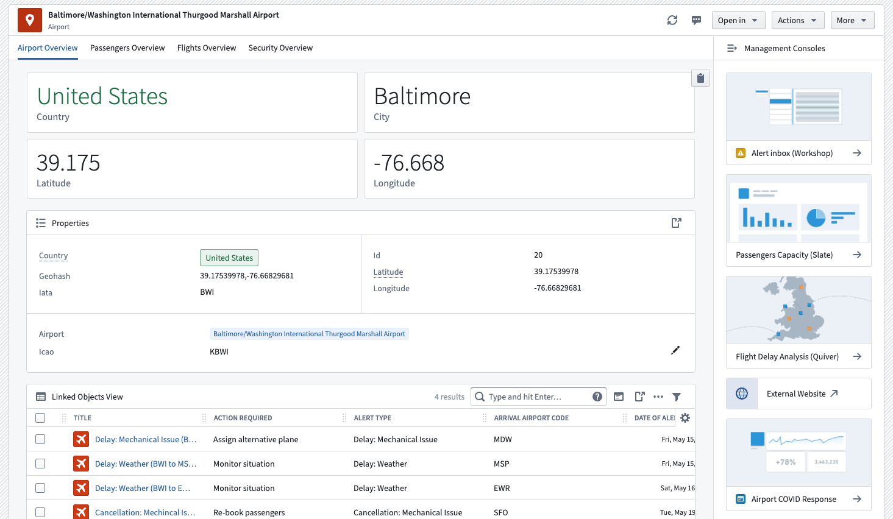
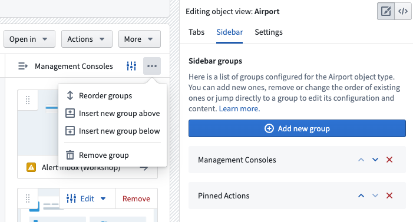
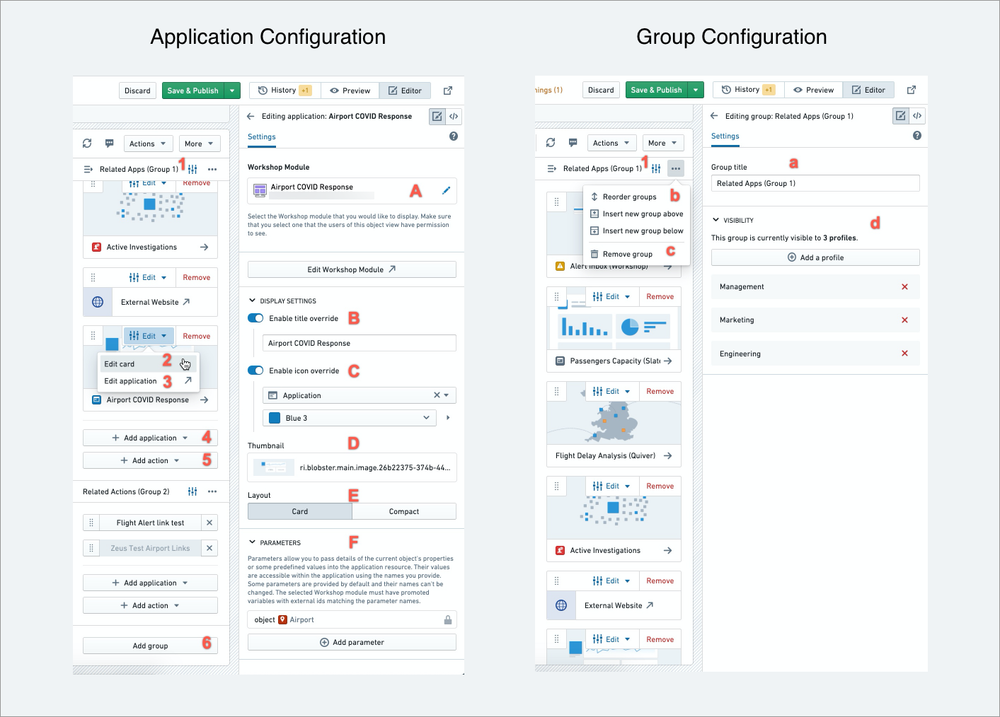

:::callout{theme="warning"}
注意：以下翻译的准确性尚未经过验证。这是使用 [AIP ↗](https://www.palantir.com/platforms/aip/) 从原始英文文本进行的机器翻译。
:::

# 配置应用程序侧边栏

**应用程序侧边栏**用于显示和嵌入与当前Object相关的应用程序、分析、操作和其他资源。应用程序侧边栏在视觉上将这些资源与该Object的主要内容区分开。

应用程序侧边栏支持嵌入所有基于Object的应用程序，包括[Workshop](https://www.palantir.com/docs/foundry/workshop/overview/)、[Quiver](https://www.palantir.com/docs/foundry/quiver/overview/)、[Slate](https://www.palantir.com/docs/foundry/slate/overview/)、[操作类型](../../../%E5%AE%9A%E4%B9%89%E6%9C%AC%E4%BD%93/%E5%8A%A8%E4%BD%9C%E7%B1%BB%E5%9E%8B/%E6%A6%82%E8%BF%B0.md)等。一旦添加到侧边栏，您可以在Object的上下文中打开这些应用程序。侧边栏还允许使用参数化URL链接到其他应用程序和外部网站。

在下面的示例中，您可以看到一个`Airport` Object。主体选项卡包括关于该Object的主要信息，而相关应用程序包括：

* 用于处理航班延误的Workshop警报收件箱；
* 用于管理机场乘客容量的Slate应用程序；以及
* 专门用于机场COVID响应的应用程序。

### 设置应用程序侧边栏

应用程序侧边栏是每个Object视图的非必填、选择性添加。侧边栏在您添加一个组之前对用户不可见。**添加新组**选项可以在**侧边栏**选项卡下找到，或者通过展开侧边栏本身（如下面的图像所示）。一旦构建者添加应用程序和/或操作并发布该版本，侧边栏将显示给最终用户。如果侧边栏仅包含一个空组或多个空组，则不会显示。

一旦您添加应用程序和/或操作并发布您的更改，侧边栏将显示给用户。如果侧边栏仅包含一个空组或多个空组，则不会显示。

### 编辑应用程序侧边栏

应用程序侧边栏是模块化和可配置的。侧边栏可以被分成不同的组，每个组内包含不同的应用程序卡片和操作。

侧边栏对每个组和应用程序卡片都有专门的配置。如下图所示，选项包括：

1. 使用以下选项编辑整个组：
   * (a) 配置组标题
   * (b) 重新排序组内的应用程序卡片和操作
   * (c) 删除整个组
   * (d) 编辑可见性（仅对特定用户配置文件可见）

2. 编辑特定的应用程序卡片，打开一个二级菜单，您可以：
   * (A) 添加或更改用于单个卡片的应用程序资源（详见下文）
   * (B) 覆盖标题
   * (C) 覆盖图标
   * (D) 在卡片上使用缩略图；缩略图必须上传到Foundry并保存在一个文件夹中
   * (E) 选择卡片模式或紧凑模式
   * (F) 添加参数

3. 编辑后台应用程序（这将打开源应用程序中的特定模块，如Workshop或Slate）

4. 添加新的应用程序到一个组

5. 添加新的操作到一个组

6. 添加新组

### 在侧边栏中添加/更改应用程序

有两种主要方式可以将应用程序添加到侧边栏：

1. 对于嵌入Object视图的Object应用程序（如Workshop、Quiver、Slate等）：
   * 选择**添加应用程序**，选择一个应用程序（如Workshop）以打开资源选择器，并选择您要嵌入的特定资源（如Workshop模块）。
   * Workshop和Slate应用程序的参数配置允许您将当前Object的属性、链接的Object集合或预定义的值传递到链接的资源中。
   * 参数值可在嵌入的Workshop或Slate应用程序中作为变量访问，其名称与参数名称相同。在Workshop中，这些必须在变量**设置**面板中配置为模块接口变量。

2. 对于其他Foundry应用程序和在新标签页中打开的外部网站：
   * 添加一个**应用程序链接**以创建一个带有参数化URL的新卡片。
   * 侧边栏上的所有链接都在新浏览器标签中打开，而不像上面提到的Object应用程序那样嵌入。
   * 这些URL可以用于Foundry应用程序（如Workshop、Vertex、另一个Object视图或Foundry文档）和外部网站。
   * URL卡片需要一个模板，该模板结合了地址和/或在参数配置中定义的任何参数。要在URL中放置参数，请将参数名称包裹成这样：`{{parameterName}}`。如果属性是整个URL，请选中**编码属性值**框以标记为整个URL，并仅在URL文本框中包含`{{parameterName}}`。
   * 默认情况下，当前Object的详细信息可通过这些参数使用：`{{objectId}}` & `{{objectTypeId}}`。

:::callout{theme="neutral"}
如果用户没有嵌入应用程序的权限，他们将无法打开它，但仍会看到应用程序卡片。请确保在侧边栏的每个应用程序上设置正确的权限。
:::
