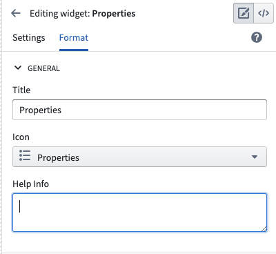
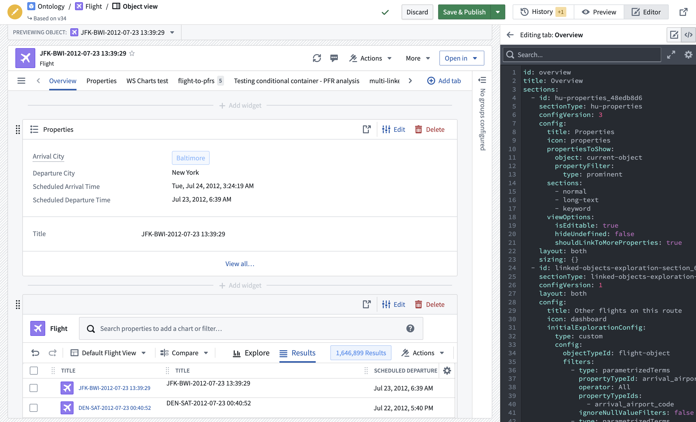

:::callout{theme="warning"}
注意：以下翻译的准确性尚未经过验证。这是使用 [AIP ↗](https://www.palantir.com/platforms/aip/) 从原始英文文本进行的机器翻译。
:::

# 配置微件（旧版）

旧版 Object View 选项卡的构建模块称为**微件**。微件有时被称为*部分*或*插件*。微件是显示某种形式数据在 Object View 上的主要方式。使用它们可以将数据可视化为 KPI 或图表，安排整个 Object View 的设计，并操作显示的数据。

在 Object View 中有几种可用的微件类型：

* [属性和链接](../Widgets/%E5%B1%9E%E6%80%A7%E5%92%8C%E9%93%BE%E6%8E%A5.md)
* [可视化](../Widgets/%E5%8F%AF%E8%A7%86%E5%8C%96.md)
* [筛选](../Widgets/%E7%AD%9B%E9%80%89.md)
* [设计](../Widgets/%E8%AE%BE%E8%AE%A1.md)
* [嵌入其他应用程序和文件](../Widgets/%E5%BA%94%E7%94%A8%E7%A8%8B%E5%BA%8F%E5%92%8C%E6%96%87%E4%BB%B6.md)

## 微件配置

### 微件特定设置

微件用于可视化或操作与 Object 相关的数据。微件通常访问以下之一：

* 当前 Object 的属性
* 链接到当前 Object 的 Objects
* 链接到当前 Object 的 Objects 属性的聚合

当您在 Object View 上配置微件时，确定要可视化哪个 Object 和什么属性。您必须在 Ontology 元数据中预先设置相关 Objects 并定义链接。

每个微件的特定设置取决于其提供的功能。一般来说，微件特定配置有两个主要组成部分：

* **Object 模型**配置需要选择 Object 或链接的 Object 及其应使用的属性。例如，在配置图表时，您可能需要聚合一个机场中每个目的地的所有航班。
* **视觉**配置需要选择选项，如图表类型、颜色、格式、文本标签等。

### 微件格式设置

所有微件都有默认格式设置：

**常规**

* **标题：** 添加一个标题以显示在微件标题中。默认情况下，这个标题要么是微件名称，要么是一个空格。您必须为微件添加一个标题以保存它。
* **图标：** 选择一个图标以显示在微件标题的左上角。每个微件都有一个默认图标。
* **帮助信息：** 默认情况下为空，您可以添加文本以向用户解释微件。

**设计**

* **对齐：** 您可以选择微件是应为 Object View 的全宽，还是设置为右对齐或左对齐以便并排放置两个微件。默认情况下，对齐设置为全宽。
* **尺寸：** 并非所有微件都有尺寸设置。当该设置可用时，您可以控制 Object View 中该部分的最小和最大高度。

## 重用微件配置

您可以通过复制 YAML 配置来重用先前创建的微件配置。通过在 Object View 编辑屏幕的右上角选择代码图标来访问配置。然后，将配置复制并粘贴到新微件的 YAML 配置中。

