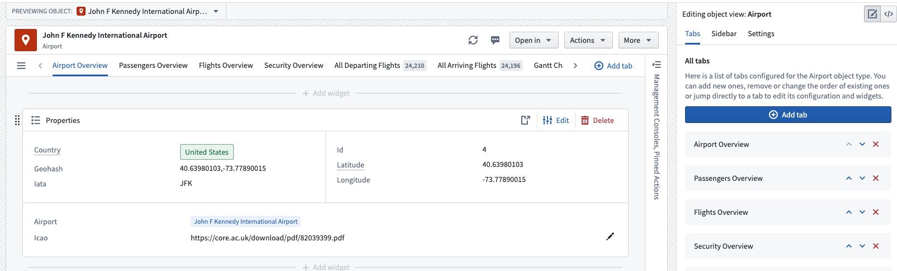
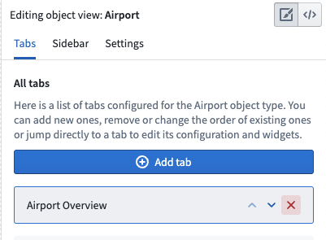
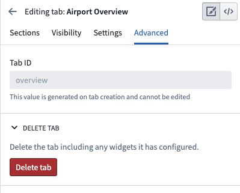
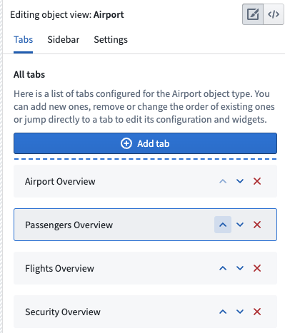
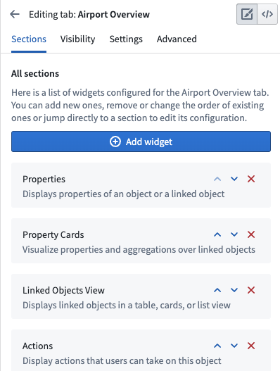
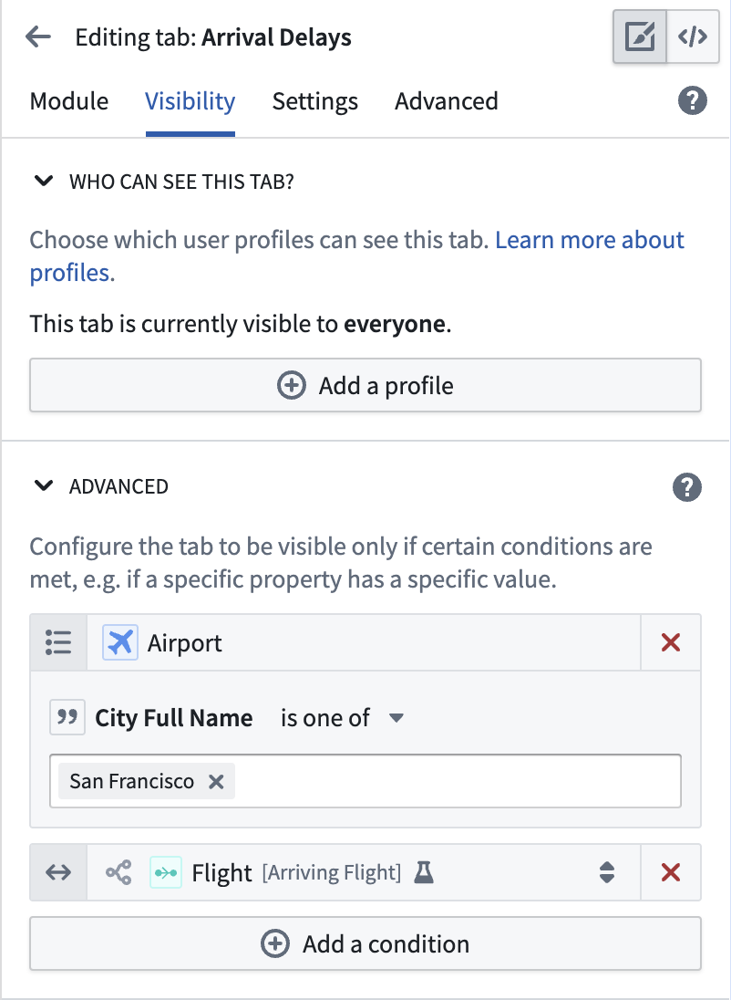
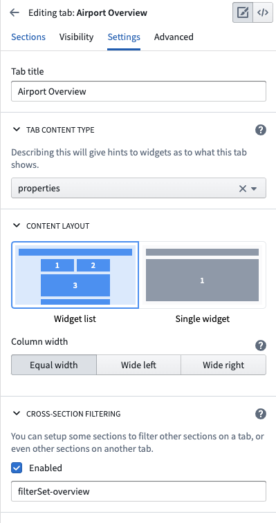

:::callout{theme="warning"}
注意：以下翻译的准确性尚未经过验证。这是使用 [AIP ↗](https://www.palantir.com/platforms/aip/) 从原始英文文本进行的机器翻译。
:::

# 配置标签页

**标签页**是Object View中导航和分组内容的主要方法。每个标签页都包含一个Workshop模块，并具有条件可见性、筛选设置和设计设置的自定义选项。

可以添加到Object View中的标签页有两种类型：受管理的Workshop模块和独立的Workshop模块。

* **受管理的Workshop模块：** 我们建议使用[Workshop](https://www.palantir.com/docs/foundry/workshop/overview/)在Object View中搭建一个新的标签页。此选项允许你开发更复杂的视图，充分利用Foundry的应用程序搭建能力。[了解更多关于Workshop支持的标签页。](%E9%85%8D%E7%BD%AE%20Workshop%20%E6%A0%87%E7%AD%BE%E9%A1%B5.md) 受管理的模块权限会自动与Object View保持同步，不能重复使用。
* **现有的Workshop模块：** 你可以将已经在Workshop中搭建的模块直接嵌入到Object View的标签页中。你可以在多个Object View中使用相同的模块。

一些标签页是使用**遗留**构建器搭建的，它允许你创建简单的标签页，但在设计、微件和数据选项方面的灵活性有限。使用此构建器的新标签页不再支持添加，但现有标签页仍然受支持。

## 管理标签页

### 添加新标签页

你可以从编辑器中的两个地方添加标签页：Object View编辑器侧边栏的**标签页**部分，或Object View预览中标签页列表中的**添加标签页**按钮。任何一种方式都可以让你选择所需的标签页类型。

### 删除标签页

你可以从Object View编辑器侧边栏的标签页列表中删除标签页。你也可以点击编辑器侧边栏中的标签页，导航到**高级**，然后点击**删除标签页**。

### 移动标签页

使用Object View编辑器侧边栏中的标签页列表移动标签页。点击向上或向下箭头以重新排列它们在Object View预览中的顺序。

## 配置标签页内容

### Workshop支持的标签页

[了解更多关于编辑Workshop支持的标签页。](%E9%85%8D%E7%BD%AE%20Workshop%20%E6%A0%87%E7%AD%BE%E9%A1%B5.md)

### 基于微件的标签页（遗留）

一个遗留的基于微件的标签页显示一个按部分组织的微件列表。你可以在标签页设置中添加、删除和重新排序微件或导航到其他设置。

[了解更多关于配置微件。](%E9%85%8D%E7%BD%AE%E5%BE%AE%E4%BB%B6%EF%BC%88%E6%97%A7%E7%89%88%EF%BC%89.md)

## 配置标签页设置

### 标签页可见性

可以通过多种方式有条件地向查看用户显示标签页。一种方法是使用自定义Object View和[配置文件](%E9%85%8D%E7%BD%AE%E9%85%8D%E7%BD%AE%E6%96%87%E4%BB%B6.md)。你还可以基于以下两个因素有条件地显示标签页：

* **属性值：** 如果当前查看的Object的某个属性值等于或不等于给定值，则满足此条件。当一个标签页显示的内容仅与属性值匹配预期值的Object相关时，属性值条件非常有用。
  * 例如，你可能想要向某个机场Object添加一个*区域视图*标签页，该标签页只适用于特定区域的机场。你可能有一个不同区域的*区域视图*标签页，有条件地显示其他区域。每个标签页可以有不同的视觉组件。
* **链接可见性：** 如果查看标签页的用户有权限查看当前查看的Object可能链接到的Object类型，则满足此条件。当一个标签页显示的内容基于Object的链接，但查看用户可能没有权限查看那些链接的Object时，链接可见性条件非常有用。

以下是这些条件的示例：

### 标签页设置

你可以配置的其他一般标签页设置包括：

* **标题：** 标题设置控制Object View中标签页列表中显示的标签。标签标题应简短且描述内容。
* **内容类型：** 如果相关，你可以使用此配置指定标签页中显示的链接类型或链接。如果选择*链接*选项，你将在Object View中的标签页标题旁看到一个徽章，显示有多少个Object链接到当前查看的Object。
* **内容设计：** 所有遗留标签页都支持一个两列微件列表设计，当微件指定对齐到特定列时激活此设计。使用此配置选项控制标签页级别的列是否应具有相同宽度或不同大小。
* **横截面筛选：** 启用此设置以允许此标签页中的微件发布和使用由与微件的交互控制的筛选。例如，你可能想在图表中选择一个条目并筛选所有其他图表以仅显示相关数据。你还可以自定义筛选集的ID，然后在其他标签页中使用相同的ID，以便在多个标签页中使用和持久化筛选。

以下是配置标签页设置的示例：

