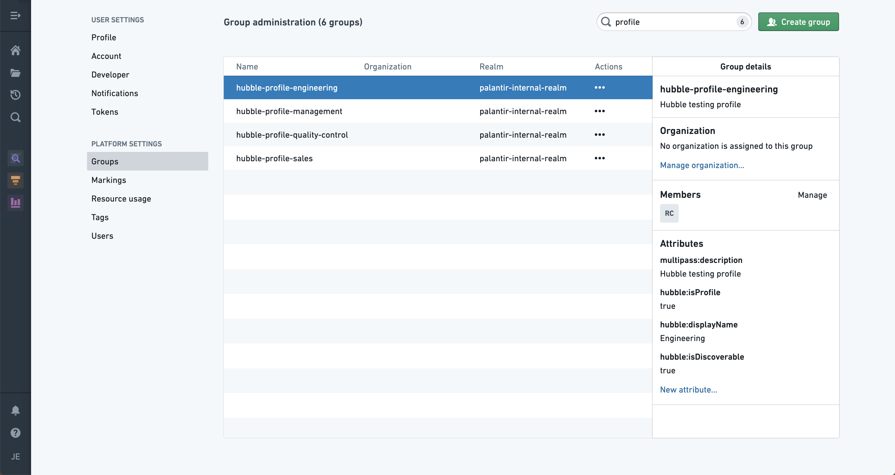
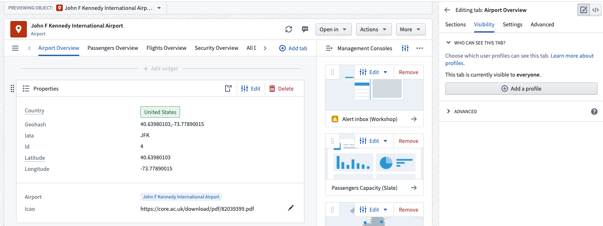
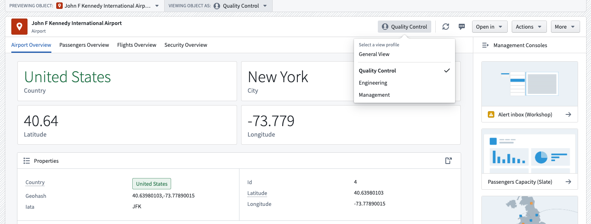
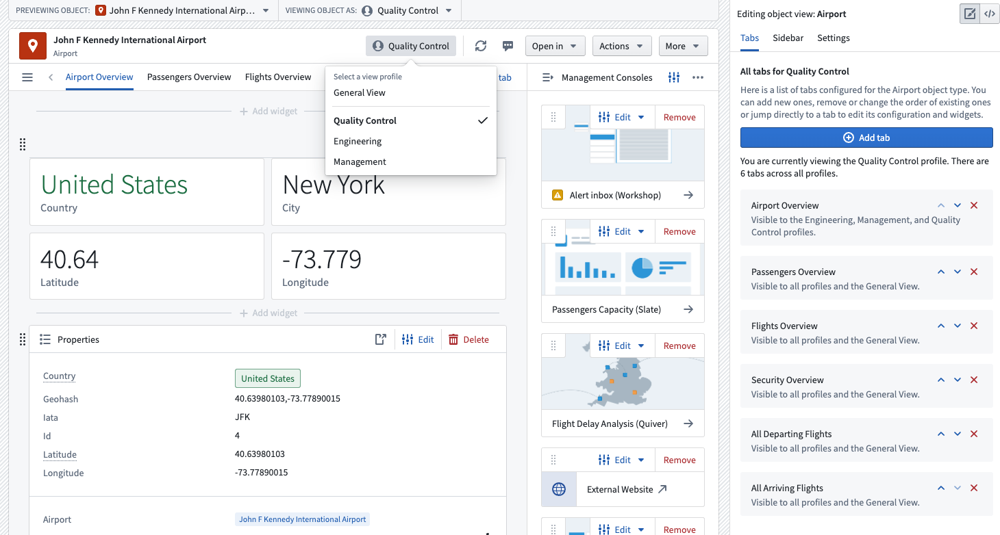

:::callout{theme="warning"}
注意：以下翻译的准确性尚未经过验证。这是使用 [AIP ↗](https://www.palantir.com/platforms/aip/) 从原始英文文本进行的机器翻译。
:::

# 配置配置文件

**配置文件**使您能够配置如何将对象视图展示给具有不同背景的用户。您可以使用配置文件来控制不同用户的Object View [选项卡](%E9%85%8D%E7%BD%AE%E6%A0%87%E7%AD%BE%E9%A1%B5.md)的可见性，以便他们看到符合其需求的视图。

### 配置配置文件

Object Explorer由名为`Hubble`的服务提供支持。要在Object View中使用组作为配置文件，请在平台设置的[**组**选项卡](https://www.palantir.com/docs/foundry/security/users-and-groups/)中添加以下Hubble属性：

* `hubble:isProfile` : `true`
* `hubble:displayName` : `设置最终用户看到的名称`
* \[非必填] `hubble:isDiscoverable` : `true`
  * 将`hubble:isDiscoverable`属性设置为`true`将使该配置文件对非组成员的用户可见。省略此属性意味着只有在组内的用户才能访问指派给此特定配置文件的视图。

:::callout{theme="neutral"}
新创建的配置文件可能需要最多五分钟才能在Object View编辑器中可用。
:::

### 指派配置文件给对象视图

配置文件是在选项卡级别指派的，这意味着对于每个选项卡，您可以指派特定的配置文件。要将配置文件添加到选项卡，请访问编辑器侧边栏，点击**选项卡**设置中的一个选项卡，选择**可见性**，然后点击**添加配置文件**。

### 作为用户切换配置文件

一旦您将配置文件添加到对象视图中，您可以在配置文件之间切换。在对象视图标题中选择配置文件类型以访问包含可用配置文件的下拉菜单。通过点击对象视图顶部的**Viewing Object As:**，您也可以找到相同的下拉菜单。

### 作为编辑器切换配置文件

在编辑对象视图时，您也可以访问不同的配置文件。这样做将允许您查看每个配置文件可见的选项卡。

### 为用户设置默认配置文件

要为用户或用户组设置默认配置文件，将其作为成员添加到支持该配置文件的组中。此操作仅在用户是单个配置文件的成员时有效。

:::callout{theme="neutral"}
您最多可以为每个对象视图添加十个配置文件。
:::
