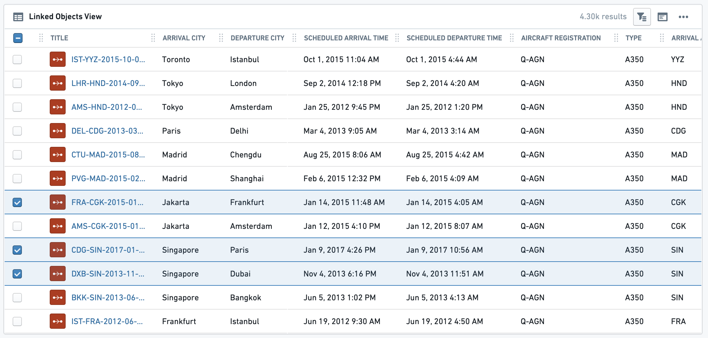
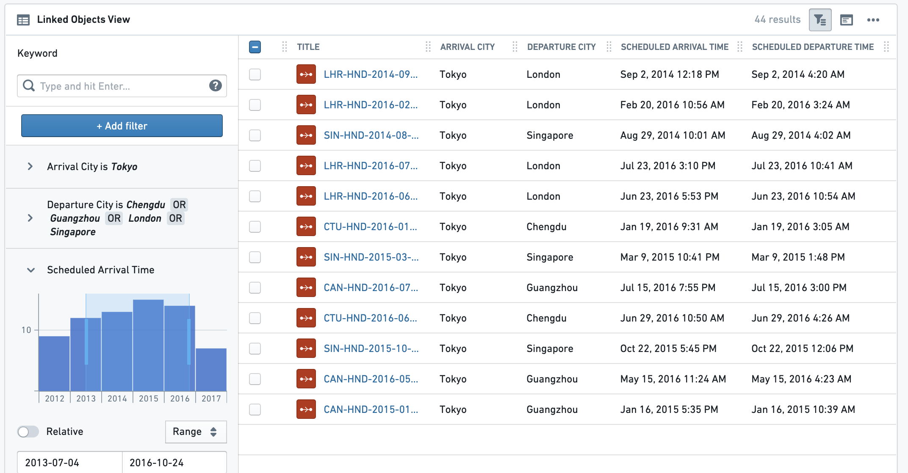
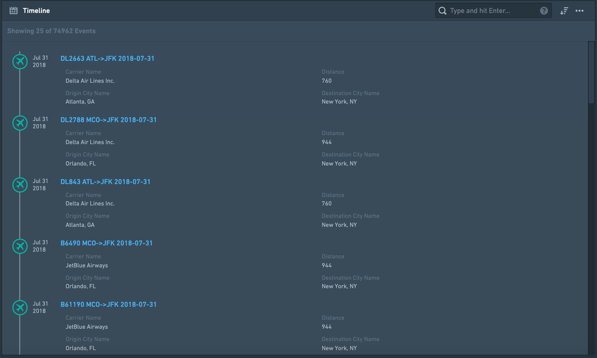
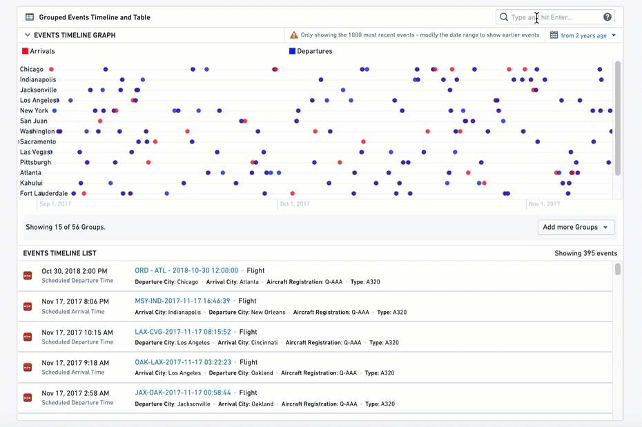

:::callout{theme="warning"}
注意：以下翻译的准确性尚未经过验证。这是使用 [AIP ↗](https://www.palantir.com/platforms/aip/) 从原始英文文本进行的机器翻译。
:::

# 可视化

**可视化微件**以图表、数据透视表、时间轴、地图和其他可视化形式显示与当前Object相关的数据，包括简单的文本和指标。在其他Foundry应用程序中创建的可视化也可以嵌入 - 请参阅[应用程序和文件](%E5%BA%94%E7%94%A8%E7%A8%8B%E5%BA%8F%E5%92%8C%E6%96%87%E4%BB%B6.md)类别以了解更多关于嵌入Slate应用程序、contour面板、Foundry报告、Fusion电子表格和Quiver时间序列或图表的信息。

## 链接Object视图

该微件主要用于显示某种类型的所有链接Objects及其相关属性的\_表格\_视图。该表格还支持选择链接Objects的子集以在其他Foundry应用程序中打开或执行已配置的Object操作。除了表格视图外，还提供简单的列表视图和卡片视图。

链接Object视图（表格）示例，没有筛选侧边栏和带有筛选侧边栏：

### 配置

#### 设置选项卡

配置分为三个部分：

* 数据
  * *要显示的链接Object*：选择您希望显示的链接Object。微件配置提供了[Ontology配置](../../../%E5%AE%9A%E4%B9%89%E6%9C%AC%E4%BD%93/%E5%AF%B9%E8%B1%A1%E9%93%BE%E6%8E%A5%E7%B1%BB%E5%9E%8B/Link%20types/%E5%88%9B%E5%BB%BA%E9%93%BE%E6%8E%A5%E7%B1%BB%E5%9E%8B.md)中定义的与当前Object链接的Objects。可以通过直接链接或使用中间Object类型通过传递链接选择Object类型。
  * *要显示的属性*：
    * 所有属性 - 显示定义为重要或普通的所有属性，但不显示隐藏属性。允许使用`要排除的属性`选择器排除特定的属性集（见下文）。
    * 重要属性 - 仅显示在Ontology管理器中定义为重要的属性。允许使用`要排除的属性`选择器排除特定的属性集（见下文）。
    * 特定属性 - 打开一个多选下拉菜单，选择该链接Object的所有属性。
    * 无属性 - 不显示任何属性。
  * *要排除的属性*：选择要从显示中排除的属性。适用于**所有属性**和**重要属性**选项。
* 视图选项 - 选择默认情况下将显示给最终用户的视图类型。最终用户仍可以在UI中更改为其他2个视图（在微件标题上）。
  * 表格视图 - 最常用的视图，显示所有值的表格，带有快速筛选搜索。
  * 卡片视图 - 每个链接Object的压缩卡片视图，带有属性（如1b中选择）。此选项不具有表格视图的全部功能。例如，它不支持选择或Object操作。
    * 注意：对于卡片显示选项，有一个次要配置称为“卡片宽度”，决定这些卡片的视觉密度。对于表格或列表视图选项无效。
  * 列表视图 - 所选链接Object的所有实例的简单列表视图，没有任何选择选项或任何链接属性的显示。
* 搜索和筛选 - 为表格视图添加搜索和筛选功能
  * 结果限制 - 限制显示的最大结果数量。显示的结果越多，视图加载的时间越长。与最小/最大高度配置（见下文的格式选项卡）一起决定此微件的整个视图的占用程度。
  * 允许对列值进行搜索 \[已弃用] - 此功能已弃用，请参阅下文的功能，提供完整的搜索和筛选功能。
  * 启用搜索和筛选 - 切换以在微件上启用搜索和筛选功能。这包括基本或高级搜索功能：
    * 基本 - 在微件标题处提供一个简单的自由文本搜索栏。
    * 高级 - 带有详细筛选选项的完整筛选侧边栏，包括切换默认情况下向最终用户展开或折叠侧边栏。与基本的自由文本搜索不同，此搜索允许基于属性类型的更复杂筛选（自由文本和多选字符串，时间戳的日期范围，双精度/整数的数字）。此搜索栏基于传统的Object Explorer功能和UI。

**格式选项卡：**

在微件配置中的格式选项卡下，除了默认的标题、图标、信息和设计外，您还可以控制部分的最小和最大高度（非必填）。

**常见问题和注意事项：**

* 此微件\_受其他微件的筛选影响\_ - 如果切换开启 - 但\_不向其他共享交叉筛选的微件发布筛选\_，即使筛选侧边栏打开也是如此。实际上，内部筛选限于Object表格微件的上下文。
* 条件格式和值渲染器 - 表格中的值可以通过条件格式和值渲染器呈现。

## 时间轴

创建事件的按时间顺序排列的列表，自上而下显示，按日期和时间排序。此时间轴由至少具有一个时间戳的链接Objects构成，通常是事件，即具有定义持续时间的起始和结束时间戳的Object。
此微件可以包括直接链接到当前Object或通过链接Object的一个或多个类型的Objects。它还可以通过不同的日期属性显示同一事件，如下例所示。

对于图形时间轴，请使用[分组事件时间轴和表格](#grouped-events-timeline-and-table)微件。

### 配置

#### 设置选项卡

* **添加一个或多个链接Objects（事件）** - 首先，通过点击“添加事件类型”添加您希望在时间轴上显示的至少一个链接Object类型。您可以添加多种类型的链接Objects：
  * 在时间轴上显示不同的Object类型，它们是完全不同的事件。示例：链接到飞机的Objects是航班事件和飞机维护事件。
  * 显示同一链接Object类型的事件，但通过不同的日期属性或定义的不同类型的链接。示例：
    * 链接到机场Object的航班事件通过不同的日期属性显示在同一时间轴上：（1）“计划到达时间”，（2）“实际到达时间”，（3）“预计出发时间”。在这种情况下，每个航班最多会出现3次。
    * 一个机场Object可以同时拥有到达航班和离港航班，并在同一时间轴上显示。
* **选择要添加的事件Object类型** - 对于您希望添加的每个事件Object，配置该Object类型的详细信息：
  * 选择链接Object类型 - 直接链接Object或扩展链接。
    * 直接链接Object的示例：当前Object是一个机场，您想显示到达航班和离港航班的时间轴。
    * 扩展Object（2级）的示例：当前Object是一个机场，您想显示所有链接到到达航班并链接到机场的飞机Object的时间轴。
* **定义用于在时间轴上排序事件的日期属性** - 选择您希望在时间轴上通过哪个属性对事件进行排序的链接Object的属性。此属性必须是时间戳/日期，因此配置仅建议此类属性。
* **选择要从链接Object显示的属性**。
  * 选择您希望显示的属性：
    * 所有属性 - 如果链接Object有很多属性，不建议这样做，因为它会很拥挤，难以通过时间轴导航。
    * 重要属性 - 仅显示在Ontology管理器中定义为重要的属性。
    * 特定属性 - 打开一个多选下拉菜单，选择该链接Object的所有属性。
    * 无属性 - 仅在时间轴上显示链接Object的标题。
  * 选择要排除的属性 - 仅适用于前两个选项的所有属性和重要属性。
* **选择每个事件在时间轴上显示的标题**。有三个选项：
  * **Object名称**作为标题（例如事件的名称） - 这是最常用的选项和默认选项。
  * **日期属性名称**作为标题 - 如果您希望通过多个属性显示来自链接Object的事件（例如“计划到达时间”，“实际到达时间”，“预计出发时间”等），此选项很有用。提醒：在这种情况下，每个基于不同属性的链接应在时间轴微件中单独配置 - 请参见上面第1点）。
  * **自定义名称** - 为该类型的所有链接Objects添加自由文本描述的选项。例如，如果您在同一时间轴下链接了到达航班和离港航班，您可能希望将所有到达航班描述为标题“到达”，将所有离港航班描述为“离港”。

#### 格式选项卡

在格式选项卡下，除了默认的标题、图标、信息和设计外，您可以控制部分的最小和最大高度。设置任一项是可选的。

### 常见问题和注意事项

* 此微件可搜索和排序（最旧的优先，最新的优先）。然而，它不支持筛选，因此不受筛选影响。对于筛选功能，请考虑使用[分组事件时间轴和表格](#grouped-events-timeline-and-table)微件。
* 如果您希望在图形时间轴上显示事件（而不仅仅是按时间顺序排列的列表），请考虑使用[分组事件时间轴和表格](#grouped-events-timeline-and-table)微件。
* 如果您希望显示甘特图样式的时间轴，有一个“链接Objects甘特图”微件。如果不可用，请联系您的Palantir代表以获取更多详情。这适用于显示较少数量的事件，具有明确的开始和结束日期，例如项目时间轴。
* 对于时间序列可视化，请联系您的Palantir团队以获取有关Quiver的更多详情，Quiver可以嵌入到Object视图中。您还可以使用图表微件（或嵌入来自contour或Quiver图表的图表），在X轴上使用日期/时间属性。
* 缺少日期的事件将不会显示在事件列表中。会有一条消息提醒用户关于缺失的事件。
* 出于性能原因，默认情况下仅显示50个链接Objects。当用户向下滚动列表时，会显示额外的Objects，每次100个。

## 分组事件时间轴和表格

此微件包括两个组件：（1）链接Objects的时间轴，以及（2）在下方列出的链接Objects表格。链接Objects可以按属性分组，并通过文本、日期范围和外部筛选进行筛选。

分组事件绘制在单独的平行线上，每条线仅包含具有某个值的属性的事件，类似于数据透视表。以下示例中，每个城市都有一条不同的线，所有抵达（红色）或离港（蓝色）该城市的航班都在该线上。

此微件可以包括直接链接到当前Object或通过链接Object的一个或多个类型的Objects。它还可以通过不同的日期属性显示同一事件（如下例所示）。

### 配置

#### 设置

* **添加一个或多个链接Objects（事件）** - 首先，通过点击“添加项目”添加您希望在时间轴上显示的至少一个链接Object类型。您可以添加多种类型的链接Object：
  * 在时间轴上显示不同的Object类型，它们是完全不同的事件。示例：链接到飞机的Objects是航班事件和维护事件。
  * 显示同一链接Object类型的事件，但通过不同的日期属性或定义的不同类型的链接。示例：
    * 链接到机场Object的航班事件通过不同的日期属性显示在同一时间轴上：（1）“计划到达时间”，（2）“实际到达时间”，（3）“预计出发时间”。在这种情况下，每个航班最多会出现3次。
    * 一个机场Object可以同时拥有到达航班和离港航班，并在同一时间轴上显示。
* **选择要添加的事件Object类型** - 对于您希望添加的每个事件Object，配置该Object类型的详细信息：
  * 选择链接Object - 直接链接Object或扩展链接。
    * 直接链接Object的示例：当前Object是一个机场，您想显示到达航班和离港航班的时间轴。
    * 扩展Object（2级）的示例：当前Object是一个机场，您想显示所有链接到到达航班并链接到机场的飞机Object的时间轴。
* **配置视觉格式选项**
  * 最大事件数量 - 此选项当前无效。
  * 颜色 - 为该项目配置下的所有事件选择颜色。使用[Blueprint标准颜色 ↗](https://blueprintjs.com/docs/#core/colors)或基本颜色名称 - “蓝色”、“红色”、“黄色”等。
  * 系列名称 - 该时间轴下所有事件的描述，将显示在图形时间轴的图例中。
* **定义用于在时间轴上排序事件的日期属性** - 选择您希望在时间轴上显示事件的链接Object的属性。此属性必须是时间戳/日期，因此配置仅建议此类属性。
* **按组事件** - 选择如何在图形时间轴上分组事件。每个组将在图形时间轴上显示为单独的水平事件线，彼此堆叠。有两种选择：
  * 常量 - 当前项目将在单个时间轴上分组，标题定义为自由文本值。在这种情况下，如果您希望将其他时间轴添加为单独的线，您必须定义额外的项目。
  * 属性 - 将事件分成多个单独的时间轴，事件根据该属性的不同值分组在每个时间轴上。
    * 示例：显示机场Object的所有到达航班的时间轴，可以选择“航空公司名称”属性并为每个航空公司提供单独的时间轴，所有该航空公司的航班在其专用时间轴上。下面的列表将包括所有航空公司的所有航班事件的按时间顺序排列的列表。
* **列表中显示的属性** - 选择您希望在微件的第二部分显示的属性，即列表：
  * 选择您希望显示的属性：
    * 所有属性 - 如果链接Object有很多属性，不推荐这样做，因为它会很拥挤，难以通过时间轴导航。
    * 重要属性 - 仅显示在Ontology管理器中定义为重要的属性。
    * 特定属性 - 打开一个多选下拉菜单，选择该链接Object的所有属性。选择要显示的特定属性。
    * 无属性 - 仅在时间轴上显示链接Object的标题。
  * 属性筛选 - 一个可选的切换器，用于添加基于单个属性的筛选，以仅包括特定值。这些值必须显式键入为区分大小写的自由文本字符串。
* 图形时间轴的其他配置（这些仅适用于时间轴组件，对表格组件无效）
  * **默认显示的组** - 时间轴中应显示多少个时间轴，或确切地说哪些时间轴，作为单独的线。在两种情况下，用户都会有一个带有所有其他组的多选帮助器。
    * 最大数量 - 图形时间轴中将显示的不同组和不同时间轴的最大数量，以数字（值）表示。
    * 明确列表 - 编写您希望显示的组的确切值列表（文本，区分大小写）。
  * **按组排序** - 时间轴可以有多个水平线，这允许您通过以下三种方式之一对这些线进行排序：
    * 配置顺序 - 配置不同项目的顺序
    * 名称 - 所有组的字母顺序，从顶部的A到底部的Z
    * 最近事件 - 最近事件所在的组在顶部
  * **最大图形高度** - 设置微件中图形时间轴的最大高度（以像素为单位）。要设置整个微件的高度，请参阅配置中的格式选项卡下的尺寸选项。

#### 格式

在格式选项卡下，除了默认的标题、图标、信息和设计外，您可以控制部分的最小和最大高度。设置任一项是可选的。

### 常见问题和注意事项

* 最终用户可以使用自由文本筛选或日期范围筛选时间轴。请注意，这些筛选器不会发布，也\_不会\_影响其他微件。
* 如果启用了跨部分筛选，此微件会受到其他筛选微件的影响。
