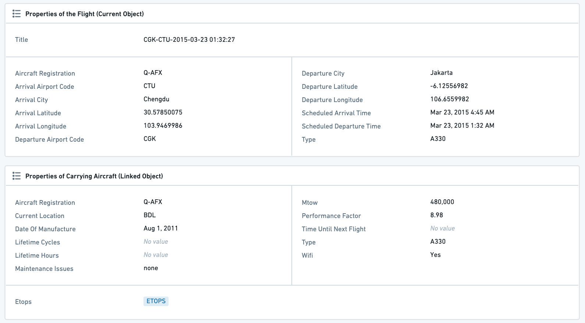
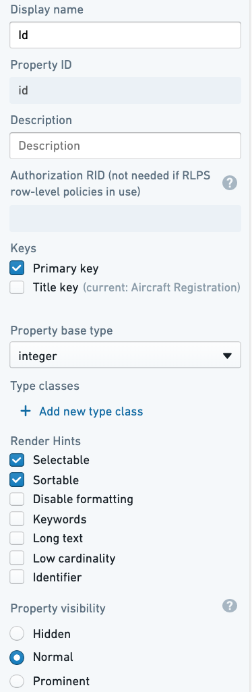
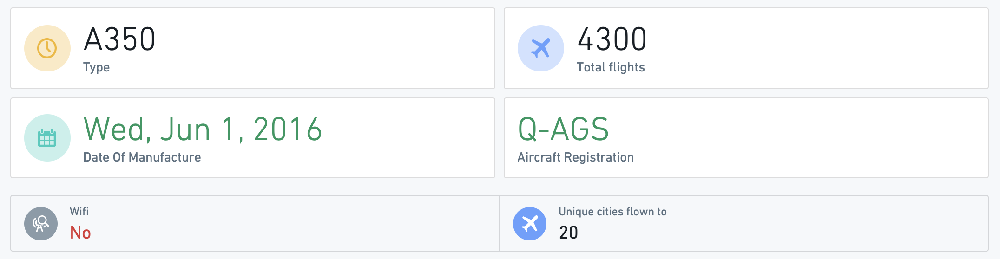
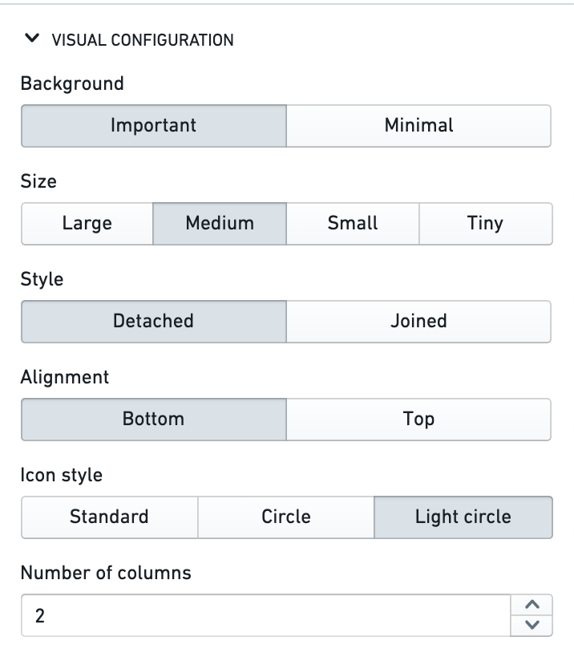
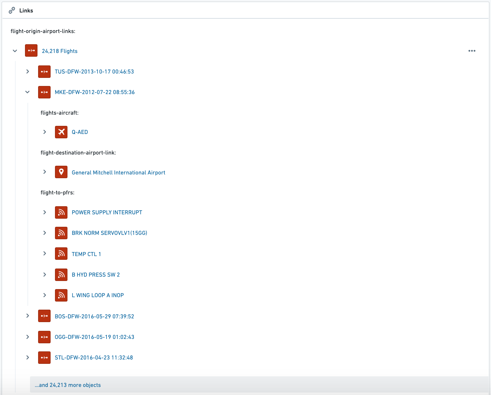
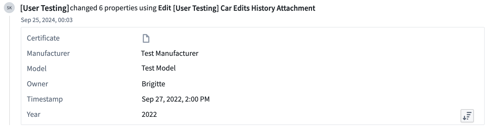

:::callout{theme="warning"}
注意：以下翻译的准确性尚未经过验证。这是使用 [AIP ↗](https://www.palantir.com/platforms/aip/) 从原始英文文本进行的机器翻译。
:::

# 属性和链接

本页讨论显示对象数据模型和Ontology的简单表格视图的所有微件，强调当前对象的属性及其与其他对象的链接。

该类别还包括用于展示统计数据、指标或关键绩效指标（KPI）的微件，这些指标要么在对象的管道中预先计算，并作为对象的一个属性提供，要么需要在链接对象上进行聚合以关联到当前对象。

## 属性微件

**属性**微件显示对象或链接对象的属性。包含此微件的选项卡被创建为任何新定义对象类型的默认Object View。

### 属性微件配置

#### Ontology Manager中的属性定义

属性微件配置与Ontology Manager中的属性定义紧密相关。当您“编辑属性和支持数据集”时，每个属性都有一个单独的设置面板，允许您定义它将在Object View中的显示方式。

有多个设置会影响属性微件中的显示：

* 属性可见性
  * 重要：该属性将在属性微件中显示，并且微件中有一个配置选项仅显示重要属性。此选项用于对象的最重要核心属性。
  * 普通：该属性将在属性微件中显示。此选项用于大多数属性。
  * 隐藏：该属性不会在属性微件中显示（或Object View或Object Explorer中的任何地方）。此选项用于内部ID、链接到其他对象的关系列等属性。
* 渲染提示
  * 长文本：此选项，将属性标记为长文本（通常用于长字符串，如描述、评论等），启用在属性微件的单独部分显示文本。
  * 关键词：将属性渲染为关键词，这会改变它在属性微件中的查看方式，并且允许在微件中单独部分显示。
* 类型类：这允许您定义属性的类型类，这会影响它们的功能。
* 使属性可编辑：如果您希望使属性可编辑，请设置一个[操作类型](../../../%E5%AE%9A%E4%B9%89%E6%9C%AC%E4%BD%93/%E5%8A%A8%E4%BD%9C%E7%B1%BB%E5%9E%8B/%E6%A6%82%E8%BF%B0.md)或[行内操作](../../../%E5%AE%9A%E4%B9%89%E6%9C%AC%E4%BD%93/%E5%8A%A8%E4%BD%9C%E7%B1%BB%E5%9E%8B/%E8%A1%8C%E5%86%85%E7%BC%96%E8%BE%91.md)。

#### 属性微件本身的配置

在微件配置中，首先选择您希望显示当前对象的属性，还是链接对象的属性：

* 如果显示链接对象，首先选择您希望显示的链接。
* 显示链接对象的属性仅在当前对象仅链接到一个对象时才可能，这可以是(1)一对一关系；(2)多对一关系，当前对象定义为“多”。
  * 例如：配置一个航班对象，可以显示链接到该航班的飞机的属性（航班到飞机是多对一关系）。然而，查看飞机对象时，无法显示链接航班的属性，因为有许多航班对象链接到任何单个飞机。

选择当前对象/链接对象后，有3个组件需要配置：数据、部分、查看选项。

##### 数据

* 选择您希望显示的属性：
  * 所有属性：显示定义为重要或普通的所有属性，但没有隐藏属性。允许使用“要排除的属性”选择器排除特定的属性集（见下文）。
  * 重要属性：仅显示在Ontology Manager中定义为重要的属性。允许使用“要排除的属性”选择器排除特定的属性集（见下文）。
  * 特定属性：打开一个多选下拉列表，包含链接对象的所有属性，以供选择。
  * 无属性：不显示任何属性。
* 要排除的属性：选择您希望从显示中排除的属性——仅对前两个选项可用——所有属性和重要属性。

##### 部分

默认情况下，有三个属性部分，它们是：

* 普通属性：所有普通和重要；
* 长文本属性：仅长文本属性，已在Ontology Manager中定义为此类（详见上文）；
* 关键词属性：显示对象的关键词属性为标签。只有在Ontology Manager中标记为关键词的属性，在“编辑属性和支持数据集”下会在此处显示。

您可以删除或更改这些部分的顺序。这三个部分没有其他类型。

##### 查看选项

* **用户可编辑：** 是否允许用户编辑属性。这需要在Ontology Manager中提前进行两个设置（详见上文）：
  * 数据集级别：必须在对象类型上启用编辑。
  * 属性级别：必须有一个[行内编辑操作](../../../%E5%AE%9A%E4%B9%89%E6%9C%AC%E4%BD%93/%E5%8A%A8%E4%BD%9C%E7%B1%BB%E5%9E%8B/%E8%A1%8C%E5%86%85%E7%BC%96%E8%BE%91.md#object-explorer-inline-edits)附加到属性上。
* **隐藏未定义值：** 隐藏所有未定义（null）值的属性。如果此开关关闭，属性将显示为“无值”文本灰显。
* **包含“更多属性”的链接：** 此选项会渲染一个**查看全部**按钮，将用户带到同一对象视图内的**属性**选项卡。

#### 常见问题和注意事项

* 属性显示的顺序是按字母顺序排列的。以不同方式排序属性的主要方法是使用上述微件配置中的“部分”。
* 有关如何将属性设置为重要、将属性设置为长文本或关键词，或使其用户可编辑的更多详细信息，请参阅[编辑属性文档](../../../%E5%AE%9A%E4%B9%89%E6%9C%AC%E4%BD%93/%E5%AF%B9%E8%B1%A1%E9%93%BE%E6%8E%A5%E7%B1%BB%E5%9E%8B/Properties/%E7%BC%96%E8%BE%91Object%E7%B1%BB%E5%9E%8B%E5%B1%9E%E6%80%A7.md)。

## 属性卡片

**属性卡片**微件让您可以可视化包含属性和对链接对象的聚合的卡片。

使用属性卡片微件来显示当前对象或链接对象的重要属性（数值、时间戳、日期、字符串等）、聚合、统计数据、指标、KPI和任何其他关键信息。

* 此微件受筛选器影响，适用于链接对象的任何聚合。
* 属性卡片微件支持用于[条件格式化](../../../%E5%AE%9A%E4%B9%89%E6%9C%AC%E4%BD%93/%E5%AF%B9%E8%B1%A1%E9%93%BE%E6%8E%A5%E7%B1%BB%E5%9E%8B/Properties/%E6%B7%BB%E5%8A%A0%E6%9D%A1%E4%BB%B6%E6%A0%BC%E5%BC%8F%E5%8C%96.md)和[值格式化](../../../%E5%AE%9A%E4%B9%89%E6%9C%AC%E4%BD%93/%E5%AF%B9%E8%B1%A1%E9%93%BE%E6%8E%A5%E7%B1%BB%E5%9E%8B/Properties/%E6%94%AF%E6%8C%81%E7%9A%84%E5%80%BC%E6%A0%BC%E5%BC%8F%E5%8C%96.md)的丰富UI，包括全局（基于Ontology编辑器中的Ontology级配置）和本地覆盖选项。

### 属性卡片配置

首先为每个属性/链接对象聚合的可视化添加一个新卡片。然后，配置微件内所有卡片的整体设计。

#### 每张卡片的配置

* 属性卡片可以显示**一个属性**或**链接属性的聚合**。
  * 显示属性时，卡片可以显示当前对象的属性，以及与当前对象有一对一关系或多对一关系的链接对象的属性（例如，如果当前对象是航班，与飞机有多对一关系，则可以显示飞机对象的属性）。
  * 显示链接对象时，卡片可以显示与当前对象有一对多或多对多关系的任何对象的聚合。
* 在聚合的情况下，选择聚合类型 - 计数、唯一计数/基数、平均值、最小值、最大值、总和。
* 添加将在卡片上显示的标签，以及图标和图标颜色。
* **条件格式化和值格式化：** 默认情况下，微件使用为特定对象和属性在Ontology级定义的全局Ontology格式化规则。
  * 此微件支持条件格式化（例如，根据预定义规则将颜色值设为红色/绿色）。支持的选项是全局格式化（在Ontology Manager中配置，参见[条件格式化文档](../../../%E5%AE%9A%E4%B9%89%E6%9C%AC%E4%BD%93/%E5%AF%B9%E8%B1%A1%E9%93%BE%E6%8E%A5%E7%B1%BB%E5%9E%8B/Properties/%E6%B7%BB%E5%8A%A0%E6%9D%A1%E4%BB%B6%E6%A0%BC%E5%BC%8F%E5%8C%96.md)）和一个可选的本地覆盖。请注意，这仅适用于属性，不适用于聚合。
  * 属性卡片微件支持值格式化（例如，`$3.6M`而不是`3,625,329`）。支持的选项是全局值格式化（在Ontology Manager中配置；参见[值格式化文档](../../../%E5%AE%9A%E4%B9%89%E6%9C%AC%E4%BD%93/%E5%AF%B9%E8%B1%A1%E9%93%BE%E6%8E%A5%E7%B1%BB%E5%9E%8B/Properties/%E6%94%AF%E6%8C%81%E7%9A%84%E5%80%BC%E6%A0%BC%E5%BC%8F%E5%8C%96.md)）和一个本地覆盖。请注意，这适用于属性和链接属性的聚合。
  * 对于本地覆盖，值和条件格式化使用与Ontology级格式化相同的UI，请查看Ontology文档（上面的链接）以了解更多细节。

#### 属性卡片微件中所有卡片的配置

* 一旦配置了所有属性和聚合卡片，使用设计配置来确定卡片在显示中的背景、大小、样式、对齐和图标样式。
* 如果您希望对不同的卡片使用不同类型的视觉配置，请考虑为每种不同的配置添加一个新的微件实例。

#### 常见问题和注意事项

* 属性卡片是可视化重要属性、聚合、统计数据、指标、KPI和任何其他关键信息的支持微件，适用于当前对象和链接对象。
  * 此微件是可视化单个关键属性和聚合的首选解决方案。考虑使用属性卡片微件而不是以下微件：统计数据、上下文统计部分、链接统计、高级统计或Property Plus。
* 属性卡片微件不支持[对象上的函数](../../../%E5%AE%9A%E4%B9%89%E6%9C%AC%E4%BD%93/%E5%87%BD%E6%95%B0/Functions%20on%20objects/%E6%A6%82%E8%BF%B0.md)。如果需要这种支持，请考虑使用Workshop或Quiver并通过专用微件将其嵌入到Object View中。

## 链接

**链接**微件以树状视图显示对象的链接，可以通过链接遍历和导航到链接对象。包括：

* 显示所有链接对象的树，能够展开每个链接对象的视图，显示所有链接到它的对象，并继续通过链接跳转（“嵌套链接”）；
* 将鼠标悬停在任何对象上以查看该对象的所有重要属性的工具提示；
* 点击任何对象以跳转到其Object View。

请参见下例，包括3个步骤：

* 从机场对象开始；
* 移动到所有链接航班；
* 移动到这些航班之一的所有链接对象：飞机、目的地机场、所有相关的飞行后评论。

### 链接微件配置

* 链接类型（仅限第一个链接） - 允许您确定将在微件上显示哪些类型的链接。用户可以通过链接遍历并跳转到其他链接对象（例如，从机场→到所有航班→到承载这些航班的飞机→到拥有这些飞机的航空公司，等等）
* 按类型筛选嵌套链接 - 此设置允许您仅显示在“链接类型（仅限第一个链接）”下选择的链接对象。

#### 常见问题和注意事项

* 目前无法排序或确定
  * 链接对象的值列表（例如，按字母顺序显示所有链接航班）。
  * 此微件下链接对象的类型（例如，首先显示链接航班，第二显示链接飞机）。
* 此微件目前不受筛选器的影响。显示的链接始终是链接到当前对象的所有对象。

## 编辑历史

**编辑历史**微件以列表视图显示当前对象视图中所有编辑的历史。如果对象从未被编辑过或所选列的子集（详见下文）没有编辑，此微件将显示`无编辑`消息。

### 编辑历史配置

|选项 |描述    |
|---    |---    |
|所有属性 |显示给定对象类型的所有属性的编辑。  |
|特定属性    |特定属性，仅显示在微件配置中的“要包含的属性”选择器中选择的属性的编辑。 |

#### 常见问题和注意事项

* 只有通过操作对对象进行的更改才会显示在编辑历史中。在支持数据集或上游管道中进行的更改将不会反映在此微件中。
* 编辑历史仅会反映在启用Ontology Manager中的[**跟踪用户编辑历史**](../../../%E6%9C%AC%E4%BD%93%E6%9E%B6%E6%9E%84/%E5%AF%B9%E8%B1%A1%E7%BC%96%E8%BE%91/%E5%90%AF%E7%94%A8%E7%94%A8%E6%88%B7%E7%BC%96%E8%BE%91%E5%8E%86%E5%8F%B2.md)开关后索引到Object Storage v2的对象所做的更改。
* 在迁移到Object Storage v2后，Object Storage v1中跟踪的用户编辑历史将丢失。
* 当前不支持跟踪具有权限标记属性的对象类型的用户编辑。
* 每个提交的值都会被记录为一次编辑，即使它来自操作参数中配置的默认值。
