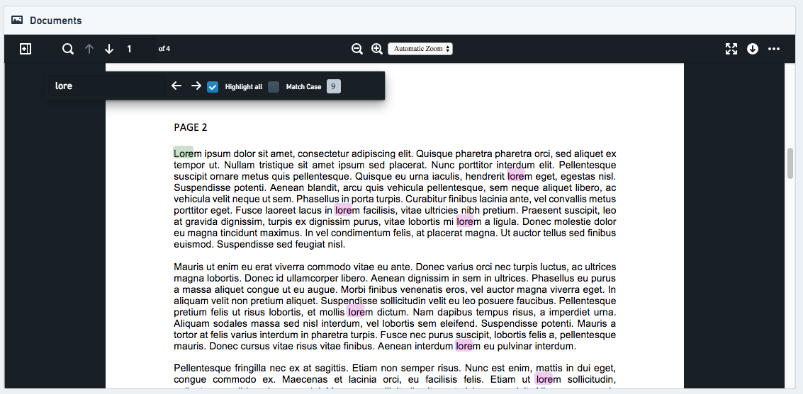
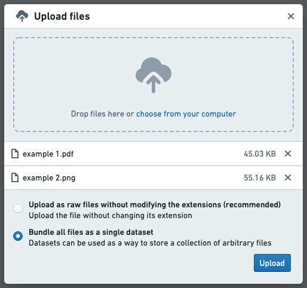
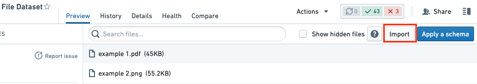
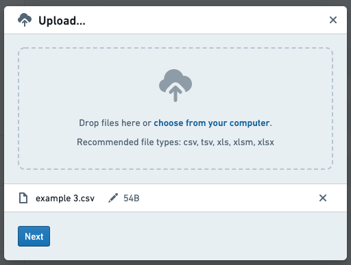
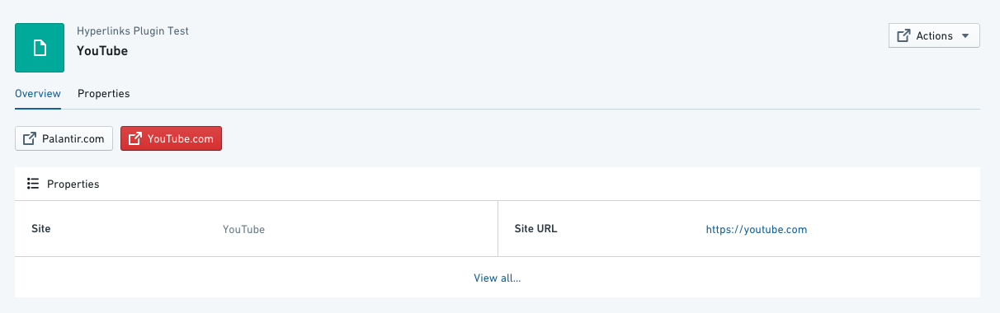
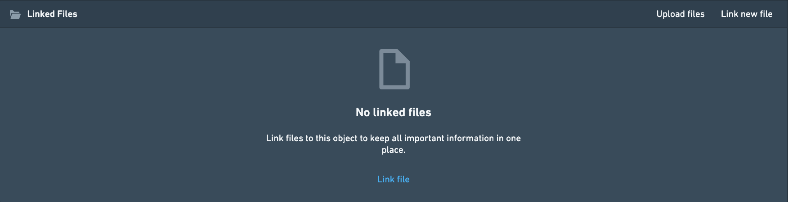

:::callout{theme="warning"}
注意：以下翻译的准确性尚未经过验证。这是使用 [AIP ↗](https://www.palantir.com/platforms/aip/) 从原始英文文本进行的机器翻译。
:::

# 应用程序和文件

**应用程序和文件微件** 允许在当前 Object 视图中嵌入、显示和链接其他 Foundry 应用程序。这些嵌入式微件可以支持在其他应用程序中搭建的资产，例如 [Quiver](https://www.palantir.com/docs/foundry/quiver/overview/) 或 [Slate](https://www.palantir.com/docs/foundry/slate/overview/)。此外，它们使 Object 视图能够显示媒体、上传文件、添加超链接或允许对该 Object 进行评论和讨论。

如果您有兴趣搭建一个更复杂的 Object 视图，可以考虑创建一个 [Workshop 支持的选项卡](../Configuration/%E9%85%8D%E7%BD%AE%20Workshop%20%E6%A0%87%E7%AD%BE%E9%A1%B5.md)。

以下的一些微件不具备 Object 感知能力。这意味着与 Object 视图中的其他微件的交互是有限的。

* 示例 1：使用评论微件时，仅在特定的 Object 视图中保存，并不输出到实际的 Object。如果这些评论在特定 Object 的上下文之外可能有用，考虑使用操作来捕获它们。
* 示例 2：使用“链接文件”添加的文件在 Foundry 中保存，但未链接到该 Object。如果希望这些文件可重复使用，考虑使用[操作附件](../../../%E5%AE%9A%E4%B9%89%E6%9C%AC%E4%BD%93/%E5%8A%A8%E4%BD%9C%E7%B1%BB%E5%9E%8B/%E4%B8%8A%E4%BC%A0%E9%99%84%E4%BB%B6.md)。
* 示例 3：嵌入 Slate 或 Contour 确实允许您传递参数，但它不发布或使用筛选，也不允许与其他微件（如图表微件）进行交叉筛选。

## Quiver Object 画布

有关如何在 Object 视图中嵌入 Quiver 模板的详细步骤，请参阅 [Quiver 模板文档](https://www.palantir.com/docs/foundry/quiver/templates-convert-to-dashboard/)。

## Slate 应用程序

此微件在 Object 视图中显示一个 [Slate 应用程序](https://www.palantir.com/docs/foundry/slate/overview/)，并支持两个应用程序之间的状态共享和交互。从 Object 视图到 Slate 应用程序，当前的 Object 上下文和活动筛选状态是可用的。从 Slate 应用程序到 Object 视图，Slate 中提供了一组事件，这些事件映射到 Object Explorer 中的行为，例如打开新的 Object 或 Exploration 选项卡并更新 Object 视图筛选。

### 配置

**Slate 资源**
选择要显示的 Slate 资源。确保所有有权限查看该 Object 的用户也可以查看该应用程序。

为 Slate 资源设计一个“响应式”设计将获得最佳效果，因为应用程序将根据 Object 视图设计和可用屏幕尺寸调整大小。

**默认参数**
默认情况下，当前 Object 的 ID 和其 Object 类型会传递到 Slate 仪表盘，并可以映射到变量。这些可以关闭或更改其目标变量。默认变量名称为 `objectId` 和 `objectTypeId`。在 Slate 应用程序中，确保在变量选项卡中手动创建匹配的变量。

**自定义参数**
使用额外的自定义参数将属性值或静态、预定义的值传递到 Slate 应用程序。在 Slate 应用程序中创建一个匹配的变量以捕获这些参数并在应用程序中使用它们。

### 在 Slate 中使用参数

配置的参数在 Slate 应用程序加载时传递到应用程序中。在配置您的 Slate 应用程序时，每个参数必须在变量面板中创建一个对应的变量。[了解更多关于如何使用变量的信息。](https://www.palantir.com/docs/foundry/slate/concepts-variables/) 要检查从 Object Explorer 传递到 Slate 的参数键和值，可以在 Object 视图编辑器的调试工具栏中选择“查看参数”。

### 访问 Object 视图筛选

Object 视图筛选以 IObjectSetFilter 格式共享，以便于与 Slate 中可用的对象集 API 一起使用。它们在更改时自动通过跨帧 `postMessage` 发送到 Slate，也可以使用从 Slate 发送到 Object Explorer 的事件手动请求。这一请求事件可以用于在您的 Slate 仪表盘首次准备接收它们时触发发送筛选。

要在 Slate 中捕获筛选，您应该配置一个 `slate.getMessage` 事件处理程序，该处理程序接受 post 消息负载，将其解析为 JSON，然后将结果设置在一个变量中。[了解更多关于事件的信息。](https://www.palantir.com/docs/foundry/slate/concepts-events/) 以下内容应该足以将筛选捕获到变量中：

```js
const payload = {{slEventValue}}["payload"]  // 从slEventValue对象中获取"payload"的值
return JSON.parse(payload); // 将获取的payload字符串解析为JSON对象
```

筛选可以以两种格式被用于在。 一种格式包含所有筛选，但不包含它们可能基于的来源对象类型，另一种格式则按对象类型分组，并为不基于特定对象类型的筛选提供一个单独的列表。

所有筛选的有效负载具有以下结构：

```json
{
    "type": "HUBBLE_SLATE_WIDGET // ACTIVE_FILTERS_UPDATED", // 指定事件类型，表示活动过滤器已更新
    "payload": <IObjectSetFilter[]> // 负载数据，包含一个 IObjectSetFilter 类型的数组
}
```

按对象类型分组的筛选条件的有效负载具有以下结构：

```json
{
    "type": "HUBBLE_SLATE_WIDGET // ACTIVE_FILTERS_BY_OBJECT_TYPE_ID_UPDATED",
    "payload": {
        "filtersByObjectType": {
            [objectTypeId]: <IObjectSetFilter[]>  // 根据对象类型ID进行的过滤器数组
        },
        "globalFilters": <IObjectSetFilter[]>  // 全局过滤器数组
    }
}
```

在这个JSON结构中：

* `type`字段表示事件的类型，这里是一个复合类型，用于标识HUBBLE\_SLATE\_WIDGET的活动过滤器更新。
* `payload`是一个负载对象，其中包含两个主要字段：
  * `filtersByObjectType`：这是一个对象，以对象类型ID为键，值为过滤器数组（`IObjectSetFilter[]`）。
  * `globalFilters`：这是一个全局作用域的过滤器数组（`IObjectSetFilter[]`）。

### 从 Slate 触发事件

Slate 可用于在 Object Explorer 中触发事件的事件类型包括：

* 在 Object Explorer 中打开一个新的对象标签（使用对象 RID）
* 在 Object Explorer 中打开一个新的对象标签（使用对象主键）
* 在 Object Explorer 中为指定的对象集打开一个新的探索标签
* 将对象集筛选发布到对象视图
* 清除对象视图上的对象集筛选
* 刷新当前对象视图上的数据
* 请求将对象视图筛选重新发送到 Slate

使用 `slate.sendMessage` 操作触发这些事件。从此操作中，返回自定义逻辑的事件消息对象。[了解更多关于事件的信息。](https://www.palantir.com/docs/foundry/slate/concepts-events/) 每个事件的预期格式如下所示。为了帮助调试您的事件集成，使用对象视图编辑器的调试工具栏。当捕获到消息但事件负载有某种错误时，它会显示警告。

**在 Object Explorer 中打开一个新的对象标签（使用对象 RID）**
此事件主要依赖于 `objectRid` 参数，但如果需要在特定标签上打开对象视图，也可以选择使用 `tabId`。

```json
{
    "type": "HUBBLE_SLATE_WIDGET // OPEN_OBJECT_BY_RID", // 指定操作类型：通过对象的RID打开对象
    "payload": {
        "objectRid": "...", // 对象的RID（资源标识符），用于唯一标识对象
    },
}
```

**在 Object Explorer 中打开一个新的 Object 选项卡（使用对象主键）** 如果不知道对象的 RID，则可以使用对象的主键属性及其对象类型 ID 加载对象视图。

```json
{
    "type": "HUBBLE_SLATE_WIDGET // OPEN_OBJECT_BY_PRIMARY_KEY", // 指定操作类型为通过主键打开对象
    "payload": {
        "objectTypeId": "...", // 对象类型的唯一标识符
        "primaryKey": {
            ... // 主键，用于唯一标识对象
        },
    },
}
```

**在Object Explorer中为给定的对象集打开一个新的探索选项卡**
通过提供一个对象集，可以打开一个新的搜索/探索选项卡。这些对象集的复杂性应有限，以避免在探索UI中表示它们时出现问题。

```json
{
    "type": "HUBBLE_SLATE_WIDGET // OPEN_NEW_SEARCH_FOR_OBJECT_SET",
    // "type"字段指定了操作类型，其中"HUBBLE_SLATE_WIDGET // OPEN_NEW_SEARCH_FOR_OBJECT_SET"表示打开一个新的对象集搜索
    "payload": {
        "objectSet": {
            ...
            // "objectSet"字段用于指定对象集的详细信息
        }
    },
}
```

**发布对象集筛选到对象视图**
许多对象视图微件可以发布筛选，从而影响视图中的其他微件。Slate微件可以通过发送要发布的筛选来实现此功能。最新发布的筛选将替换同一Slate微件之前发布的任何筛选，因此这些筛选的状态应在Slate内部进行管理。筛选应作为对象集筛选进行筛选，与请求对象集服务API时使用的格式相同。筛选可以针对特定对象类型提供（`filtersByObjectType`）或针对全局属性提供（`globalFilters`）。

```json
{
    "type": "HUBBLE_SLATE_WIDGET // PUBLISH_OBJECT_SET_FILTER", // 事件类型，表示设置对象过滤器的发布操作
    "payload": {
        "filtersByObjectType": { // 根据对象类型的过滤器
            ...
        },
        "globalFilters": { // 全局过滤器
            ...
        }
    },
}
```

**清除对象视图上的对象集筛选**
对象视图上已发布的筛选可以通过此事件快速清除。它不需要任何负载。

```json
{
    "type": "HUBBLE_SLATE_WIDGET // CLEAR_PUBLISHED_FILTERS" // 清除已发布的过滤器
}
```

**刷新当前Object视图中的数据**
如果Object视图中的数据已应用更新，可能需要触发数据刷新。此事件可用于实现此目的。它不需要任何负载。

```json
{
    "type": "HUBBLE_SLATE_WIDGET // REFRESH_OBJECT_VIEW" // 刷新对象视图
}
```

**请求重新发送对象视图筛选到Slate**
如上文“访问对象视图筛选”部分所述，由其他微件发布的对象视图上的筛选通过post消息发送到Slate。当Slate仪表盘初始化并准备好处理筛选时，应触发此事件以请求它们。来自Hubble的单独事件将包含筛选。您可以请求两种类型的筛选，一种格式包含所有筛选，无论其原始对象类型，另一种格式则按其原始对象类型分组。这些请求不需要负载。

发送所有筛选:

```json
{
    "type": "HUBBLE_SLATE_WIDGET // REQUEST_ACTIVE_FILTERS"
    // 这是一个JSON对象，其中包含一个类型字段
    // "HUBBLE_SLATE_WIDGET // REQUEST_ACTIVE_FILTERS" 可能是一个请求活动过滤器的操作类型
}
```

以对象类型分组的筛选发送：

```json
{
    "type": "HUBBLE_SLATE_WIDGET // REQUEST_ACTIVE_FILTERS_BY_OBJECT_TYPE"
    // 这是一个Hubble板块小部件请求，用于根据对象类型获取活动过滤器
}
```

## 媒体预览

此微件显示一个大型行内的媒体文件预览，给定一个附件属性或某种类型媒体（图像、PDF 等）的URL属性。



### 配置

要使用媒体预览微件，您需要配置当前查看的对象以包含一个附件属性。附件属性在Foundry中存储相关媒体，并通过继承添加到对象上的权限来确保媒体被正确授权。请参阅[此页面](../../../%E5%AE%9A%E4%B9%89%E6%9C%AC%E4%BD%93/%E5%8A%A8%E4%BD%9C%E7%B1%BB%E5%9E%8B/%E4%B8%8A%E4%BC%A0%E9%99%84%E4%BB%B6.md)了解如何将媒体添加到您的附件属性。

或者，媒体预览微件也可以用于显示Foundry中现有的媒体，使用存储在属性中的URL。查看对象视图的用户需要访问对象和存储媒体的位置。要将媒体添加到您的对象视图，请执行以下步骤：

1. **将媒体上传到Foundry：** 数据集可以用作存储一组任意文件的方式。要创建这样的数据集，您可以先将文件上传到一个文件夹，并在出现的弹出窗口中选择**将所有文件打包为单个数据集**。如果您只上传一个文件，则该选项将显示为**上传到没有架构的数据集**。



一旦创建了这个数据集，您可以根据需要添加其他文件。为此，请点击数据集预览右上角的**导入**。



在出现的对话框中，选择要上传的其他文件。



2. **添加URL列：** 在当前查看对象的支持数据集中，添加一个包含每个对应行媒体文件URL的新列。URL应具有以下格式：`https://{my-foundry-url}/foundry-data-proxy/api/web/dataproxy/datasets/{dataset rid}/transactions/{transaction rid}/{filename}` 或 `https://{my-foundry-url}/foundry-data-proxy/api/web/dataproxy/datasets/{dataset rid}/views/{branch name}/{filename}`
   * 示例：`https://{my-foundry-url}/foundry-data-proxy/api/web/dataproxy/datasets/ri.foundry.main.dataset.39ce332b-1d74-40ca-be35-5a5b48459a9a/transactions/ri.foundry.main.transaction.00000000-0000-30d2-8067-4b5d9c819f4c/sample-doc.pdf`
   * 注意：如果您使用PDF，URL应以`/foundry-data-proxy/api/dataproxy`开头，而不是`/foundry-data-proxy/api/web/dataproxy`
3. **在Ontology中将列标记为`hubble:media_url`：** 为列在Ontology中创建一个属性，并给它一个Typeclass，kind = `hubble`，name = `media_url`。
   * 其他媒体Typeclass：其他可能性包括`hubble:icon`和`hubble:thumbnail`。这些将使用此URL作为对象的图标或在搜索结果卡片中作为缩略图。
4. **在对象浏览器中向对象视图添加一个媒体微件：** 目前有两种内置的媒体微件：*媒体预览*和*媒体缩略图*。如果您编辑对象视图并点击**添加部分**，您可以看到每种部分的描述。微件需要设置**媒体属性**，即包含您希望预览的媒体URL的属性。

其他需要配置的参数：

* 标题（必填）：要在微件标题中显示的标题。
* 图标（必填）：要在微件标题中显示的标题。
* 帮助信息：在工具提示中显示额外的帮助信息。
* 高度：以像素为单位渲染媒体微件的高度。

## 超链接

超链接微件创建一个按钮，作为一个简单的网页链接。您可以向对象视图添加任意数量的链接，每个链接可以是静态的（即，所有对象实例的相同链接）或动态的每个对象链接。



### 配置

1. *打开链接于* - 选择是否在浏览器的同一标签页打开（默认）不同的标签页或弹出窗口中打开。弹出窗口的可靠性较低；可能会导致问题/被浏览器或已安装的扩展程序阻止。这将适用于所有对象。
2. *链接意图* - 5种链接“意图”决定链接按钮的颜色。[Blueprint Intent ↗](https://blueprintjs.com/docs/#core/components/button.css) CSS类应用于按钮（默认没有）：
   1. “无” - 灰色
   2. “主要” - 蓝色
   3. “成功” - 绿色
   4. “警告” - 橙色
   5. “危险” - 红色
3. *URL类型* - 3种URL配置类型：
   1. 属性 - 一个动态属性，包含一个用作超链接目标的URL。
      1. 要配置：（1）选择对象类型（通常是当前查看的对象）；（2）选择链接应取自的属性列。可以切换选项以隐藏超链接按钮，如果值为空。
      2. 例如，您可以有2个“网站”对象，两个对象的`site_URL`字段都在您的ontology中定义，其中对象1的`site_URL`设置为`https://palantir.com`，对象2的`site_URL`设置为`https://palantir.com/uk`。
   2. 硬编码 - 一个静态URL，适用于所有对象。只需复制粘贴URL，并确保它有`https://`
   3. 模板化 - 模板化URL允许您根据对象的属性自定义链接。您可以通过将任何属性放在单个大括号`{ }`之间将其带入URL中。
      1. 例如，如果您有一个报告RID作为属性`report_rid`保存，您可以使用URL模板`/workspace/report/{report_rid}`来创建一个按钮以打开与每个对象相关的报告。
4. *链接标题* - 超链接按钮上显示的文本标签。这对于所有对象将是相同的。

**常见问题和注意事项：**

* 如果超链接损坏，用户将被重定向到对象浏览器的登录页面。

## 链接文件

链接文件微件使用户能够将查看的对象链接到文件，用户可以通过资源选择器浏览以选择Foundry中已有的文件，或通过从本地计算机上传新文件到Foundry。



### 配置

此部分没有自定义选项。您仍然可以在格式选项卡下更改标题和其他常规格式。

**常见问题和注意事项：**

* 通过此微件上传的文件不会作为Ontology的一部分被写回，即它们不会作为属性保存在当前对象上。为了实现这一点，请考虑使用Foundry Forms与数据输出。
* 目前无法隐藏两个选项之一，因此总是显示“上传文件”和“链接新文件”。
* 目前无法设置文件上传的默认目的地，因此用户每次上传时都必须浏览Foundry中的目标位置。

## Iframe

您可以在Object View中嵌入一个Slate仪表盘或其他Foundry应用程序的行内框架，作为“网页中的网页”。使用iframe可以将当前对象中的值传递给Slate中的筛选变量或Contour中的参数。

### 配置

要嵌入iframe，您需要使用Handlebar语法配置到正确Foundry地址的链接，如下所述。

1. **必填：** 复制您希望嵌入的页面的完整链接，并删除所有在`/workspace/`之前的文本。
   * 报告示例：对于`https://EXAMPLE.palantirfoundry.com/workspace/report/ri.report.main.report.ABCDEF-1234-5678`，您应保留`/workspace/report/ri.report.main.report.ABCDEF-1234-5678`。
   * Slate示例：对于`https://EXAMPLE.palantirfoundry.com/workspace/slate/documents/SLATE_DOCUMENT_NAME`，您应保留`/workspace/slate/documents/SLATE_DOCUMENT_NAME`。
2. **必填：** 添加`embedded=true`以简单显示完整视图。如果`embedded=true`是唯一语句，添加前缀`/?`；如果`embedded=true`附加到其他语句，则添加前缀`&`。
   * 报告示例：`/workspace/report/ri.report.main.report.ABCDEF-1234-5678/?embedded=true`
   * Slate示例：`/workspace/slate/documents/SLATE_DOCUMENT_NAME/latest?&embedded=true`
3. **非必填：** 向Slate传递值以筛选特定变量/参数。使用Object Explorer中的对象类型ID、特定对象ID或特定属性ID。使用`&`并在大括号中说明您希望注入Slate的值，例如`{{propertyID}}`。这是基于Handlebar语法的。
   * 报告示例：`/workspace/report/ri.report.main.report.ABCDEF-1234-5678/?PARAMETER_NAME={{propertyID}}&embedded=true`
   * Slate示例：`/workspace/slate/documents/SLATE_DOCUMENT_NAME/latest?VARIABLE_NAME={{propertyID}}&embedded=true`

#### 其他配置

* 标准iframe和无头iframe的区别在于无头iframe隐藏了微件的标题；微件标题通常包含一个图标、一个标题以及在配置中添加标题的选项。
* iframe微件允许您设置微件的高度。默认是500，并且可以手动调整。
* 一旦设置iframe，您将在对象视图中看到一个帮助窗口（仅在编辑模式下显示）。帮助窗口包括对象特定的提示，并显示您可以传递给Slate和其他Foundry应用程序的属性和ID。
* 可以通过在URL中添加以下内容来隐藏报告标题：`&__rp_headerBar=hidden`。
* 嵌入Foundry外部的网站可能会受到安全和政策要求的限制。如果您认为这对于您的应用案例是必要的，请联系您的Palantir代表。

## 评论

此微件为在对象上协作的用户提供一个本地对话框，并可以选择提及其他用户（通过标记`@user_name`）。

这些评论不会在对象本身上捕获，并且无法在Foundry中跨会话进行未来的搜索或重用。

### 配置

此部分没有自定义选项。您仍然可以在**格式**选项卡下更改标题和其他常规格式。

### 当源数据集更改时的评论行为

如果对象类型的源数据集被更改，则相应的评论提要将消失。

### 评论的数据输出

通过此微件添加的评论不会作为Ontology的一部分被写回；也就是说，这些评论不会作为属性保存在当前对象上。如果您的评论应用案例包括搜索、分析或从评论中学习，请考虑使用操作。
