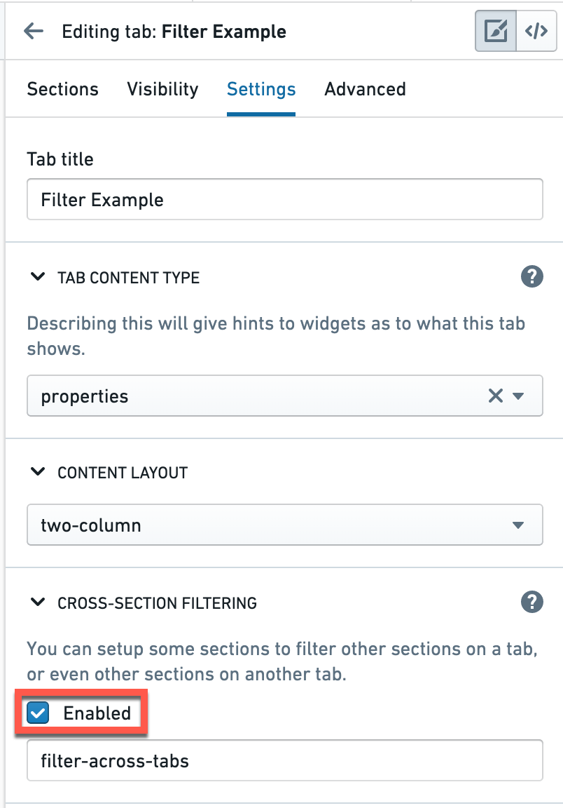
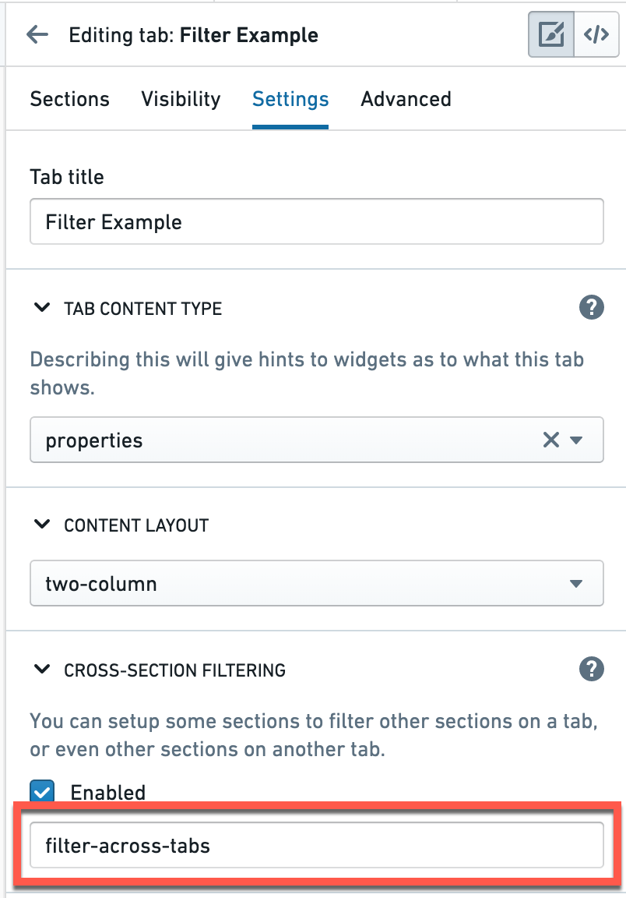
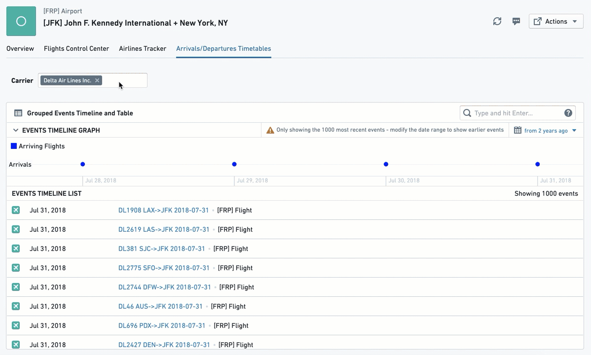
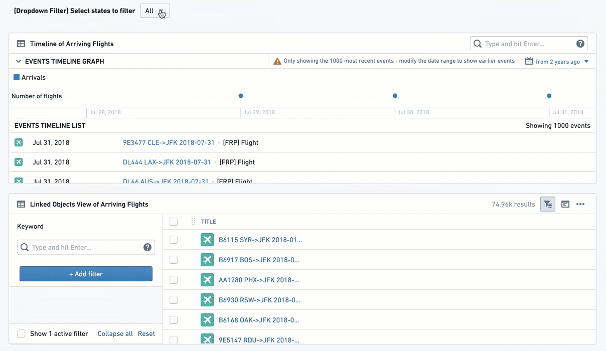
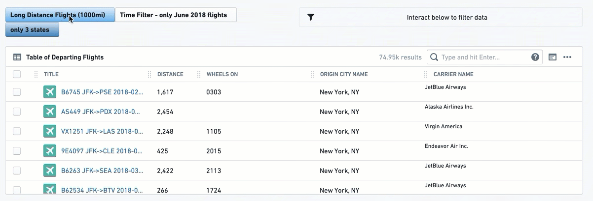
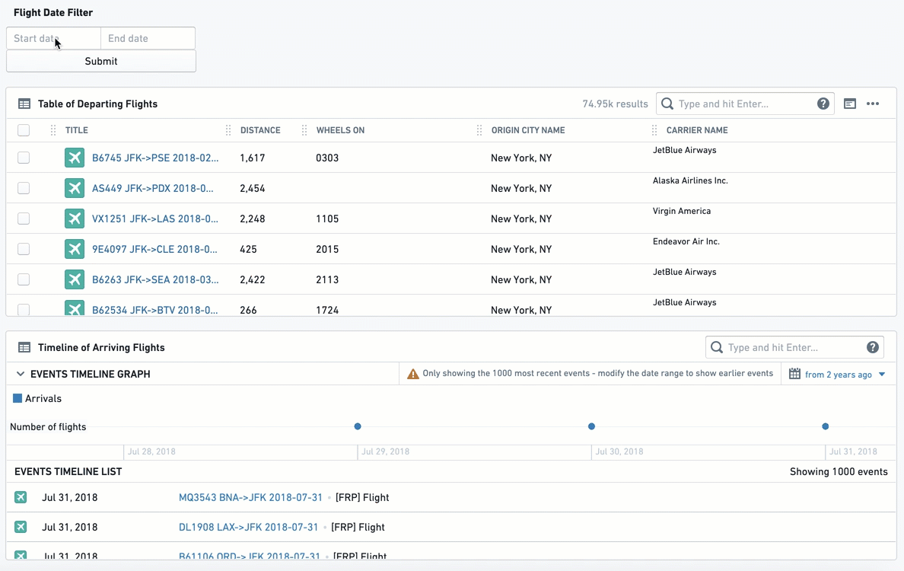
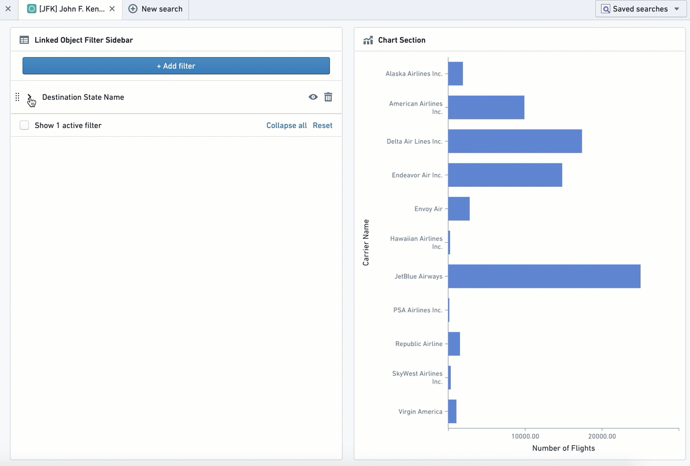
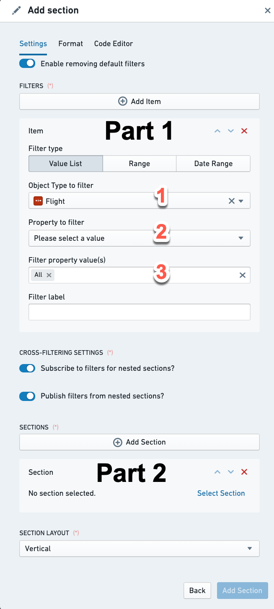
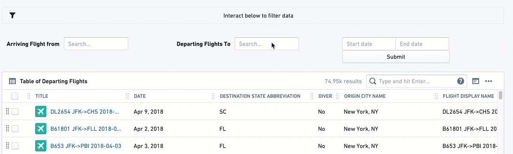

:::callout{theme="warning"}
注意：以下翻译的准确性尚未经过验证。这是使用 [AIP ↗](https://www.palantir.com/platforms/aip/) 从原始英文文本进行的机器翻译。
:::

# 筛选

许多 Object 视图需要用户在图表、表格、聚合指标和 KPI 等视觉组件上进行筛选。**筛选微件**允许用户应用不同类型的筛选，以便深入到该 Object 视图上链接 Object 的特定子集。

此类别包括几个筛选微件：

* 通过使用 [多选筛选](#multiselect-filter)、[下拉筛选](#dropdown-filter)、[按钮筛选](#button-filter) 或 [日期范围筛选](#date-range-filter) 以预定义属性进行筛选，包括字符串、数值和日期。
  * 使用 [链接 Object 筛选侧边栏](#linked-object-filter-sidebar) 以获得更灵活的筛选功能
* 使用 [筛选沙箱容器](#filter-sandbox-container) 以便仅对当前视图的一部分应用某些筛选。
* 使用 [筛选容器](#filter-container) 以便仅对 Object 视图内的某些微件应用预定义的筛选。
* 使用 [活动筛选](#active-filter) 以查看当前应用于 Object 视图的所有筛选的摘要。

除了这些核心的筛选微件（专用于筛选），还有一些专用于可视化的微件，但也允许进行一些筛选，例如图表。[条件容器](%E8%AE%BE%E8%AE%A1.md#conditional-container) 使得根据用户交互的筛选来显示/隐藏内容。

**常见问题和注意事项：**

* 要激活筛选以在 Object 视图的单个选项卡或甚至跨选项卡中的不同微件上应用，**必须在右侧栏编辑器的“设置”下勾选“交叉筛选”复选框**。未勾选此复选框的选项卡中不会应用筛选。  

* 要在**不同选项卡之间**应用筛选，确保选项卡设置下的“filterSet 值”在所有希望筛选的选项卡中具有相同的文本值。此值区分大小写。
  * 在这种情况下，使用相同 filterSet 值的筛选将受到相同活动筛选的影响。例如，如果选项卡 A 和选项卡 B 共享相同的 filterSet 值，则应用于选项卡 A 的任何筛选都将应用于选项卡 B，反之亦然。  

* 在所有筛选配置中，您将选择一个链接 Object 到您当前正在编辑的对象，而不是您正在编辑的对象本身。
  * 示例：如果您正在配置“机场”的 Object 视图，并连接了“航班”，您可能会在航班上看到不同的可视化（时间轴、图表、表中的所有航班列表），并希望在“航班”的不同属性上设置筛选（例如：按航空公司筛选、按日期筛选、按出发城市筛选）。
  * 因此，在配置筛选之前，您的当前对象需要链接到另一个对象。链接的设置是在 Ontology 管理器中完成的。

* 大多数筛选微件仅添加了一种非必填功能，允许用户在其当前浏览的对象的当前视图中应用筛选。
  * 大多数筛选微件不允许您预先配置默认激活的筛选，以便为用户缩小视图（筛选容器是一个例外，因为它允许设置预配置的筛选）。
  * 用户可以在其当前视图的当前对象上激活筛选，但一旦他们转到另一个对象或刷新，这些筛选将不再适用。

## 多选筛选

多选筛选允许用户通过多个值筛选 Object 视图，其中它们之间有一个“或”语句。它保留满足至少一个所选值的所有条目。

配置完成后，它看起来如下所示：

### 配置

注意：始终需要的每个设置旁边都有一个 (\*) 标记。

* \[必填] **要筛选的链接 Object：** 选择此筛选要应用的链接 Object。微件配置将仅提供链接到您当前正在配置的对象的对象（如 Ontology 管理器中定义）。
  * 示例：在包含*航班*对象视图的*机场* Object 视图中，涉及到连接到*机场*的链接类型：“*抵达航班*”和“*出发航班*”。如果您设置了多选筛选，并选择了链接 Object “*抵达航班*”，它将应用于涉及相同 Object “*抵达航班*”的所有其他微件。
* \[必填] **要筛选的属性：** 选择您要筛选的属性：（1）您首先需要选择筛选的对象类型；然后（2）选择您要筛选的对象的属性。
  * 选择后，此值列表将在 Object 视图中以多选下拉框的形式提供给用户。所有其他受此筛选影响并与此筛选共享对象的微件将仅过滤到具有所选属性值（一个或多个）的对象实例。
  * 示例：查看具有来自 20 个起点的抵达航班的机场对象，用户有一个附加微件显示来自这些起点的所有抵达航班的表格。用户为对象 `抵达航班` 选择一个多选筛选，然后选择 `航班` 对象的属性 `起点城市`。下拉筛选将向用户显示所有 20 个起点。一旦用户选择了一部分起点，表格微件将仅显示来自这些起点子集的抵达航班。
* \[非必填] **筛选标签：** 将显示在 Object 视图中的筛选框旁边。
* \[非必填] **最大筛选选项数：** 决定要显示的属性的不同值的数量。默认设置为 100。

**常见问题和注意事项：**

* 配置完成后，您需要在右侧的配置编辑器设置中勾选“允许交叉筛选”复选框（详见上文）以便筛选影响 Object 视图。

## 下拉筛选

此筛选允许使用单选下拉框对单个属性进行一个或多个筛选，允许用户使用下拉值筛选 Object 视图中的其他微件。

配置完成后，它看起来如下所示：

### 配置

对于您希望配置的每个下拉筛选选项，您需要首先点击“添加项目”。您可以通过再次点击“添加项目”在单个微件下添加多个下拉筛选（它们将全部出现在彼此旁边）。

添加项目后，配置菜单提供两种“筛选类型”选项：

**选项 1 - 动态列表：**

这是一个更简单的选项，允许像大多数筛选微件一样轻松选择对象和属性作为下拉选项：

* \[必填] **要筛选的链接 Object：** 选择此筛选要应用的链接 Object。微件配置将仅提供链接到您当前正在配置的对象的对象（如 Ontology 管理器中定义）。
* \[必填] **要筛选的属性：** 选择您要筛选的属性：（I）您首先需要选择筛选的对象类型；然后（II）选择您要筛选的对象的属性。
  * 选择后，所有受此筛选影响并与此筛选相关的相同对象类型的其他微件将从所有链接对象中筛选，只保留其属性与下拉中选择的值相同的对象。
* \[非必填] **筛选标签：** 将显示在 Object 视图中的筛选框旁边。
* **启用“全部”筛选选项切换：** 如果筛选需要是强制性的，请保持此切换关闭，以强制用户选择一个值。如果可以选择所有值（不按其中任何一个筛选），请将切换打开。如果您希望选择多个值，请选择多选筛选微件。

**选项 2 - 值列表：**

这是一个更复杂的选项，专为希望定义一个确切筛选值列表的情况而设计，该列表将是完整下拉列表的子列表。您需要手动输入希望为用户包含在下拉筛选中的每个值。如何配置：

* \[必填] **要筛选的链接 Object：** 选择此筛选要应用的链接 Object。
* \[必填] **要筛选的属性：** 选择您要筛选的属性：（I）您首先需要选择筛选的对象类型；然后（II）选择您要筛选的对象的属性。
  * 选择后，所有受此筛选影响并与此筛选相关的相同对象类型的其他微件将从所有链接对象中筛选，只保留其属性与下拉中选择的值相同的对象。
* \[必填] **筛选属性值：** 您需要手动输入希望为用户包含在此下拉筛选中的每个值，并点击“创建”以添加。
  * 输入的值区分大小写，并按输入顺序出现；一旦输入，除非删除值（点击‘X’）并重新输入，否则无法重新排列。
  * 显示值的数量限制为 100。
  * 默认提供“全部”选项。您可以移除此选项并在需要时重新添加（“全部”，区分大小写）。
* \[非必填] **筛选标签：** 将显示在 Object 视图中的筛选框旁边。

**常见问题和注意事项：**

* 如果（a）您希望选择多个选项的功能；（b）您不需要多个下拉选项（尽管这也可以通过筛选容器解决），请考虑使用多选筛选而不是下拉筛选。
* 下拉微件与“活动微件”的交互有限。即使启用了“启用‘全部’筛选选项”切换，用户仍然无法“清除筛选”，除非他们明确选择多选筛选下的“全部”。
* 配置完成后，您需要在右侧的配置编辑器设置中勾选“允许交叉筛选”复选框（详见上文）以便筛选影响 Object 视图。
* UI 能够在单个下拉筛选微件下显示的下拉筛选框数量有限（大约 7-8 个不同的下拉选项）。如果您需要为单个 Object 视图提供更多下拉筛选，请使用附加的下拉筛选或使用筛选容器。

## 按钮筛选

此微件创建一个按钮，通过单击即可筛选到预定义的值集：文本（字符串）值、数值范围或日期范围。再次单击按钮可取消筛选选择。

这是一个固定筛选；一旦由 Object 视图编辑器配置，最终用户将无法进行配置选择。

注意，选择或取消选择按钮时，按钮会改变颜色。您可以添加[活动筛选](#active-filter)以使状态在视觉上清晰。

配置完成后，它看起来如下所示：

### 配置

首先，选择一个按钮筛选类型：

* 值列表：筛选文本属性（字符串）。
* 范围：筛选数值属性（如整数或双精度数）。
* 日期范围：筛选到一个日期属性列表。

对于所有三种类型的按钮筛选，您将拥有以下内容：

* \[必填] **要筛选的对象：** 选择此筛选要应用的链接 Object。

* \[必填] **要筛选的属性：** 选择您要筛选的属性：（I）您首先需要选择筛选的对象类型；然后（II）选择您要筛选的对象的属性。
  * 选择后，所有受此筛选影响并与此筛选相关的相同对象类型的其他微件将从所有链接对象中筛选，只保留其属性值符合筛选条件的对象。

* \[必填] 从此点开始，按钮的设置根据按钮类型不同：
  * **值列表：** 手动输入您希望筛选的确切值列表，其中有一个“或”语句。注意，它区分大小写且无法简单地重新排列。重新排列值的方法是删除并重新编写整个值列表。注意，如果您同时应用“全部”选项和其他特定值 X，则筛选将仅适用于值 X。
  * **范围：** 提供数值的下限和上限。至少输入其中一个值：
    * 下限 = 大于或等于；
    * 上限 = 小于或等于；
    * 填写两者以具有范围筛选。
    * 如果希望有“大于”，请确保删除上限中的 0，反之亦然。
  * **日期范围：** 提供一个带有 2 个选项的切换 - 精确日期（“从 1\1\2019 到 31\12\2019”）或相对于当前时间（“上个月”或“两年前到一年前之间”）。配置本身是通过标准日历日期选择器完成的。

* \[非必填] **按钮标签：** 按钮上显示的文本。虽然是可选的，但最好为按钮创建一个标签。

* \[非必填] **按钮颜色：** 默认颜色为灰色。要为按钮选择不同的颜色，请使用 Blueprint 标准颜色（请参阅 https://blueprintjs.com/docs/#core/colors）或使用内部 Palantir Blueprint 库。基本颜色（“蓝色”、“红色”、“黄色”等）也可以使用。
  * 未选择的按钮将具有淡化的颜色。只有在点击后，它才会更改为所选颜色。
  * 日期范围按钮没有选择按钮颜色的选项。

**常见问题和注意事项：**

* 为了给用户提供更多的灵活性，请考虑使用：
  * “日期范围筛选”而不是“日期范围按钮筛选”；
  * “多选筛选”或“下拉筛选”而不是“值列表按钮筛选”。
* 注意，有两种方法可以指示按钮筛选的作用：（I）对按钮进行良好的标签；（II）添加一个“活动筛选”微件，显示所有筛选，包括通过点击按钮筛选筛选的实际值。
* 按钮筛选默认处于关闭状态，因此必须点击才能应用筛选。
* 配置完成后，您需要在右侧的配置编辑器设置中勾选“允许交叉筛选”复选框（详见上文）以便筛选影响 Object 视图。

## 日期范围筛选

日期范围筛选允许用户根据特定的日期属性将其 Object 视图筛选到一系列日期。一旦配置完成，Object 视图中的任何微件都会在选择日期范围并用户选择**提交**后受到影响。视图将仅显示所选日期属性在范围内的对象实例。

注意，您应该插入要筛选的对象的对象 ID，通常这是您当前正在配置的对象的链接 Object。

配置完成后，它看起来如下所示：

### 配置

* \[必填] **要筛选的对象：** 选择此筛选要应用的链接 Object。
* \[必填] **要筛选的属性：** 选择您要筛选的属性：（I）您首先需要选择筛选的对象类型；然后（II）选择您要筛选的对象的属性。
  * 选择后，所有受此筛选影响并与此筛选相关的相同对象类型的其他微件将从所有链接对象中筛选，只保留所选日期属性在此日期范围内的对象。
* \[非必填] **筛选标签：** 将显示在 Object 视图中的筛选框旁边。

**常见问题和注意事项：**

* 配置完成后，您需要在右侧的配置编辑器设置中勾选“允许交叉筛选”复选框（详见上文）以便筛选影响 Object 视图。

## 链接 Object 筛选侧边栏

此微件创建灵活的筛选体验，允许用户通过链接 Object 的所有属性中的任何特定值集筛选当前 Object 视图。

此微件提供很高的选择度，但对用户来说也更复杂。它要求用户了解并了解链接 Object 的属性，而所有其他筛选微件（例如下拉筛选、按钮筛选）则预先配置它们。

配置完成后，它看起来如下所示：

### 配置

此微件的配置只需要选择您希望 Object 视图根据其进行筛选的链接 Object。其余的配置，即选择具体的属性和值进行筛选，完全由用户决定，并仅在他们的视图中应用。一旦用户刷新页面或转到不同对象，他们将需要重新配置这些筛选。

**常见问题和注意事项：**

* 为某个属性选择的所有值之间将有一个“或”语句。不同属性的值之间将有一个“和”语句。
  * 示例：当使用“机场”对象时，Object 视图编辑器选择添加一个链接 Object 筛选侧边栏用于链接 Object “抵达航班”。用户可以选择通过属性“月份”进行筛选，并仅选择一月至六月；以及通过“承运人名称”进行筛选，并选择达美航空和联合航空。视图将筛选到所有在该机场抵达的航班，它们在一月至六月之间（一月或二月...或六月），并且是联合航空或达美航空。

## 筛选沙箱容器

筛选沙箱容器允许您将微件组织到一个容器中，使其内部的所有筛选都被沙箱化，即它们仅影响和被此容器内的其他微件影响。

### 配置

添加筛选沙箱容器微件，然后通过点击“添加项目”将现有微件添加到容器中。
从微件选择器中选择要添加的微件。

另一种配置选项是筛选集合标识符。默认情况下，每个新筛选沙箱都会生成一个新的唯一值。如果您想与以下对象共享筛选，则可以更改它：

* 筛选沙箱容器 - 为它们都设置相同的筛选集合标识符值。
* 另一个选项卡上的所有微件 - 启用目标选项卡的交叉筛选，并为其设置相同的筛选集合标识符值。

**常见问题和注意事项：**

* 交叉筛选（筛选影响和被容器内的其他微件影响）始终为此容器启用。
* 如果需要容器内微件的交叉筛选，请使用此容器而不是筛选容器微件进行沙箱化。如果需要仅受预定义筛选影响的微件，请使用筛选容器并禁用对筛选的订阅。
* 如果您需要沙箱内的交叉筛选和预定义筛选，请使用筛选沙箱容器，并在其中添加一个筛选容器，并启用对筛选的发布和订阅。

## 筛选容器

此微件允许创建一个仅应用预定义筛选集合的微件子集。

此筛选子集可以在以下属性类型的任何组合上定义：（1）文本（字符串）值列表；（2）数值范围；和（或）（3）日期范围。

不要将此微件用作筛选沙箱，因为它仅支持预定义筛选。

注意：要拥有一个筛选沙箱容器（即仅在容器内应用筛选而不受外部筛选影响），请使用[筛选沙箱容器](#filter-snadbox-container)而不是。

### 配置

筛选容器配置分为两部分：

**第一部分 - 在容器内的所有微件上应用预配置的筛选**

这些预定义的筛选将默认仅应用于容器内的微件。容器中的预定义筛选可以是以下三种筛选类型的任何组合：

* 值列表 - 筛选文本属性（即字符串）
* 范围 - 筛选数值属性（即整数、双精度数）
* 日期范围 - 筛选到日期属性列表

对于每个默认筛选，您需要配置以下内容：

* \[必填] **要筛选的链接 Object：** 选择此筛选要应用的链接 Object。微件配置仅提供链接到当前对象的对象（如 Ontology 管理器中定义）。
* \[必填] **要筛选的属性：** 选择您要筛选的属性：（I）您首先需要选择筛选的对象类型；然后（II）选择您要筛选的对象的属性。
  * 选择后，所有与此容器相关的微件将从所有链接对象中筛选，只保留其属性值符合筛选条件的对象。
* \[必填] 从此点开始，设置根据筛选类型不同（文本值列表、数值范围、日期范围）：
  * **值列表：** 手动输入您希望筛选的确切值列表，其中有一个“或”语句。注意，它区分大小写且无法简单地重新排列。重新排列值的方法是删除并重新编写整个值列表。注意，如果您同时应用“全部”选项和其他特定值 X，则筛选将仅适用于值 X。
  * **范围：** 允许您设置数值范围的下限和上限。至少输入其中一个值：
    * 下限 = 大于或等于；
    * 上限 = 小于或等于；
    * 填写两者以具有范围筛选。
    * 如果希望有“大于”，请确保删除上限中的 0，反之亦然。
  * **日期范围：** 提供一个带有 2 个选项的切换 - 精确日期（“从 1\1\2019 到 31\12\2019”）或相对于当前时间（“上个月”或“两年前到一年前之间”）。配置本身是通过标准日历日期选择器完成的。
* \[非必填] **筛选标签：** 用于文档的内部标签，不会出现在用户界面的任何地方。可选。

**交叉筛选设置：**

* ***为嵌套部分订阅筛选吗？*** 如果您希望筛选容器受到容器外应用的筛选的影响 - 来自包含它的选项卡以及与当前选项卡共享交叉筛选的其他选项卡。这还将使其消耗容器内的其他筛选微件，例如选择了条的图表微件或多选筛选。
* ***从嵌套部分发布筛选吗？*** 如果希望筛选容器内的筛选应用于容器外 - 来自包含它的选项卡以及与当前选项卡共享交叉筛选的其他选项卡。这不适用于预定义筛选，但仅适用于容器内的任何其他筛选微件。

如何使用这些切换？

* 两个切换均关闭 - 预定义筛选仅在容器内应用，但既不发布也不消耗任何其他筛选 - 容器内外。
* 仅订阅切换打开 - 容器受到外部筛选的影响，但容器内的筛选不起作用，除非是预定义筛选。
* 仅发布切换打开 - 容器内的筛选微件仅应用于容器外，而不在容器内。只有预定义筛选在容器内应用。
* 两个切换均打开 - 选项卡上的所有筛选应用于所有地方，除了此容器中的预定义筛选。

**常见问题和注意事项：**

* 预定义筛选仅应用于容器内，不应用于容器外的任何微件。这仅适用于这些预定义筛选，而不适用于可以在容器内配置的其他筛选微件。寻找沙箱容器功能？请尝试[筛选沙箱容器](#filter-sandbox-container)。
* “筛选容器”中的预定义筛选不会在用户界面中显示，用户无法删除，除非您按照以下步骤操作：
  * 在筛选容器内添加一个“活动筛选”微件以显示它。
  * 确保“启用删除默认筛选”切换已打开（默认是打开的）。否则，即使有“活动筛选”删除选项，用户也无法删除这些筛选。
* 在筛选容器内应用筛选还会删除筛选微件中不匹配的选项，例如[下拉筛选](#dropdown-filter)。如果不希望这种行为，请使用[筛选沙箱容器](#filter-sandbox-container)代替。

**第二部分 - 筛选容器作为微件的容器**

将此容器内的视图配置为与任何其他容器相同。您添加的每个微件都将订阅筛选容器的预定义筛选，以及定义为影响它的任何其他筛选。

一旦您点击“添加部分”，您将获得与任何其他“添加部分”相同的配置体验，无论是在主 Object 视图上还是在嵌套选项卡的其他微件上（例如任何容器微件）。

**部分设计：**

这决定了筛选容器内的微件是垂直堆叠（一个在另一个下方，默认是这样）还是水平排列（一个在另一个旁边，从左到右）。

## 活动筛选

此微件显示当前应用于 Object 视图的所有筛选的摘要，并允许用户删除单个筛选或清除所有筛选。此筛选不需要配置。

活动筛选是用户了解其 Object 视图上当前活跃筛选的有用视觉指示。一旦您的 Object 视图包含多个筛选微件（包括使用图表筛选），尤其是在您使用筛选容器或按钮筛选时，活动筛选的可见性对用户体验非常重要。

配置完成后，它将如下所示，具有一个位于左侧的筛选图标。在此示例中，它受不同筛选微件的影响：

## 配置

活动筛选微件不需要配置。只需将其添加为新部分。

**常见问题和注意事项：**

* 此微件将显示所有共享交叉部分和跨选项卡筛选的部分应用的筛选。
* 某些筛选微件可能无法与此微件交互。目前，它不会删除下拉筛选应用的筛选，用户仍需要手动更改下拉中的值。当下拉默认限制您只能选择一个值时，这很合理，但即使启用了“全部”选项，它仍然适用。
