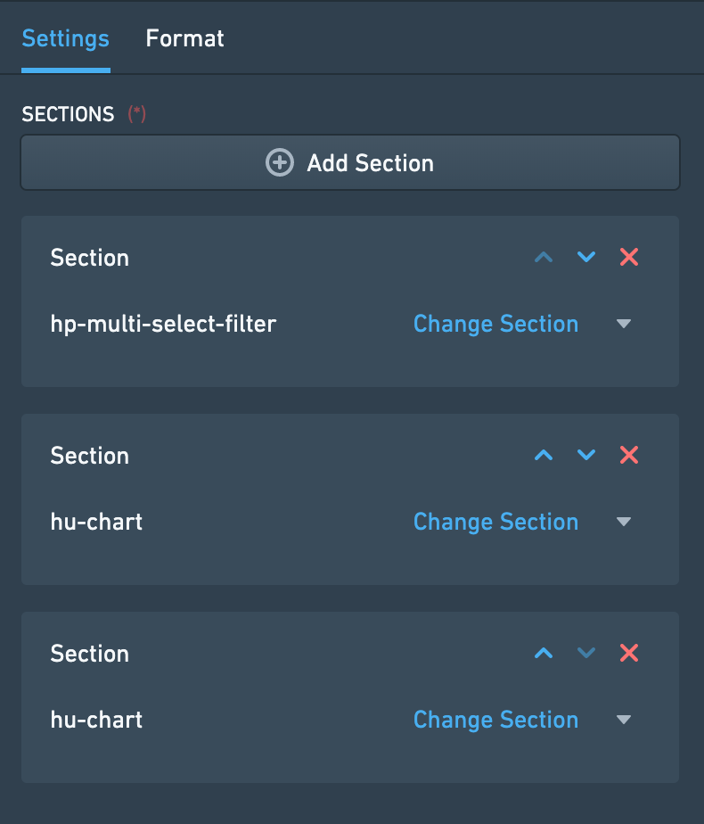
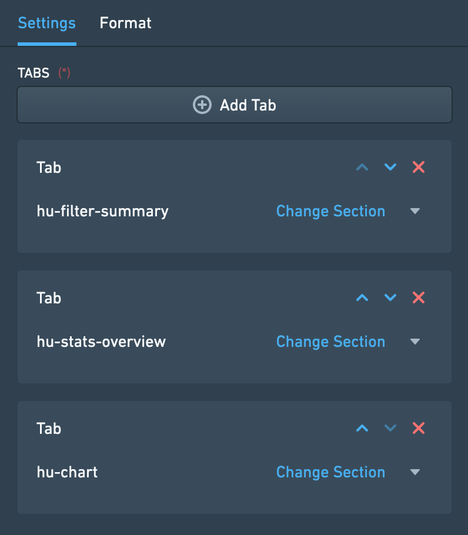
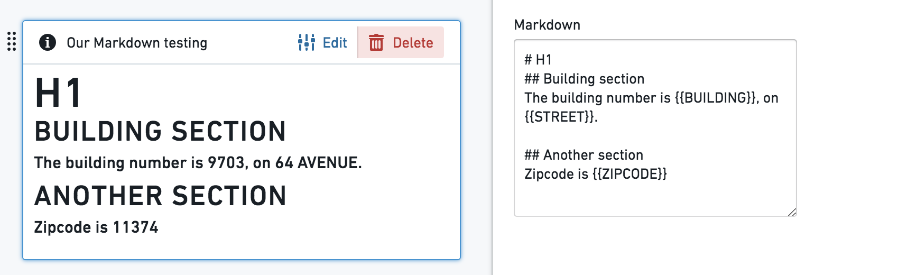
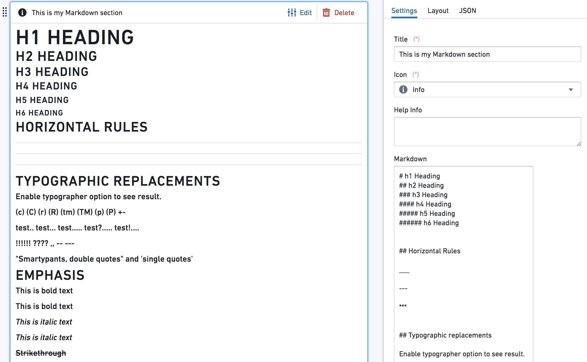

:::callout{theme="warning"}
注意：以下翻译的准确性尚未经过验证。这是使用 [AIP ↗](https://www.palantir.com/platforms/aip/) 从原始英文文本进行的机器翻译。
:::

# 设计

**设计微件**用于在某个标签内组织和构建Object视图页面的设计，通过将视图排列到不同的容器中。

每个Object视图可以有三个级别的设计控制：

* 标签，功能集描述在[配置标签](../Configuration/%E9%85%8D%E7%BD%AE%E6%A0%87%E7%AD%BE%E9%A1%B5.md)中
* 标签内的设计微件（也称为容器），使您可以在内容框内组织Object视图。
* 所有内容微件（可视化、属性和链接、筛选等），它们是Object视图的构建模块。

这些是设计容器的类型：

* 页面视觉设计 - [水平分布](#horizontal-distribution)和[垂直堆叠容器](#vertical-stack-container)。
* 在标签内添加另一层内容 - [标签容器](#tabbed-container)。
* 根据用户交互的[筛选](%E7%AD%9B%E9%80%89.md)启用显示/隐藏内容 - [条件容器](#conditional-container)。
* 显示文本，结合对象值 - [Markdown](#markdown)微件。

## 水平分布

此微件使您可以通过在一个容器内水平分布微件来视觉上组织Object视图的设计，一个接一个。它只是其他微件的一个容器，本身没有其他功能。

### 配置

一旦添加水平分布微件，配置允许您通过点击“添加项目”在此容器内添加不同的微件，这将打开微件选择器。

有两种选择来确定容器内每个微件的宽度分配：

* 相对 - 为容器内的每个微件选择一个整数。微件根据其相对数字分布。示例：三个微件的大小为A=1, B=3, C=2；微件A将占用1/6的长度，微件B将占用3/6的长度。
* 像素 - 为每个微件分配一个绝对像素数。如果像素总和超过Object视图限制（约1150像素），微件将“溢出”页面。

**常见问题和注意事项：**

* 确保为水平分布微件添加标题，这是添加它的必要条件。标题将显示在微件头部。

## 垂直堆叠容器

此微件使您可以通过在一个容器内垂直分布微件来视觉上组织Object视图的设计，堆叠一个在另一个之上。它只是其他微件的一个容器，本身没有独立功能。

### 配置

一旦添加垂直堆叠容器微件，配置允许您通过点击“添加项目”在此容器内添加不同的微件，这将打开微件选择器。

**常见问题和注意事项：**

* 确保为垂直堆叠容器微件添加标题，这是添加它的必要条件。
* 要将垂直堆叠容器与其他微件对齐，请在配置中的“格式”标签中选择左/右对齐，而不是默认的“全宽”。
* 使用配置中的上下箭头选择标签的顺序。这也允许您删除标签或替换每个标签内的微件。

## 标签容器

通过在当前标签内创建一个标签容器，为Object视图添加另一层标签。用户可以在这些标签之间浏览，每个标签包含一个微件（也可以是多个微件的容器）。

标签容器只是其他微件的一个容器，本身没有独立功能。

### 配置

* 一旦添加标签容器微件，配置允许您通过点击“添加标签”在此容器内添加不同的微件标签，这将打开微件选择器。
* 每个标签的名称是该标签上微件的标题，显示在配置中的“格式”下。
* 使用配置中的上下箭头选择标签的顺序。这也允许您删除标签或替换每个标签内的微件。

**常见问题和注意事项：**

* 在Ontology中的中心对象中，有时需要使用此标签。然而，请注意，它增加了用户体验的复杂性，“标签内有标签”。
* 确保为标签容器微件添加标题，这是添加它的必要条件。标题将显示在微件头部。

## 条件容器

条件容器根据条件显示或隐藏内容。此条件可以基于：

* 用户在Object视图上应用的筛选
* 对象或链接对象的属性值
* 某种类型的链接对象的存在

### 配置

此微件支持添加一个或多个*条件部分*。每个部分包括一个*条件*和一个或多个根据该条件*有条件显示*的微件。要设置条件部分，请遵循以下三个步骤：

**步骤 1 – 设置条件**

第一步是定义条件，根据该条件容器的内容应显示或隐藏。有三种不同类型的条件：

***条件 1 – 筛选***

*筛选*条件根据是否在Object视图上应用筛选来显示或隐藏容器内容。此条件可以通过三种不同方式配置：

* **特定筛选** – 仅当在特定属性上应用筛选时才显示容器内容。该属性可以是当前视图对象的属性或链接对象的属性。这意味着要使用此条件，必须有另一个筛选微件对同一对象和属性进行筛选。
  * *示例*：在配置一个机场的Object视图时，有一个筛选器仅保留取消的航班（状态=“取消”）。条件容器显示有关取消航班的详细信息，配置为仅在应用此类特定筛选时显示。
  * *注意*：为了使此条件类型起作用，必须在“筛选链接对象”和“筛选属性”的下拉菜单中选择相同的对象类型。
* **无筛选** – 仅在当前标签或与此标签共享交叉筛选的任何标签中没有应用筛选时显示容器。可以是任何类型的筛选，例如日期筛选、下拉筛选、按钮筛选等。
* **任意筛选** – 仅在当前标签或与此标签共享交叉筛选的任何标签中至少应用了一个筛选时显示容器。与*无筛选*一样，可以是任何类型的筛选，例如日期筛选、下拉筛选、按钮筛选等。

***条件 2 – 属性***

*属性*条件根据对象属性的值显示或隐藏容器内容。相关的对象可以是当前视图中的对象或链接对象。在链接对象的情况下，与当前对象的关系需要是*1对1*或*多对1*，此时当前对象需要位于关系的“多”侧。

要使用此条件类型，您首先选择要使用的属性。接下来，定义在基于该属性的情况下应何时显示条件容器的内容。有四种选项：

* **已定义** – 属性的值不是`null`。
* **未定义** – 属性的值是`null`。
* **属于** – 属性的值匹配您定义的值之一。
* **不属于** – 属性的值*不*匹配您定义的值之一。

对于**属于**和**不属于**，您定义的值会根据属性类型进行翻译（如果是整数、双精度、日期或布尔值）。请参见下文以了解有关此属性比较的更多详细信息。

***条件 3 – 链接对象***

*链接对象*条件根据某种类型的链接对象的存在显示或隐藏容器内容。要设置此条件，您首先选择一个链接路径。然后，您决定是否应在所选路径的链接对象*存在*或*不存在*时显示条件容器的内容。

此条件的逻辑可以通过将其与链接对象视图进行比较来推理。具有此条件的容器的内容仅在具有相同链接路径的链接对象视图至少显示一个对象（如果链接对象应*存在*）或没有对象（如果链接对象应*不存在*）时才显示。

**步骤 2 – 添加微件**

一旦定义了条件，第二步是配置容器内要显示的实际内容。点击“添加部分”按钮，添加所需数量的微件。请注意，可以使用上下箭头对条件容器中显示的微件进行排序。

**步骤 3 – 选择设计**

最后，第三步是选择容器的设计。设计可以是：

* **水平** – 微件从左到右显示，如水平分布容器微件
* **垂直** – 微件从上到下显示，如垂直堆叠容器微件

完成这三个步骤后，您的条件容器应该已设置并可以使用！

**常见问题和注意事项：**

* 属性值比较是如何进行的？
  * 字符串值正常匹配
  * 对于数值属性，微件中的所有输入值都转换为数字并与数值属性进行比较（例如，输入字符串3.1415将转换为双精度）
  * 对于布尔属性，如果在微件中使用“true”、“yes”和“1”，它们都被视为真输入值，其他所有都是假。
  * 日期和时间戳值在字符串转换后匹配
  * 目前不支持数组
* 如果添加了多个条件，条件将自上而下评估 - 将呈现满足第一个条件的部分，其他部分将被忽略。
* 按属性值选项的条件容器适用于1对1或多对1关系，其中当前显示的对象位于相关侧（“多”）。
  * 它\_不允许\_许多对多或1对多的条件，其中当前对象在主要侧，并且它\_不允许\_通过链接对象中的值汇总进行条件可见性。
  * *示例*：查看一个飞机对象，我可以添加一个依赖于它属于哪个航空公司的条件（假设它只属于一个航空公司），但我不能添加一个依赖于“它是否有一个链接航班对象具有属性X？”的条件。
* 此微件是标签级别非必填“可见性”配置的扩展，但在微件级别。然而，它不是一个完整的等价物：
  * “可见性”允许您根据用户配置文件定义条件标签。
  * 此微件允许您在单个标签内设置条件视图；（2）根据应用筛选的条件可见性选项（依赖于用户的交互）；（3）不包括根据用户配置文件的条件视图。
* 为了启用条件部分选项通过应用的筛选进行显示/隐藏，请确保在右侧栏配置编辑器的“设置”下勾选“交叉筛选”复选框。
* 条件容器只是其他微件的一个容器，以水平或垂直方式分布。

## Markdown

此微件允许在Object视图设计中添加富文本。它提供了一个基于Markdown轻量级富文本格式语法的纯文本编辑器（`markdown-it`库）。此外，此微件允许将对象属性值模板化为文本的一部分。

### 配置

* 文本框是一个简单的文本编辑器，支持标准的`markdown-it`库。
* **对象属性模板化** - 使用{{propertyName}}格式，双花括号，将Markdown内容与当前对象属性值模板化。propertyName是[Ontology中的属性](../../../%E5%AE%9A%E4%B9%89%E6%9C%AC%E4%BD%93/%E5%AF%B9%E8%B1%A1%E9%93%BE%E6%8E%A5%E7%B1%BB%E5%9E%8B/Properties/%E6%A6%82%E8%A7%88.md)的确切大小写敏感名称。也支持{{objectId}}、{{objectTypeId}}和{{objectTypeRid}}值。

*附加配置*：

* 换行，有两种选择：
  * 启用换行 - 默认开启时，编辑器中的单个换行作为实际换行；关闭时，编辑器中的换行不影响结果。使用标题格式仍然有效。
  * 将"\n"转换为换行 - 显示`\n`作为换行（需要启用“启用换行”）。
* 启用安全的HTML渲染 - 使用markdown-it进行安全HTML渲染。嵌入对象属性的HTML被禁用；所有属性值为了安全性进行转义。

**常见问题和注意事项：**

* 目前，使用{{propertyName}}格式包含的长文本和数组可能会溢出文本框，并且默认不呈现。
