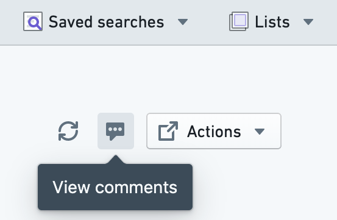

:::callout{theme="warning"}
注意：以下翻译的准确性尚未经过验证。这是使用 [AIP ↗](https://www.palantir.com/platforms/aip/) 从原始英文文本进行的机器翻译。
:::

# 对Object发表评论

多个用户经常处理特定的Object。为了促进这种合作，Object Explorer允许用户对Object发表评论，提及其他用户，并附加文件和图像。

您可以使用任何Object视图标题中的**查看评论**按钮打开任何Object的评论助手。

Object Explorer对Object的评论*不*与[Workshop中的评论微件](https://www.palantir.com/docs/foundry/workshop/widgets-comments/)相关。
