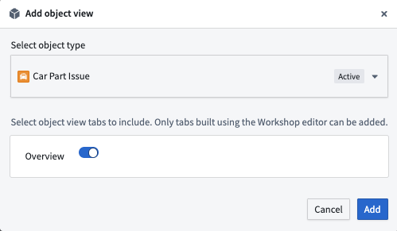

:::callout{theme="warning"}
注意：以下翻译的准确性尚未经过验证。这是使用 [AIP ↗](https://www.palantir.com/platforms/aip/) 从原始英文文本进行的机器翻译。
:::

# 添加Object视图到Marketplace产品 \[Beta]

使用[Foundry DevOps](https://www.palantir.com/docs/foundry/devops/overview/)将您的Object视图包含在[Marketplace产品](https://www.palantir.com/docs/foundry/devops/core-concepts/#product)中，以便其他用户安装和重复使用。[了解如何创建您的第一个产品。](https://www.palantir.com/docs/foundry/foundry-devops/create-products/)

## 支持的功能

Marketplace产品仅支持使用[Workshop标签](Configuration/%E9%85%8D%E7%BD%AE%20Workshop%20%E6%A0%87%E7%AD%BE%E9%A1%B5.md)搭建器的[Object视图标签](Configuration/%E9%85%8D%E7%BD%AE%E6%A0%87%E7%AD%BE%E9%A1%B5.md)。不支持旧版Object视图搭建器。如果您想打包利用旧版搭建器的Object视图标签，您应首先使用Workshop标签搭建器重新搭建该标签。

## 将Object视图添加到产品中

要将Object视图添加到产品中，首先[创建一个产品](https://www.palantir.com/docs/foundry/foundry-devops/create-products/)，然后选择如下所示的**Object视图**内容类型。

[官方图片已失效：add object view](https://www.palantir.com/docs/resources/foundry/object-views/marketplace-add-object-view.png)

选择Object视图后，您可以选择要包含在产品中的标签。

> 配图缺失说明：本页有 1 个官方图片地址在抓取及重试时失效（返回 HTML 错误页）。下列地址保留用于溯源，未替换成其他版本的图片。

- 官方图片已失效：<https://www.palantir.com/docs/resources/foundry/object-views/marketplace-add-object-view.png>
