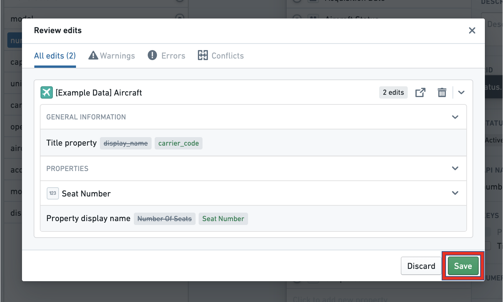
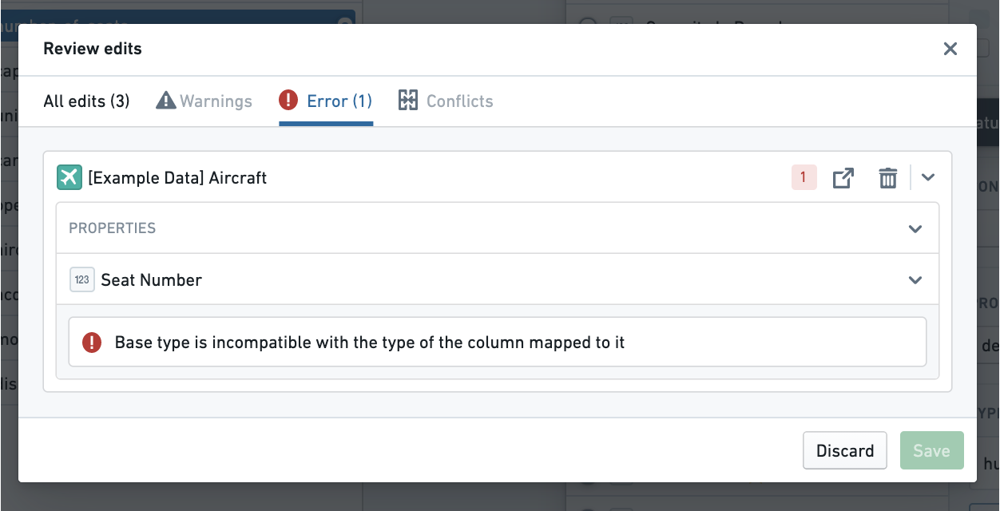
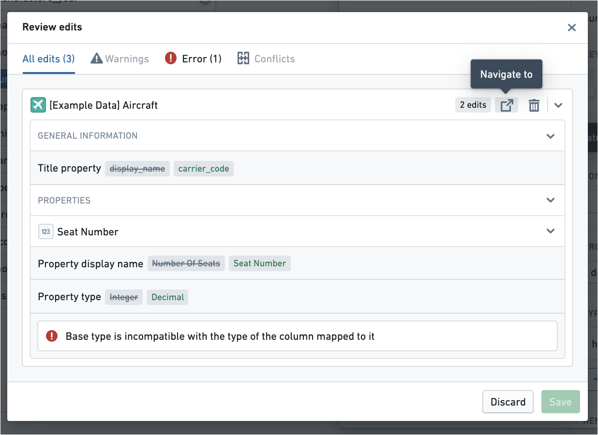
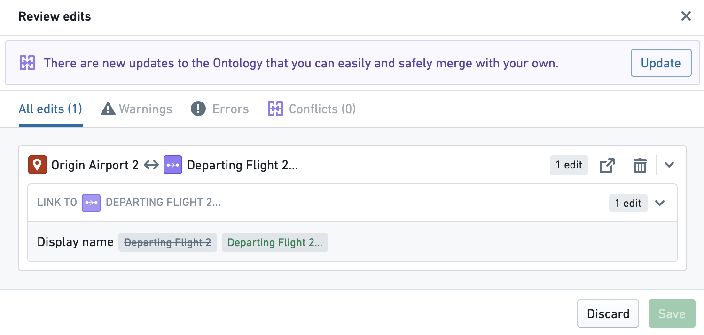
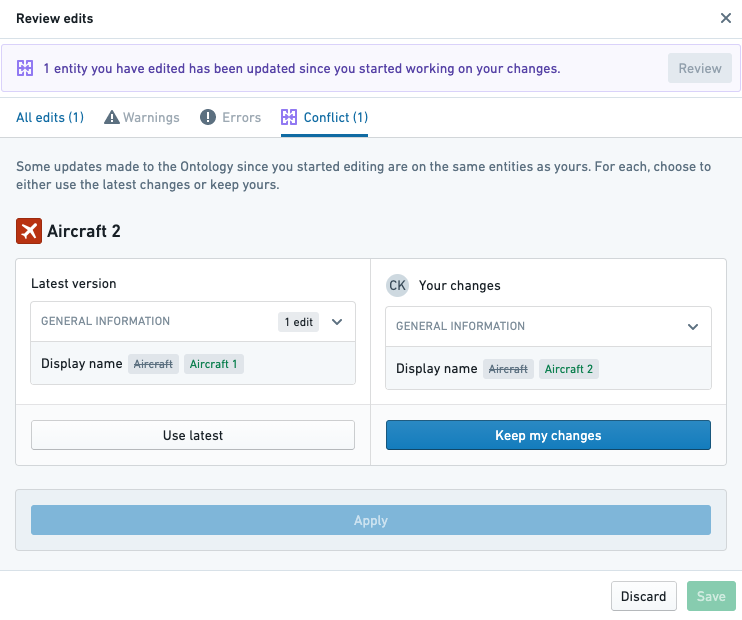
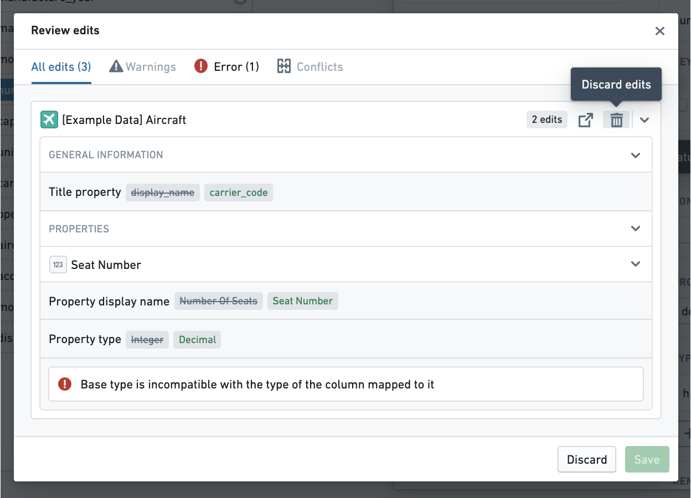
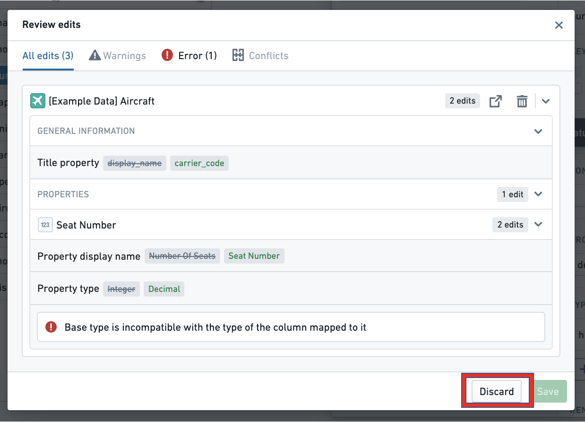
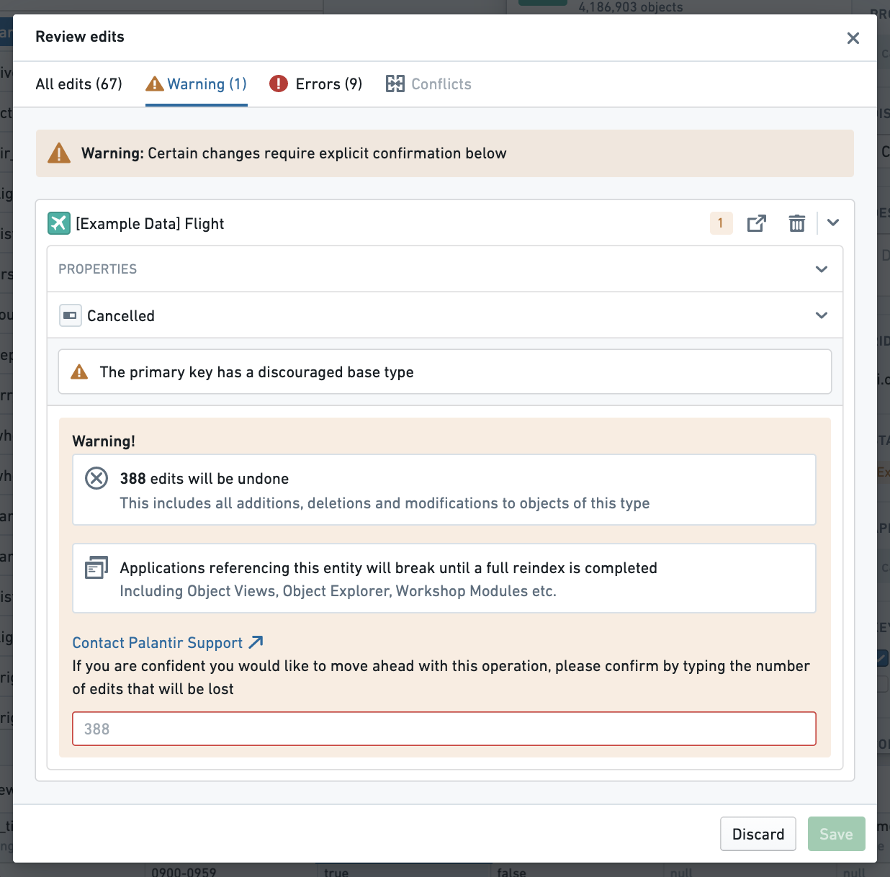
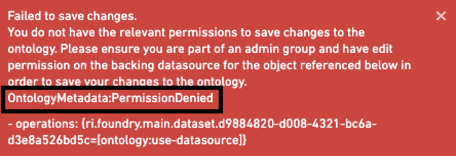

:::callout{theme="warning"}
注意：以下翻译的准确性尚未经过验证。这是使用 [AIP ↗](https://www.palantir.com/platforms/aip/) 从原始英文文本进行的机器翻译。
:::

# 保存对Ontology的更改

## 保存您的更改

您在Ontology管理器中所做的任何更改都会以工作中的状态本地存储。为了让这些Ontology更改对他人可用并反映在用户界面应用程序中，您必须保存您的更改。要保存更改：

1. 从应用程序右上角的应用程序标题中选择**保存**。

2. 打开**审核编辑**对话框以审核您所有的更改。
3. 最后，选择**保存**以更新Ontology。

## 处理错误和警告

如果**保存**按钮变灰，您可能遇到了阻止保存的错误。为了解决此问题，您可以：

* 滚动查看您的更改并查看行内的错误消息，或
* 在**审核编辑**对话框顶部选择**错误**选项卡以查看阻止您保存的错误。

**审核编辑**对话框还会在行内和**警告**选项卡中显示建议您进行的更改的警告。虽然必须处理错误才能保存，但警告不会阻止您保存。

如果您收到错误，可以使用打开快捷方式导航到需要编辑的资源，然后再保存。

:::callout{theme="neutral"}
对函数的更改只能在函数库中进行，而不能在Ontology管理器中进行。您可以从Ontology管理器中的函数实体视图导航到函数库。
:::

## 处理更新和合并冲突

如果在您开始更改之后，Ontology已被其他用户保存，则**保存**按钮可能会变灰。您需要从审核编辑对话框顶部选择**更新**，以将其他用户的更改与您自己的更改合并。

可能存在其他用户所做的更改与您工作状态中的更改之间的合并冲突。系统将提示您解决这些冲突。您可以选择保留Ontology最新版本中的更改，或者用您工作状态中的更改覆盖它们。

## 放弃您的更改

您在Ontology中编辑的每个资源都会在**审核编辑**对话框中有自己的条目。您可以通过将鼠标悬停在**审核编辑**对话框中的条目上并选择回收站图标来放弃对资源所做的更改。

您可以在任何时候通过选择应用程序右上角标题中的**放弃**按钮，或在**审核编辑**对话框底部选择**放弃**，来放弃您对Ontology所做的所有未保存更改。

## 响应警告信息

当您在**审核编辑**对话框中查看更改时，可能会收到一个警告信息，提示您在保存之前确认警告。

对Object类型及其属性的编辑可能会对依赖于这些Object类型的应用程序产生破坏性影响。此外，如果某个Object类型启用了数据输出，在对该Object类型进行编辑时应格外小心，以确保不删除对该类型Object所做编辑的历史记录。

有关哪些更改可能是破坏性的完整描述，请阅读关于[潜在破坏性更改](../../../%E5%AE%9A%E4%B9%89%E6%9C%AC%E4%BD%93/%E5%AF%B9%E8%B1%A1%E9%93%BE%E6%8E%A5%E7%B1%BB%E5%9E%8B/Object%20types/%E7%BC%96%E8%BE%91Object%E7%B1%BB%E5%9E%8B.md)的更多信息。

一旦您阅读了警告信息中详细说明的更改影响并理解这些更改的含义，您可以输入您编辑的实体名称以继续保存。

## 保存失败时的故障排除

如果支持Ontology的后台服务在您保存时遇到问题，您将收到一个错误消息“toast”（弹出），如下图所示。在解释为什么不能保存的文本末尾，将打印错误消息的名称。错误消息名称将以`OntologyMetadata:`或`Phonograph2:`前缀开头。

在整个Ontology文档中，有与Ontology所做不同更改相关的最常见错误的引用。如果您看到错误消息，请在文档中搜索它，以查看错误及其解决方法是否已记录。
