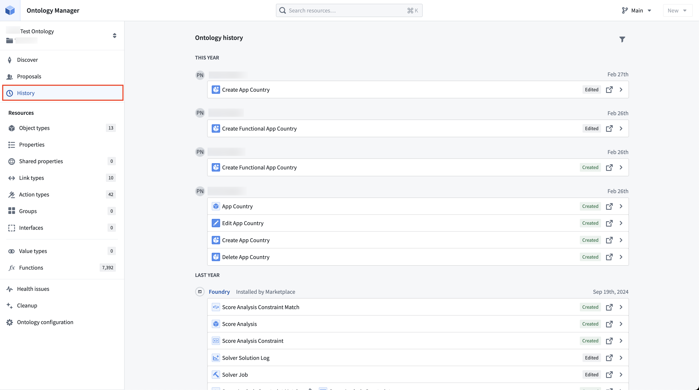
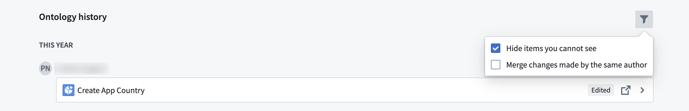
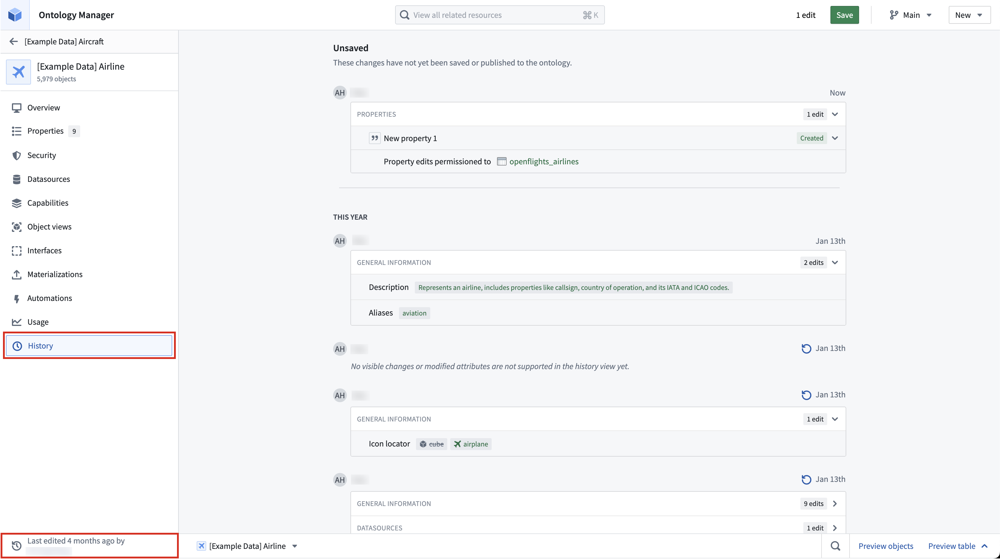

:::callout{theme="warning"}
注意：以下翻译的准确性尚未经过验证。这是使用 [AIP ↗](https://www.palantir.com/platforms/aip/) 从原始英文文本进行的机器翻译。
:::

# 审查和恢复更改

## 审查对全局Ontology的更改

要审查对全局Ontology的更改：

1. 在应用程序头部的右上角，有一个**历史记录**按钮，突出显示了您对Ontology所做的尚未保存的更改次数。
2. 选择**历史记录**按钮将打开一个**编辑历史**对话框。对话框顶部突出显示了您所做的未保存更改，接下来是所有Ontology更改的列表，并附有更改的时间和由谁进行的详细信息。

默认情况下，更改是折叠的。您可以选择任何更改的（下箭头）以查看更改的详细信息。

## 筛选对全局Ontology的更改

在**编辑历史**对话框中，您可以选择隐藏您无法查看的更改。如果对您没有访问权限的Ontology中的object类型和链接类型进行了更改，这些更改将存在。在这种情况下，您会看到Ontology进行了更改，但没有这些更改的详细信息。

编辑历史中的每个条目对应于用户保存更改的单个实例。您还可以选择通过将同一作者所做的更改合并到单个条目中来整合视图。

## 审查对单个Ontology资源的更改

在Ontology资源视图的左下角，有一个按钮显示object类型、链接类型或操作类型最后编辑的时间和由谁编辑。

选择此按钮将为该特定资源打开一个**编辑历史**对话框。此对话框显示：

* 顶部突出显示：您对object类型、链接类型或操作类型所做的未保存更改。
* 下方突出显示：所有对object类型、链接类型或操作类型所做的更改，并附有更改时间和由谁进行的详细信息。

## 恢复对单个object类型的更改

要将object类型恢复到其较旧版本：

1. 将鼠标悬停在**编辑历史**中您希望保存的object类型最新更改的条目上。
2. 选择**恢复**。

:::callout{theme="warning" title="警告"}
在将object类型恢复到以前的版本后，您选择的条目之后所做的任何更改都将被撤销。这些更改将被添加到您的工作状态中，您需要保存更改到Ontology，以便您的恢复生效。[了解有关保存到Ontology的更多信息。](%E4%BF%9D%E5%AD%98%E5%AF%B9Ontology%E7%9A%84%E6%9B%B4%E6%94%B9.md)
:::
