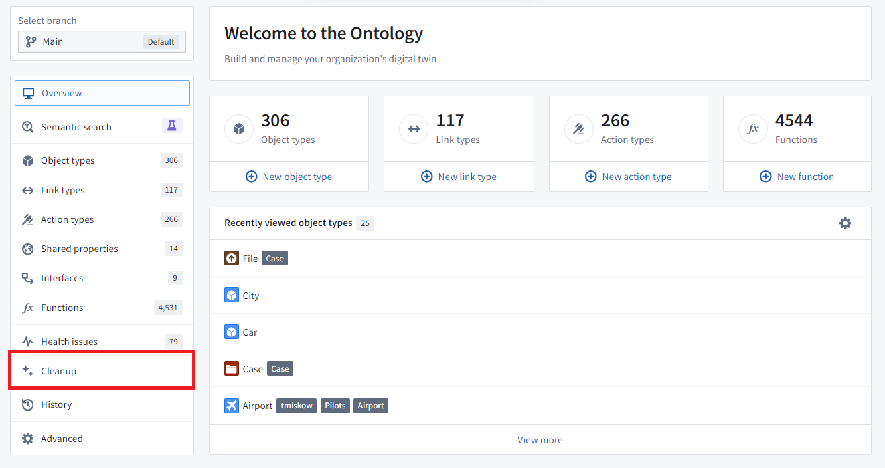
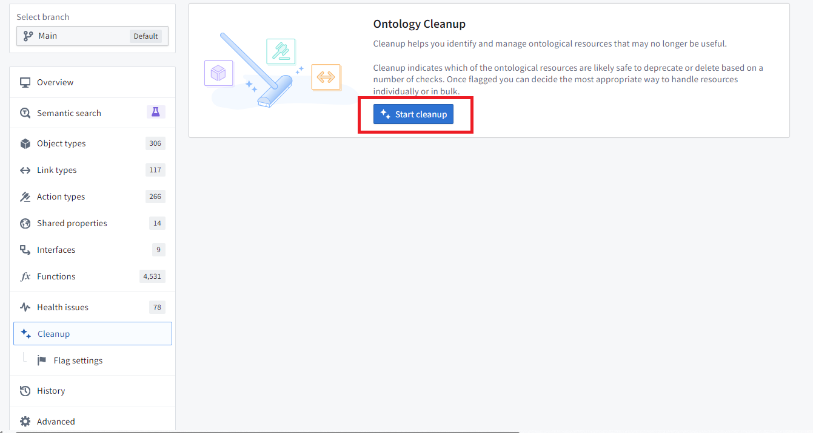
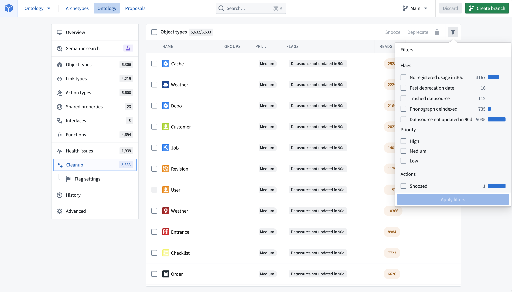
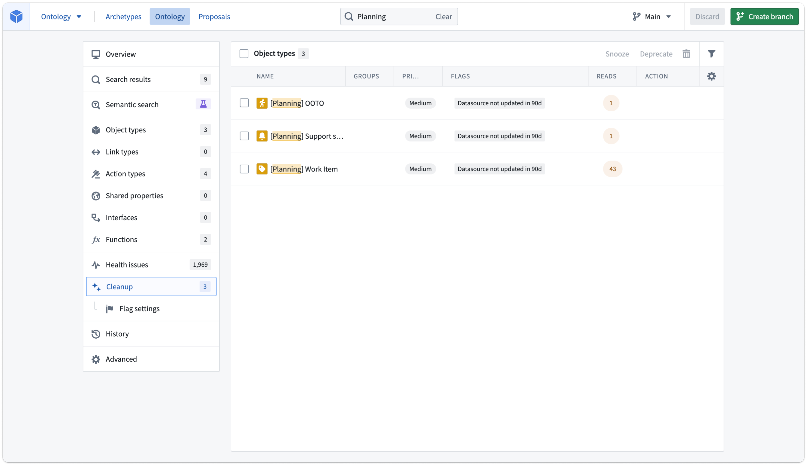
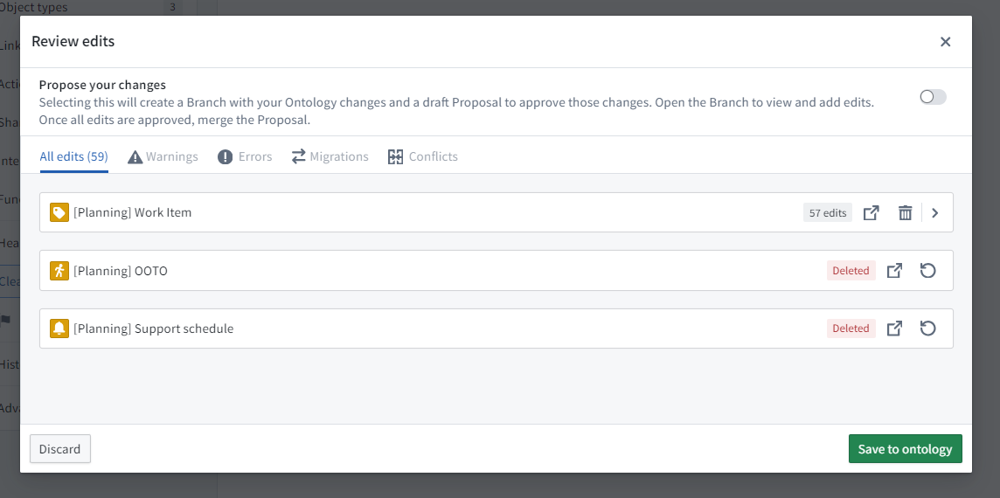
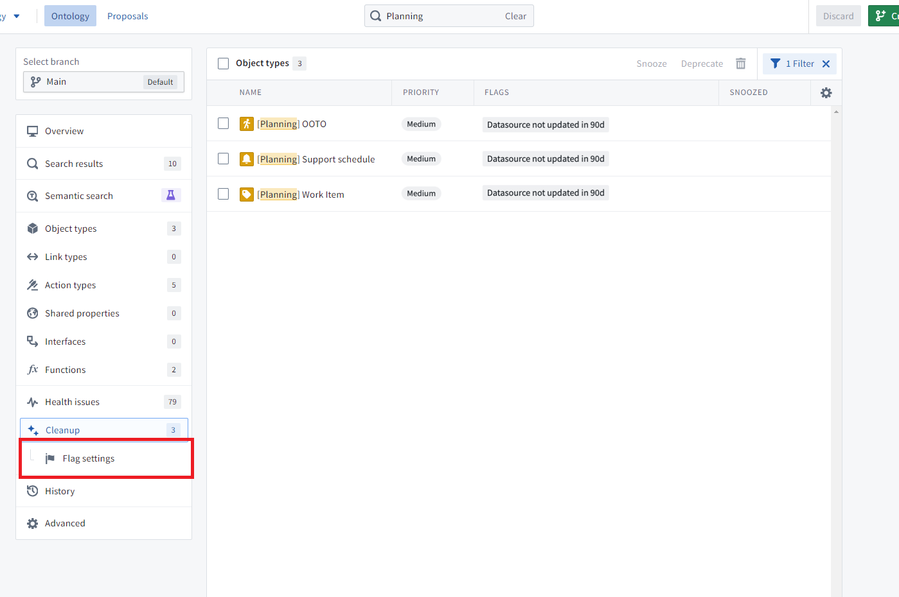
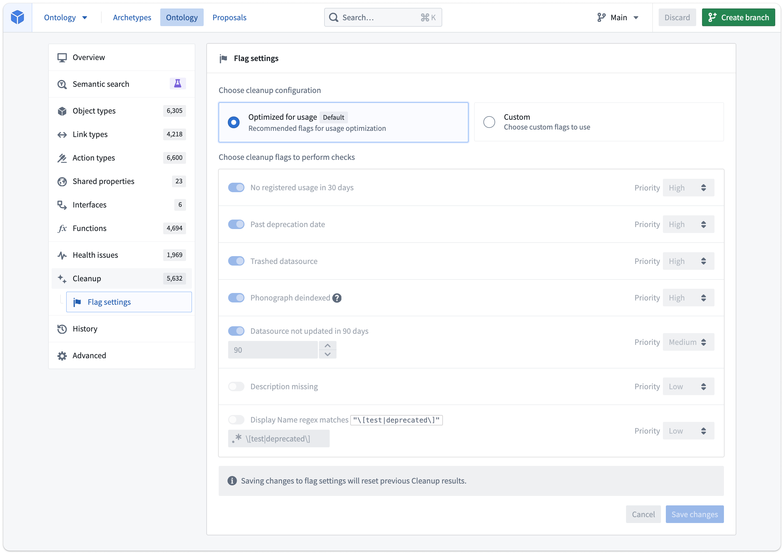

:::callout{theme="warning"}
注意：以下翻译的准确性尚未经过验证。这是使用 [AIP ↗](https://www.palantir.com/platforms/aip/) 从原始英文文本进行的机器翻译。
:::

# Ontology 清理

Ontology 清理工具是一种安全删除 Object 类型的方法，提供了多项好处，包括：

* 更易于导航的 Ontology，无多余的 Object 类型
* 更高效的 Ontology，因为搜索和加载操作针对的 Object 类型更少
* 无需承担多余存储成本的 Ontology

该工具旨在帮助 Ontology 编辑确定删除 Object 类型的安全性，并提供弃用选项，以通知 Object 类型用户其未来将被移除。

## 访问 Ontology 清理工具

可从 Ontology 清理工具的主页访问该视图。

当您选择 **开始清理** 时，根据您的 Ontology 大小，工具可能需要一些时间来查找清理候选项。

生成的 Object 类型列表操作方式与从主页访问的其他显示列表的页面类似。列表可以筛选到特定标记或您负责的 Object 类型组。您还可以自定义表格中显示的列。

默认情况下，表格按照 Object 类型触发的标记中的最高优先级排序。

## 清理您的 Ontology

以下是我们筛选到“计划”工作流的示例，这是一个正在开发但从未发布的工作流。

使用内联复选框选择三个 Object 类型。

管理这些 Object 类型有三种选项：

* **延迟处理:** 在可配置的时间内从您的清理队列中隐藏 Object 类型。延迟处理是一个只影响执行操作的用户的操作。
* **弃用:** 在显示 Object 类型状态的每个上下文中将 Object 类型显示为弃用。此选项通知用户移动到不同的 Object 类型或标记该 Object 类型仍然有用。您可以设置一个弃用期限，以便用户知道他们有多少时间不再使用这些 Object 类型。
* **删除:** 从 Ontology 中删除 Object 类型，并从 Object 存储中删除相关数据。

一旦您对队列中的 Object 类型进行操作，该类型将从队列中消失。使用表格筛选查看您已选择的所有操作。

弃用和删除与正常的 Ontology 修改方式相同。在上述示例中，“工作项” Object 类型具有用户编辑的对象，因此可以弃用，而其他两个可以删除。选择右上角的 **保存** 可以将更改直接保存到 Ontology 或创建提案以请求其他用户审核。

## 配置 Ontology 清理

清理页面包含一个子页面，允许您自定义使用的标记及其各自的优先级。

您可以在此页面上配置标记设置，可以选择使用默认集合或自定义标记。

与从队列中延迟处理 Object 类型类似，这是一个不影响其他 Ontology 编辑的个人自定义。

当您保存更改并返回主 **清理** 选项卡时，系统会提示您重新计算清理队列。

请注意，如果使用自定义标记设置，将来添加的新标记在使用默认标记集时不会自动打开。

## Ontology 清理标记

以下标记列表旨在解决常见问题，但并不详尽：

* **弃用日期已过:** Object 类型当前具有 `弃用` 状态，且弃用日期字段已过期。
* **回收站数据源:** 支持该 Object 类型的任何数据源（无论是数据集、受限视图还是其他）在 Compass 中已被回收。
* **数据源未在 \[x] 天内更新:** 检查 Compass 中支持数据源的最后修改时间。
* **缺少描述:** Object 类型的描述为空。不会检查 Object 类型的所有属性上的描述。
* **显示名称正则表达式匹配字符串:** `\[test|deprecated\]` 的默认值将匹配显示名称中包含 `[test]` 或 `[deprecated]` 的 Object 类型。例如，如果您的组织中常见的模式是用前缀 `UAT -` 或 `Testing -` 标记用户接受测试中的 Object 类型，您可以使用正则表达式 `UAT -|Testing -` 找到所有匹配此模式的 Object 类型。支持 ECMA（JavaScript）正则表达式语法。
* **Phonograph 取消索引:** 标记仅应用于 Object 存储 V1 中的 Object 类型。Object 存储 V2 没有等效检查。
