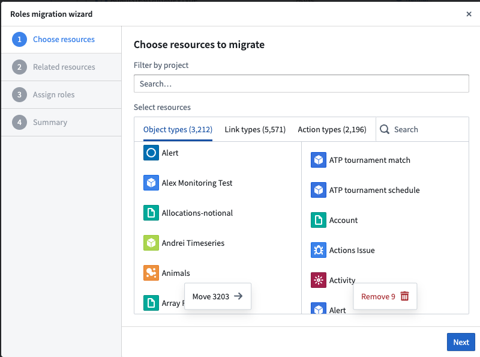
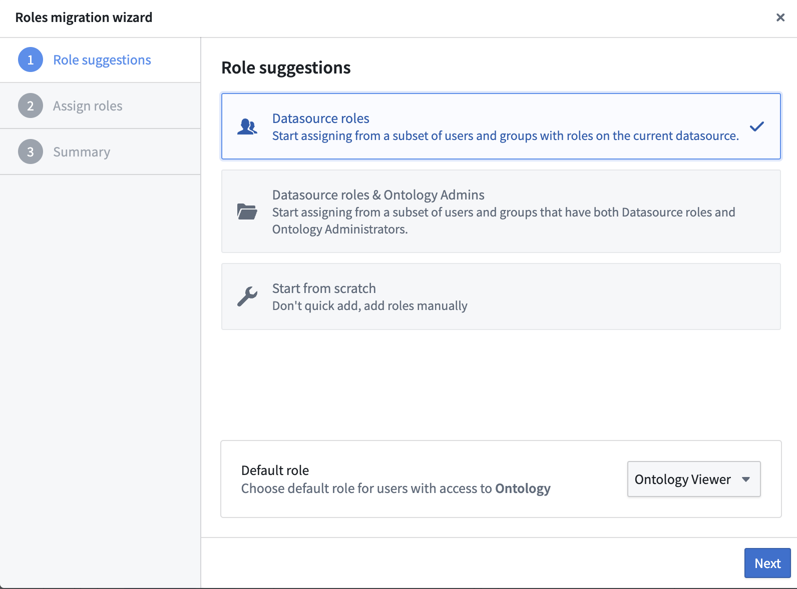
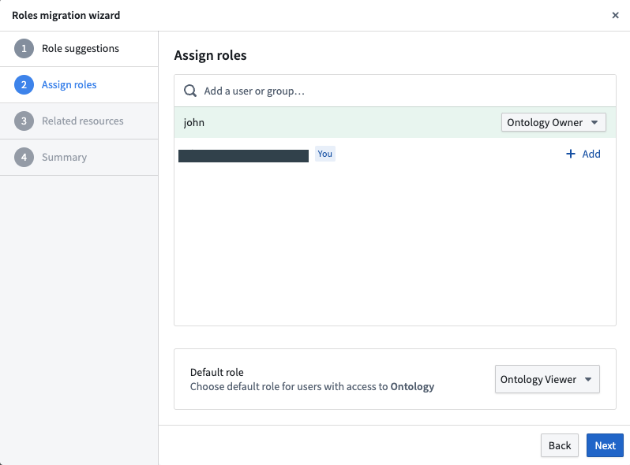
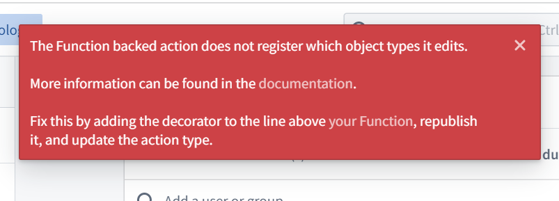

:::callout{theme="warning"}
注意：以下翻译的准确性尚未经过验证。这是使用 [AIP ↗](https://www.palantir.com/platforms/aip/) 从原始英文文本进行的机器翻译。
:::

# Ontology 角色迁移

:::callout{theme="warning"}
**Ontology 资源**的授权模型正在从[数据源派生权限](#datasource-derived-permissions-legacy)更改为[Ontology 角色](#ontology-roles)。本文档提供了有关如何进行迁移的分步指南。

Ontology 角色尚未在所有 Foundry 注册中普遍可用，但将在 2024 年下半年推出。有关更多信息，请联系您的 Palantir 代表。
:::

## 什么是 Ontology 角色？

* [Ontology 角色](../../%E5%AE%9A%E4%B9%89%E6%9C%AC%E4%BD%93/%E6%9C%AC%E4%BD%93/%E6%9D%83%E9%99%90.md#ontology-roles)是授权 Ontology 资源的更新解决方案。Ontology 角色将取代[数据源派生权限](../../%E5%AE%9A%E4%B9%89%E6%9C%AC%E4%BD%93/%E6%9C%AC%E4%BD%93/%E6%9D%83%E9%99%90.md#datasource-derived-permissions-legacy)作为 2024 年的默认授权模型。
* Ontology 角色适用于对象类型、链接类型和操作类型，这些通常称为“Ontology 资源”。默认情况下，自 2023 年 9 月以来创建的所有新注册都适用 Ontology 角色授权模型；您必须应用这些角色以使用 Ontology 的最新功能，包括共享属性类型、接口等。
* **Ontology 角色允许您直接在每个 Ontology 资源及其元数据上授予角色**。所有元数据权限均在 Ontology Manager 中管理。
* **数据权限始终由数据源权限管理**。Ontology 角色允许您将 Ontology 资源与这些资源的数据分离，如[对象实例](../../%E5%AE%9A%E4%B9%89%E6%9C%AC%E4%BD%93/%E5%AF%B9%E8%B1%A1%E9%93%BE%E6%8E%A5%E7%B1%BB%E5%9E%8B/Object%20types/%E6%A6%82%E8%A7%88.md#overview)和链接实例，它们仍由输入数据源权限管理。了解更多关于[Ontology 权限](../../%E5%AE%9A%E4%B9%89%E6%9C%AC%E4%BD%93/%E6%9C%AC%E4%BD%93/%E6%9D%83%E9%99%90.md)的信息。

## 定义

[Ontology 角色](../../%E5%AE%9A%E4%B9%89%E6%9C%AC%E4%BD%93/%E6%9C%AC%E4%BD%93/%E6%9D%83%E9%99%90.md#ontology-roles)是授权 Ontology 资源的更新解决方案，并将很快取代[数据源派生权限](../../%E5%AE%9A%E4%B9%89%E6%9C%AC%E4%BD%93/%E6%9C%AC%E4%BD%93/%E6%9D%83%E9%99%90.md#datasource-derived-permissions-legacy)作为默认授权模型。
Ontology 角色允许您直接在每个 Ontology 资源上授予角色，例如对象类型、链接类型和操作类型以及它们的元数据。
此功能将 Ontology 资源与这些资源的数据分离，如[对象实例](../../%E5%AE%9A%E4%B9%89%E6%9C%AC%E4%BD%93/%E5%AF%B9%E8%B1%A1%E9%93%BE%E6%8E%A5%E7%B1%BB%E5%9E%8B/Object%20types/%E6%A6%82%E8%A7%88.md#overview)和链接实例本身，这些仍由输入数据源权限管理。

每个 Ontology 都链接到一个或多个[Foundry 组织](https://www.palantir.com/docs/foundry/security/orgs-and-spaces/#organizations)。

角色权限在[Ontology 角色文档](../../%E5%AE%9A%E4%B9%89%E6%9C%AC%E4%BD%93/%E6%9C%AC%E4%BD%93/%E6%9D%83%E9%99%90.md#ontology-roles)中有详细说明。

:::callout{theme="neutral"}
迁移到角色的每个对象类型、链接类型和操作类型将为所有有权访问该特定 Ontology 的用户提供查看权限。因此，Ontology 元数据信息对该 Ontology 的所有用户都是可访问的。
:::

### 示例

迁移 Ontology 资源到 Ontology 角色不需要明确排序，因此可以混合使用[数据源派生权限](../../%E5%AE%9A%E4%B9%89%E6%9C%AC%E4%BD%93/%E6%9C%AC%E4%BD%93/%E6%9D%83%E9%99%90.md#datasource-derived-permissions-legacy)的对象类型，和使用 Ontology 角色的对象类型。因此，为了迁移的目的，我们将“能够编辑对象类型”定义如下：

* **使用数据源派生权限的对象类型：** 用户在该对象类型的输入数据源上具有`编辑者`权限。
* **使用 Ontology 角色的对象类型：** 用户在对象类型上具有`Ontology 编辑者`权限，并且不需要任何输入数据源的权限。用户应注意，这仅允许编辑 Ontology 资源及其元数据，并不授予对数据/数据源本身的任何权限。对象数据（不是元数据）的访问仍由输入数据源上授予的权限管理。

## 迁移到 Ontology 角色

如果在您的注册中启用了 Ontology 角色，但您尚未将您拥有的 Ontology 资源迁移到角色授权模型，您将在 Ontology Manager 中看到提示您进行迁移的横幅。
或者，当查看 Ontology 资源的表格时，您可以筛选出仍在使用“与支持数据源相同权限”的资源。

:::callout{theme="neutral"}
Ontology 角色尚未在所有 Foundry 注册中可用。如果您无法访问 Ontology 角色，请联系 Palantir 支持。
:::

### 前提条件

要执行迁移，用户必须拥有以下权限：

1. 更改 Foundry Ontology 的权限。

2. 每个单独资源的以下权限：

   * 对于对象类型，用户必须在输入数据源上具有`所有者`权限。
   * 对于一对多链接类型，用户不需要额外的权限。只需要在链接类型中引用的两个对象类型上具有`只读`权限，并且用户必须在链接类型本身或在 Ontology 级别上是`所有者`。
   * 对于多对多链接类型，除了对一对多链接类型所需的权限之外，用户必须在链接类型的输入数据源上具有`所有者`权限。
   * 操作类型不需要额外的权限。

:::callout{theme="neutral"}
在迁移到 Ontology 角色后，[修改操作类型](../../%E5%AE%9A%E4%B9%89%E6%9C%AC%E4%BD%93/%E6%9C%AC%E4%BD%93/%E6%9D%83%E9%99%90.md#permissions-for-editing-action-types)需要额外的权限。您需要对操作类型编辑的任何对象类型以及操作类型本身拥有权限，才能修改具有角色的操作类型。
:::

### 迁移通知

Ontology 角色的迁移通过[升级助手](https://www.palantir.com/docs/foundry/upgrade-assistant/overview/)进行管理。专用的升级助手任务显示必须迁移的 Ontology 资源列表，以及有权限执行迁移的指派人。从升级助手打开资源会将用户引导到资源的**安全性**选项卡，以便在 Ontology Manager 应用程序中进行迁移。

如果用户有权设置 Ontology 角色，则尚未迁移的 Ontology 资源将出现在迁移界面的**安全性**选项卡中，以首次设置 Ontology 角色。Ontology 资源迁移后，Ontology 角色选择器将显示在**安全性**选项卡下，并可由`Ontology 所有者`更新。

### 使用 Ontology Manager 应用程序进行迁移

有两种方法可以将 Ontology 资源（对象类型、操作类型、链接类型）迁移到角色：[批量迁移](#bulk-migration-of-ontology-resources) Ontology 资源或[逐一迁移](#one-by-one-migration-for-all-ontology-resources)所有 Ontology 资源。

#### 批量迁移 Ontology 资源

您可以批量迁移 Ontology 资源到角色。在继续之前，请参阅[前提条件](Ontology%20%E8%A7%92%E8%89%B2%E8%BF%81%E7%A7%BB.md#prerequisites)列表。一次最多只能迁移 500 个资源。

要进行批量迁移，请转到 Ontology Manager 中的**高级**，然后在迁移部分选择**继续使用迁移助手**。

迁移向导将出现以下步骤。

1. **选择资源：** 选择您希望应用相同角色的所有对象类型、链接类型或操作类型。下图显示了迁移向导中选择资源的界面：

1. **相关资源：** 仅当有可以迁移的相关资源（链接类型或操作类型）时才会显示此步骤。
2. **指派角色：** 您可以手动设置要指派给这些 Object 类型的组/用户和默认角色。目前，角色迁移工具无法建议批量角色。我们强烈建议在授予角色时使用**用户组**而不是**用户**。
3. **总结：** 查看总结，确认迁移的影响，并完成迁移以应用角色。

:::callout{theme="warning"}
当您确认迁移的影响时，您是在确认先前从支持数据源派生的权限将被新指派的角色授予覆盖，并且迁移是不可逆的。
:::

##### 批量迁移的例外情况

某些操作类型无法在没有进一步步骤的情况下进行批量迁移。

如果操作类型没有提交标准来检查当前用户的权限，则无法迁移到角色。

* 解决方案：在 Ontology Manager 的操作类型的**安全性和提交标准**选项卡中根据当前用户添加条件（在**提交标准**部分），并在重新尝试迁移之前保存到 Ontology。
* 如果操作类型由一个函数支持，则必须在迁移之前使用`@edits decorators`重新发布。
  * 解决方案：请参阅[decorators](../../%E5%AE%9A%E4%B9%89%E6%9C%AC%E4%BD%93/%E5%87%BD%E6%95%B0/TypeScript%20basics/%E8%A3%85%E9%A5%B0%E5%99%A8.md#decorators)文档中的步骤。

要解决这些问题，请转到**操作类型**页面并筛选到**与支持数据源相同权限**，这将显示由于问题而未迁移的操作类型。解决所有未解决的问题，然后再次对任何剩余的操作类型进行批量迁移。

:::callout{theme="warning" title="警告"}
在迁移操作类型时，请确保仅将权限授予对引用的对象类型和所有应用案例具有足够背景的用户。
:::

#### 为所有 Ontology 资源逐一迁移

从 Ontology Manager 首页中，选择您想要迁移的 Ontology 资源（对象类型、链接类型或操作类型），并按`安全设置`筛选为`与支持数据源相同权限`，按`权限`筛选为`所有者`。

选择要迁移的实体，然后在标题上选择**迁移到角色**或在安全性选项卡上选择**开始使用角色**。

迁移向导将出现两个建议的角色选项：**数据源角色**和**Ontology 管理员和数据源角色**。这些选项允许用户使用和配置与其现有 Ontology 设置一致的角色。选择其中一个选项会预填建议角色列表；这些角色可以稍后更改。

* **数据源角色：** 此选项添加在输入数据源上具有`编辑者`或`所有者`角色的所有用户和用户组。
* **Ontology 管理员和数据源角色：** 此选项添加所有当前可以根据[数据源派生权限](../../%E5%AE%9A%E4%B9%89%E6%9C%AC%E4%BD%93/%E6%9C%AC%E4%BD%93/%E6%9D%83%E9%99%90.md#type-specific-edit-permissions-1)修改给定 Ontology 资源的用户。这些用户属于`Ontology 管理员`用户组，并在输入数据源上具有编辑者或所有者角色。

下图显示了迁移向导中的角色建议：

选择所需的角色建议，查看建议的[Ontology 角色](../../%E5%AE%9A%E4%B9%89%E6%9C%AC%E4%BD%93/%E6%9C%AC%E4%BD%93/%E6%9D%83%E9%99%90.md#overview-of-ontology-roles)和对象类型的默认角色，然后根据需要进行修改。接下来，查看总结，确认影响，并完成迁移以应用角色。

下图显示了如何在迁移向导中指派角色：

##### 例外情况

如果：

* 操作类型没有提交标准来检查当前用户的权限，您可能会被阻止尝试将操作类型迁移到角色。
  * 解决方案：在 Ontology Manager 的操作类型的**安全性和提交标准**选项卡中根据当前用户添加条件（在**提交标准**部分），并在重新尝试迁移之前保存到 Ontology。
* 如果操作类型由一个函数支持，则必须在迁移之前使用`@edits decorators`重新发布。
  * 解决方案：请参阅[decorators](../../%E5%AE%9A%E4%B9%89%E6%9C%AC%E4%BD%93/%E5%87%BD%E6%95%B0/TypeScript%20basics/%E8%A3%85%E9%A5%B0%E5%99%A8.md#decorators)文档中的步骤。

解决这些问题后，您将能够将操作类型迁移到角色。

#### 如果某些 ontology 资源不再需要怎么办？

如果您不再需要需要操作的 ontology 资源，您可以使用[Ontology 清理工具](Ontology%20%E6%B8%85%E7%90%86.md)删除该资源。该工具可帮助您根据一组标准（例如，如果数据源已被删除，弃用日期已过，索引失败，无论它们是否使用 Ontology 角色等）识别哪些对象类型可以安全删除。

#### 迁移函数支持的操作类型

函数支持的操作类型需要迁移支持的函数。Foundry 将尝试自动迁移函数，以便您也可以迁移操作类型。然而，某些函数可能无法自动迁移，需要在函数中手动声明编辑的对象类型。如果在将操作类型迁移到 Ontology 角色后看到函数支持的操作失败，请查看[常见问题](Ontology%20%E8%A7%92%E8%89%B2%E8%BF%81%E7%A7%BB.md#how-can-i-resolve-a-function-backed-action-that-is-failing-post-migration)部分。

### 迁移常见问题

#### 对象感知应用会有任何变化吗？

用户可能会在[Ontology Manager](%E6%A6%82%E8%BF%B0.md)中访问他们以前因为没有`只读`访问权限而无法查看的对象类型和链接类型的元数据。这并不意味着他们将获得输入数据源中的数据访问权限，该权限始终由这些数据源上的角色管理。他们可以看到的元数据具体内容由他们的[Ontology 角色](#ontology-role-definitions)决定。

此外，当对象类型迁移时，Object Explorer 将更新编辑 Object 视图的权限检查。在对象类型迁移之前，用户需要在`Object View 管理员`组中并具有输入数据源的`编辑者`访问权限才能编辑 Object 视图。对象类型迁移后，Object Explorer 只会检查用户是否在对象类型本身上具有`Ontology 编辑者`权限。

#### 如何解决迁移后失败的函数支持的操作？

如果 Foundry 未能自动检测到 Ontology 编辑函数正在编辑的对象类型，操作将在提交后失败并显示以下错误。

要解决此错误，请按照[函数文档](../../%E5%AE%9A%E4%B9%89%E6%9C%AC%E4%BD%93/%E5%87%BD%E6%95%B0/Ontology%20edits/%E6%A6%82%E8%BF%B0.md#manually-specifying-the-edited-object-type)中解释的步骤进行操作。
