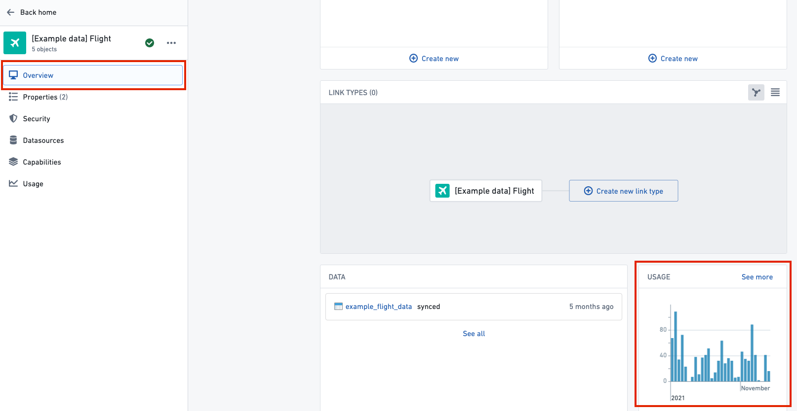
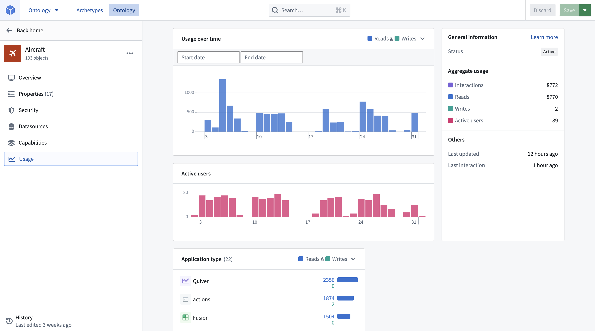

:::callout{theme="warning"}
注意：以下翻译的准确性尚未经过验证。这是使用 [AIP ↗](https://www.palantir.com/platforms/aip/) 从原始英文文本进行的机器翻译。
:::

# Ontology指标

可以配置Ontology Manager以显示对象类型和链接类型的使用指标。

## 关键术语

* **读取:** 当应用程序加载指定对象类型的对象时，会记录一次读取。这可以包括在Workshop中将对象显示在表格中，返回给定对象类型的搜索结果中的所有对象，对对象类型的属性进行聚合等。请注意，一次读取代表从[Object Storage v1 (Phonograph)](../../%E6%9C%AC%E4%BD%93%E6%9E%B6%E6%9E%84/%E5%AF%B9%E8%B1%A1%E6%95%B0%E6%8D%AE%E5%BA%93/%5B%E9%81%97%E7%95%99%5D%20Object%20Storage%20v1%20%28Phonograph%29.md)或Object Set Service (OSS)的一次加载请求。一次性加载或聚合的多个对象只会被记录为一次读取。另请注意，Ontology Manager中发生的任何对象类型或链接类型使用不包括在内。
* **写入:** 当应用程序由于某个[操作](../../%E5%AE%9A%E4%B9%89%E6%9C%AC%E4%BD%93/%E5%8A%A8%E4%BD%9C%E7%B1%BB%E5%9E%8B/%E6%A6%82%E8%BF%B0.md)、[函数](../../%E5%AE%9A%E4%B9%89%E6%9C%AC%E4%BD%93/%E5%87%BD%E6%95%B0/%E6%A6%82%E8%BF%B0.md)、Foundry Form、直接的Object Explorer编辑或API调用而对这种类型的对象进行编辑时，会记录一次写入。请注意，一次写入代表发送到[Object Storage v1 (Phonograph)](../../%E6%9C%AC%E4%BD%93%E6%9E%B6%E6%9E%84/%E5%AF%B9%E8%B1%A1%E6%95%B0%E6%8D%AE%E5%BA%93/%5B%E9%81%97%E7%95%99%5D%20Object%20Storage%20v1%20%28Phonograph%29.md)的一次编辑请求。一次性批量编辑的多个对象只会被记录为一次写入。
* **交互:** 过去30天内对这种类型的对象进行的读取和写入的总次数。
* **活跃用户:** 在过去30天内触发记录的读取和写入的唯一用户ID数量。

## 查看使用情况

在Ontology Manager中有两个地方可以查看对象类型和链接类型的使用情况：

* **概览**标签上的使用图表：过去30天使用情况的高级总结，使Ontology用户能够快速理解对该资源进行重大更改的影响。

:::callout{theme="warning" title="警告"}
如果您在使用图表中看到“过去30天无使用情况”，而预期会看到使用统计信息，则可能是内部表格尚未配置。请联系您的Palantir代表以获取更多信息。
:::

* 专用的**使用**标签：资源的详细使用指标。用户可以查看过去30天内谁在何时以及在哪些Foundry应用程序中使用了每种对象类型。该功能旨在帮助Ontology用户更安全地进行Ontology更改，通过提供对更改影响的更清晰理解来实现。在**概览**标签中的使用图表上点击**查看更多**也可以访问**使用**标签。

## 启用Ontology使用情况

**概览**标签上的使用情况和**使用**标签中的详细使用指标可以从控制面板中的**Ontology设置**标签中通过**Ontology指标**开关进行配置。此开关只能由Ontology管理员启用或禁用，更改可能需要长达60分钟才会在Ontology Manager中生效。

## 共享Ontology使用情况

如果您的组织与另一个组织共享Ontology，那么启用了Ontology指标的所有组织的用户都可以访问**使用**标签。显示的使用指标仅包括那些有权访问对象类型的用户以及来自启用了Ontology指标的组织的用户的使用情况。有关更多信息，请参阅[启用Ontology使用情况](#enabling-ontology-usage)中列出的步骤。
