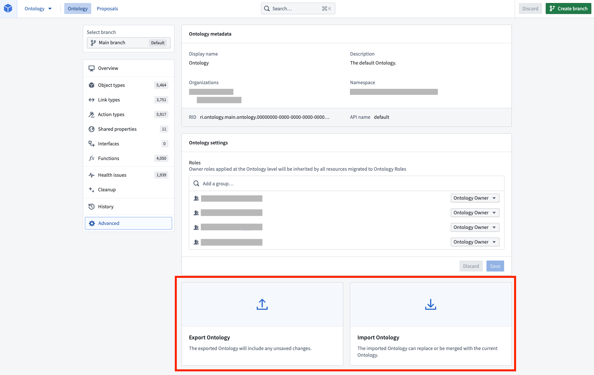

:::callout{theme="warning"}
注意：以下翻译的准确性尚未经过验证。这是使用 [AIP ↗](https://www.palantir.com/platforms/aip/) 从原始英文文本进行的机器翻译。
:::

# 导出、编辑和导入Ontology

:::callout{theme="neutral"}
您不应依赖导出的JSON架构，因为它可能会随时间更改。
:::

Ontology架构定义存储在[JSON文件 ↗](https://en.wikipedia.org/wiki/JSON)中。可以导出Ontology JSON文件，并在代码编辑器或文本编辑器中进行编辑，然后再导入回Foundry。此导入/导出功能为高级用户提供了两种工作流程：

* 如果您更喜欢在代码中进行Ontology编辑，可以通过导出Ontology JSON文件直接在代码编辑器或文本编辑器中编辑JSON文件，然后将修改后的Ontology JSON文件导入平台，从而绕过Ontology管理器界面。
* 如果您想将一个Ontology的工作状态复制到另一个Ontology，可以将Ontology的当前状态导出为JSON文件，然后将复制的JSON导入平台（可以在代码编辑器中对JSON进行任何所需的更改）。

## 导出

您可以通过从应用程序主页选择**高级**设置页面，然后选择**导出**来导出您的Ontology工作状态。

:::callout{theme="neutral"}
工作状态中的任何更改都会包含在导出中。
:::

## 导入

您可以通过从应用程序主页选择**高级**设置页面，然后选择**导入**来导入先前导出的Ontology工作状态。系统将提示您从本地驱动器中选择一个Ontology文件。

接下来，选择**导入**，这将在应用程序中从JSON文件重新创建整个工作状态。您将在应用程序头部看到文件中需要保存的更改数量。

:::callout{theme="neutral"}
配置了条件格式规则的导出Ontology工作状态不能导入到除其导出源以外的其他Ontology。
:::

## 疑难解答

### 出错: `OntologyMetadata:UnreferencedRuleSets`

如果您收到错误`OntologyMetadata:UnreferencedRuleSets`，则表示您尝试导入具有条件格式规则的Ontology工作状态，而这些规则未在该Ontology中定义且无法转移。您需要在导入之前删除Ontology工作状态中的条件格式规则。
