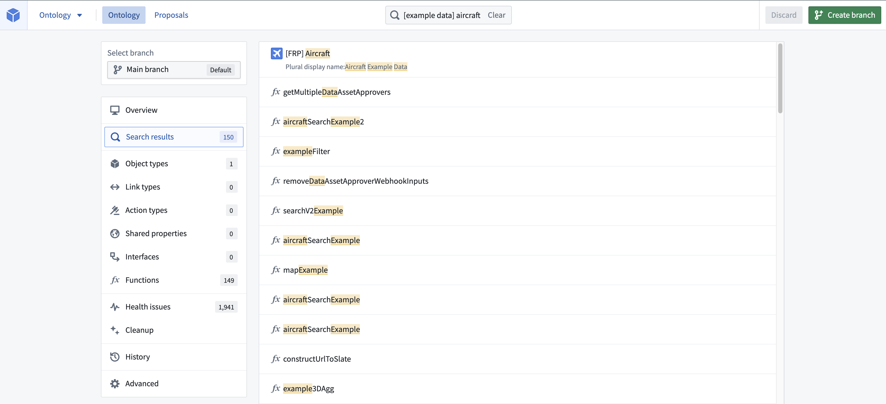
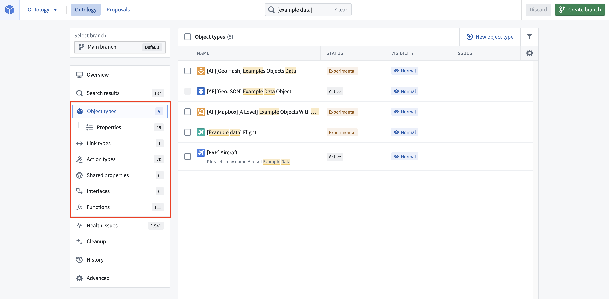
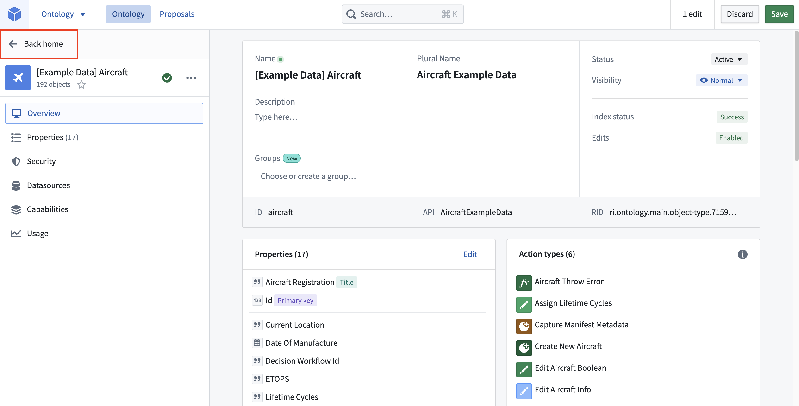
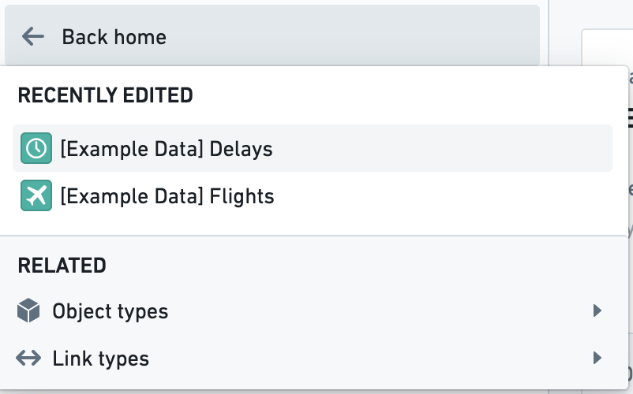

:::callout{theme="warning"}
注意：以下翻译的准确性尚未经过验证。这是使用 [AIP ↗](https://www.palantir.com/platforms/aip/) 从原始英文文本进行的机器翻译。
:::

# 导航

## 头部搜索栏

在应用程序头部的中间是**搜索**栏。您可以点击**搜索**栏或按住`Cmd/Ctrl + K`来打开**搜索**栏对话框。

在主页的**搜索**栏中进行搜索将更新主页，显示与搜索匹配的资源列表。您可以搜索任何您感兴趣的Object类型、属性、链接类型、操作类型、共享属性、接口或函数。搜索结果将突出显示您的搜索词匹配的字段。您可以使用键盘上的上箭头和下箭头键在搜索结果中移动，并查看选定结果的预览。您可以选择**打开**或使用Enter键打开选定的结果。

## 主页筛选

可以从主页侧边栏中选择**Object类型**、**链接类型**、**操作类型**、**共享属性**、**接口**和**函数**页面。这些页面允许根据可见性、开发状态和索引问题来筛选Object类型和链接类型。

其支持数据源未注册或未能重新索引到Object存储V1（Phonograph）的Object类型将在Object类型页面的问题列中显示红色错误消息。

## 从选择中导航返回

一旦您打开了Object类型、链接类型或操作类型，您可以选择视图侧边栏左上角的**返回主页**。

将鼠标悬停在**返回主页**按钮上还会显示快速链接，指向最近编辑的Object类型、链接类型和操作类型，以及与您当前查看的资源相关的所有资源。

