:::callout{theme="warning"}
注意：以下翻译的准确性尚未经过验证。这是使用 [AIP ↗](https://www.palantir.com/platforms/aip/) 从原始英文文本进行的机器翻译。
:::

# 概述

**Ontology Manager**（有时称为Ontology管理应用程序或OMA）使您能够搭建和维护组织的Ontology。您可以使用Ontology Manager进行与Ontology相关的广泛活动，从创建新的Object类型和定义新的操作类型，到将数据连接到Ontology，以及调查数据是否正在用户应用程序中更新。

## 访问应用程序

您可以通过三种不同的方式访问应用程序：

* 从工作区侧边栏的**应用程序**部分选择**Ontology Manager**图标；
* 在数据沿袭中右键单击一个Object类型，然后选择**配置Object类型**；或
* 在Foundry主页URL的末尾添加`/workspace/ontology`（例如，`https://example.website.com/workspace/ontology`）。

## 用户界面

Ontology Manager界面分为以下元素，这些元素将在整个文档中被引用：

* [Ontology Manager导航](#ontology-manager-navigation)
* [发现视图](#discover)
* [Object类型视图](#object-type-view)
* [属性编辑器视图](#property-editor-view)
* [链接类型视图](#link-type-view)
* [操作类型视图](#action-type-view)
* [函数类型视图](#function-type-view)

### Ontology Manager导航

Ontology Manager的两个持久元素是顶部栏和侧边栏。顶部栏和侧边栏作为导航元素，提供对应用程序内各种功能、功能和部分的直观访问。

顶部栏具有三个主要功能。它允许用户搜索Ontology资源，创建新的Ontology资源，并在分支之间导航或创建新分支。

侧边栏提供在Ontology Manager内不同资源、页面或应用程序之间的轻松导航。

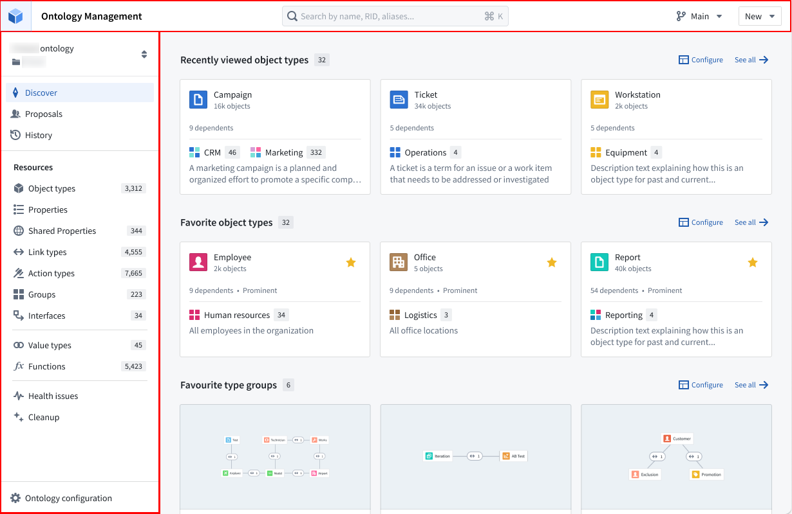

### 发现

发现视图提供了一个高度可自定义的默认位置页面，以满足您的偏好。默认情况下，发现视图展示收藏的Object类型、最近查看的Object类型和收藏的群组。

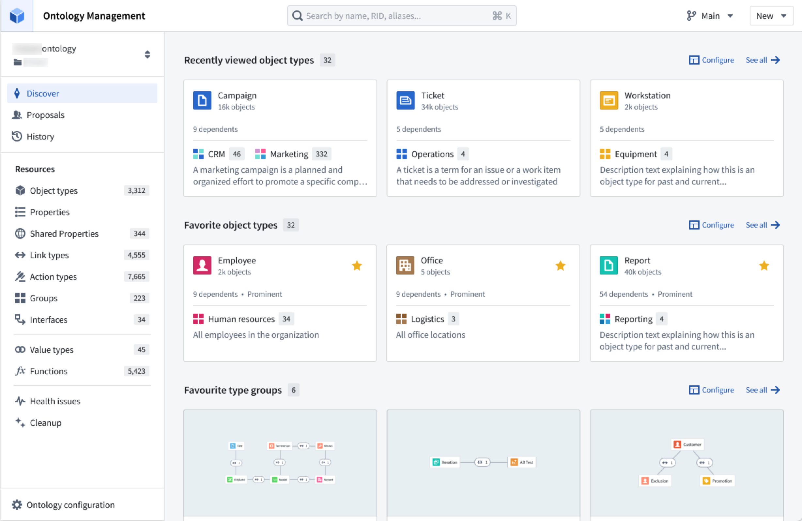

如果用户是Ontology的新手，将会呈现两个专门的部分：一个显示该Ontology中最近修改的所有Object类型，另一个显示所有重要的Object类型。

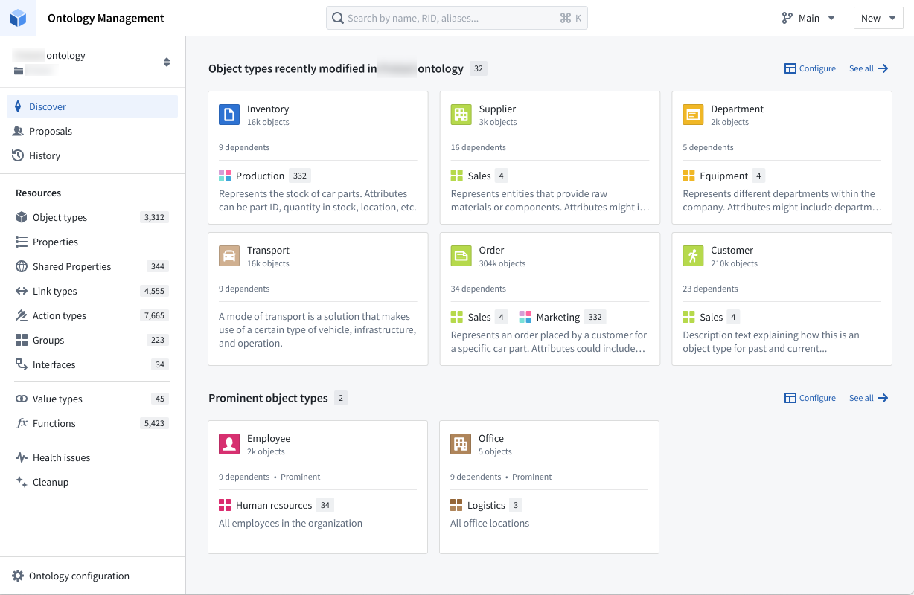

发现视图提供配置页面上显示的部分的灵活性，并控制每个部分中显示的项目数量。可用的部分包括“最近查看的Object类型”、“收藏的Object类型”和“收藏的群组”。此外，您还可以为特定群组添加一个单独的部分，以便浏览该群组内的所有Object类型。

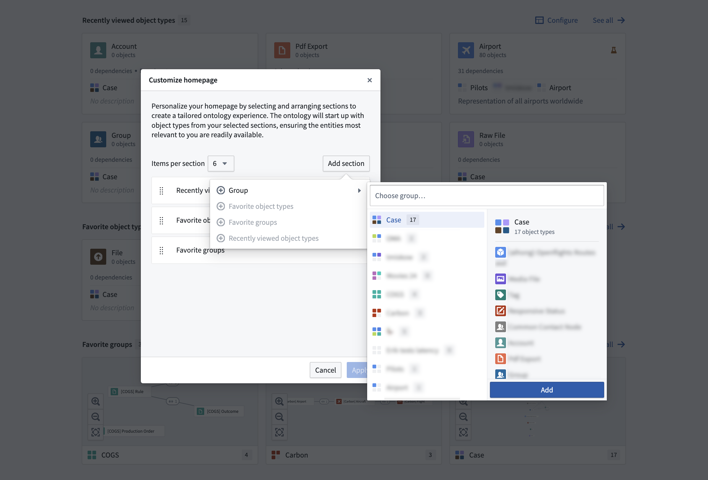

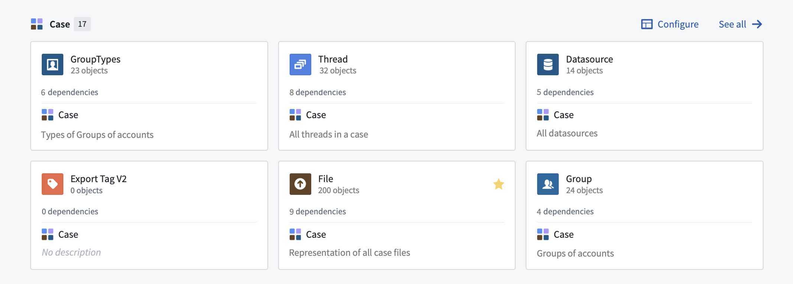

### Object类型视图

选择一个Object类型会弹出Object类型视图，其中包含以下组件：

* 带有页面选择的侧边栏（在下图的左侧）
* 选定的页面（在下图的右侧）

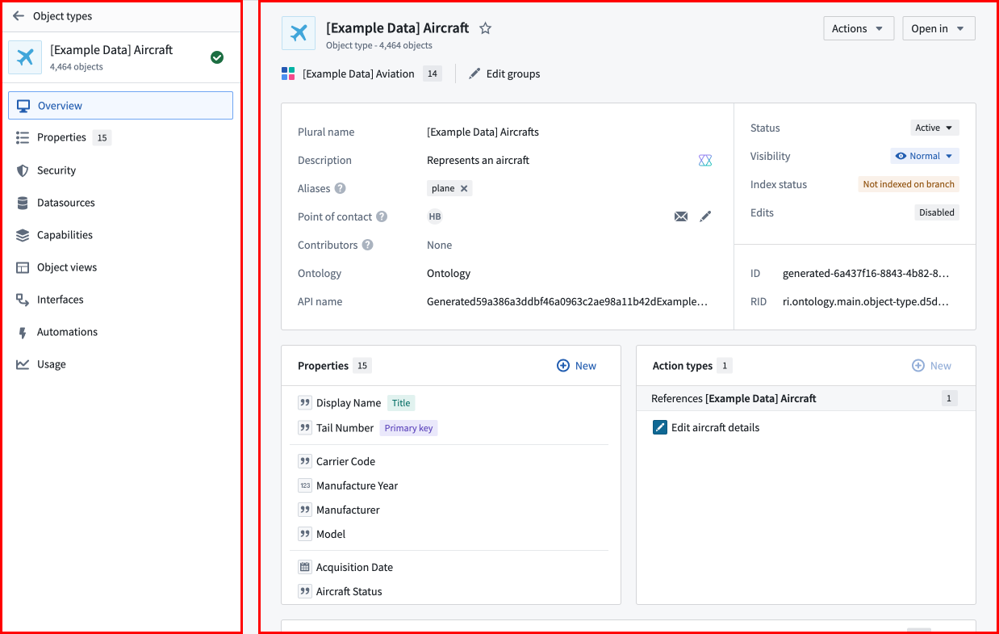

Object类型的**概述**页面包括以下部分，如下图所示：

1. Object类型元数据
2. 属性
3. 操作类型
4. 链接类型图
5. 数据
6. 使用

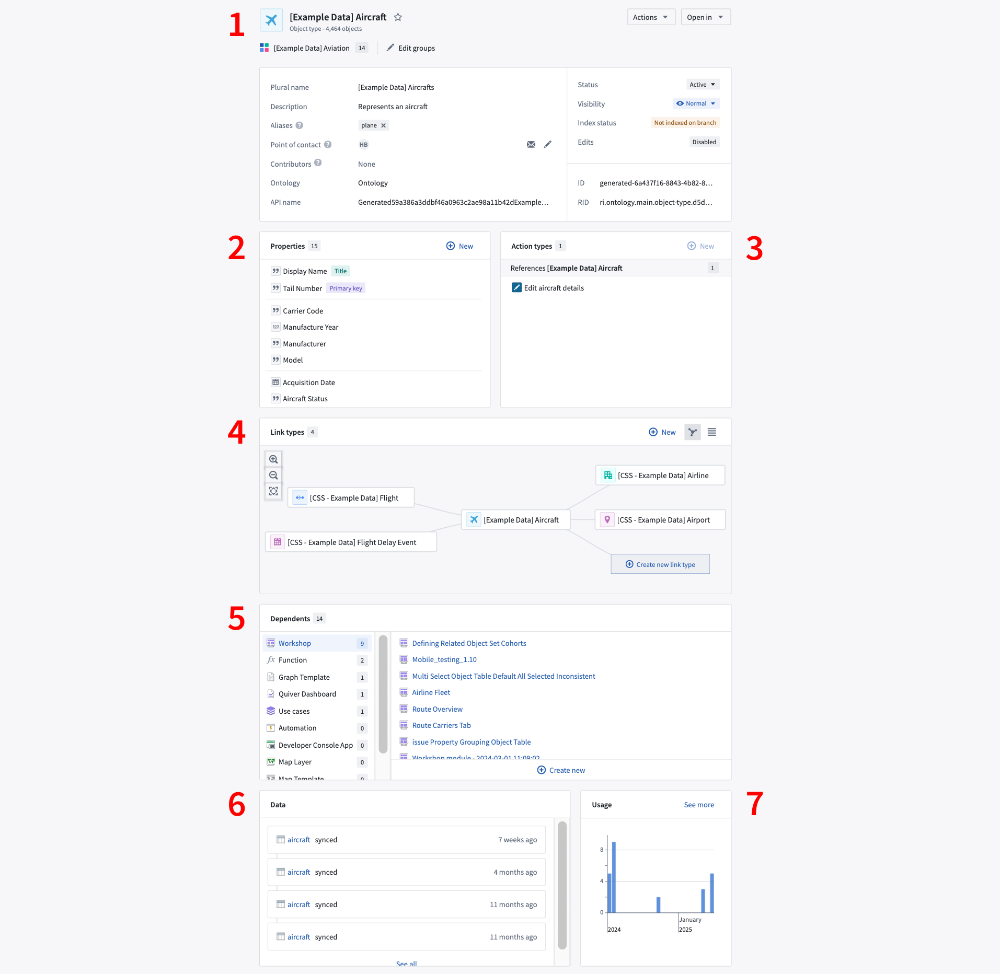

### 属性编辑器视图

从Object类型的**概述**页面的**属性**部分中选择一个属性以打开应用程序的属性编辑器视图。

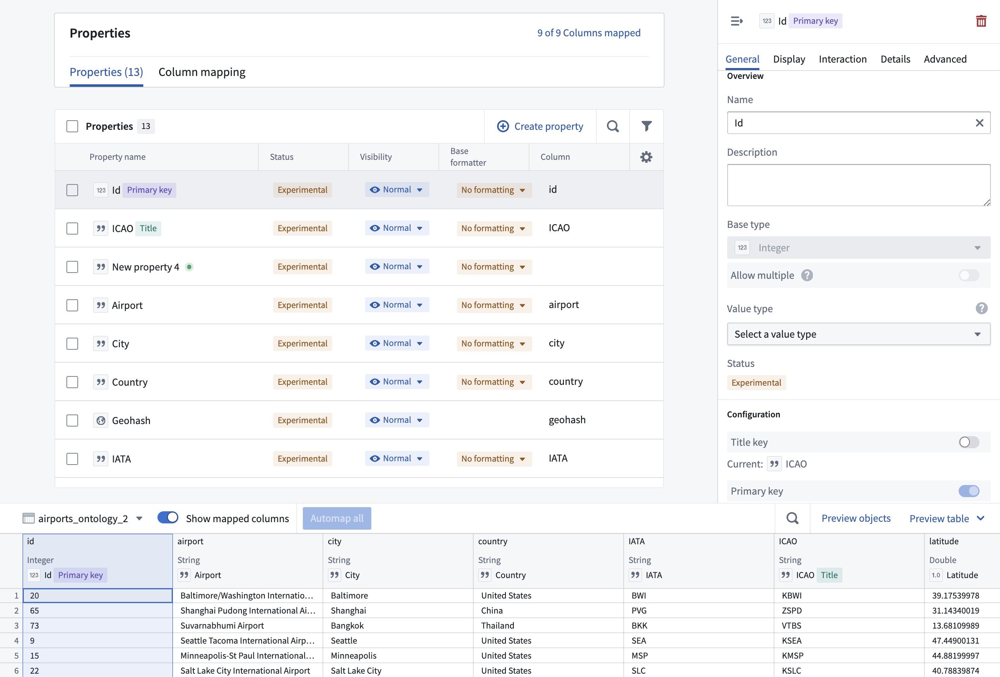

### 链接类型视图

从Object类型的**概述**选项卡的链接类型图中选择一个链接类型（见下图）会打开链接类型视图（包括**概述**和**数据源**页面）。

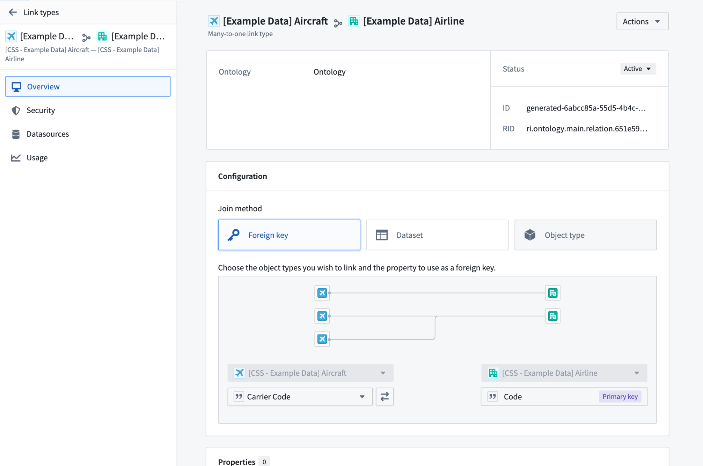

### 操作类型视图

从Object类型的**概述**选项卡的操作类型部分中选择一个操作类型会打开操作类型视图（包括**概述**和**逻辑**页面）。

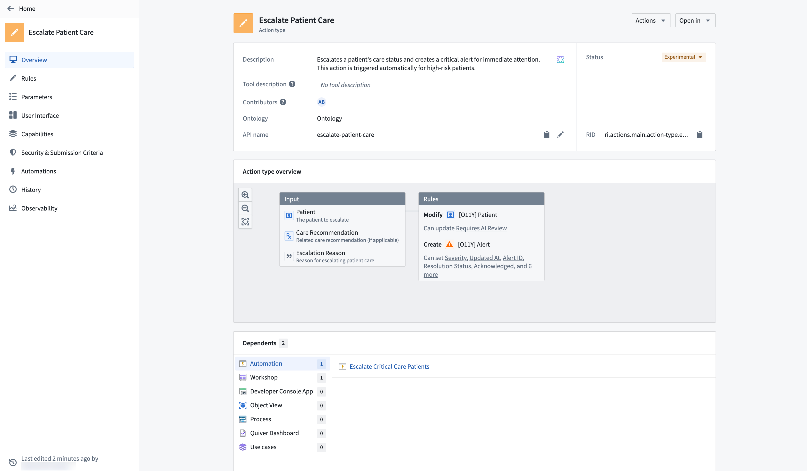

### 函数类型视图

从Object类型的**概述**选项卡的函数类型部分中选择一个函数类型会打开函数类型视图（包括**概述**页面）。

#### 函数的使用历史

使用历史面板记录使用过任何版本函数的应用程序，以及相应的版本信息。您可以从该面板导航到这些应用程序，以升级函数的版本。

#### 查看函数的以前版本

默认情况下，显示函数的最新版本。要查看其他版本，请使用位于左侧面板的版本下拉选择器。

#### 导航到函数代码库

只能在函数代码库中进行函数的修改。要导航到代码库，请使用实体视图右上角的**在代码库中打开**按钮。

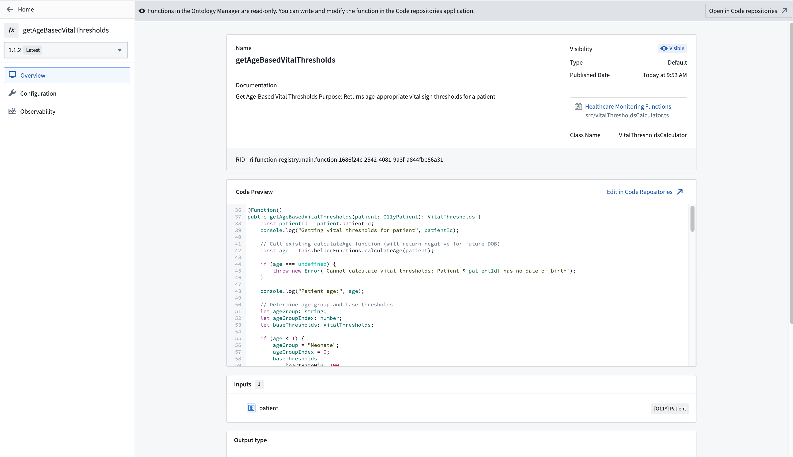
