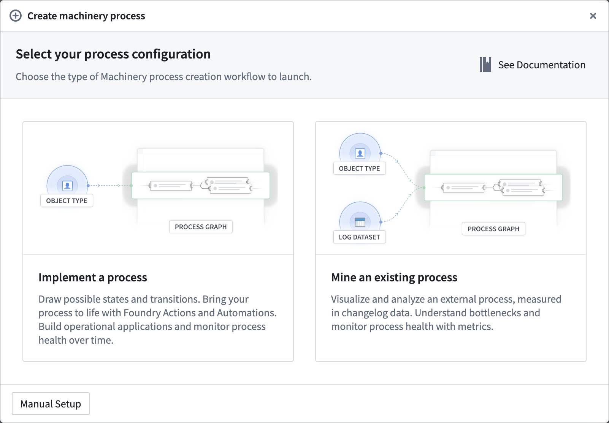

:::callout{theme="warning"}
注意：以下翻译的准确性尚未经过验证。这是使用 [AIP ↗](https://www.palantir.com/platforms/aip/) 从原始英文文本进行的机器翻译。
:::

# 创建机械流程

您可以通过在机械中选择**新流程**或从[Ontology Manager](../%E6%9C%AC%E4%BD%93%E7%AE%A1%E7%90%86%E5%99%A8/%E6%A6%82%E8%BF%B0.md)中对象类型的**依赖项**部分创建新流程。系统将提示您选择以下设置选项之一：

* **实施流程**：如果流程的所有组件都在Foundry中，即没有外部变更日志，请选择此选项。流程的组件包括`Process`对象类型、操作和自动化。您可能已经拥有其中一些组件，否则可以在设置工作流中生成它们。

* **挖掘现有流程**：如果您希望了解并监控外部流程，请选择此选项。主要的必需输入是一个变更日志数据集，用于跟踪流程对象随时间的变化。由于机械对Ontology是敏感的，您可以提供流程和流程日志对象类型，或者允许机械为您生成它们。

* **手动设置**：如果您已经维护一个符合机械规范的对象类型来跟踪随时间变化的情况，您可以选择手动设置。选择此选项可跳过配置对话框，因此您可以直接开始绘制并随时配置您的Ontology。

:::callout{theme="warning"}
机械目前支持对外部流程的只读视图。如果您还希望在Foundry中定义流程上的操作，则需要对外部和内部更改进行协调，机械将很快支持此功能。如果您的应用案例今天需要此功能，请选择手动设置或联系Palantir客服支持。
:::

## 要求

当您在机械中配置对象类型时，可以将您的属性（及其名称）映射到必需字段。

### 流程对象类型

表示通过流程的实体的对象类型。

* **流程ID**（字符串）\[必填]：流程实体的主键
* **状态**（字符串）\[必填]：流程实体的当前状态

### 变更日志数据集

此配置仅适用于**挖掘现有流程**设置选项。它代表您对外部流程的测量。数据集中的每一行表示在给定时间对流程对象的更改。

* **processId**（字符串）\[必填]：流程实体的唯一标识符。
* **state**（字符串）\[必填]：流程进入的新状态。
* **timestamp**（时间戳）\[必填]：发生转换的时间戳。
* **isDeleted**（布尔值）\[非必填]：标记实体为已删除的属性。如果最新日志的*isDeleted*为`true`，则该对象将不会出现在Ontology中。

### 流程日志对象类型

日志表示在时间戳T从旧状态到新状态的转换。流程日志对象类型通常由机械创建和维护。如果您选择手动设置选项，则必须提供以下属性。如果缺少非必填属性，机械的某些功能将不可用。

* **日志ID**（字符串）\[必填]：日志对象的主键。
* **流程ID**（字符串）\[必填]：正在跟踪的流程对象的主键。在[设置Ontology链接](#set-up-ontology-link)时使用流程对象和日志对象之间的链接。
* **旧状态**（字符串）\[必填]：转换的起始状态。
* **新状态**（字符串）\[必填]：转换的结束状态。
* **时间戳**（时间戳）\[必填]：进入结束状态的时间戳。
* **isLatest**（布尔值）\[非必填]：如果此日志是流程对象的最新日志，则为`true`，否则为`false`。
* **持续时间**（长整型）\[非必填]：从进入旧状态以来的持续时间，以毫秒为单位。
* **路径**（字符串）\[非必填]：到目前为止遇到的所有状态的列表，包括当前状态。必须是一个序列化的JSON字符串。

## 生成流程图

机械是您勾勒流程的地方——详细说明*可以*或*应该*发生的事情。您应定义流程的以下组件，这些组件在机械图上表示为节点和边：

* 允许的状态
* 可能的状态转换
* 负责状态转换的操作
* 可以基于达到声明的输入状态自动发生的操作

### 绘制

您可以使用点击和绘制交互来创建新的状态和操作。通过连接线链接状态和操作节点决定可能的状态转换。通过在图上拖动节点，可以设置它们的位置，或从控制栏选择自动设计功能。

[官方图片已失效：绘制交互](https://www.palantir.com/docs/resources/foundry/process-mining/drawing-ux.gif)

### 挖掘

或者，一旦日志对象类型成功索引并拥有数据，您可以通过*挖掘*历史数据来获得状态和转换集。这是基于变更日志数据集的流程最常见的工作流。从**操作**菜单中选择**挖掘**。

### 值类型

机械中的状态ID等于数据中的状态值。为了避免输入错误或其他偏差，您可以通过枚举[值类型](../../%E5%AE%9A%E4%B9%89%E6%9C%AC%E4%BD%93/%E5%AF%B9%E8%B1%A1%E9%93%BE%E6%8E%A5%E7%B1%BB%E5%9E%8B/Value%20types/%E6%A6%82%E8%BF%B0.md)支持您的状态属性。这将确保Ontology中的数据只能承担预定义的一组值。机械将发现该设置并保持流程状态同步。

### 预期转换

从历史日志中挖掘状态和转换时，数据健康问题通常会导致意外的转换。例如，您可能会注意到一个**病人**从*治疗中*进入*已入院*状态，这不是一个合理的转换。通过切换到**预期转换**模式，您可以定义期望的边。此筛选器用于机械微件中，仅显示图的相关部分。

> 配图缺失说明：本页有 1 个官方图片地址在抓取及重试时失效（返回 HTML 错误页）。下列地址保留用于溯源，未替换成其他版本的图片。

- 官方图片已失效：<https://www.palantir.com/docs/resources/foundry/process-mining/drawing-ux.gif>
