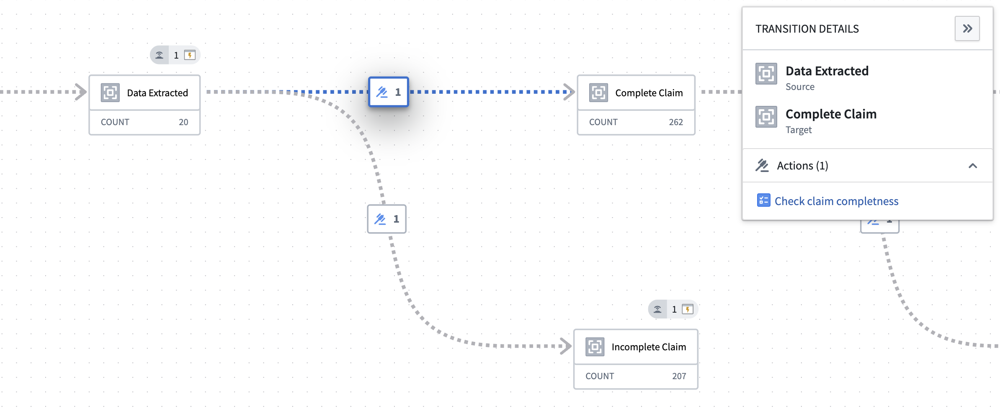
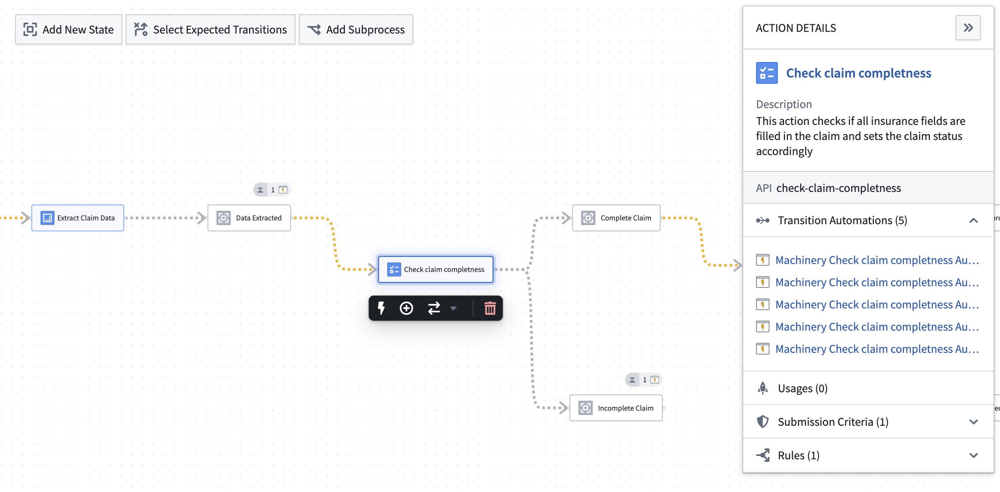

:::callout{theme="warning"}
注意：以下翻译的准确性尚未经过验证。这是使用 [AIP ↗](https://www.palantir.com/platforms/aip/) 从原始英文文本进行的机器翻译。
:::

# 核心概念

我们建议在通过Machinery应用程序使用Foundry的过程挖掘功能之前，先回顾以下概念。

## 过程

在现实世界的过程中，文档、设备或个人等实体会随着时间的推移在不同状态之间转换。每个Machinery资源描绘了这样的过程。这些实体，也称为“过程对象”，必须通过Ontology中的对象类型来表示，例如*Claim*、*Flight*或*Employee*。该对象类型必须具有一个表示对象状态的字符串类型属性。通常，它还会有其他属性和与相关对象类型的链接。

## 状态

状态描述了对象的当前状况，例如包裹的*进行中*或*已交付*。可能的状态必须是可枚举的，例如，`Name`属性不适合，因为可能的名称是无限多的。

每个对象在任何时候必须处于**一个**可能的状态。如果不是这种情况，应将其建模为过程层次结构。例如，员工可以同时处于*新员工*或*入职*状态以及*已支付*或*等待支付*状态。这些应该是独立的过程，父过程跟踪员工是否*可支付*。

在Ontology中，状态被编码为`State`属性的字符串值。此值等同于Machinery中的状态ID。要更改图中显示的状态标签，您可以覆盖显示名称。

## 转换

过程对象从一个状态转换到另一个状态。在Machinery中，您可以定义哪些转换是预期的。这允许您筛选数据中的噪声，或专注于最常见的路径。

## 操作

操作是转换的原因。在Foundry中发生的状态更改由[操作](../../%E5%AE%9A%E4%B9%89%E6%9C%AC%E4%BD%93/%E5%8A%A8%E4%BD%9C%E7%B1%BB%E5%9E%8B/%E6%A6%82%E8%BF%B0.md)定义。您可以将它们导入到Machinery图中，并确定它们在过程中的角色。对于外部发生的更改，此信息通常不可用，但您可以使用名称和描述注释操作节点以提供上下文。Machinery利用以下关于操作的信息：

* **输入状态**：操作前对象的允许状态。对于Foundry操作，这可以通过[提交标准](../../%E5%AE%9A%E4%B9%89%E6%9C%AC%E4%BD%93/%E5%8A%A8%E4%BD%9C%E7%B1%BB%E5%9E%8B/%E6%8F%90%E4%BA%A4%E6%A0%87%E5%87%86.md)来强制执行。您可以在操作节点的**详细信息**面板中检查现有的提交标准。
* **输出状态**：操作后的可能结果状态。例如，*提取实体*操作可以导致*提取成功*或*提取失败*。输出状态无法强制执行，但可以通过审核Machinery中的操作逻辑手动验证。
* **自动化**（Foundry操作）：当某些条件满足时，操作可以自动执行，例如当过程对象进入某个状态时。Machinery允许您轻松查看和创建相关[自动化](https://www.palantir.com/docs/foundry/automate/overview/)。

## 过程日志

过程的本质是实体随着时间的推移发生更改。为了识别对象所经历路径中的模式或诸如在某状态下平均时间等指标，捕捉更改的时间维度是至关重要的。Machinery通过维护一个`过程日志`对象类型来记录对对象所做的每次更改，无论是来自外部数据源还是Foundry操作。您可以像查看其他对象类型一样查看此对象类型，但不应自行定义操作。

对于在Foundry之外发生的过程，您需要提供一个变更日志格式的数据集，记录哪个对象在何时进入了哪个状态。Machinery计算分析和监控所需的推导，例如之前的状态、两者之间的持续时间以及对象到目前为止的路径。

## 交互模式

Machinery应用程序有两种交互模式。**查看**模式让您可以检查过程定义的所有组件，即状态、转换、操作和自动化。您可以在图上移动节点，但这些位置不会被保留。此模式还显示所有过程对象的当前状态。

从应用程序头部，您可以进入**编辑**模式，您可以更改和保存过程定义。默认情况下，Machinery资源在**查看**模式下打开。

Machinery提供了两种不同的视角来查看操作与过程的关系。

* **状态中心视角**：图表专注于对象可以采取的路径。节点表示状态，连接线描述状态之间可能的转换。您可以通过选择特定的边来检查负责这些转换的操作。这是应用程序**查看**模式下的默认视角。

    

* **操作中心视角**：图表解释了操作如何影响过程。状态和操作都被表示为节点，具有不同的样式。连接线描述了操作的预期输入和输出状态。如果两个状态之间没有配置操作，连接线仅表示可能的状态转换。这是Machinery应用程序**编辑**模式下唯一支持的视角。在**查看**模式中可以选择此视角。

    
