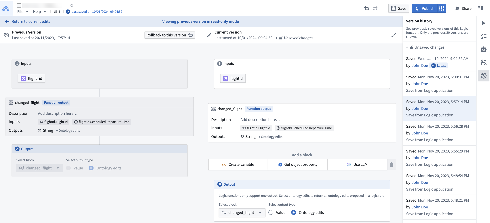
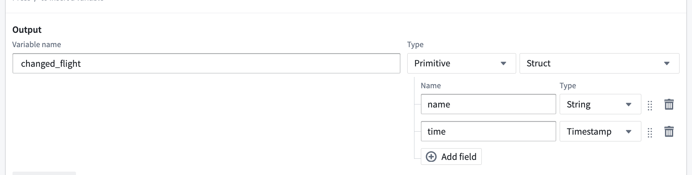
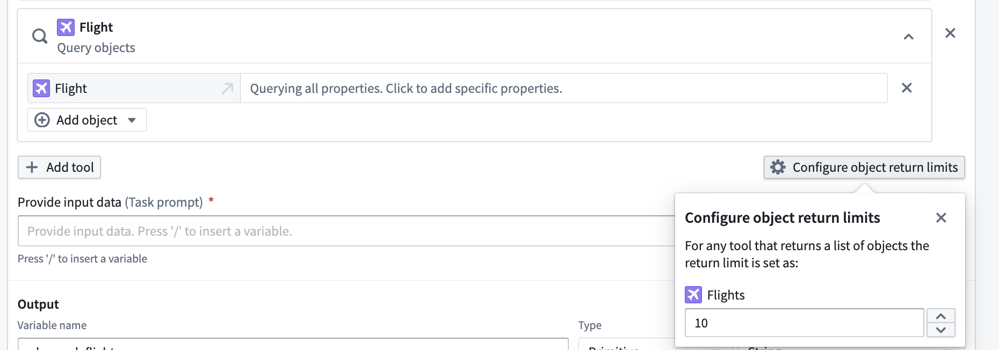

:::callout{theme="warning"}
注意：以下翻译的准确性尚未经过验证。这是使用 [AIP ↗](https://www.palantir.com/platforms/aip/) 从原始英文文本进行的机器翻译。
:::

# AIP Logic 常见问题解答

本页面详细介绍了一些关于 AIP Logic 应用程序的常见问题。

* [我如何将 AIP Logic 与平台的其他部分一起使用？](#how-can-i-use-aip-logic-with-the-rest-of-the-platform)
* [我如何减少我的词元计数？](#how-do-i-reduce-my-token-count)
* [什么时候我应该将我的 Logic 函数保留在一个块中，而不是拆分成多个块？](#when-should-i-keep-my-logic-function-in-one-block-versus-splitting-into-multiple-blocks)
* [我如何提高 AIP Logic 块的性能？](#how-do-i-improve-the-performance-of-an-aip-logic-block)
* [有没有办法修改 LLM 或其他模型参数的温度？](#is-there-a-way-to-modify-the-temperature-of-the-llm-or-other-model-parameters)
* [是否可以使用 Logic 支持语义搜索工作流？](#is-it-possible-to-support-semantic-search-workflows-using-logic)
* [LLM 如何从反馈中“学习”？](#how-can-an-llm-learn-from-feedback)
* [我如何确保我的 Logic 输出是正确的？](#how-can-i-ensure-the-output-of-my-logic-is-correct)

## 我如何将 AIP Logic 与平台的其他部分一起使用？

查看关于[使用 Logic 函数](%E5%85%A5%E9%97%A8%E6%8C%87%E5%8D%97.md#use-a-logic-function)的文档。

## 我如何减少我的词元计数？

AIP Logic 中的所有活动均计入词元限制，包括工具响应。词元限制在每个块的基础上重置。您可以在调试器中每条消息的末尾查看使用的词元数量。如果条是红色的，请考虑减少词元计数以促进可靠性能。

我们建议采取以下步骤来减少词元计数：

* 从输入Object中选择所需的特定属性，或指定您要查询的Object属性，以减少LLM发送和接收的字符串(`OBJECT_NAME property1 property2`等)的大小；您可以通过选择 **显示原始** 在调试器中查看。
* 使用 **查询Objects** 工具时，选择要发送到LLM的属性子集。
* 考虑[将单个块拆分为多个 **使用LLM** 块](#when-should-i-keep-my-logic-function-in-one-block-versus-splitting-into-multiple-blocks)；每个块都有一个词元限制，因此您可以尝试将一个块分解为中间步骤。
* 将您的LLM模型更改为32k。
* 尽可能使用确定性块，例如[变换块](%E5%85%A5%E9%97%A8%E6%8C%87%E5%8D%97.md#transform-block)、[执行块](%E5%85%A5%E9%97%A8%E6%8C%87%E5%8D%97.md#execute-block)和[应用操作块](%E5%85%A5%E9%97%A8%E6%8C%87%E5%8D%97.md#apply-action-block)。这些块有助于产生更可预测的结果，并且不使用任何词元，使您的逻辑更高效和可管理。

## 什么时候我应该将我的 Logic 函数保留在一个块中，而不是拆分成多个块？

一个大的单一块可以让您快速迭代，并在实验LLM的能力时轻松进行大的更改，但如果出现以下情况，您可能需要将 Logic 拆分为多个块：

* 您有多个步骤需要LLM执行，并且结果不一致。
* 块达到了其上下文限制。
* 每次运行执行时间过长。

由于每个块都有自己的上下文窗口，将其拆分为多个块可以具有以下优点：

* LLM 只能访问您传递的内容；单个大块中的中间结果可能无关。
* 您不太可能用完词元。
* 几个较小的任务可能比一个长任务执行得更快。

## 我如何提高 AIP Logic 块的性能？

要提高 AIP Logic 块的性能，请尝试以下建议：

* 选择5-10个输入/输出对的示例，并在每次修改提示时运行这些示例。将这些保存为 AIP Logic 中的单元测试。
* 为 LLM 提供少量示例；这可以通过使任务对模型更容易理解来显著提高 LLM 的性能。您可以为 LLM 输入系统提示以供参考。
* 如果您看到意外失败，请验证模型是否对您的数据有正确的“理解”，方法是询问LLM解释其计划和问题的理解 - 这可以提供有关缺失上下文的洞察。
* 考虑使用动态少量示例构建反馈循环。
* 使用确定性变换面板，例如[变换块](%E5%85%A5%E9%97%A8%E6%8C%87%E5%8D%97.md#transform-block)、[执行块](%E5%85%A5%E9%97%A8%E6%8C%87%E5%8D%97.md#execute-block)和[应用操作块](%E5%85%A5%E9%97%A8%E6%8C%87%E5%8D%97.md#apply-action-block)。

## 有没有办法修改 LLM 或其他模型参数的温度？

您可以通过在 **使用LLM** 块的 **配置** 文本字段中编辑温度来修改LLM的*温度*，这是一个表示LLM响应随机性的参数。默认温度为0。较低的温度返回更确定的输出。

示例代码：

```json
{
    "temperature": 0.9  // 在机器学习和自然语言处理领域，temperature 参数用于控制生成文本的随机性。值越高，生成的文本越随机；值越低，生成的文本越确定。
}
```

## 可以使用Logic支持语义搜索工作流吗？

可以，您目前可以添加一个工具，使Logic能够在Ontology上执行语义搜索，这可以通过一个操作或编写一个函数在Object上，然后从AIP Logic调用。查看[语义搜索工作流](../../%E5%AE%9A%E4%B9%89%E6%9C%AC%E4%BD%93/%E5%87%BD%E6%95%B0/Semantic%20search/%E4%BD%BF%E7%94%A8Palantir%E6%8F%90%E4%BE%9B%E7%9A%84%E6%A8%A1%E5%9E%8B%E5%88%9B%E5%BB%BA%E8%AF%AD%E4%B9%89%E6%90%9C%E7%B4%A2%E5%B7%A5%E4%BD%9C%E6%B5%81.md)教程以了解更多信息。

## LLM如何从反馈中“学习”？

如果适合您的工作流，您可以使用此设计模式帮助LLM从反馈中“学习”：

1. 每当LLM提出建议时，捕获(1)建议以及(2)推理。然后，在将Logic函数连接到Workshop并构建人工审核过程时，将(3)人工反馈以及(4)正确的人工验证决策写回。为了这个例子，假设我们称这个数据输出Object为“Suggestion” Object。
2. 在您的Logic函数中，启用LLM使用**Query objects**工具在“Suggestion” Object上，搜索LLM提出相同建议的其他实例。让LLM处理人工反馈，然后查询LLM是否继续执行LLM的建议。

## 如何确保我的Logic输出是正确的？

您可以为Logic添加单元测试，这将测试函数在给定输入上是否成功运行（手动）。

## 我可以查看我Logic的以前版本吗？

可以，您可以使用版本历史侧边栏查看并回滚到以前保存的版本。

从列表中选择一个先前的版本与当前状态进行比较。



## 一个LLM块可以返回多个值吗？

可以。通过使用"Struct"输出类型，您可以返回多个命名值。



## 我可以配置我的工具提供给LLM块的Object数量吗？

可以，当您在LLM块的函数工具上添加一个Object Query工具时，您可以选择**配置Object返回限制**，以选择您希望从任何工具使用中返回的Object数量。



## 为什么我的函数在AIP Logic调试器中成功执行，但在Workshop或通过API调用时失败？

在调试器中测试和开发您的AIP Logic函数时，该函数不受五分钟执行时间限制。然而，当函数从Workshop环境或通过函数执行API调用时，五分钟执行时间限制会被强制执行。
