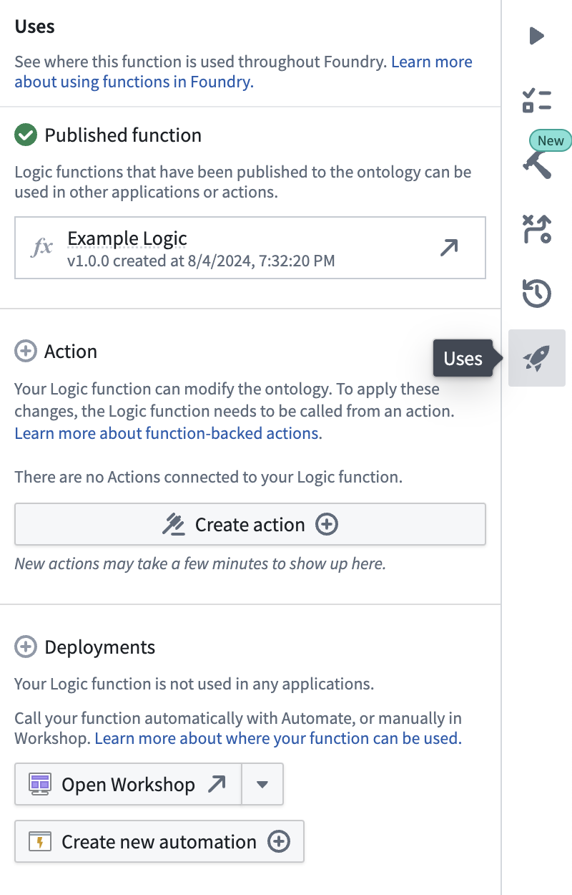
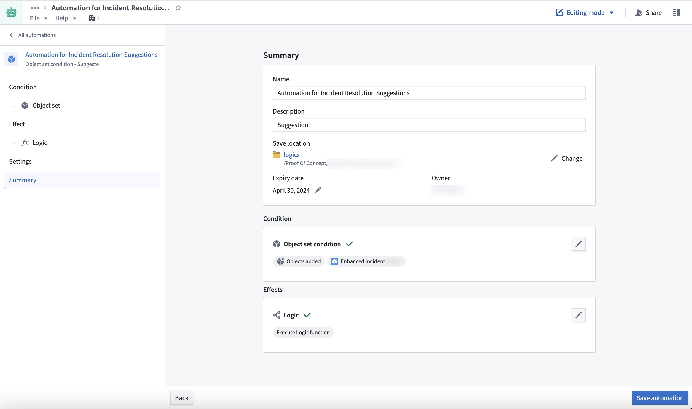
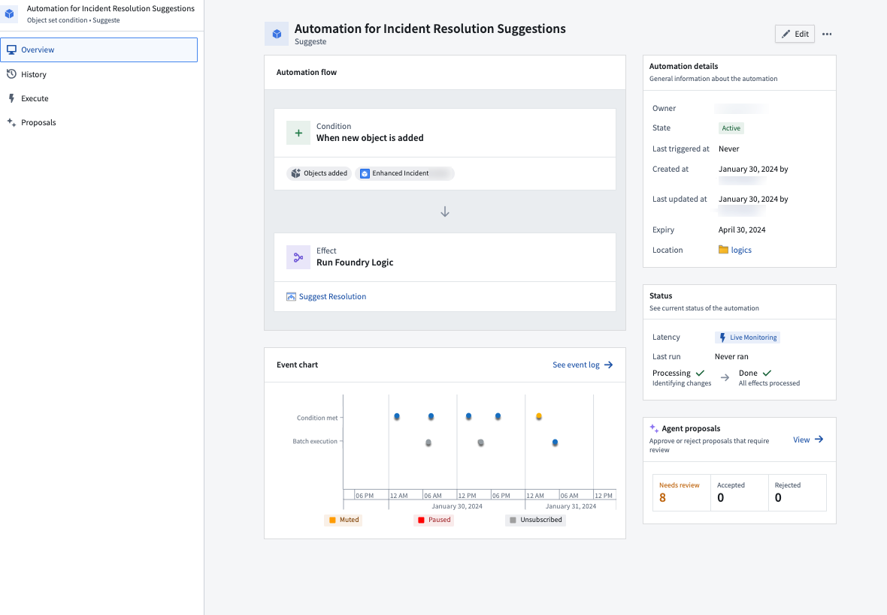
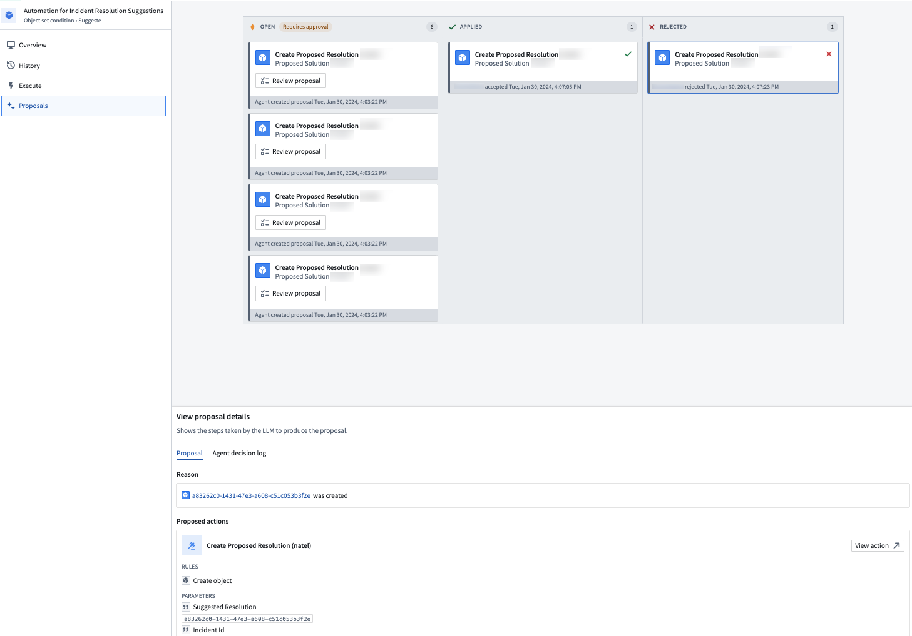

:::callout{theme="warning"}
注意：以下翻译的准确性尚未经过验证。这是使用 [AIP ↗](https://www.palantir.com/platforms/aip/) 从原始英文文本进行的机器翻译。
:::

# AIP Logic与自动化的集成

AIP Logic现在可以实现自动化，以便Ontology编辑可以自动应用或由人工审核。可以在现有对象上或在新对象创建时触发这些自动化。

## 从AIP Logic文件创建新的自动化

您可以使用右侧的**Uses**选项开始从您的AIP Logic文件创建新的自动化。

这样做将会弹出一个新窗口，窗口中根据您的Logic指令预填充了自动化流程。

您设置的条件将监控一个对象集，并在每个新对象添加时触发Logic效果或自动运行编辑。了解如何[设置自动化](https://www.palantir.com/docs/foundry/automate/getting-started/)。

确认新自动化的名称和设置后，选择**保存自动化**。

保存后，您将被重定向到**自动化概览**屏幕。

概览屏幕显示自动化流程、状态和事件图表，当自动化被触发时会自动更新。

如果您配置的自动化是将操作分阶段审批而非自动运行编辑，您可以通过左侧导航栏进入**提案**选项卡查看生成的并需要审核的代理提案概览。

要审核这些代理提案，请执行以下操作之一：

* 从导航栏访问**提案**选项卡。
* 从**代理提案**部分中，选择**查看**。

在**提案**选项卡上，选择一个特定提案以检查其创建原因。

此外，建议的操作将在屏幕底部预览。通过选择**查看提案详情**下的**代理决策日志**选项卡，您可以检查LLM生成建议操作时遵循的决策过程。

当您接受一个提案时，操作将自动执行，提案卡片将被移动到**已应用**列。

## 常见问题

以下是一些关于AIP Logic集成的常见问题。

### 为什么我看不到任何提案？

出于安全考虑，开放的提案仅对创建自动化的用户可见24小时。较早的提案将不可见。

### 为什么**创建自动化**按钮不可用？

AIP Logic输出必须返回Ontology编辑才能运行自动化。

### 为什么自动化摘要页面没有条件块？

确保AIP Logic输入是一个Object。
