:::callout{theme="warning"}
注意：以下翻译的准确性尚未经过验证。这是使用 [AIP ↗](https://www.palantir.com/platforms/aip/) 从原始英文文本进行的机器翻译。
:::

# 入门指南

本指南演示如何访问 AIP Logic，介绍 AIP Logic 界面，并描述如何通过组合 LLM 块和在调试器中检查 LLM 的 [思维链 (CoT)](%E6%A0%B8%E5%BF%83%E6%A6%82%E5%BF%B5.md#debugging) 来设置基本的 Logic 函数。

## 访问 AIP Logic

可以通过平台的工作区导航栏访问 AIP Logic，或使用快捷搜索键 `CMD + J` (macOS) 或 `CTRL + J` (Windows)。或者，您可以从您的 **文件** 中创建新的 Logic 函数，选择 **+新建**，然后选择 **AIP Logic**，如下图所示。

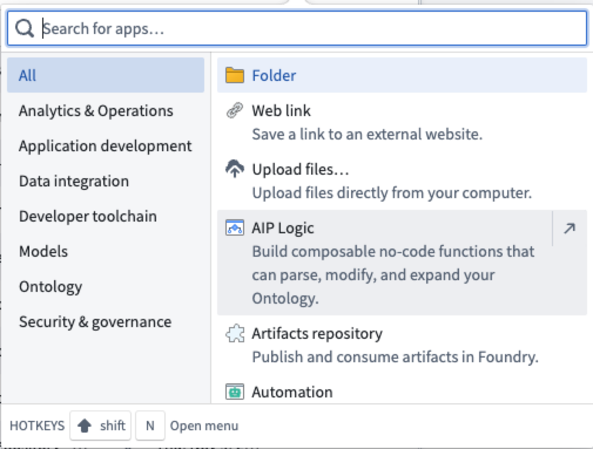

打开 AIP Logic 后，您可以创建一个新的 Logic 文件。请注意，Logic 文件必须保存在项目文件夹中，而不是您的主文件夹中。

## 应用界面

AIP Logic 的界面主要有三个组成部分，以下图中的假想截图为例，从左到右编号：

1. [输入、块和输出配置](#inputs-blocks-and-outputs-configuration)
2. [调试器](#debugger)
3. [运行面板](#run-panel)

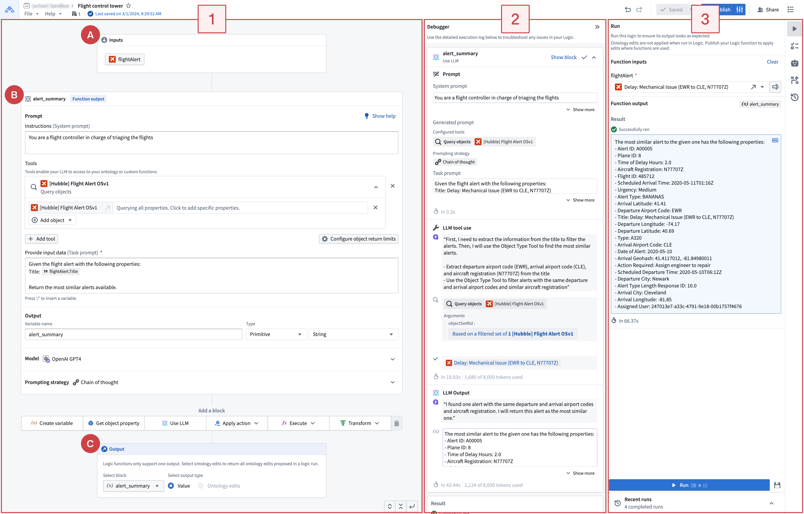

## 工作流概述

在典型的 AIP Logic 工作流中，您可能会先在左侧面板 (1) 配置 [**输入 (A)、块 (B) 和输出 (C)**](#inputs-blocks-and-outputs-configuration)，然后使用 [**运行面板**](#run-panel) (3) 生成示例输出。运行您的 Logic 后，您将能够在 [**调试器**](#debugger) (2) 中看到 LLM 的思维链（CoT）提示，以及 LLM 生成输出的步骤。您还可以在调试器中结合运行面板可视化最终输出。运行面板使您可以查看最新的 Logic 运行并创建单元测试。在右侧侧边栏中，您可以找到更多功能，例如与 [自动化](https://www.palantir.com/docs/foundry/automate/overview/) 应用的 Logic 集成。

## 输入、块和输出配置

首次使用 AIP 时，您将在右侧看到 **运行** 面板，左侧有三种类型的面板：[输入](#inputs)，用于非必填选择对象及其属性，[块](#blocks) 用于定义您的 Logic 指令，[输出](#outputs) 表示所需的 Logic 函数结果。一个块的输出可以输入到后续的块中。

下图显示了输入、块和输出的配置区域，**运行** 面板已折叠。

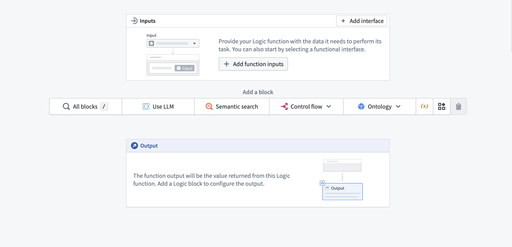

## 输入

AIP Logic 接受多种 *输入*：这些可以是 Ontology 中的基本类型或对象类型。在 **输入** 块中（在[应用界面指南](#application-interface)中标记为 "A"），您可以指定输入名称、类型（输入是基本类型还是对象），以及基本类型或对象类型。支持的基本类型包括数组、布尔值、日期、双精度、浮点、整数、长整数、短整数、字符串和时间戳。

## 块

AIP Logic 函数由块组成（在[应用界面指南](#application-interface)中标记为 "B"），代表 LLM 与您的数据交互的方式。您可以选择四种类型的 AIP Logic 块：[创建变量](#create-variable)、[获取对象属性](#get-object-property)、[使用 LLM](#use-llm) 和 [变换块](#transform-block)。一个块的输出可以在后续块中使用。以下单独部分详细介绍了这三种类型的块。

### 创建变量

**创建变量**块创建一个可以在未来块中使用的变量。变量可以是以下类型：数组、布尔值、日期、双精度、整数、长整数、字符串或时间戳。

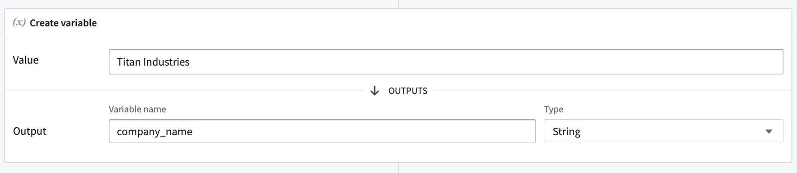

### 获取对象属性

**获取对象属性**块返回对象的属性。当选择输入对象时，您可以从对象中选择一个属性。

### 使用 LLM

**使用 LLM** 块是 AIP Logic 的核心，使您可以利用 LLM 定义 Logic 块。Logic 块由 [提示](#prompts)、[工具](#tools) 和 [输出](#output) 组成。

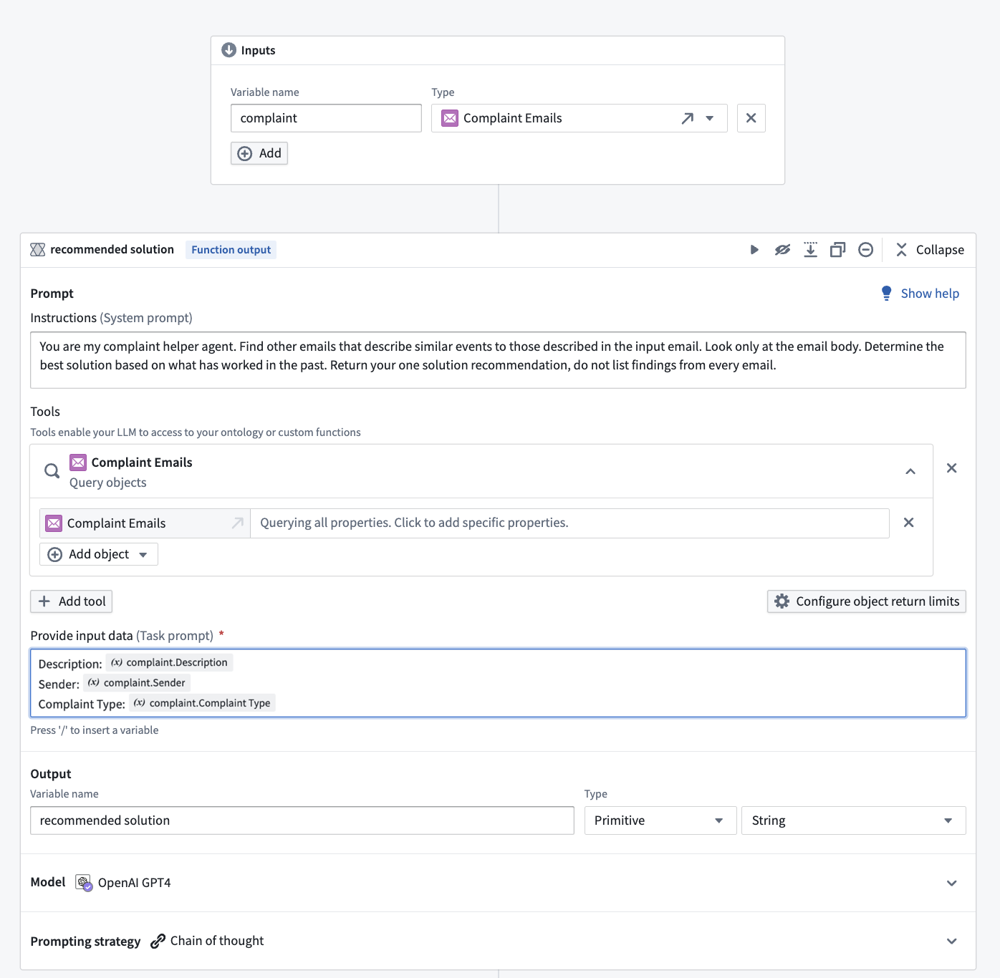

### 变换块

变换块允许您在 AIP Logic 中使用表达式。

这是在 AIP Logic 中对数据进行变换的好方法，例如将字符串转换为日期、解析 JSON、执行数学表达式等。

## 应用操作块

应用操作块允许您确定性地调用操作，而无需通过 LLM 块。此块为您提供了精确的参数填写控制，并加快执行速度。在此示例中，我们可以调用一个操作，将优先级状态归属于给定事件。

:::callout{theme="neutral"}
从操作中调用 AIP Logic 函数是将编辑写回到 Ontology 的必要条件。除非从操作中执行 Logic 函数，否则即使函数包含应用操作块，Ontology 也不会被编辑。
:::

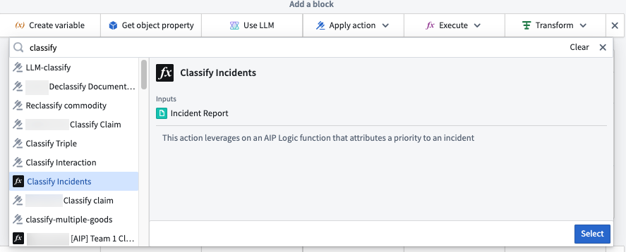

## 执行块

您可以在 AIP Logic 中确定性地使用函数。执行块对于加载特定数据以传递给 LLM 块以及在所需表达式不可用时补充变换块非常有用。在此示例中，执行块用于利用语义搜索函数的输出，以帮助返回类似事件的解决方案文本。

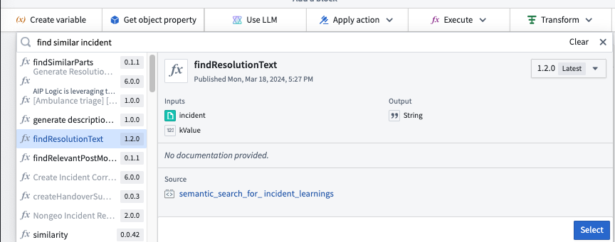
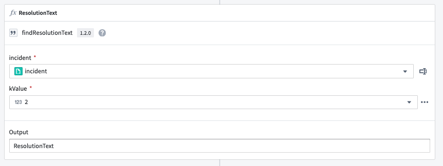

#### 提示

提示是为 LLM 编写的指令，以自然语言编写。我们建议从最重要的信息开始（例如 LLM 应完成的任务概述），然后是 LLM 需要的数据以及何时使用 [工具](#tools) 的指导。在编写提示时，请记住 LLM 只能访问您特定提供的信息。

在以下假想提示中，我们使用 LLM 从之前的电子邮件对话中搜索信息，以向寻求解决方案的客户提供响应。假想提示以任务概述开始：

> 你是我的投诉助手代理。寻找描述与输入电子邮件中描述的事件类似的其他电子邮件。仅查看电子邮件正文。根据过去有效的解决方案确定最佳解决方案。返回一个解决方案建议，不要列出每封电子邮件的发现。

然后，提示指定要查询的数据（在本例中为投诉电子邮件，表示为 `complaint` 对象）。输入提示后，您可以通过输入“/”并选择分析中可用的一个或多个变量来向 LLM 提供对输入的访问权限；在下图中，我们选择了电子邮件对象的属性。

#### 工具

工具是 AIP Logic 使 LLM 能够读取或写入 Ontology 并驱动现实世界操作的机制。AIP Logic 利用三类基于 Ontology 的工具——数据、逻辑和操作——有效地查询数据、执行逻辑操作并安全地采取行动。

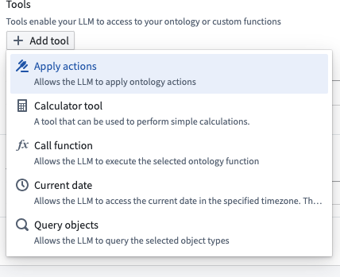

可用的工具包括：

* [应用操作](#apply-actions)
* [调用函数](#call-function)
* [查询对象](#query-objects)
* [计算器工具](#calculator-tool)

##### 应用操作

**应用操作**工具使 LLM 能够使用 [操作](../../%E5%AE%9A%E4%B9%89%E6%9C%AC%E4%BD%93/%E5%8A%A8%E4%BD%9C%E7%B1%BB%E5%9E%8B/%E6%A6%82%E8%BF%B0.md) 来编辑 Ontology。您可以描述 LLM 应何时使用提供的操作。有关如何将更改应用于 Ontology 的详细信息，请查看下面的 [使用 Logic 函数进行 Ontology 编辑](#make-ontology-edits-using-logic-functions)。

![在 "\[Titan\] Delivery" 上应用 "Adjust delivery completion date" 操作。](../../../assets/foundry/logic/apply-actions-example.png)

##### 调用函数

**调用函数**工具允许您选择 LLM 可以调用的函数。函数可以在存储库中以代码定义，也可以是现有的 Logic 函数。

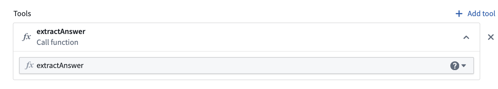

##### 查询对象

**查询对象**工具指定 LLM 可以访问的对象类型。您可以根据需要添加任意多的对象类型，并指定 LLM 可以访问哪些属性，以使查询更具词元效率。

![查询对象工具，添加了三个对象 "\[Titan\] customer order"、"\[Titan\] Distribution center" 和 "\[Titan\] Finished good"。](../../../assets/foundry/logic/query-objects-example.png)

##### 计算器工具

**计算器工具**使您能够使用 LLM 执行准确的数学计算。

## 输出

您可以为每个 Logic 块定义一个中间输出。Logic 路径中的最后一个块是 Logic 函数的输出，在[应用界面指南](#application-interface)中标记为 "C"。

* **块输出：** 在块之间传递的中间输出。块的输出可以是用于后续块的基本类型或对象。

* **Logic 函数输出：** 您想要返回的 Logic 函数的输出。可以是 **值**（基本类型或对象）或您函数所做的所有 **Ontology 编辑**。

## 调试器

一旦您编写了 Logic 函数，可以通过在视图右侧选择 **运行** 来测试 Logic 函数。当 Logic 运行时，调试器将打开以显示 LLM 的 [思维链 (CoT)](%E6%A0%B8%E5%BF%83%E6%A6%82%E5%BF%B5.md)。

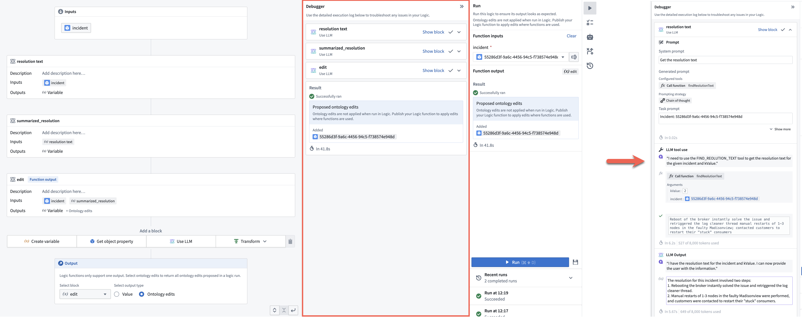

调试器允许您展开和折叠块卡，清除工具调用，并轻松查看生成的提示，使解释思维链更容易。

## 运行面板

从 **运行** 面板，您可以运行和评估您的 Logic，以及查看最近的运行。右侧侧边栏可让您设置单元测试、运行 [自动化](https://www.palantir.com/docs/foundry/automate/overview/) 和查看运行历史。

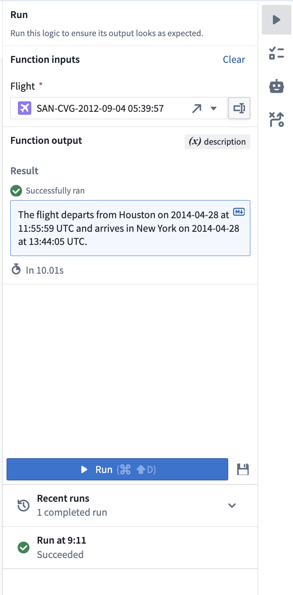

在 **运行** 面板底部，您还可以选择任何最近的运行以查看其输出和调试日志。

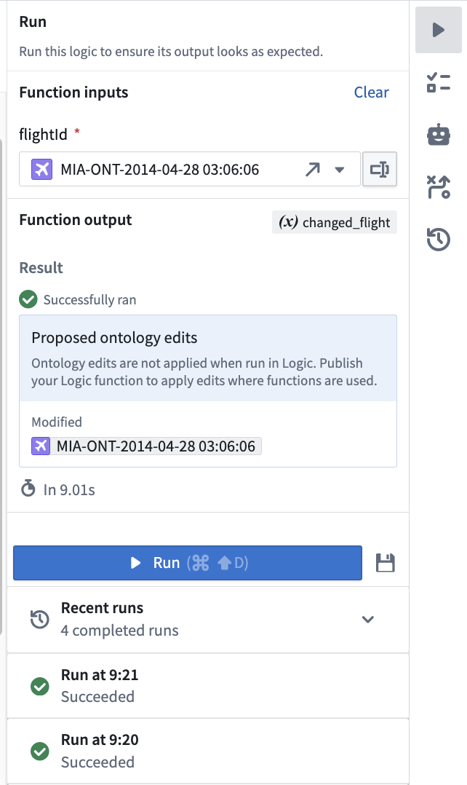

选择单元测试图标 () 保存用于性能评估目的的输入版本。

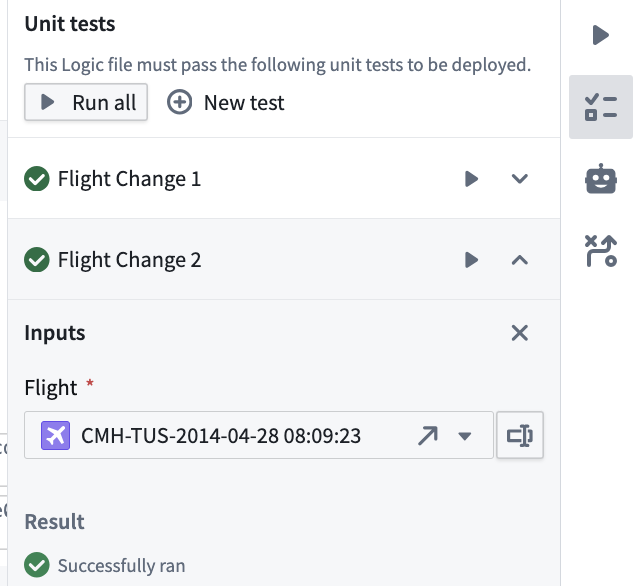

## 使用 Logic 函数

Logic 函数可以像平台中的常规 [对象上的函数 (FoO)](../../%E5%AE%9A%E4%B9%89%E6%9C%AC%E4%BD%93/%E5%87%BD%E6%95%B0/Functions%20on%20objects/%E6%A6%82%E8%BF%B0.md) 一样使用。

* 您可以用 Logic 函数支持一个操作，然后从 Workshop 调用该操作。

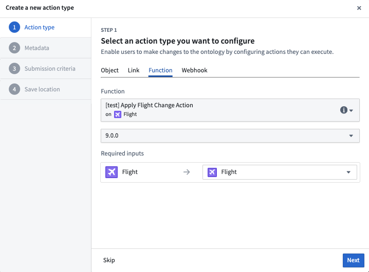

* 您还可以调用 Logic 函数以支持 Workshop 中的 Markdown 微件；在这种情况下，Logic 函数的输出类型必须是字符串。

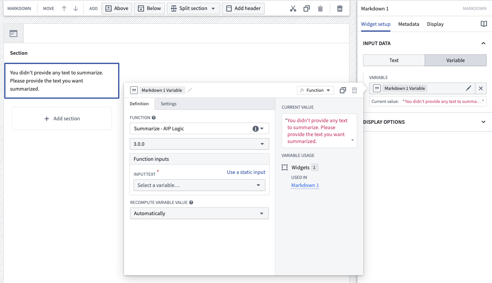

* 您可以在其他 Logic 函数中调用 Logic 函数，以及在对象上的函数中，通过 AIP Logic 中的 **Ontology 函数** 工具。

## 使用 Logic 函数进行 Ontology 编辑

在 Logic 中运行函数时，您将在调试器中看到场景中的所有提议的 Ontology 编辑。这些编辑实际上不会被执行。如果您希望将编辑应用于 Ontology，请执行以下操作：

* 从操作中调用您的 Logic 函数；或者，
* 从自动化中调用您的 Logic 函数。您可以使用位于右侧的 **自动化**  选项从 Logic 仪表盘开始创建新的自动化。

要使 Logic 函数能够编辑 Ontology，您必须：

1. 在可以被 Logic 函数调用的 **使用 LLM** 块中设置 **应用操作工具**。这样可以让 LLM 编辑 Ontology。

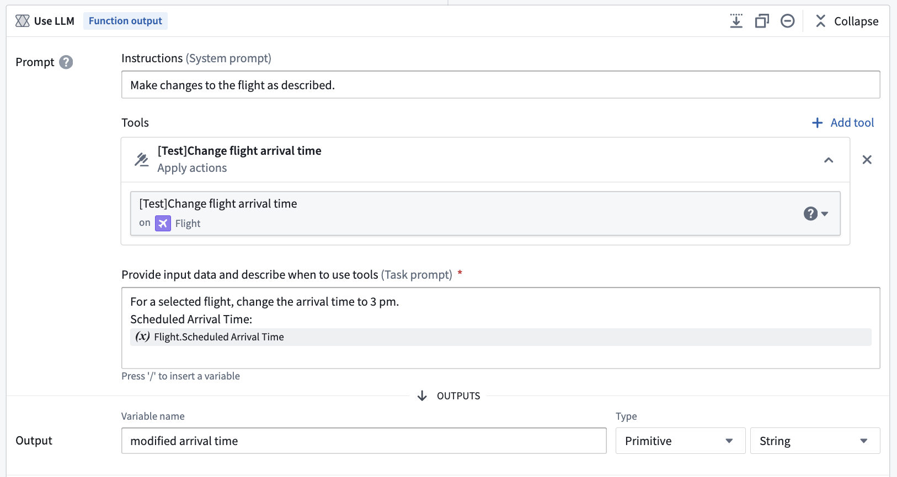

2. 完成 Logic 函数的迭代后，找到并选择位于保存旁边的 **发布** 选项以发布 Logic 函数。

3. 接下来，创建一个新的操作，由您刚刚发布的 **Logic 函数** 提供支持。

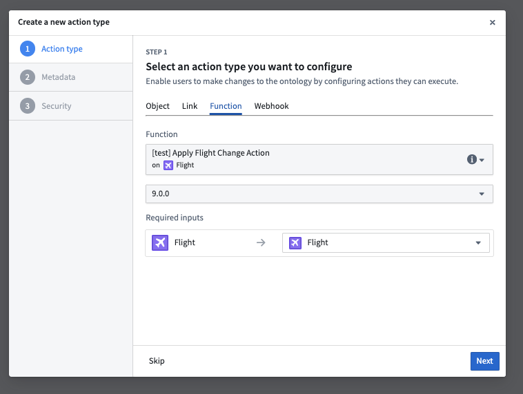

4. 您现在可以在 Workshop 模块中使用此新操作来支持操作工作流。
     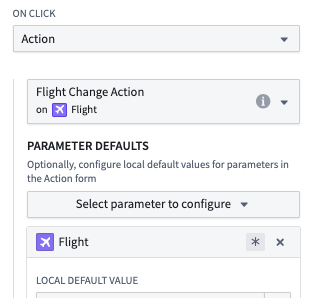

## 下一步

如果您可以访问 AIP Logic，我们建议您开始实验 LLM 块以与您的 Ontology 交互并构建您自己的应用案例。您可能会发现查看平台上 [函数](../../%E5%AE%9A%E4%B9%89%E6%9C%AC%E4%BD%93/%E5%87%BD%E6%95%B0/%E6%A6%82%E8%BF%B0.md) 的文档很有帮助。
