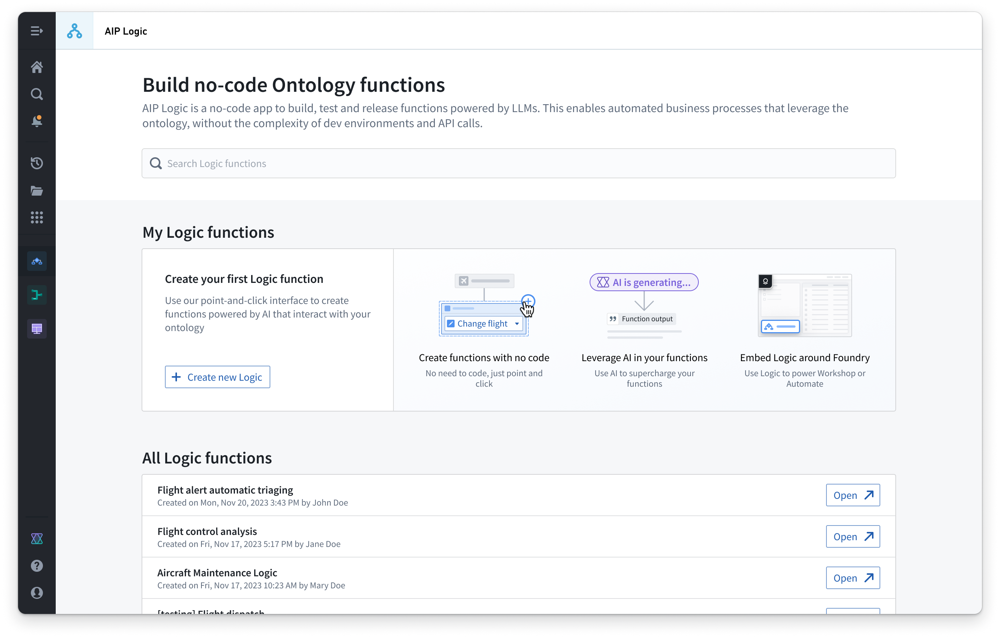

:::callout{theme="warning"}
注意：以下翻译的准确性尚未经过验证。这是使用 [AIP ↗](https://www.palantir.com/platforms/aip/) 从原始英文文本进行的机器翻译。
:::

# 概述

AIP Logic 是一个无代码开发环境，用于搭建、测试和发布由 LLMs 提供支持的函数。AIP Logic 使您能够搭建丰富功能的 AI 驱动函数，这些函数利用 Ontology，而无需开发环境和 API 调用通常带来的复杂性。通过 Logic 的直观界面，应用程序构建者可以设计提示、测试、评估和监控、设置自动化等。

您可以使用 AIP Logic 来自动化并支持您的关键任务，无论是将非结构化输入中的关键信息连接到您的 Ontology，解决日程冲突，通过找到最佳分配来优化资产性能，应对供应链中的中断，等等。

Logic 函数还可以[自动化](https://www.palantir.com/docs/foundry/automate/overview/)，以便[Ontology 编辑可以自动应用或安排人工审查](AIP%20Logic%E4%B8%8E%E8%87%AA%E5%8A%A8%E5%8C%96%E7%9A%84%E9%9B%86%E6%88%90.md)。

AIP Logic 提供一个直观的界面，通过一个 Logic 函数利用 Ontology 和 LLMs，该函数接受输入（如 Ontology 对象或文本字符串），并可以返回输出（对象和/或字符串）或对 Ontology 进行编辑。例如，下面的 LLM 支持的函数从一个 Ontology 对象中获取输入数据，并将这些数据与客户电子邮件进行交叉引用，以根据先前的解决方案推荐给定问题的解决方案。

![一个 AIP Logic "使用 LLM" 块，其中给出了一个提示 "你是我的供应链助手代理。寻找其他描述与输入电子邮件中描述的事件类似的电子邮件（在任何位置）。只查看电子邮件正文。根据过去有效的解决方案确定最佳解决方案。返回您一个解决方案推荐，不要列出每封电子邮件的发现。" 该块设置了 "\[Titan\] 配送中心电子邮件" 对象的查询对象工具，并提供了访问电子邮件内容属性的权限。输出设置为类型为 "primitive, string" 的变量名 "recommended solution"。](../../../assets/foundry/logic/block-use-llm-prompt.png)

AIP Logic 建立在与 Palantir 平台其他部分相同的严格[安全](https://www.palantir.com/docs/foundry/security/overview/)模型之上，包括用户和[函数权限](../../%E5%AE%9A%E4%B9%89%E6%9C%AC%E4%BD%93/%E5%87%BD%E6%95%B0/%E6%9D%83%E9%99%90.md)。这些平台安全控制仅授予 LLM 完成任务所需的访问权限。

了解有关 AIP Logic 的[核心概念](%E6%A0%B8%E5%BF%83%E6%A6%82%E5%BF%B5.md)的更多信息或[开始](%E5%85%A5%E9%97%A8%E6%8C%87%E5%8D%97.md)搭建 Logic 函数。
