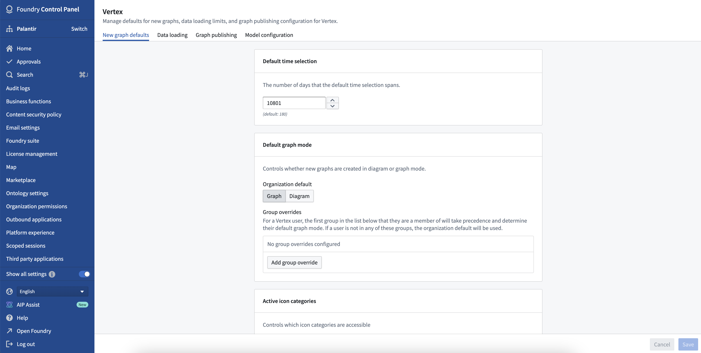

:::callout{theme="warning"}
注意：以下翻译的准确性尚未经过验证。这是使用 [AIP ↗](https://www.palantir.com/platforms/aip/) 从原始英文文本进行的机器翻译。
:::

# 在控制面板中配置Vertex设置

可以使用[控制面板](https://www.palantir.com/docs/foundry/administration/control-panel/)配置各种组织范围内的Vertex设置。要修改Vertex设置，您需要`Vertex Admin`角色。

## 图形默认设置

* **默认时间选择：** 默认时间选择范围的天数。
* **默认图形模式：** 控制新图形是在图示模式（测试版）还是图形模式中创建。
* **活动图标类别：** 控制通过图示模式（测试版）可访问的图标类别。

:::callout{theme="neutral" title="图示模式测试版"}
图示模式处于[测试版](https://www.palantir.com/docs/foundry/platform-overview/development-life-cycle/)。要了解更多关于图示模式的功能，请联系您的Palantir代表。
:::

## 数据加载

* **时间序列轮询间隔：** 在实时模式下，Vertex检查更新的时间序列值的频率（以秒为单位）。
* **时间序列缺失数据警告：** 当时间序列没有最近观测值时，Vertex会显示警告。此设置控制警告出现前允许的最大时间段（以小时为单位），即选定时间与最近的时间序列值之间的间隔。
* **Object搜索限制：** 控制用户可以从搜索对话框添加到图形中的最大Object数量。
* **搜索周边限制：** 控制通过搜索周边将Object添加到图形的行为。
  * **最大Object数量：** 单次搜索周边中Vertex将加载的最大Object数量。
  * **最大未分组Object数量：** 搜索周边结果中Vertex会作为单个节点而非群组添加到图形中的最大Object数量。如果添加到图形中的Object超出此限制，则这些Object将自动分组。
  * **模板搜索周边最大深度：** 创建模板时允许的嵌套搜索周边的最大数量。

## 模型配置

* **遗留模型配置：** 通过建模目标应用程序提供了更新的模型配置体验。虽然支持直接通过Vertex配置的模型仍将保留，但现在不鼓励在Vertex配置面板中配置新模型。
* **模型配置映射：** 选择哪些类型的数据映射可供模型配置者使用。
