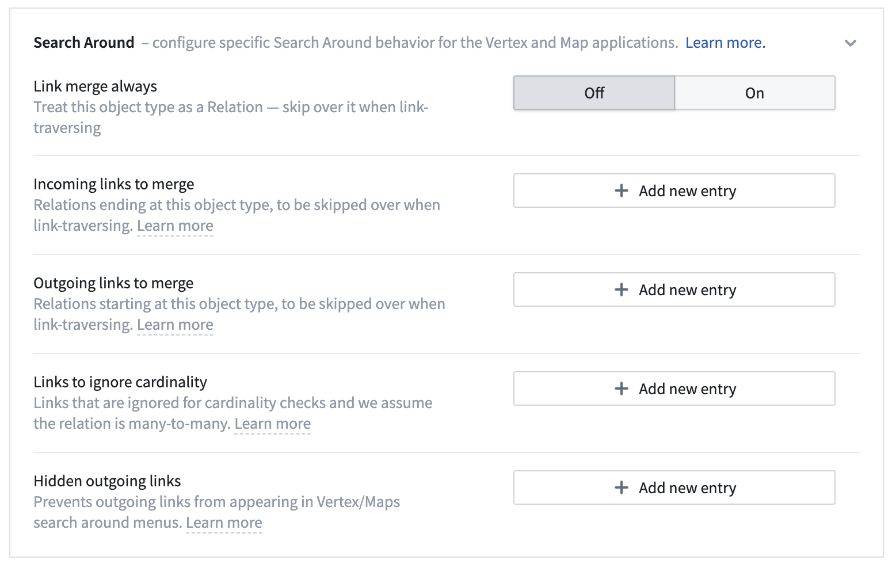
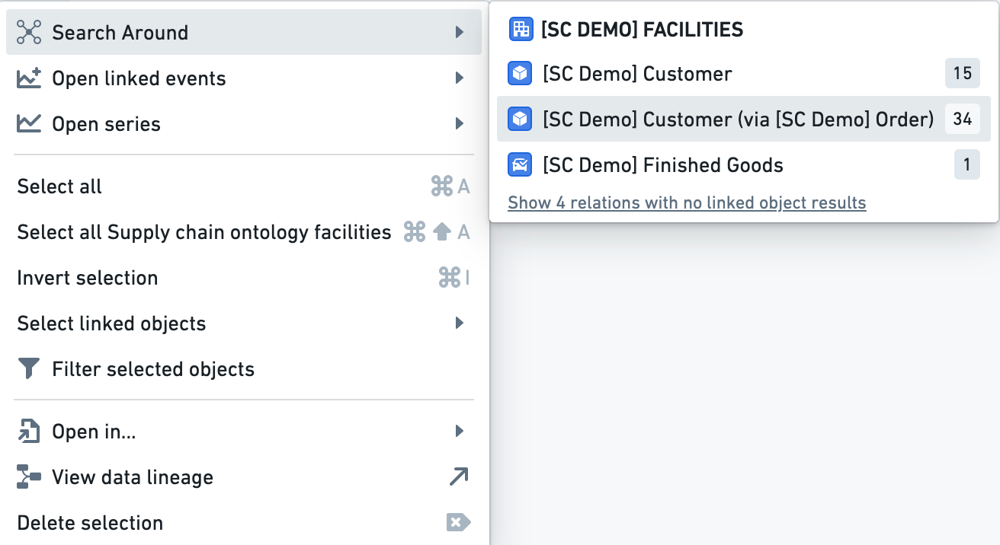

:::callout{theme="warning"}
注意：以下翻译的准确性尚未经过验证。这是使用 [AIP ↗](https://www.palantir.com/platforms/aip/) 从原始英文文本进行的机器翻译。
:::

# 配置链接合并

在Ontology管理器的Vertex Ontology功能部分配置**链接合并**将允许Object自动分组到两个节点之间的边缘。此配置有助于可视化节点之间的事务流并简化图的生成。

用户可以通过**搜索周围**菜单中的**通过链接**选项访问此功能。

