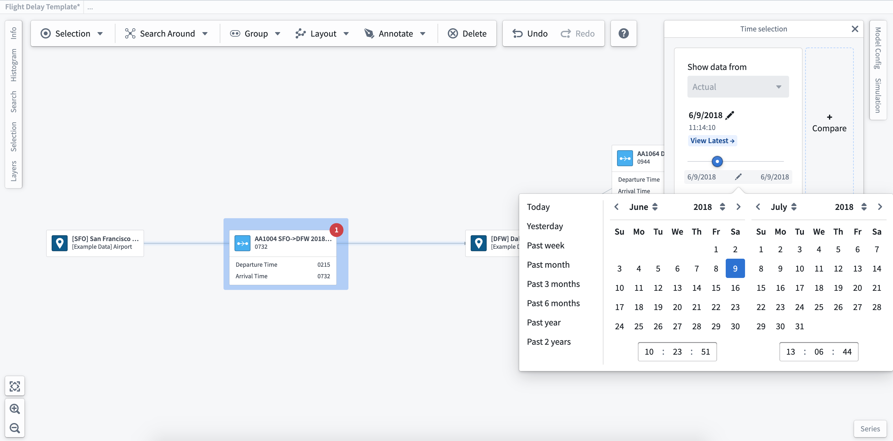
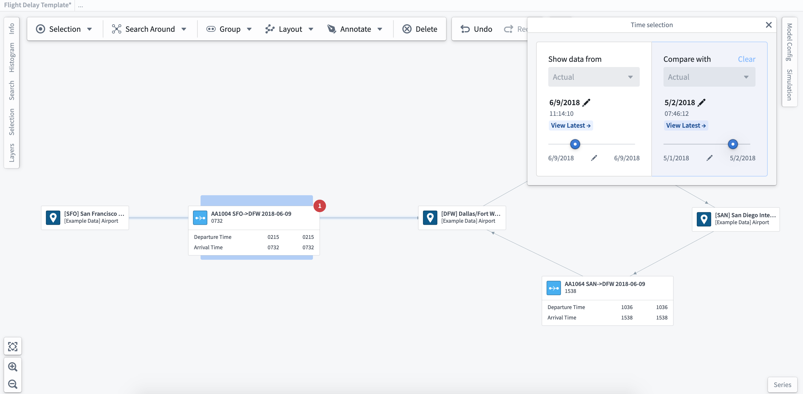

:::callout{theme="warning"}
注意：以下翻译的准确性尚未经过验证。这是使用 [AIP ↗](https://www.palantir.com/platforms/aip/) 从原始英文文本进行的机器翻译。
:::

# 使用时间选择

通过选择工作区顶部的**时间选择**栏，您可以设置一个时间窗口并滚动查看系统随时间的变化。如果有特定的时间范围感兴趣，您也可以使用日期选择器来设置时间窗口。

您可以选择创建多个时间选择以进行比较。点击**时间选择**面板右侧的\*\*+ 比较\*\*按钮以创建额外的时间选择。在比较选定的时间窗口时，图表上扩展标签/读数显示的值将会更新。这些更新使您能够可视化并比较随时间的更改。

:::callout
如果您有模拟案例研究，您可以从下拉菜单中选择它以比较建模值。
:::
