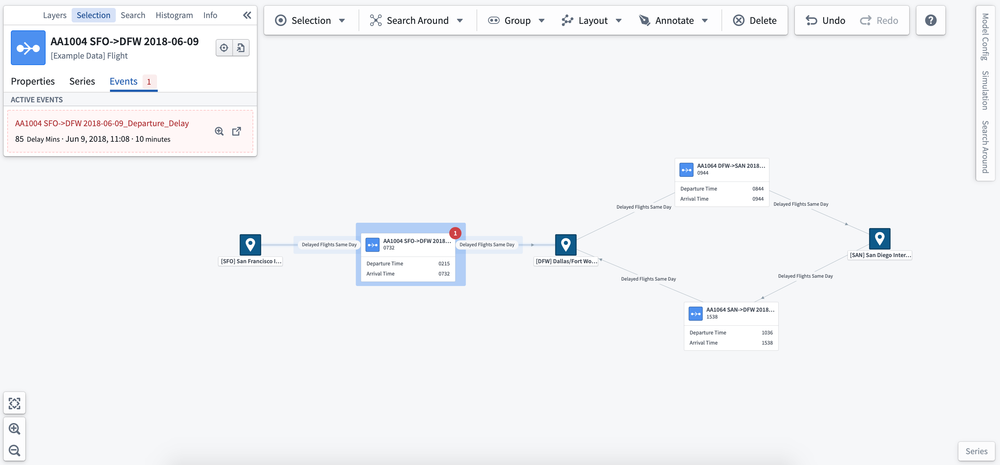
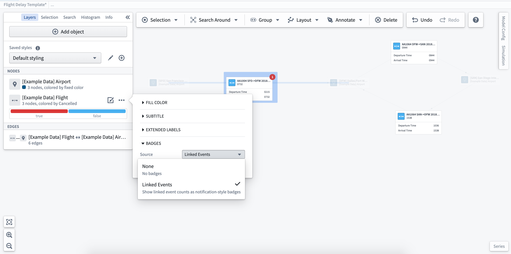
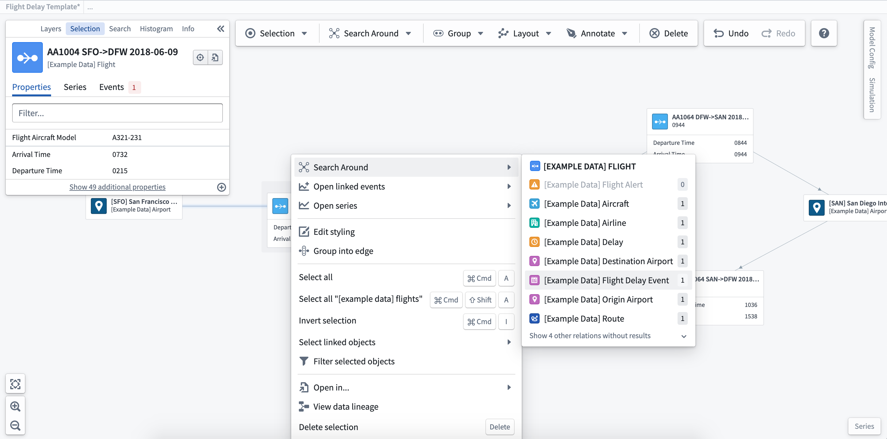
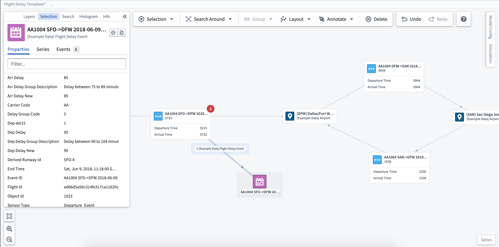
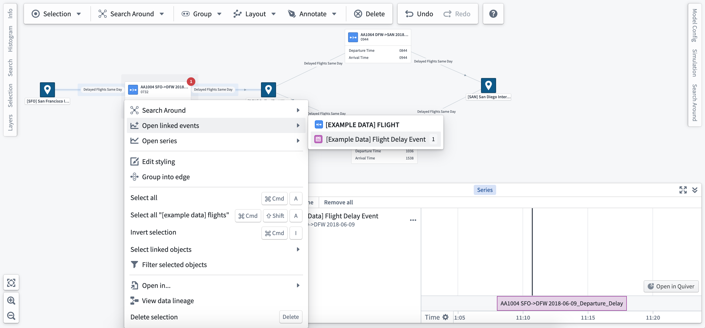

:::callout{theme="warning"}
注意：以下翻译的准确性尚未经过验证。这是使用 [AIP ↗](https://www.palantir.com/platforms/aip/) 从原始英文文本进行的机器翻译。
:::

# 探索相关事件

**事件**在Ontology中定义和配置。所有事件必须具有明确的起始和结束时间，并可以配置特定的阈值以定义事件显示的颜色。[了解更多关于设置和配置事件的信息。](%E9%85%8D%E7%BD%AE%E4%BA%8B%E4%BB%B6.md)。

一旦创建并配置好事件Object，您可以通过系统图与其进行动态交互。

### 查看事件

与选定Object关联的事件将在选择面板中显示，并在事件期间作为徽章显示在该Object上。

### 事件徽章

事件徽章在图层样式选项中配置。选择您想要为其显示事件徽章的Object类型，并选择**关联事件**选项，以便在图中的节点或边上添加徽章。

### 事件Object

要查看事件的完整细节，您可以将关联的Object添加到图中。右键单击与事件相关的Object，然后选择**搜索周围**选项以找到事件Object（在此情况下，为航班延误事件）。

一旦添加到图中，您可以选择事件Object以在选择面板中查看完整的细节和属性。

### 系列面板中的事件

右键单击一个Object并选择**打开关联事件**以打开并将事件添加到系列面板。从这里，您可以使用时间选择工具来浏览时间并查看多个事件。

