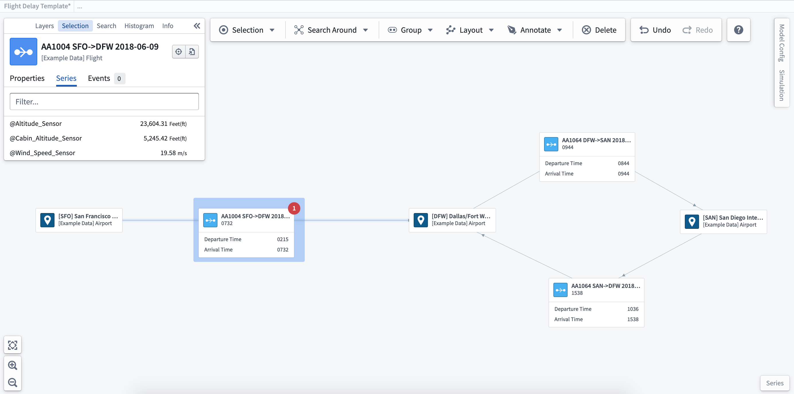
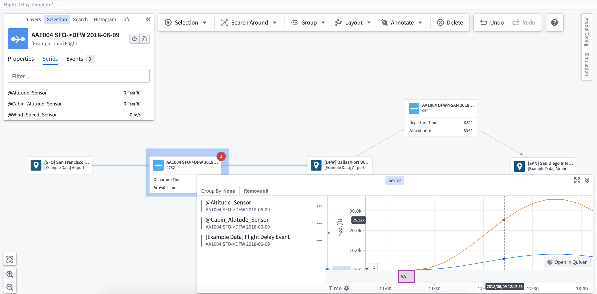
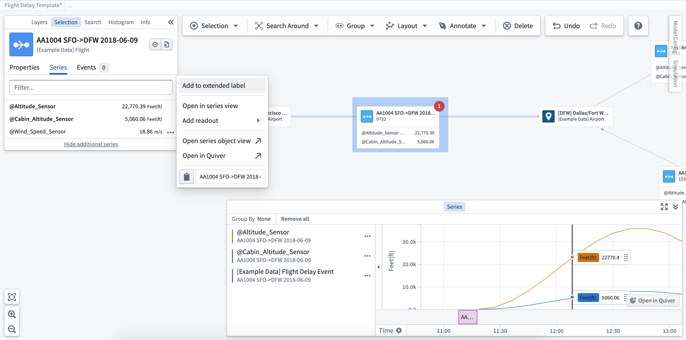

:::callout{theme="warning"}
注意：以下翻译的准确性尚未经过验证。这是使用 [AIP ↗](https://www.palantir.com/platforms/aip/) 从原始英文文本进行的机器翻译。
:::

# 探索相关时间序列

Vertex 图表允许您与[时间序列](https://www.palantir.com/docs/foundry/time-series/time-series-overview/)进行互动，以可视化系统中的更改，并深入分析以显示过去决策的影响、当前状态和未来潜力。

:::callout
并非所有客户安装中都包括时间序列功能。如果您想了解更多关于这些功能的信息，请联系您的 Palantir 代表。
:::

**查看相关时间序列：** 一旦选择了一个Object，您将在选择侧边栏的 **Series** 标签上看到任何相关的时间序列。在您选择Object所示的单个时间序列旁边的 **...** 后，菜单中会出现多个选项。

**在系列视图中打开：** 当您将时间序列添加到系列视图时，时间轴可视化将显示在图表的底部。您可以使用系列视图通过单击您希望查看的时间点，或使用系列面板底部的时间轴滚动来穿越时间。

**在 Quiver / Object Explorer 中打开：** 选择 **在 Quiver 中打开** 或 **在 Object Explorer 中打开** 选项，将打开一个新窗口以便您更详细地查看时间序列。

**添加到扩展标签/读数：** 这将在所选Object的标签上显示时间序列值。选择 **添加到读数** 允许您将时间序列值添加到图表中而不附加到Object标签上，以便您可以将这些值放置在系统或流程中最相关的位置。

