:::callout{theme="warning"}
注意：以下翻译的准确性尚未经过验证。这是使用 [AIP ↗](https://www.palantir.com/platforms/aip/) 从原始英文文本进行的机器翻译。
:::

# 查看和筛选时间轴上的事件

时间轴可被用于在检查对象的时间属性并筛选特定时间范围内的事件。

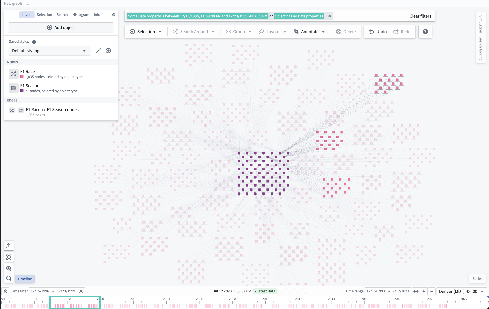

## 查看时间事件

界面左下角的 **时间轴** 按钮可被用于在显示或隐藏时间轴。

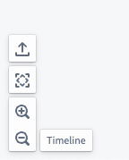

如果时间轴上没有可见内容，**缩放以适应** 按钮可以帮助显示时间轴 **时间范围** 内的图形上的时间事件。

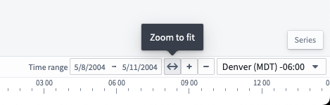

当可见时，时间轴将显示对象的时间属性的线条和对象属性中的时间范围的条形。

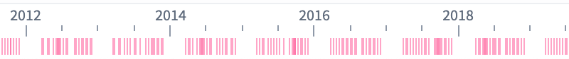
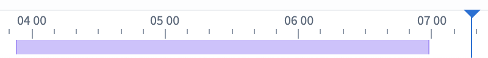

## 筛选时间事件

可以通过在时间轴上按住 Shift 并左键拖动以创建时间筛选窗口，或使用时间轴控制栏中的 **时间筛选** 按钮来在图形上筛选事件。

应用程序顶部也提供了 **时间筛选**。与筛选匹配的图形节点是完全不透明的，而不匹配时间筛选的节点则会淡出。

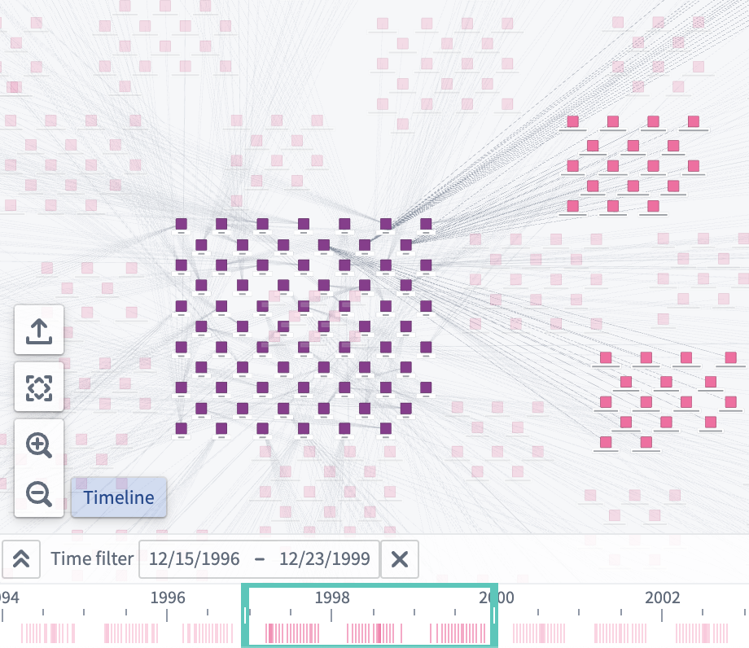

## 更改光标位置

可以通过双击左键点击时间轴、更改光标位置或使用控制栏中间的输入框来更改时间轴上的光标位置。

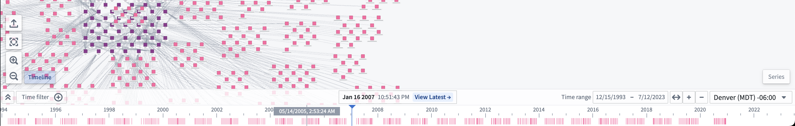

要为光标获取更具体的日期，您可以点击光标表单以输入特定的日期和时间。

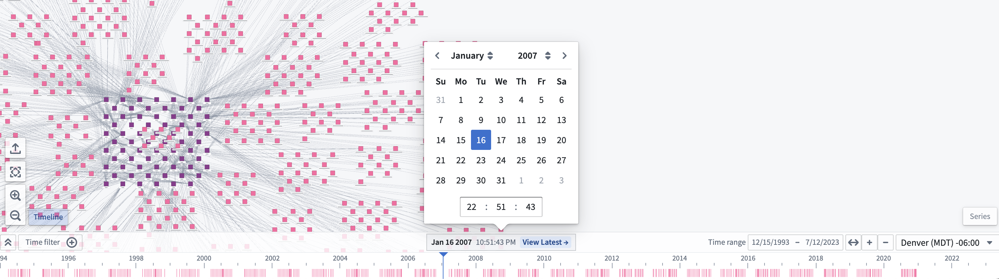

## 展开时间轴

要在自己的时间轴行上显示每种对象类型，请点击时间轴控制栏中的“展开”按钮 ()。

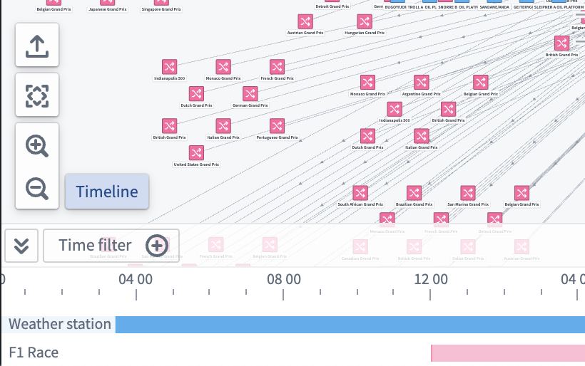

## 样式化时间轴

要更改对象在时间轴上的显示方式，请在屏幕左侧的 **图层** 面板中选择对象节点旁的画笔图标。然后，展开 **时间轴形状** 部分。

!\[The **Timeline shape** style configuration section for the `F1 Race` object node. The shape is set to `Bar`, and there are options to select a start property and end property]]\(../../foundry-docs/vertex/media/timeline\_shape-menu.png)

您可以在时间轴上绘制所选形状时使用的属性；对于使用两个时间属性的形状，选择 **起始属性** 和 **结束属性** 下拉菜单，或对于使用单个属性的形状选择 **时间属性**。

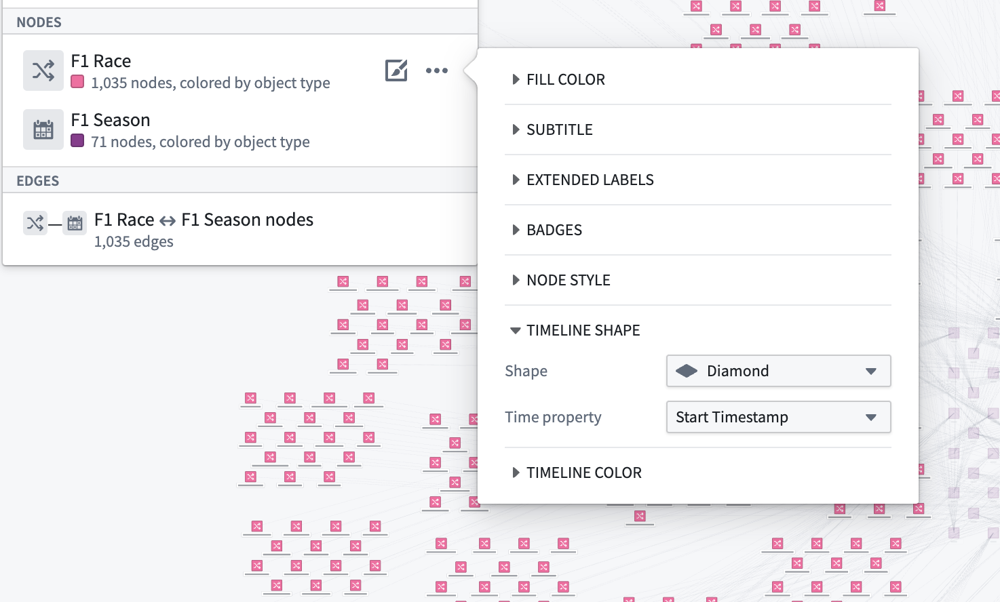

在时间轴样式配置中选择的形状将在时间轴中显示的每个对象类型实例中出现。

选择 **时间轴颜色** 菜单以配置形状颜色在时间轴上的表示方式。

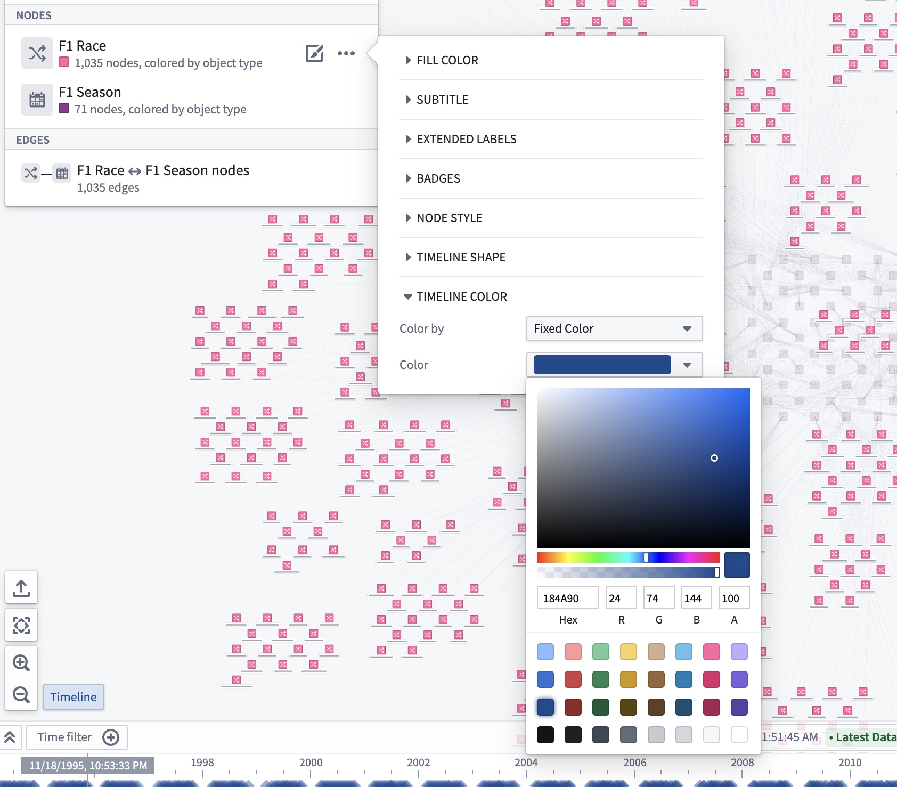

您还可以通过更改 **按颜色** 下拉菜单中选择的选项，使用属性和度量来配置时间轴的 [颜色样式](../Graphs/Object%E5%92%8C%E8%BE%B9%E6%98%BE%E7%A4%BA%E9%80%89%E9%A1%B9.md#color-by)。例如，下面的图像配置为按 `Year` 属性以彩虹色谱着色：

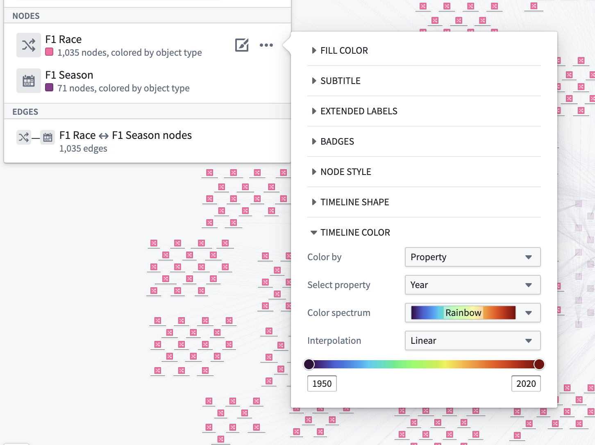

## 时间轴播放

您可以使用播放按钮 (⏵) 自动移动时间光标；播放速度可以通过速度预设（1x, 2x, 5x, 10x, 100x 等）进行调整。

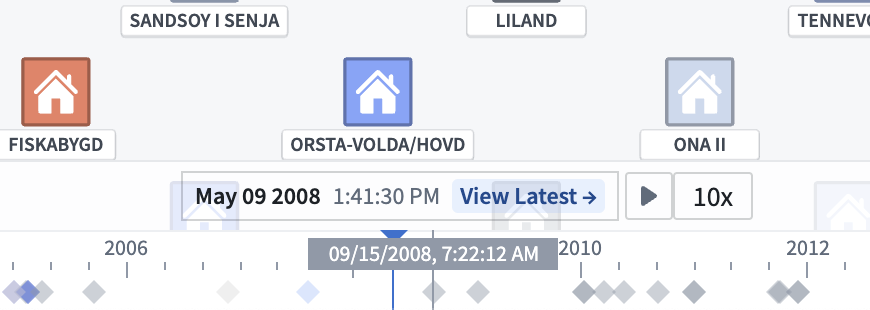

光标将在时间轴上的时间窗口或存在的时间筛选内自动循环。

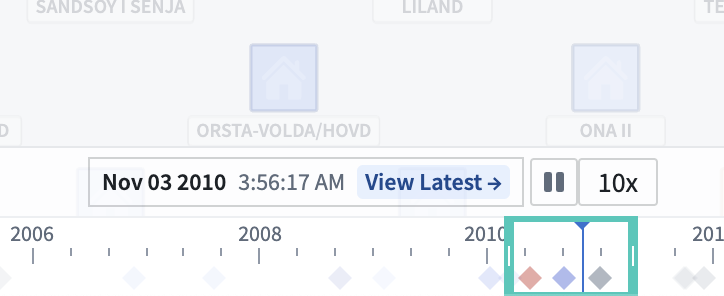
