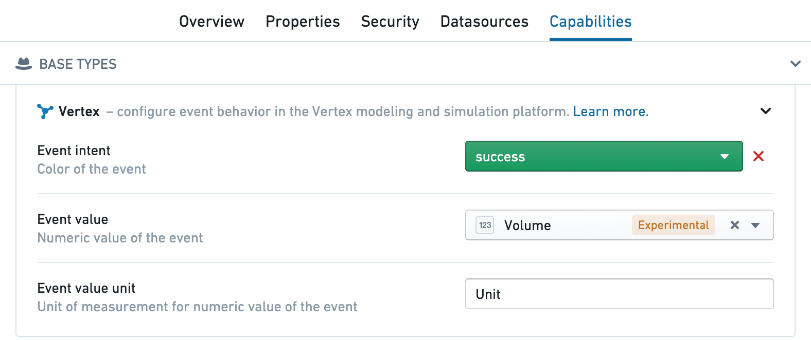

:::callout{theme="warning"}
注意：以下翻译的准确性尚未经过验证。这是使用 [AIP ↗](https://www.palantir.com/platforms/aip/) 从原始英文文本进行的机器翻译。
:::

# 配置事件

## 事件配置

要在Vertex中使用事件，需创建一个时间序列事件Object类型，并添加一个额外的Vertex类型类以设置警报的颜色和/或严重性（这可以在任何列上，但通常是主键）：

* 橙色: `kind`: `vertex`, `name`: `event_intent.warning`
* 红色: `kind`: `vertex`, `name`: `event_intent.danger`
* 蓝色: `kind`: `vertex`, `name`: `event_intent.primary`
* 绿色: `kind`: `vertex`, `name`: `event_intent.success`

可以在本体管理器的**功能**选项卡中为事件Object配置这些类型类，或直接在Object属性的类型类中配置。

