:::callout{theme="warning"}
注意：以下翻译的准确性尚未经过验证。这是使用 [AIP ↗](https://www.palantir.com/platforms/aip/) 从原始英文文本进行的机器翻译。
:::

# Object和边显示选项

Vertex允许您为图中的Object和边配置动态样式。设置样式并配置关键属性读数后，您可以使用时间选择窗口查看这些关键属性如何随时间变化。

## 图设计

### 自动设计选项

您可以在工作区顶部的工具栏中找到许多预定义的设计选项。选择后，Object和边将自动移动，让您在探索关系时对图进行排序。这些设计中的许多包含用于修改其行为的高级参数。可以通过选择相应设计旁边的齿轮图标访问这些参数。

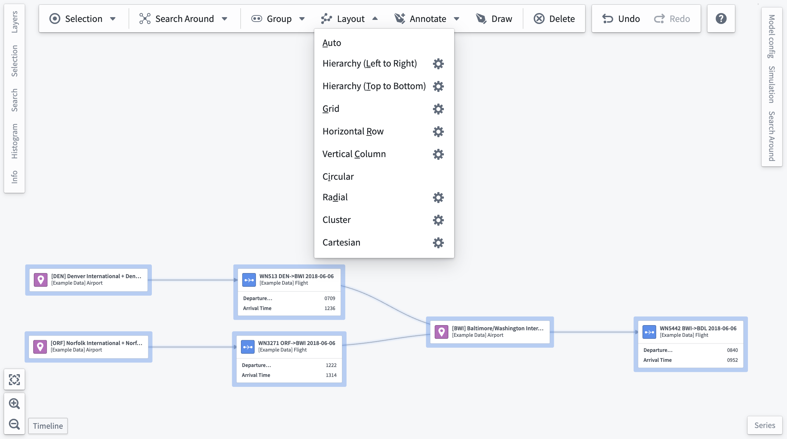

以下是每种设计的高级参数。请注意，**自动**和**圆形**设计没有高级参数。

#### 层次结构（从左到右/从上到下）

* **反转：** 颠倒层次结构的顺序；左-右变为右-左，上-下变为下-上。
* **根节点：** 选择一个节点来占据层次结构的根。如果选择了`自动`，将根据边的方向为您选择一个根节点。

#### 网格

* **交错：** 提供偏移元素奇数行的选项。
* **网格尺寸：** 指定网格中行或列的数量限制。`自动`模式将尝试使用相等数量的行和列。

#### 水平行/垂直列

* **以排序：** 一个Object属性用于排序节点。
  * 默认使用升序。
  * 如果没有选择“以排序”属性，设计将保持现有的行水平节点顺序，或列垂直节点顺序。
  * 分组的节点和任何由不包含指定属性的Object支持的节点将在升序时放在开头，降序时放在末尾。
  * 只有数值属性会出现在此选择列表中。
  * 不同Object上匹配的属性名称将一起排序。
* **反转：** 在升序和降序之间切换排序顺序。仅当选择了“以排序”属性时，此选项才会出现。

#### 辐射状

* **中心节点：** 指定应出现在设计中心的节点。
* **密度：** 一个介于一到五之间（包括）的值，决定节点之间的间距。

#### 聚类

* **聚类依据：** 指定应按节点聚类的属性。
  * 如果未选择属性，此设计将按Object类型聚类。
  * 分组的节点和任何由不具备选定属性的Object支持的节点将聚集在一起。
  * 只有具有[渲染提示](../../../%E5%AE%9A%E4%B9%89%E6%9C%AC%E4%BD%93/%E5%AF%B9%E8%B1%A1%E9%93%BE%E6%8E%A5%E7%B1%BB%E5%9E%8B/Metadata/%E6%B8%B2%E6%9F%93%E6%8F%90%E7%A4%BA.md)`可选`或`低基数`的属性才会出现在此下拉菜单中。
  * 不同Object上匹配的属性名称将一起聚类。

#### 笛卡尔

* **X/Y属性：** 用作设计中节点x和y坐标的属性。
  * 坐标将被规范化，以便在执行设计时节点适合视窗。
  * 除非选择了x属性、y属性或两者，否则不会执行笛卡尔设计。
  * 分组的节点和任何由不具备选定属性的Object支持的节点将保留在其设计前的位置。
  * 只有具有[渲染提示](../../../%E5%AE%9A%E4%B9%89%E6%9C%AC%E4%BD%93/%E5%AF%B9%E8%B1%A1%E9%93%BE%E6%8E%A5%E7%B1%BB%E5%9E%8B/Metadata/%E6%B8%B2%E6%9F%93%E6%8F%90%E7%A4%BA.md)`可选`或`低基数`的属性才会出现在此下拉菜单中。
  * 不同Object上匹配的属性名称将一起排序。
* **X/Y反转：** 反转x和y坐标。仅在属性选择后才会出现反转切换。

### 按Object类型分组节点

当您添加更多相关Object时，您可能希望开始将Object分组到图上的单个节点中。一旦选择了要分组的Object，请使用工作区顶部的设计工具栏对选定的Object进行分组或取消分组。

将多个Object分组到单个节点后，您将在工作区左侧的选择面板中看到已分组的完整Object列表。如果您只想取消分组节点中的一部分Object，请使用选择面板选择这些Object并选择下图所示的**取消分组**。这也可以通过直方图中的**筛选到**功能来完成。

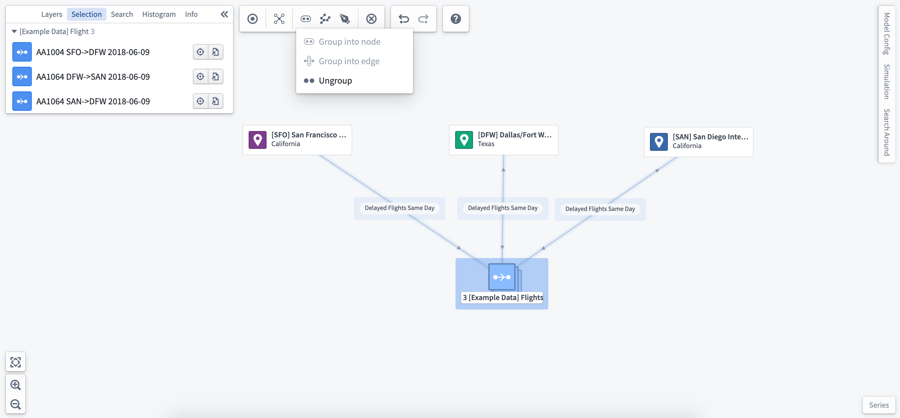

### 按Object类型的属性分组

使用直方图，您可以探索选定Object的属性，并按显示的值对Object进行分组。这将更改图上的Object设计以反映新的分组。

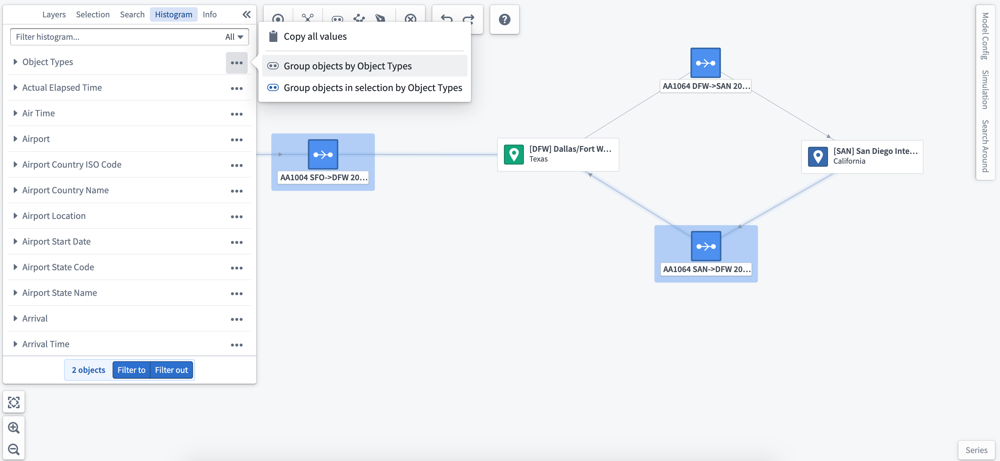

### 将节点分组到边中

一些Object是事务性的，并在系统中的其他节点/Object之间移动。例如，航班作为事务性Object在`出发机场`和`目的地机场`之间移动。在这种情况下，您可以将订单Object分组到边上，并能够根据关键属性/指标设计边。

选择边并从右键菜单中选择**取消分组**以显示先前在边中分组的所有Object。或者，您可以通过首先使用直方图或选择面板选择要取消分组的Object来取消分组子集。

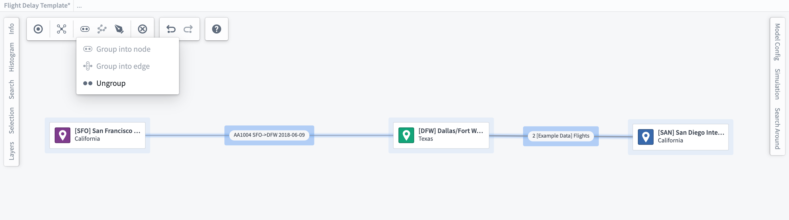

:::callout
您可以在Ontology管理器→功能选项卡中自动将事务性Object分组到相关的边中。[了解更多关于链接合并的信息。](../Configuration/%E9%85%8D%E7%BD%AE%E9%93%BE%E6%8E%A5%E5%90%88%E5%B9%B6.md)
:::

## 层样式选项

层是指相同Object类型的Object节点或节点之间的边关系。可以通过多种设计选项单独配置这些层，以便灵活地可视化和直观地与系统的数字孪生体进行交互。

使用左侧边栏中的层样式面板，您可以单独为节点和边设置样式，或通过Object的属性和相关的时间序列/测量值设置样式。层样式允许您可视化关键信息、计算指标，并通过参数化条件设置样式以显示当前或模拟的系统状态。

### Object样式

选择您希望配置的Object类型旁边的**样式选项**以打开样式菜单。

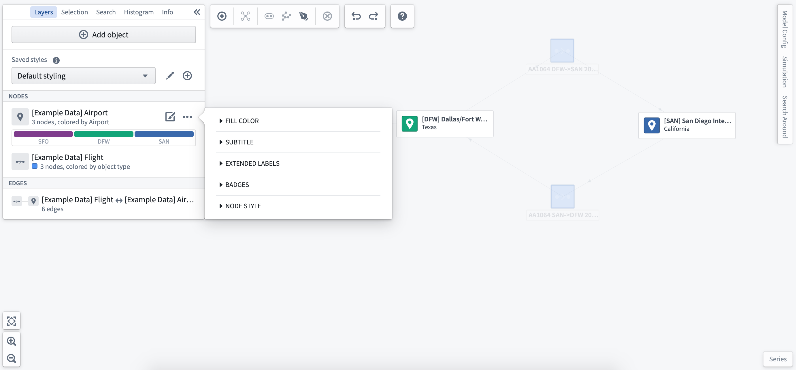

#### 按颜色

选择**填充颜色**下拉菜单以选择样式参数以及此层中所有Object的颜色选择。您可以选择一个时间序列测量值作为**按颜色**参数，这将根据所选时间窗口动态更新样式。您还可以使用[派生属性函数](%E4%BD%BF%E7%94%A8%E5%87%BD%E6%95%B0%E6%B4%BE%E7%94%9F%E5%B1%9E%E6%80%A7.md)为节点上色。

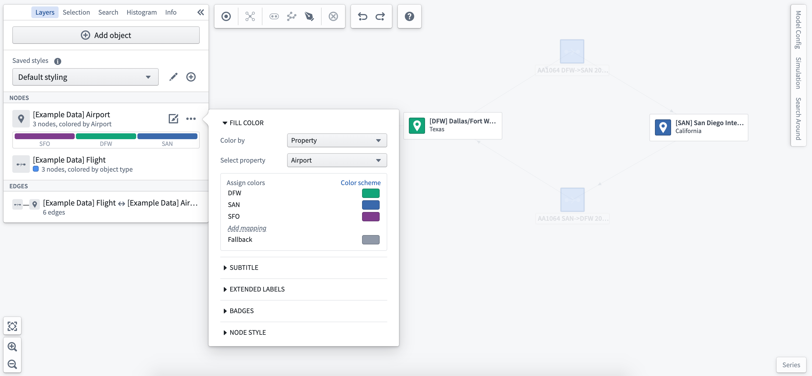

#### 副标题

您可以为每个Object类型或Object的选定属性添加副标题。副标题将显示在图上所有相同类型的Object上。

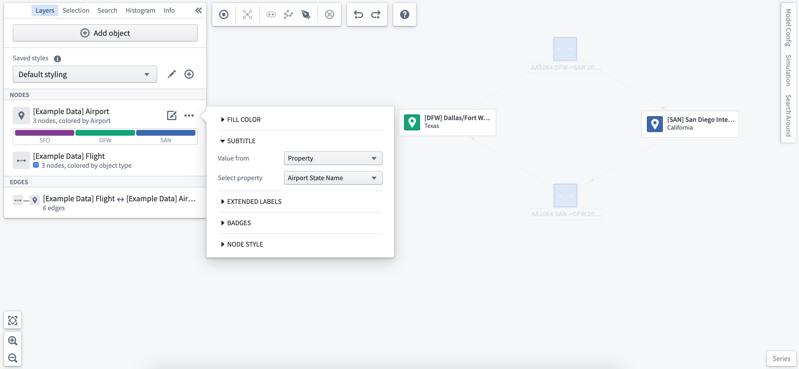

#### 扩展标签

选择**扩展标签**可允许您为选定的Object节点添加特定的读数。您可以选择现实世界的时间序列读数或模拟值，以便在单一视图中比较当前和建模条件。

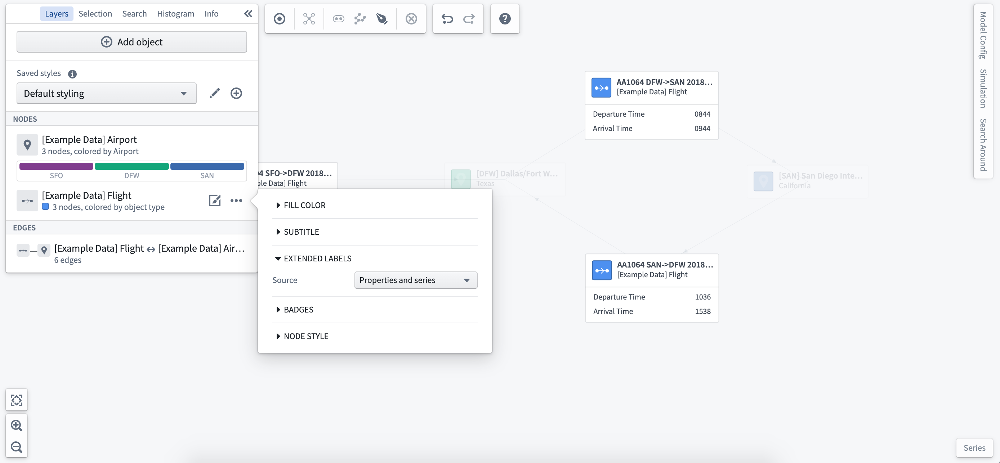

设置扩展标签样式后，您可以从工作区左侧的Object选择面板中选择要显示的属性或时间序列。

#### 徽章

添加徽章以指示与特定Object类型相关的事件数量。在下图中，您可以看到有一个航班延误事件。

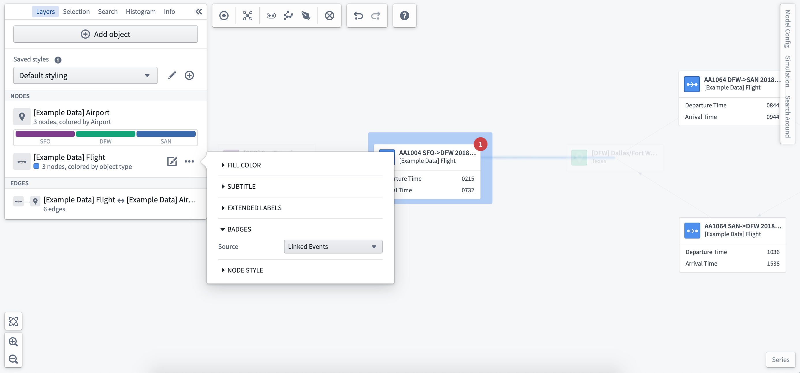

#### 节点样式

您可以选择将Object显示为默认节点或完整Object卡片。

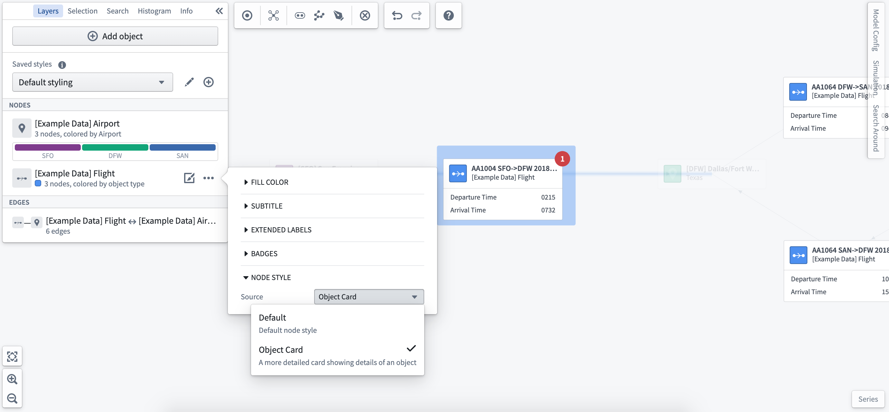

### 边样式

边代表Object之间的关系，可以设置样式以可视化系统或过程中节点之间的交互。

从您想要配置的边选择**样式选项**。

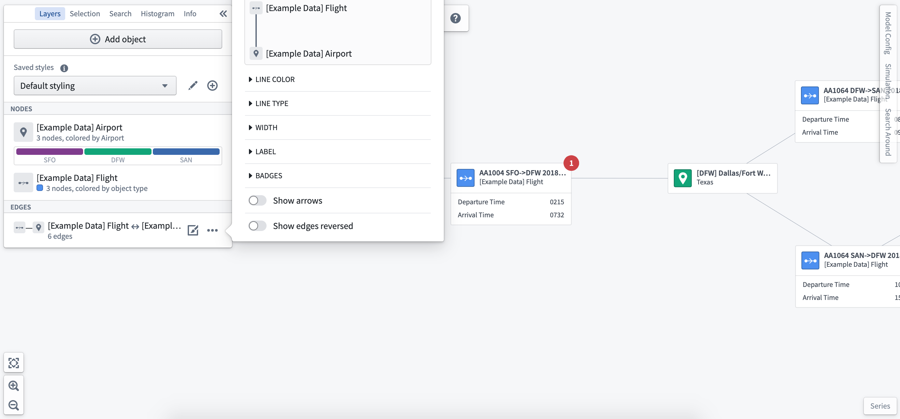

#### 线条颜色

您可以根据Object类型或相关Object的共同属性设置边的颜色。

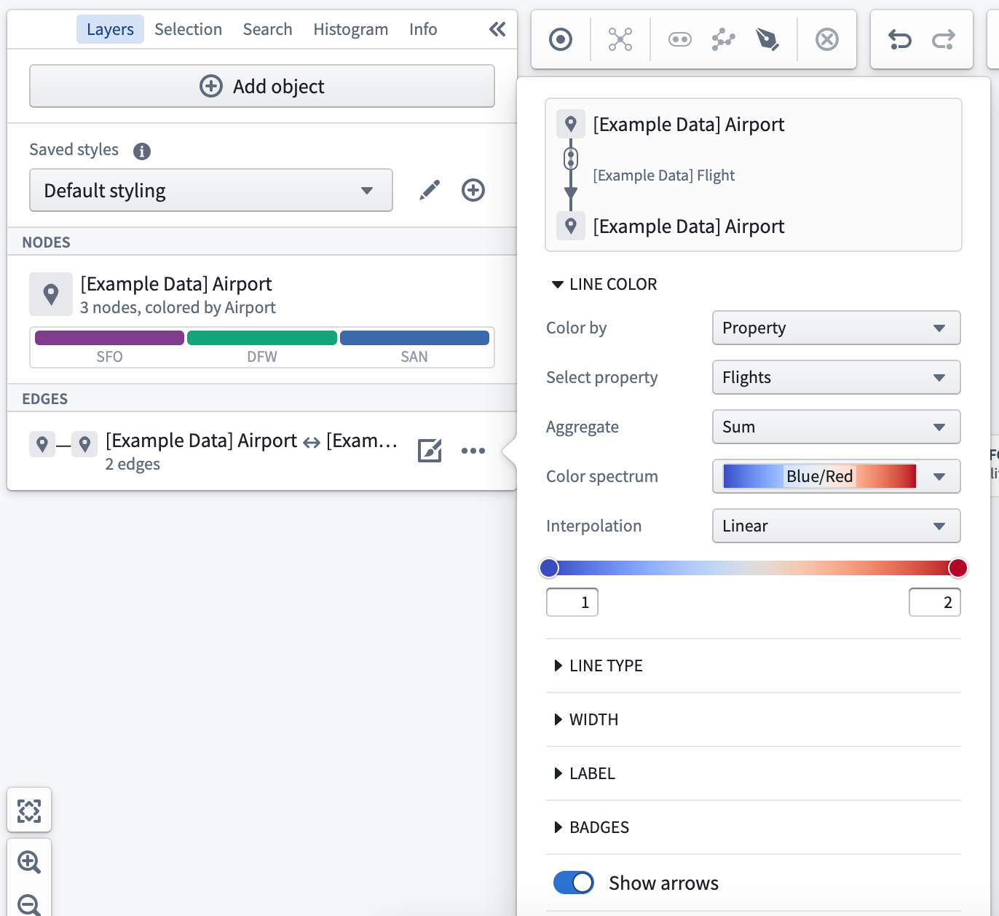

#### 线条类型

您可以将绘制的线条格式化为直线、曲线或直角线。

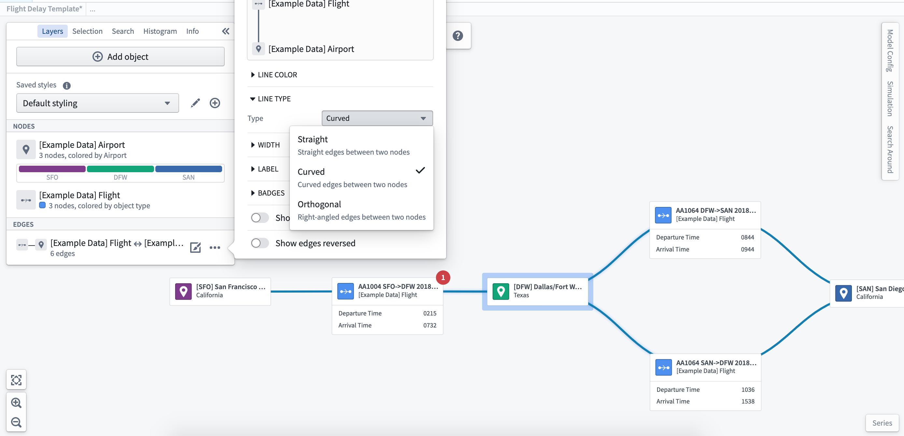

#### 标签

当边中分组了Object时，您可以根据Object的单个或聚合属性配置标签以显示关键指标。

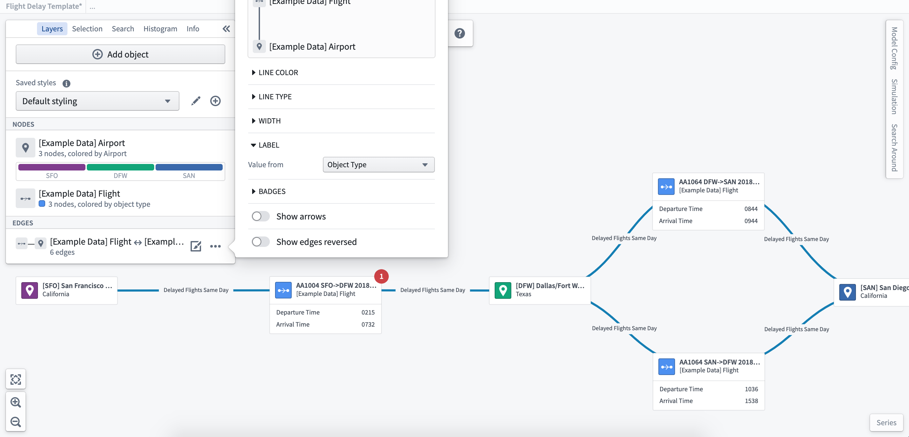

#### 线宽

您可以根据Object的属性对边应用不同的宽度。应用不同的线宽可以指示Object之间（如机场之间的航班）的移动和交易量。

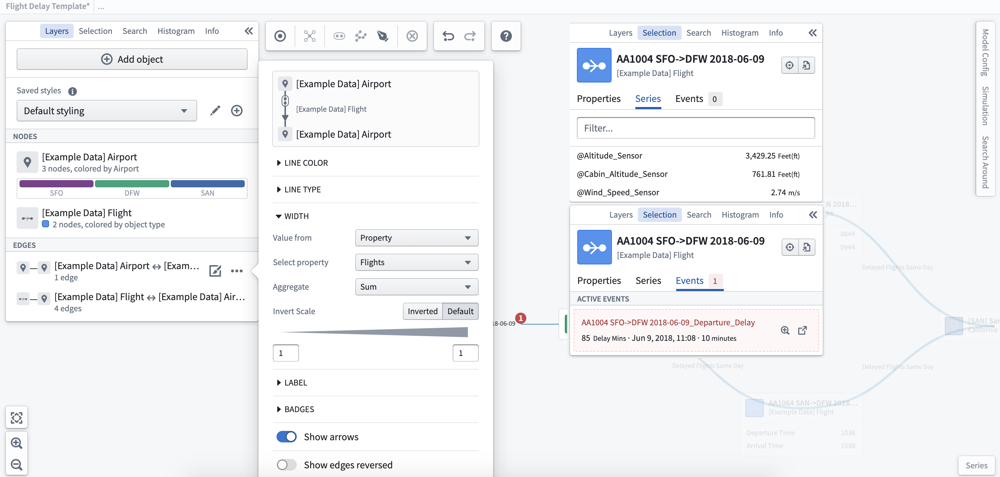

#### 徽章

与Object节点一样，您可以添加徽章以指示与特定边关系相关的事件数量。在这里，您可以看到有一个航班延误事件。

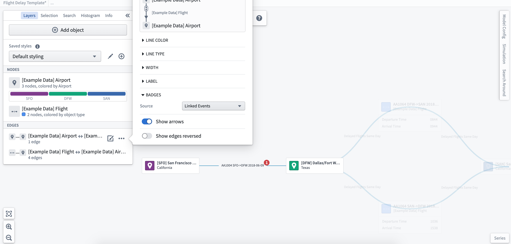

#### Ontology级别边方向配置

在向图中添加链接时，默认情况下边箭头从链接的右侧指向左侧。例如，对于在Ontology中配置为多对一链接类型的链接，箭头将从一侧指向多侧。这可以使用以下Ontology类型类按链接类型进行配置：

* 主方向：`kind`: `vertex`, `name`: `link_primary_direction`
  * 当放置在链接的一侧时，表示边箭头应指向链接这一侧的Object。
* 无方向：`kind`: `vertex`, `name`: `link_undirectional`
  * 当放置在链接的任何一侧时，表示边上不应显示箭头。
* 双向：`kind`: `vertex`, `name`: `link_bidirectional`
  * 当放置在链接的任何一侧时，表示应在边的两侧显示箭头。

边箭头也可以在每个图中使用层样式选项隐藏或反转。

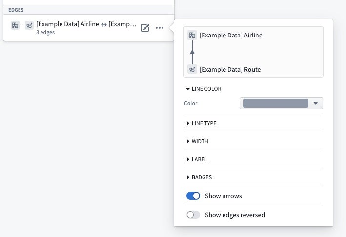

### 保存的样式

配置后，您可以为相同的图保存不同的样式选项，以提供系统的不同视图。例如，您可以配置一个航班在一组机场之间的视图，以航空公司运营商的关键绩效指标为样式。然后，您可以使用相同的图以不同的样式显示相同航线上的客户满意度。

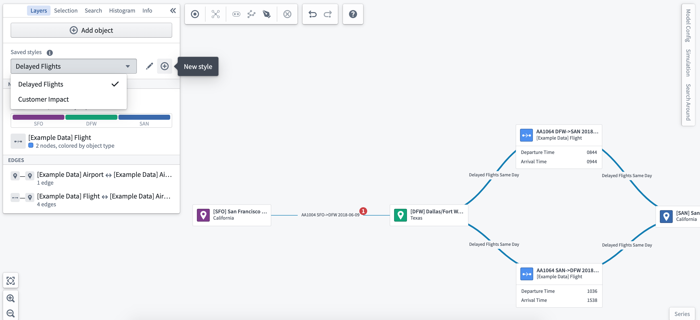

## 保存的选择

您还可以保存您在图上选择的Object组作为保存的选择。为此，选择包含所需Object的任意数量的节点和边，并在右键菜单或工具栏中的**选择**菜单中选择**保存当前选择中的Object**。

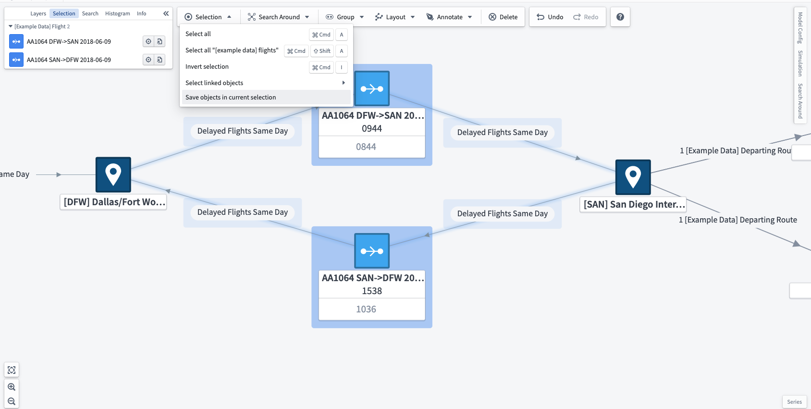

每个保存的选择都有一个关联的名称和颜色，出现在层面板的**保存的选择**部分。图上的每个Object，无论是作为边还是节点表示，都将在其所属的保存选择的颜色中具有分隔边框。每个Object可以是任意数量保存选择的一部分，但边框只会显示前三个保存选择的颜色。

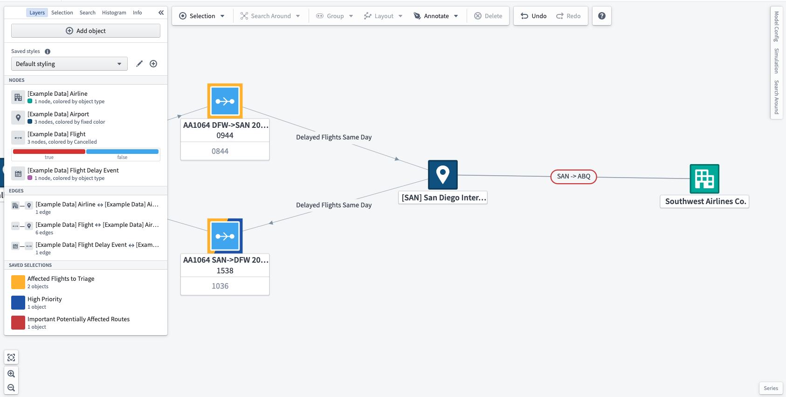

要快速选择保存选择中存储的所有Object，请在保存选择上悬停时选择快速选择操作。

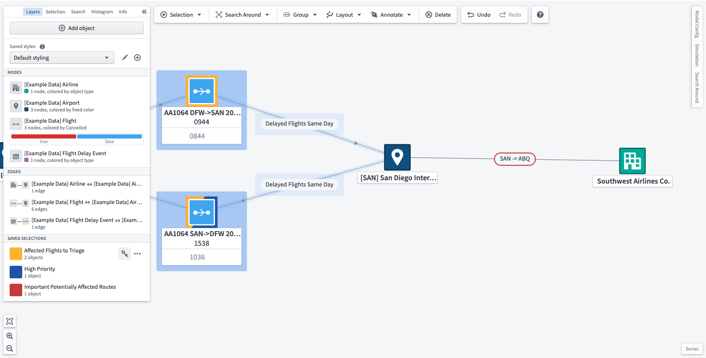

您可以在层面板中编辑保存的选择。要编辑保存选择的名称，只需选择名称，输入新名称，并使用Enter键。要删除或编辑保存选择的颜色，请在保存选择上悬停时选择\*\*...\*\*图标 ()。您还可以使用眼睛图标 ()切换每个保存选择的边框。

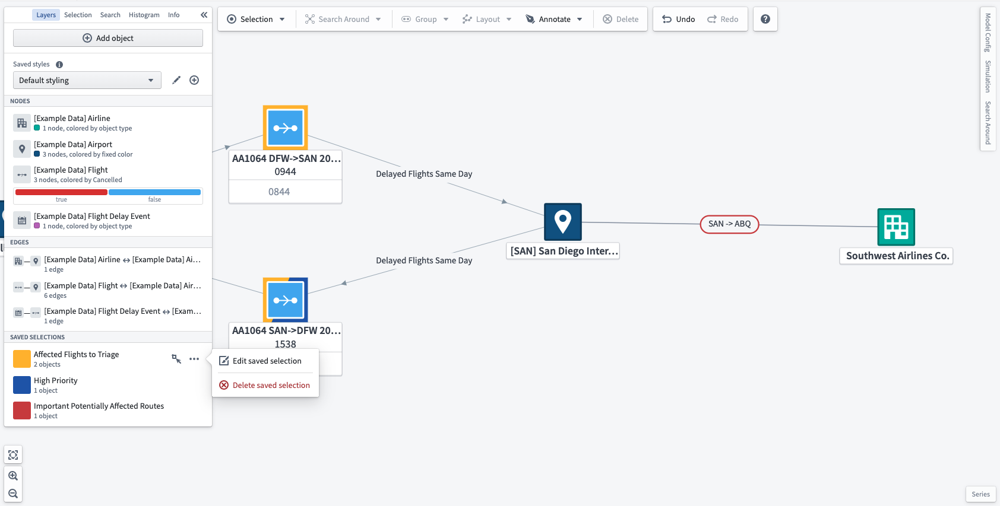

选择图上的Object，选择\*\*...\*\* ()按钮，然后使用**添加选定Object**或**移除选定Object**选项可以编辑保存选择中的Object。

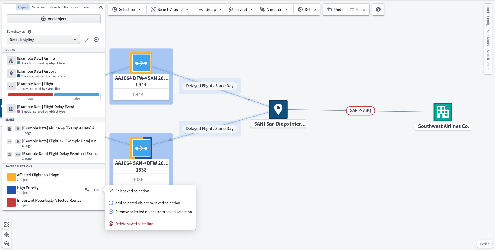
