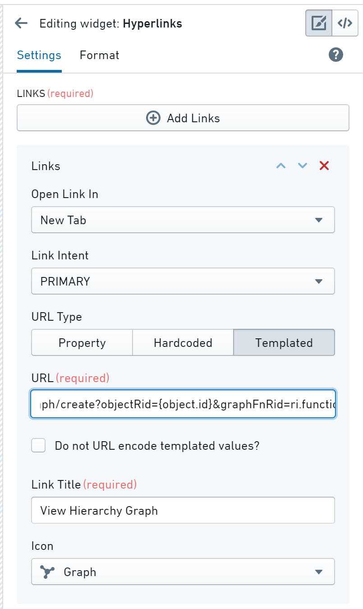

:::callout{theme="warning"}
注意：以下翻译的准确性尚未经过验证。这是使用 [AIP ↗](https://www.palantir.com/platforms/aip/) 从原始英文文本进行的机器翻译。
:::

# 从其他应用生成图表

您可以在其他 Foundry 应用中配置一个链接，该链接将自动生成一个预填充的 Vertex 图表。

## 使用URL参数生成图表

您可以使用URL参数执行以下操作：

* 以现有图表开始或创建一个新图表。
* 通过指定对象ID或对象集ID，将对象添加到图表中。
* 运行[**搜索周边**函数](%E4%BD%BF%E7%94%A8%E5%87%BD%E6%95%B0%E7%94%9F%E6%88%90%E5%9B%BE%E8%A1%A8.md)。
* 设置时间选择器的时间范围。

这些参数仅适用于创建新图表的URL (`/workspace/vertex/graph/create`)：

* `selectObjectRid`: 选择并将图表居中在指定对象上（如果存在）。
* `objectRid`: 将指定对象作为节点添加到图表中。
* `objectSetRid`: 将指定对象集中的所有对象作为节点添加到图表中。
* `searchAroundFnRid`: 将指定**搜索周边**函数的结果添加到图表中。该函数将与 `objectRid` 参数一起使用单个对象，或与 `objectSetRid` 对象集中的所有对象一起使用。
  * 必须与 `objectSetRid` 或 `objectRid` URL 参数结合使用。

以下参数适用于现有图表 (`/workspace/vertex/graph/{graphRid}`) 和新创建图表的URL (`/workspace/vertex/graph/create`)：

* `selectedTime`: 设置选定的时间。
* `startTime`: 设置时间范围的起始时间。
* `endTime`: 设置时间范围的结束时间。

:::callout
所有时间可以是以毫秒为单位的UNIX时间戳或ISO格式的日期/时间（例如 `2020-02-15/2020-02-15 13:45:00 UTC`）。如果指定了 `selectedTime`，但没有至少一个 `startTime` 和 `endTime`，则时间范围将具有默认持续时间，并围绕选定时间居中。如果指定了 `startTime` 和 `endTime`，但没有指定 `selectedTime`，则选定时间将与 `startTime` 相同。
:::

## 从其他应用生成Vertex图表

一旦设置了URL参数，您可以使用此链接从其他应用生成预配置的图表。例如，在Object Explorer中使用超链接微件：

