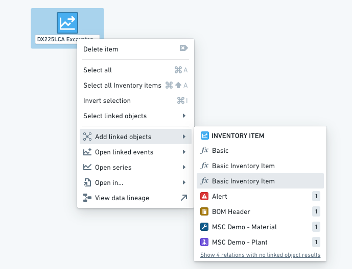
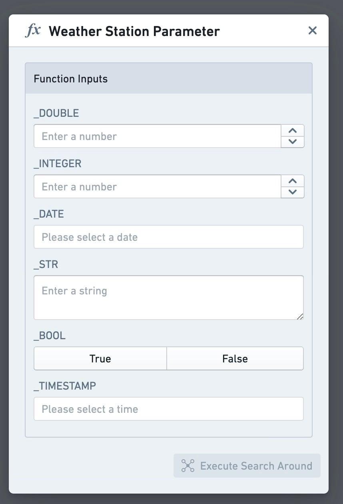
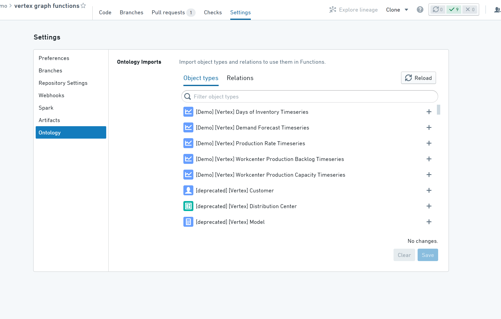
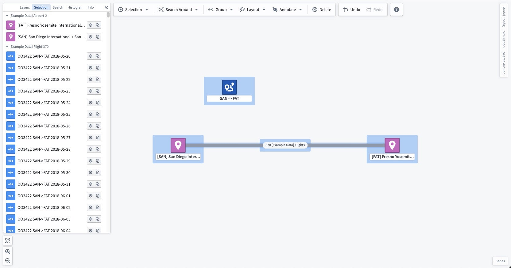
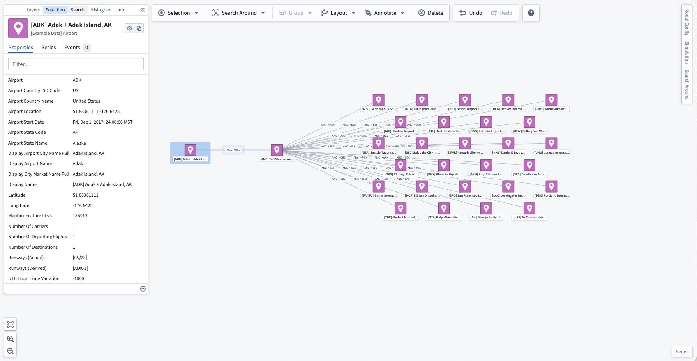

:::callout{theme="warning"}
注意：以下翻译的准确性尚未经过验证。这是使用 [AIP ↗](https://www.palantir.com/platforms/aip/) 从原始英文文本进行的机器翻译。
:::

# 使用函数生成图表

[函数](../../../%E5%AE%9A%E4%B9%89%E6%9C%AC%E4%BD%93/%E5%87%BD%E6%95%B0/%E6%A6%82%E8%BF%B0.md) 可以被用于在编写复杂的**搜索周边**函数，起始于一个或多个对象，返回一个结果图。这些函数可以从**搜索周边**工具栏菜单、右键菜单，或[通过URL参数创建图表时](%E4%BB%8E%E5%85%B6%E4%BB%96%E5%BA%94%E7%94%A8%E7%94%9F%E6%88%90%E5%9B%BE%E8%A1%A8.md)执行。每个函数必须有且只有一个参数，该参数是一个Ontology对象类型或Ontology对象列表，并且函数必须具有返回类型 `IGraphSearchAroundResultV1`，具体如下所述。



通过工具栏或右键菜单使用时，函数可能有其他类型为 `Integer`、`Double`、`Float`、`字符串`、`boolean`、`Timestamp` 或 `Date` 的参数。在运行这些搜索周边时，将生成一个表单供用户输入这些参数。



### 搜索周边函数

**搜索周边**函数是在TypeScript函数库中编写的。有关更多信息，请参见[函数文档](../../../%E5%AE%9A%E4%B9%89%E6%9C%AC%E4%BD%93/%E5%87%BD%E6%95%B0/%E6%A6%82%E8%BF%B0.md)。

一个**搜索周边**函数必须声明一个返回类型为 `IGraphSearchAroundResultV1` 或 `Promise<IGraphSearchAroundResultV1>`。Vertex 将使用返回类型的名称和结构来发现搜索周边函数，因此它必须如下所示准确声明：

```typescript
export interface IGraphSearchAroundResultV1 {
    directEdges?: IGraphSearchAroundResultDirectEdgeV1[]; // 直接边的数组，可选
    intermediateEdges?: IGraphSearchAroundResultIntermediateEdgeV1[]; // 中间边的数组，可选
    orphanObjectRids?: string[]; // 孤立对象的RID数组，可选
    objectRidsToGroup?: string[][]; // 分组对象RID的二维数组，可选
    layout?: string; // 布局信息，可选
}

export interface IGraphSearchAroundResultDirectEdgeV1 {
    sourceObjectRid: string; // 源对象的RID
    targetObjectRid: string; // 目标对象的RID
    linkTypeRid?: string; // 链接类型的RID，可选
    label?: string; // 标签，可选
    direction?: string; // 方向，可选
}

export interface IGraphSearchAroundResultIntermediateEdgeV1 {
    sourceObjectRid: string; // 源对象的RID
    sourceToIntermediateLinkTypeRid?: string; // 从源到中间体的链接类型RID，可选
    intermediateObjectRid: string; // 中间对象的RID
    intermediateToTargetLinkTypeRid?: string; // 从中间体到目标的链接类型RID，可选
    targetObjectRid: string; // 目标对象的RID
    label?: string; // 标签，可选
    direction?: string; // 方向，可选
}
```

* `directEdges` 将在图上表示为两个对象之间的直接边。如果此边基于链接，可以提供其在 Ontology 中找到的 `linkTypeRid`，以显示此边沿的链接类型显示名称，并使 Vertex 了解边的方向。
* `intermediateEdges` 允许您基于事件或其他中间对象在两个对象之间创建边。中间边将表示为两个对象之间的边，并将中间对象分组到该边中。如果在相同的两个对象之间返回多个中间边，所有中间对象将被分组到单个边上。与直接边一样，如果表示的关系是基于一对链接（一个从源对象到中间对象，另一个从中间对象到目标对象），则可以提供这些链接类型 RID。
* `orphanObjectRids` 允许您返回在响应中没有与其他对象链接的对象。参与 `directEdges` 或 `intermediateEdges` 中的任何对象不需要在此返回。
* `objectRidsToGroup` 允许通过返回一组数组来将对象分组为单个节点，其中每个组是对象 RID 的数组。
* `label` 允许您为在源对象和目标对象之间生成的功能链接指定自定义标签。
* `direction` 允许您更改通过搜索功能产生的功能链接的方向性。提供的值必须是 `NONE`、`FORWARD` 或 `REVERSE` 之一。如果省略，则默认为 `FORWARD`。由于存在 `linkTypeRid` 而出现的链接不受 `direction` 影响。
* `layout` 允许您更改将结果对象添加到图时使用的设计。提供的值必须是 `auto`、`auto-grid`、`grid`、`linear-row`、`linear-column` 或 `circular` 之一。如果省略，则默认为层次设计。

## 提示与故障排除

* 为了最大化性能，所有代码应尽可能是异步的。
* Vertex 将使用函数的最新发布版本。要发布您的函数，您需要使用 semver 版本标记您想要的分支/提交，例如 1.0.0。
* 您的存储库需要访问您希望在函数中使用的所有 Ontology 对象和链接。这可以在 **Repository Settings** 的 **Ontology** 部分进行配置。
* 如果对象类型及其支持的数据集在与存储库不同的项目中定义，则包含存储库的项目将需要引用支持的数据集和这些对象类型。



## 参考示例：

以下示例包含两个 **Search Around** 函数。

第一个函数 `allFlights` 返回沿航线的所有航班，合并到机场之间的单个边上。例如，当在航线 "SAN -> FAT" 上运行时，它生成以下结果：



第二个函数 `destinations` 允许用户选择距离，并返回从初始机场起一定航班数内的所有机场。例如，当在机场 "\[ADK] Adak + Adak Island, AK" 上运行，距离为 2 时，它生成以下结果：



```typescript
import { Function, Integer, OntologyObject } from "@foundry/functions-api"
import { ExampleDataAirport, ExampleDataRoute } from "@foundry/ontology-api";

// 定义接口 IGraphSearchAroundResultV1，用于表示图搜索的结果
export interface IGraphSearchAroundResultV1 {
    directEdges?: IGraphSearchAroundResultDirectEdgeV1[]; // 直接边的集合
    intermediateEdges?: IGraphSearchAroundResultIntermediateEdgeV1[]; // 中间边的集合
    orphanObjectRids?: string[]; // 孤立对象的RID集合
    objectRidsToGroup?: string[][]; // 需要分组的对象RID集合
}

// 定义接口 IGraphSearchAroundResultDirectEdgeV1，用于表示直接边
export interface IGraphSearchAroundResultDirectEdgeV1 {
    sourceObjectRid: string; // 源对象的RID
    targetObjectRid: string; // 目标对象的RID
    linkTypeRid?: string; // 链接类型的RID
}

// 定义接口 IGraphSearchAroundResultIntermediateEdgeV1，用于表示中间边
export interface IGraphSearchAroundResultIntermediateEdgeV1 {
    sourceObjectRid: string; // 源对象的RID
    sourceToIntermediateLinkTypeRid?: string; // 从源到中间对象的链接类型RID
    intermediateObjectRid: string; // 中间对象的RID
    intermediateToTargetLinkTypeRid?: string; // 从中间到目标对象的链接类型RID
    targetObjectRid: string; // 目标对象的RID
}

// VertexSearchArounds 类包含用于查找航班和目的地的方法
export class VertexSearchArounds {

    @Function()
    public async allFlights(routes: ExampleDataRoute[]): Promise<IGraphSearchAroundResultV1> {
        // 异步获取所有航班
        const flights = await Promise.all(routes.map(route => route.flights.allAsync()));

        const intermediateEdges: IGraphSearchAroundResultIntermediateEdgeV1[] = [];

        for (let i = 0; i < routes.length; i++) {
            const route = routes[i];
            const flightBetweenOriginAndDestination = flights[i];

            const sourceObjectRid = route.departingAirport.get().rid!;
            const targetObjectRid = route.arrivingAirport.get().rid!;

            // 为每个航班创建中间边并添加到集合中
            for (const flight of flightBetweenOriginAndDestination) {
                intermediateEdges.push({
                    sourceObjectRid,
                    intermediateObjectRid: flight.rid!,
                    targetObjectRid,
                });
            }
        }

        const result: IGraphSearchAroundResultV1 = {
            intermediateEdges,
        };
        return result; // 返回中间边的结果
    }

    @Function()
    public async destinations(airport: ExampleDataAirport, distance: Integer): Promise<IGraphSearchAroundResultV1> {
        let currentDistance = 0;
        let currentAirports = [airport];

        const directEdges: IGraphSearchAroundResultDirectEdgeV1[] = [];

        // 迭代查找指定距离内的目的地
        while (currentDistance < distance) {
            let nextAirports = new Set<ExampleDataAirport>();

            // 异步获取当前机场的所有航线
            const routesByAirport = await Promise.all(currentAirports.map(airport => airport.routes.allAsync()));
            const destinationsByAirport = await Promise.all(
                routesByAirport.map(routes =>
                    Promise.all(routes.map(route => route.arrivingAirport.getAsync()))
                )
            );

            // 为每个目的地创建直接边并添加到集合中
            for (let i = 0; i < currentAirports.length; i++) {
                const airport = currentAirports[i];
                const destinations = destinationsByAirport[i];
                for (const destination of destinations) {
                    directEdges.push({
                        sourceObjectRid: airport.rid!,
                        targetObjectRid: destination!.rid!,
                    });
                }
                nextAirports.add(destination!);
            }

            currentAirports = Array.from(nextAirports);
            currentDistance++;
        }

        return { directEdges }; // 返回直接边的结果
    }
}
```

这段代码定义了一些接口和一个类，用于处理图搜索相关的逻辑。`IGraphSearchAroundResultV1`接口用于表示图搜索的结果，其中包括直接边和中间边的信息。`VertexSearchArounds`类提供了两个方法：`allFlights`用于获取航班信息并返回中间边的结果，`destinations`用于根据给定的机场和距离查找目的地并返回直接边的结果。
