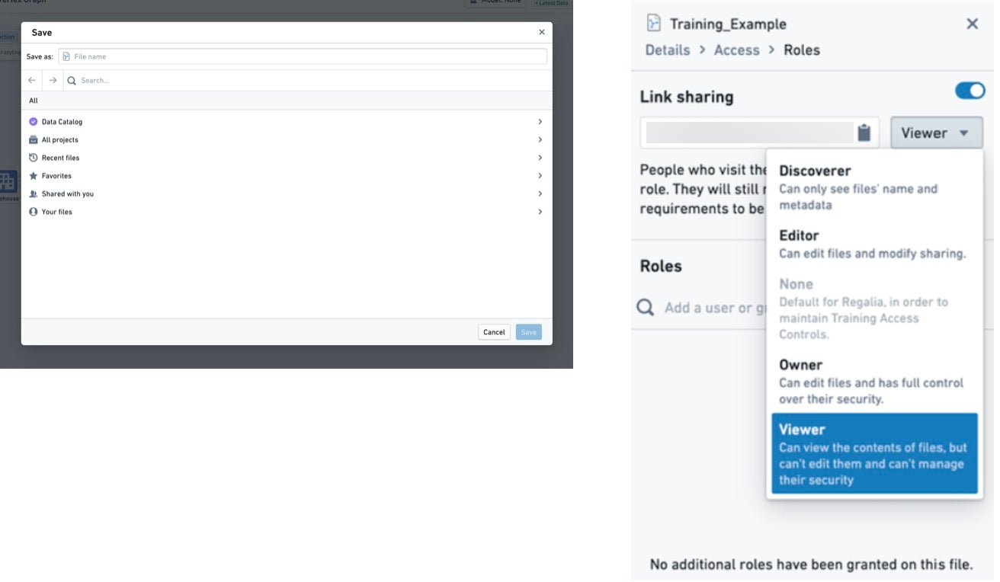
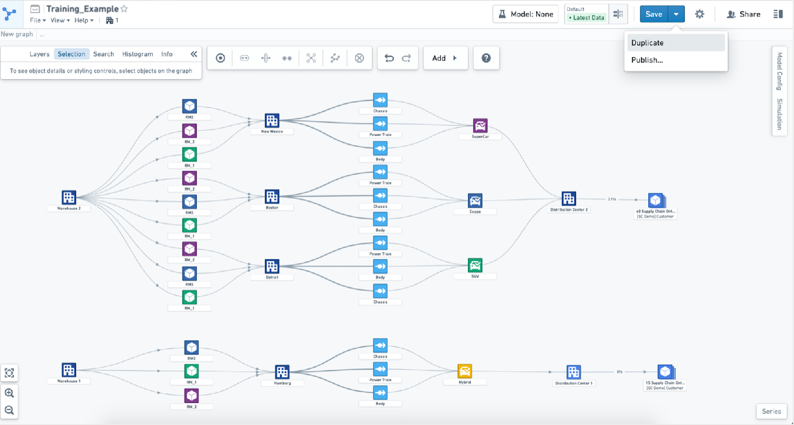
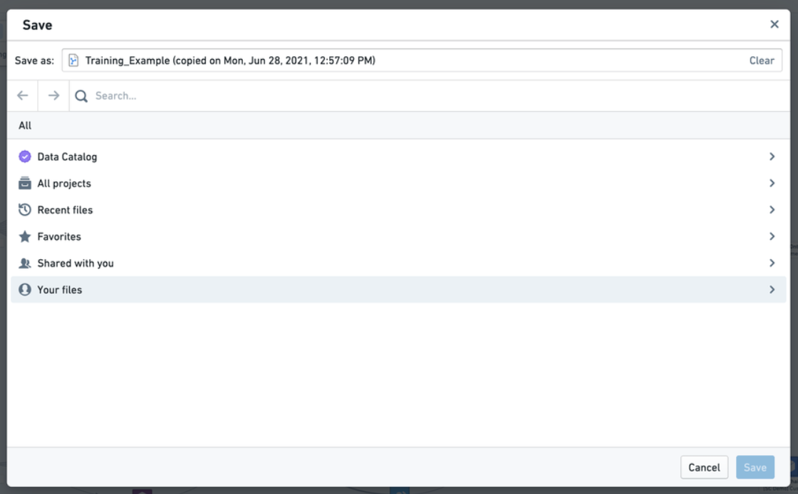
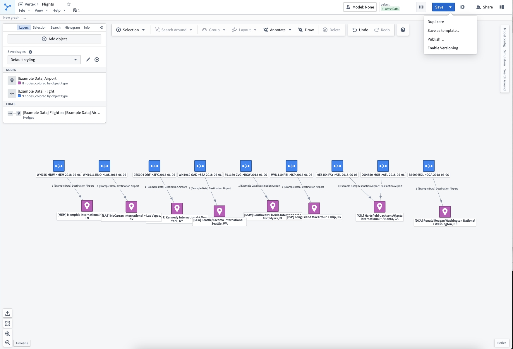
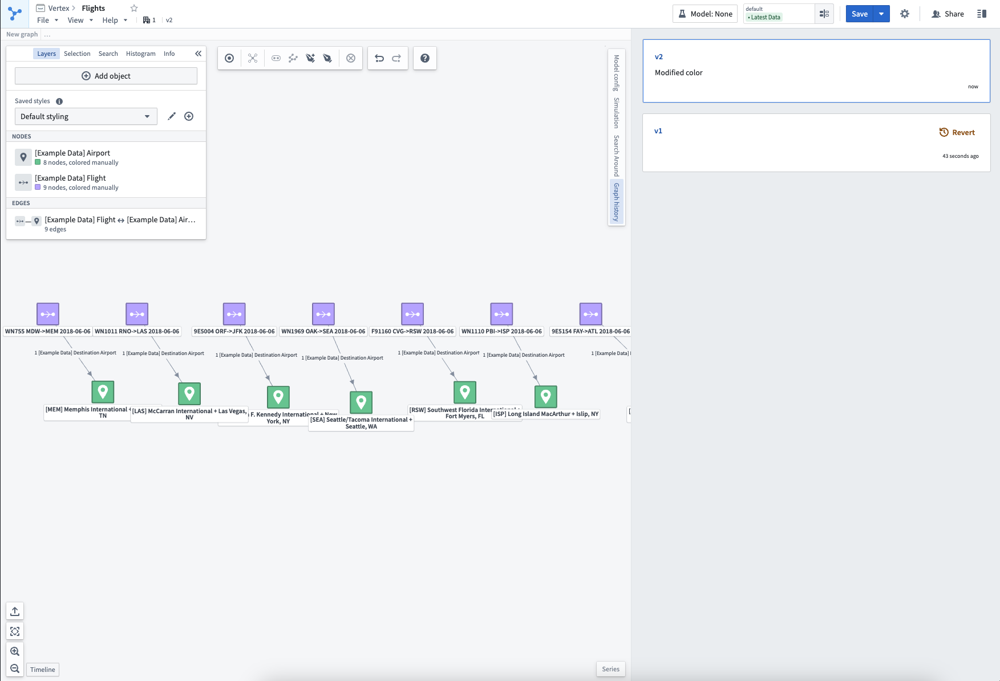

:::callout{theme="warning"}
注意：以下翻译的准确性尚未经过验证。这是使用 [AIP ↗](https://www.palantir.com/platforms/aip/) 从原始英文文本进行的机器翻译。
:::

# 保存、共享和协作

有多种方式可以保存和共享您的系统图或案例研究。

## 保存草稿

选择顶部工具栏中的**另存为**将提示您在相关的Foundry项目中保存图表。图表仅对有权限访问其所在项目的人可见。草稿首次保存后，选择**保存**将更新状态。

如果您希望更广泛地共享此图表，可以从顶部工具栏中的**共享**菜单中开启链接共享。在此菜单中，您可以选择希望用户在使用共享链接时允许的相关权限角色。当其他人访问链接时，您将在**角色**下看到他们的用户名。

共享图表不会授予用户对他们尚无权限访问的任何其他资源的访问权限。打开图表时，如果用户由于权限或已删除的数据无法访问图表中引用的任何对象或时间序列，他们仍将看到图表的结构和形状。用户将看不到与对象相关的具体数据。

## 复制现有图表

如果您希望从现有图表开始工作，可以从下拉**保存**菜单中选择**复制**。此操作将提示您在您选择的新项目中保存图表的副本。复制会创建一个新图表，您可以在此基础上工作而不更改原始图表。

## 版本控制

如果您希望跟踪图表随时间的更改，可以从下拉**保存**菜单中选择**启用版本控制**。随后的保存将创建图表的新版本。

可以在**图表历史**侧边栏中查看完整的版本历史记录。图表的以前版本可以以只读模式访问（当前版本号将在资源头部可见）。

通过从图表历史侧边栏中选择**还原**，将创建一个与所选版本内容相同的新版本。
