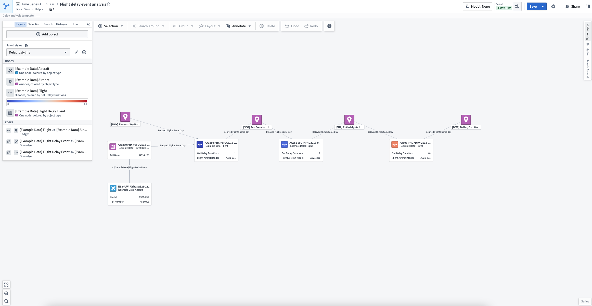
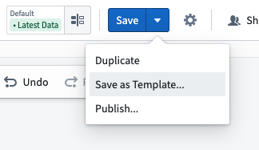
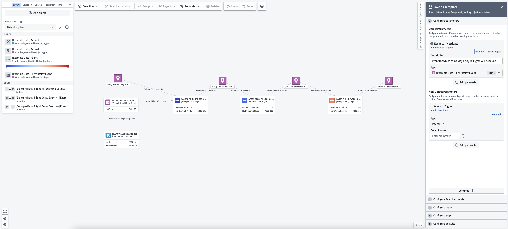
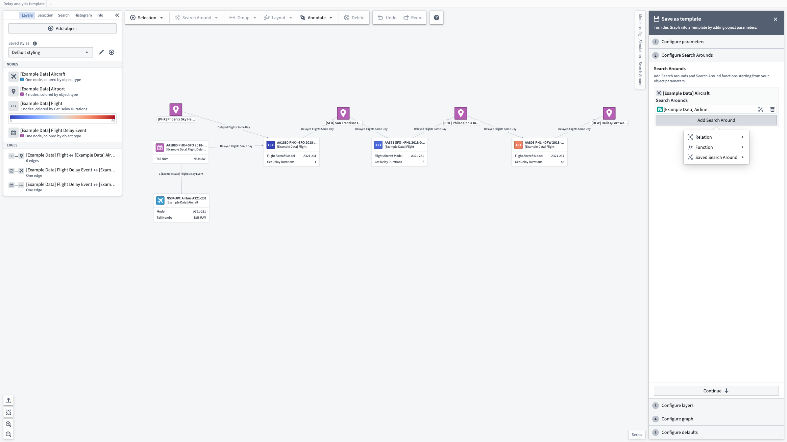
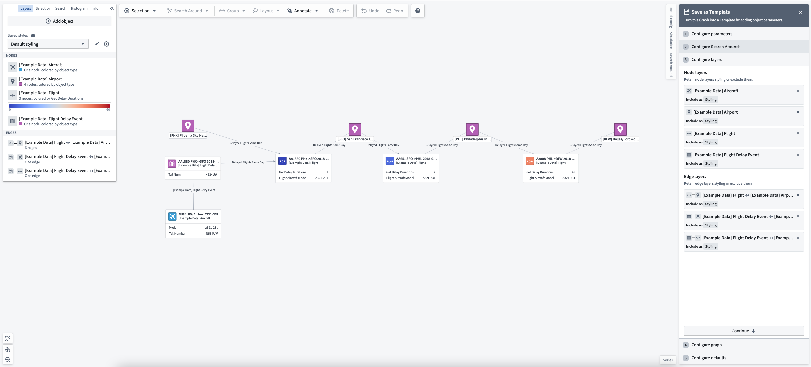
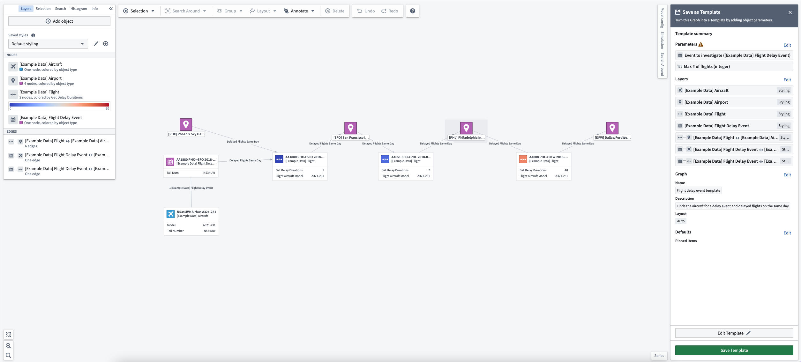
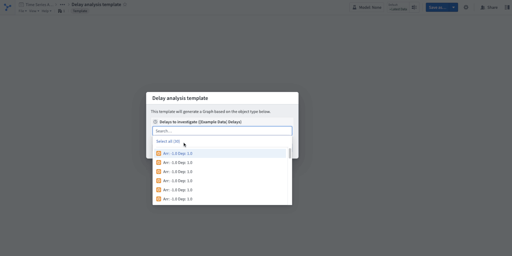

:::callout{theme="warning"}
注意：以下翻译的准确性尚未经过验证。这是使用 [AIP ↗](https://www.palantir.com/platforms/aip/) 从原始英文文本进行的机器翻译。
:::

# 创建图模板

Vertex 图模板是根据参数生成具有定义样式的图的资源。它们支持以下工作流：

* 将图分析从一个对象/对象集转向另一个对象/对象集。
* 创建一个可重用的资源，为消费者编码图生成工作流。
* 在另一个 Foundry 应用程序中嵌入图模板，例如 Object View 或 Workshop 应用程序。

任何 Vertex 分析都可以转换为图模板。将分析转变为模板可以更轻松地进行相同性质的未来分析。

在这个例子中，我们正在探索航空公司延误问题，通过分析一个与 `Aircrafts` 和其他在同一天于 `Airports` 延误的 `Flights` 相关联的航班 `Delay Event`，使用 Search Around 函数。生成航班延误调查图的分析如下图所示，以自由形式进行，没有强加的结构。通过从分析中创建图模板，我们可以在未来的调查中重用此分析模板。

要将此分析转换为图模板，请打开右上角工具栏中的保存选项并选择 **另存为模板...**。

这将打开一个助手，并提供 **配置参数** 的选项。图模板参数有两种：**对象参数** 和 **非对象参数**。

对象参数是您的模板的对象输入，使用模板时将添加到图中。添加对象参数还允许您对图模板用户提供的对象执行 Search Around 和函数。

非对象参数是可用作自定义 Search Around 函数或保存的 Search Around 的参数的附加参数。非对象参数支持的类型与 Search Around 函数支持的非对象参数相同。

接下来，您可以 **配置与模板相关联的 Search Around**。每个对象参数都可以与 Search Around 关联，这些 Search Around 可以是使用 Ontology 链接的简单 Search Around，Search Around 函数或通过 Search Around 边栏构建的保存 Search Around。任何非对象参数到 Search Around 函数或保存 Search Around 的输入都可以映射到一个值，该值可以是常量或参数。要将输入映射到参数，请选择输入框左侧的参数按钮，并从下拉列表中选择一个参数。

在添加任何所需的参数和 Search Around 后，您可以 **配置与模板相关联的图层** 和图层样式。样式化图层将保存当前在您的图上存在的样式。排除的图层将在保存的模板中省略图层样式。

最后，在选择要应用的设计和保留当前分析中的哪些图设置后，您可以查看 **模板摘要** 并选择保存您的模板。

## 使用图模板

一旦打开模板，系统会提示您提供模板参数的值。

对象或对象集也可以通过 URL 查询参数预加载到模板中：

* **对象：** 使用查询参数 `objectRid=<your_object_rid_here>`
* **对象集：** 使用查询参数 `objectSetRid=<your_object_set_rid_here>`

要与给定参数值进行交互，请使用顶部工具栏中的 **参数** 按钮。这将允许您选择用作给定对象参数值的所有对象，或更改参数值以重新生成您的图。

:::callout{theme="neutral"}
模板也可以通过 [Vertex 微件](%E5%9C%A8Workshop%E6%A8%A1%E5%9D%97%E4%B8%AD%E5%B5%8C%E5%85%A5%E5%9B%BE%E5%BD%A2.md) 嵌入到 Workshop 中。
:::
