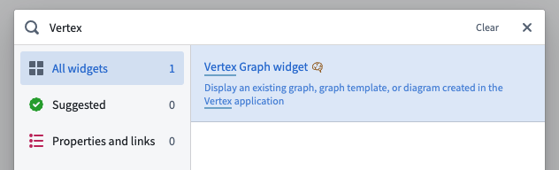

:::callout{theme="warning"}
注意：以下翻译的准确性尚未经过验证。这是使用 [AIP ↗](https://www.palantir.com/platforms/aip/) 从原始英文文本进行的机器翻译。
:::

# 在Workshop模块中嵌入图形

图形、图形模板和图表可以嵌入到Workshop模块中。

图形模板也可以直接从Workshop变量中传递参数值。

在Workshop模块中嵌入模板主要分为三个步骤：

1. [在Workshop中添加Vertex图形微件](#add-a-vertex-graph-widget-in-workshop)
2. [选择资源](#choose-a-resource)
3. [配置微件](#configure-the-widget)

## 在Workshop中添加Vertex图形微件

在Workshop模块中选择的部分，点击\*\*+**图标或**+添加微件**按钮以打开微件菜单，并搜索**Vertex图形\*\*微件。

## 选择资源

在微件编辑器中，通过点击**选择**，选择要嵌入的图形、图形模板或图表资源。只有兼容的资源才会显示在资源选择器中。

## 配置微件

对于**Vertex图形**微件，核心配置选项如下：

* **输入**
  * **资源**
    * **静态：** 选择此资源模式时，使用资源选择器选择单个输入资源。如果选择的资源是图形模板，可以提供非必填的**覆盖图形RID**。如果提供，则会显示此图形，而不是默认的使用模板及其参数生成图形的行为。这允许，例如，从保存于对象属性中的RID加载现有图形。
    * **变量：** 选择此资源模式时，输入资源由一个应包含图形、图形指针或图形模板RID的字符串变量提供。
  * **参数：** 嵌入图形模板时，使用Workshop变量为模板参数提供值。
  * **子图：** 嵌入具有多个子图的图形或图表资源时，可以通过选择Workshop中的对象集变量来选择要显示的子图，该变量包含子图中的任何对象。
  * **刷新键：** 每当此变量的值更改时，微件将完全重新加载图形。
  * **从场景加载数据：** 启用此切换以使用场景而不是基础Ontology加载给定资源。
  * **应用场景后重新生成图形：** 设置后，每次场景修改后图形将刷新。
* **交互**
  * **选定对象：** 此选项输出当前选定对象的对象集。此对象集可以在当前模块中的下游微件中使用。
  * **当选定对象更改时：** 配置Workshop事件以在图形上的选定对象更改时触发（例如，触发器可以打开抽屉式导航以查看选定对象的更详细视图）。
  * **缩放到对象集：** 设置视口以显示给定对象集中的对象，每当输入更改时。
* **时间配置**
  * **选定时间：** 启用时，此设置使用类型为`Timestamp`或`Date`的Workshop变量控制图形上的选定时间。
  * **时间窗口：** 启用时，此设置使用两个类型为`Timestamp`或`Date`的Workshop变量控制图形上使用的时间窗口。
* **功能**
  * **只读模式：** 打开只读模式将移除编辑功能并隐藏工具栏。[了解更多关于只读模式的信息。](%E5%8F%AA%E8%AF%BB%E6%A8%A1%E5%BC%8F.md)
  * **启用切换到Vertex应用程序：** 启用以显示按钮，允许用户以其当前状态打开Vertex应用程序。
  * **启用导出为PNG** 启用以允许将当前图形以PNG格式导出，适用于具有前端导出权限的嵌入资源用户。
  * **保存设置** 启用以允许用户保存当前图形。
    * 当嵌入的资源是图形模板时，保存将创建一个新图形。
      * 此图形将被命名为**默认资源名称**并放置在**默认文件夹**中。如果启用了**显示资源对话框**，用户将被提示选择资源名称和位置，配置的名称和文件夹将在资源对话框中显示为起始点。
      * 如果成功创建图形，**在创建新图形时**定义的事件和/或Ontology操作将被触发。只有创建图形的初始保存会触发此操作，而不是后续保存。如果您希望使用创建的图形RID作为操作参数的输入，请在参数输入选择器中使用特殊的**已保存图形RID**选项。所有必需的参数必须配置为定义的默认值，因为操作表单将不会向用户显示。
    * 当嵌入的资源是图形时，保存将简单地更新嵌入的图形资源，而不是创建新的资源。
* **界面**
  * **图例/对象面板：** 启用时，此切换将在左侧显示层、对象和当前选择。
  * **时间选择面板：** 启用时，此切换将在右侧显示时间滚动条。
  * **系列面板：** 启用时，此切换将在底部显示系列面板。
  * **输入不完整消息** 当由于缺少必需输入而无法运行图形模板时，此消息将在对话框中显示给用户。

:::callout{theme="neutral"}
以前，模板输入是使用包含图形模板中定义的所有必需对象类型的单个输入对象集变量提供的。现在不鼓励这样做，因为它仅适用于没有非对象参数且每个对象类型只有一个对象参数的模板。但是，如果您希望使用此功能，请选择**使用旧版输入对象集**复选框并提供对象集变量。
:::
