:::callout{theme="warning"}
注意：以下翻译的准确性尚未经过验证。这是使用 [AIP ↗](https://www.palantir.com/platforms/aip/) 从原始英文文本进行的机器翻译。
:::

# 探索Object关系

Vertex允许您可视化并量化现实世界组织的数字孪生中的因果关系。使用Vertex，您可以访问并探索您的组织已发布的现有图形或搭建新图形。

## 开始新的探索

Vertex可以从Foundry工作区侧边栏的**应用程序**部分下的**运营应用程序**标题中启动。要启动新的探索，从应用程序列表中选择**Vertex**并点击\*\*+ 新建图形\*\*图标。

当开始新的探索时，会打开一个空白工作区，您可以选择\*\*+ 添加Objects\*\*以开始。从Object搜索弹出窗口中，选择您感兴趣探索的Object(s)以开始创建您的图形。

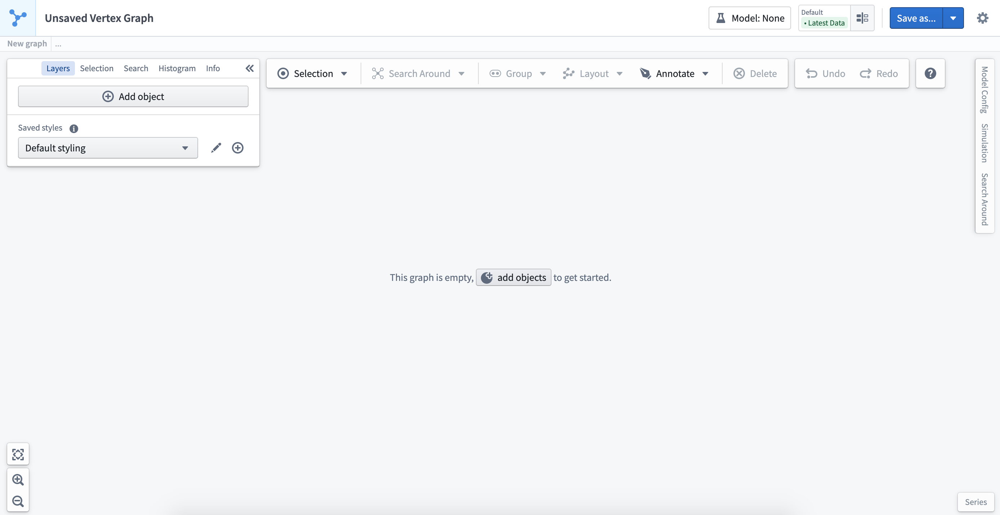

### Object选择面板

当您点击图形上的一个Object时，选择面板将自动打开以显示该Object的属性。

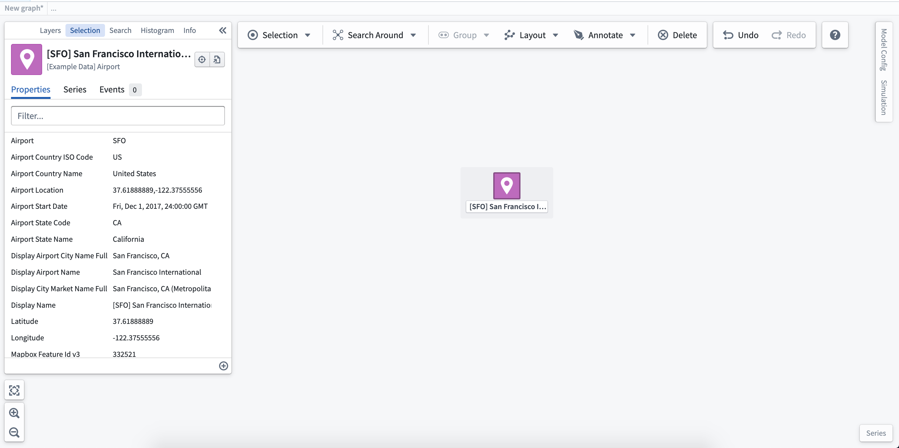

选择选择面板右下角的\*\*(+)\*\*符号将允许您添加[派生属性函数](%E4%BD%BF%E7%94%A8%E5%87%BD%E6%95%B0%E6%B4%BE%E7%94%9F%E5%B1%9E%E6%80%A7.md)。在这种情况下，一个简单的函数计算与机场相关的航线上警报的总数。派生属性显示在选择面板的顶部。

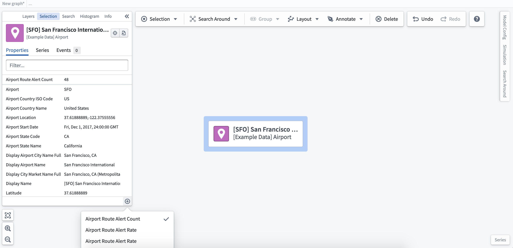

## 探索相关Objects

Vertex允许您遍历运营关系以构建您的图形可视化。从单个节点或节点组，您可以右键点击以查看您的选择、设计和探索选项。

### 搜索周边

从相关Object列表中选择以将其添加到图形中。每种类型的Object总数显示在下拉列表中。对于大量的Object，您应该考虑使用Object数量旁边的筛选图标以包含其他筛选。这将打开**搜索周边**面板，您可以在其中添加筛选并跨多个步骤进行搜索。

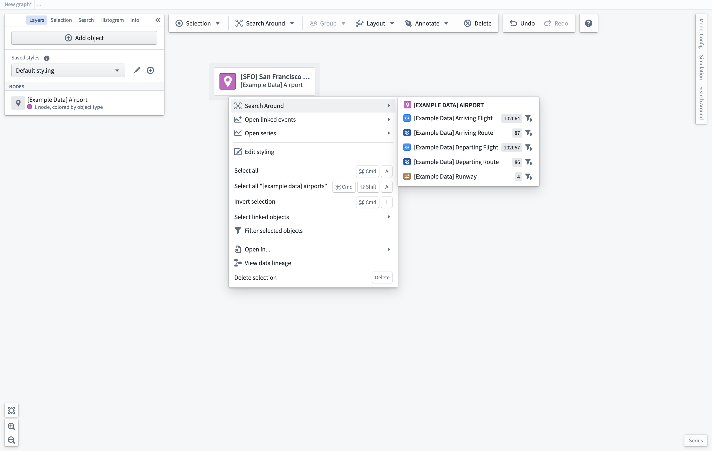

### 搭建多步搜索周边

从图形上的Object运行基本搜索周边是探索您的Ontology并快速将相关Objects添加到图形中的好方法。在您希望创建跨不同Object类型的多步、筛选图形的情况下，**搜索周边**面板提供了一个点选界面，以便在生成新图形时搭建逻辑。

您可以通过选择基本**搜索周边**下拉列表中的筛选图标或通过工作区右侧可用的选项卡来访问**搜索周边**面板。要开始搜索周边，选择一个单个Object或相同类型的Objects；然后，您可以通过选择链接从您的选择中创建搜索周边。

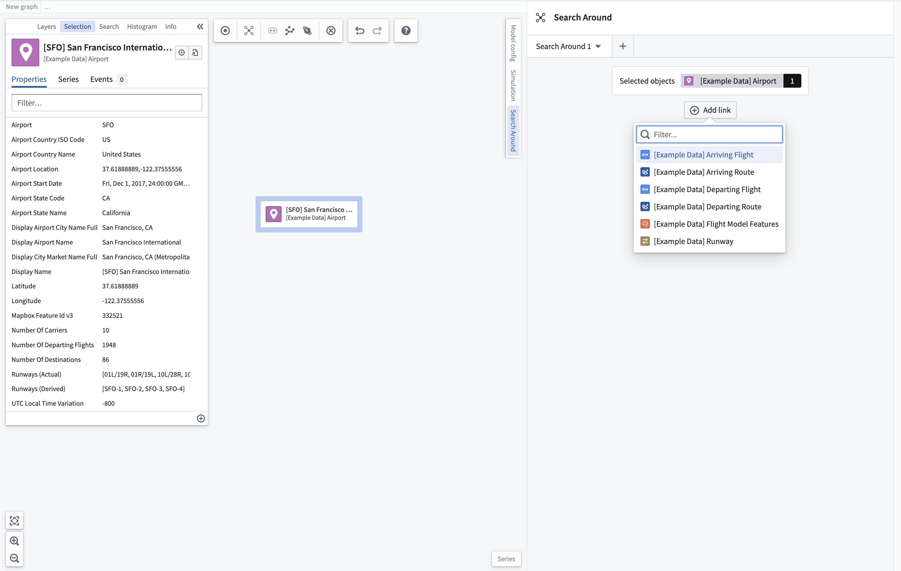

如果您想更新您的起始Objects集，选择一个新的Object（或一组Objects）并点击当鼠标悬停于起始Objects框时出现的**设置起始Objects**选项。

### 查找相关Objects

一旦您选择了要添加的相关Object(s)，找到的Object数量将显示在结果Object类型旁边。要进一步筛选返回的Objects，请点击**添加筛选**按钮并选择您希望用于筛选结果对象集的属性。

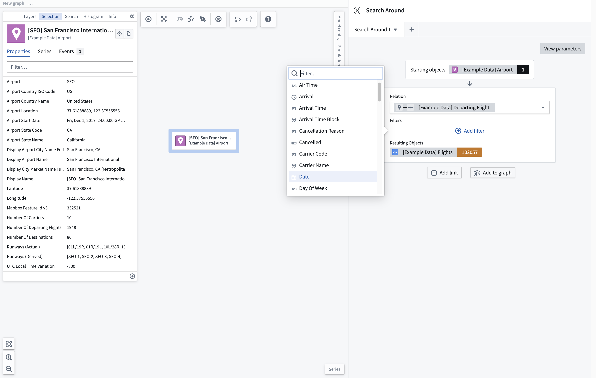

一旦您筛选了您的对象集，您可以选择立即将其添加到您的图形中，或继续使用**添加链接**按钮搭建跨多个Object的多步搜索周边。

搜索周边中的下一个链接将以先前链接的结果对象集作为其起始对象集。使用此新搜索周边产生的对象集，您可以找到其他相关Objects以添加到图形中；在这种情况下，为Link 1生成的航班的目的地机场。

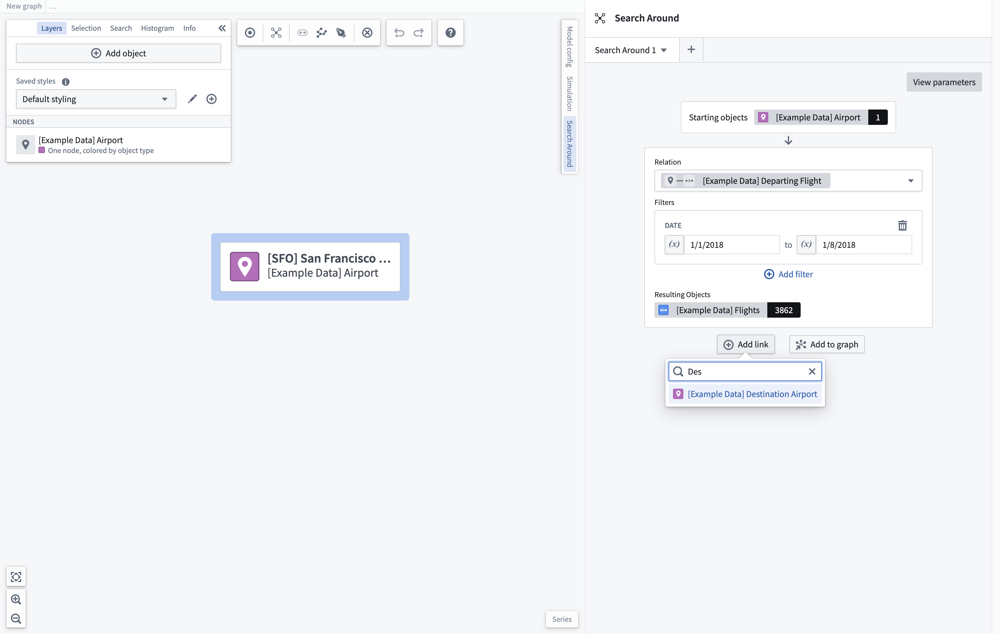

一旦您添加了新的相关对象集，您可以进一步筛选此对象集。应用筛选后，起始对象集将被筛选为那些连接到筛选结果对象集的Objects。在这种情况下，157个航班正在前往纽约州的机场。

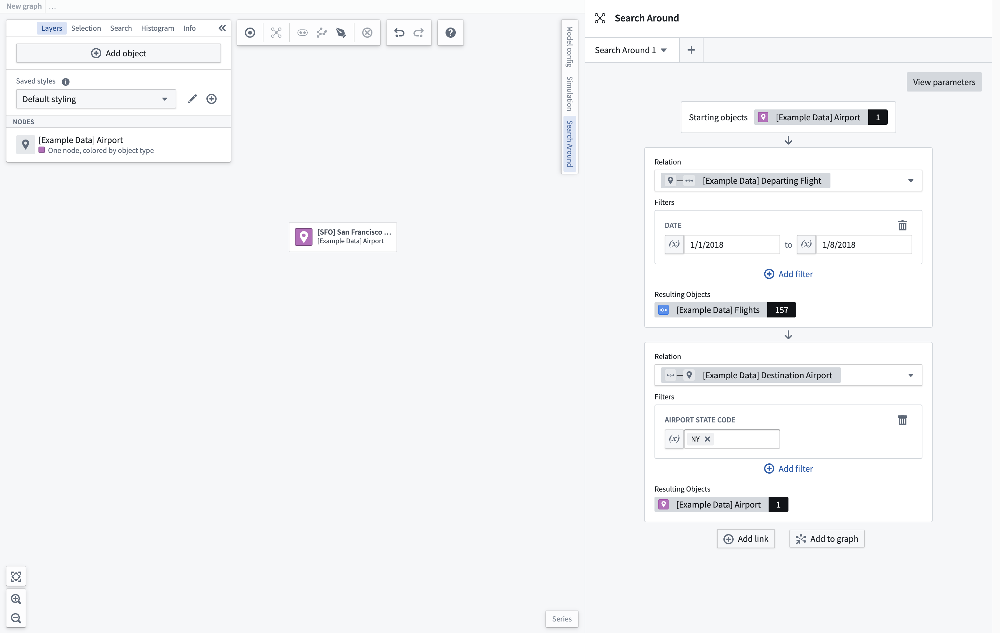

选择**添加到图形**以根据在搜索周边面板中定义的遍历生成新图形。根据搜索周边的复杂性，生成图形可能需要一些时间。

### 添加参数

为提高搜索周边的可重用性，您可以定义可在整个搜索周边中使用的参数。选择面板右上角的**查看参数**按钮以查看任何现有参数或创建新参数。选择**添加参数**按钮以选择要添加的参数类型。

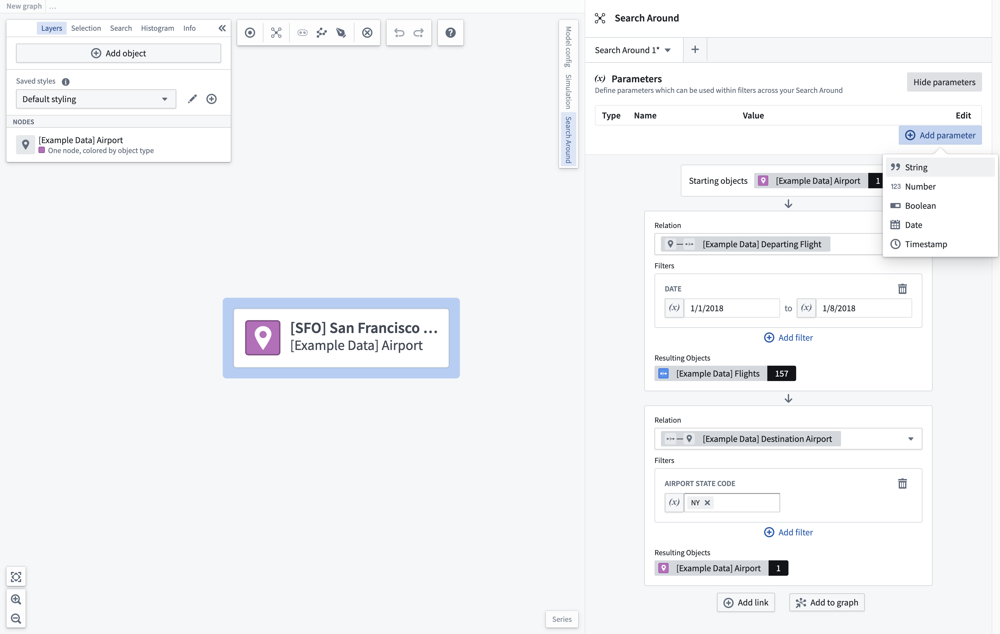

一旦您添加了参数，您可以为其赋值或选择编辑按钮以更改其名称、描述和默认值，这将在加载此搜索周边时使用。

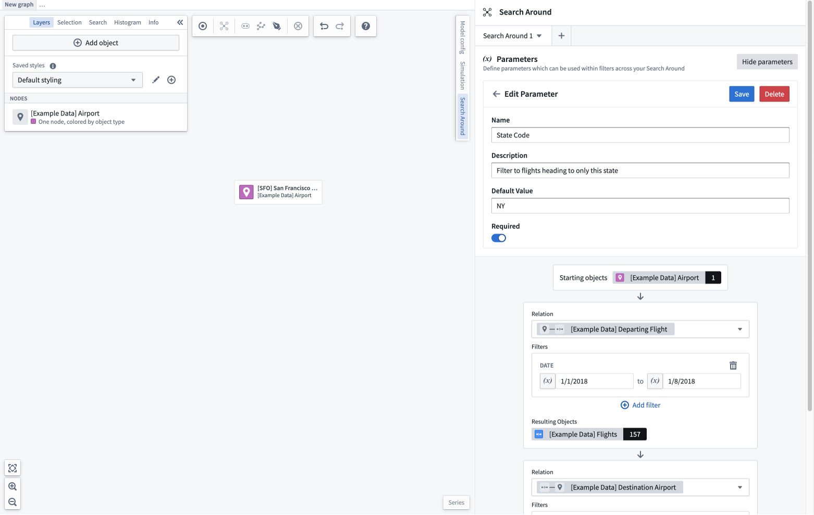

然后，您可以在任何适当类型的筛选字段中使用此参数。要使用参数，请选择筛选字段旁边的参数切换按钮，然后从下拉列表中选择参数。当更改参数的值时，搜索周边将更新以反映该参数使用位置的新值。

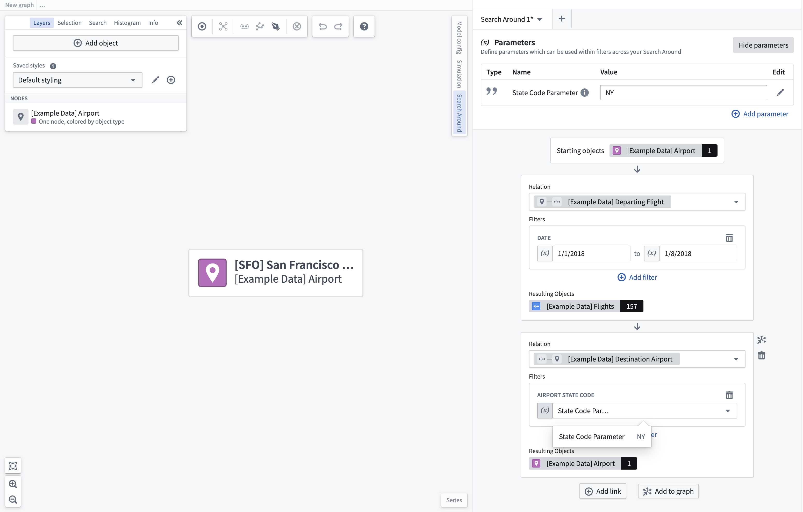

### 保存和加载

如果您希望在其他图形或图形模板中重用此搜索周边，您可以将其保存为资源。为此，选择您希望保存的搜索周边选项卡旁边的下拉列表。这将打开一个模态窗口，您可以选择搜索周边的名称和保存位置。

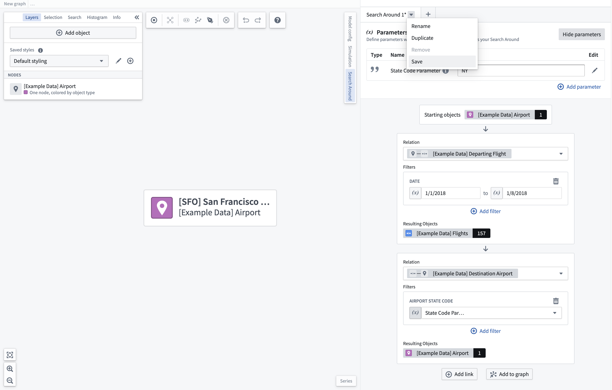

通过搜索周边选项卡标题中的\*\*+**图标添加新的搜索周边时，选择**加载搜索周边\*\*选项将打开资源选择器，允许您选择要打开的搜索周边。在加载搜索周边时，系统将提示您从图形中选择要用作搜索周边起始对象集的Objects。只能选择适当类型的Objects。

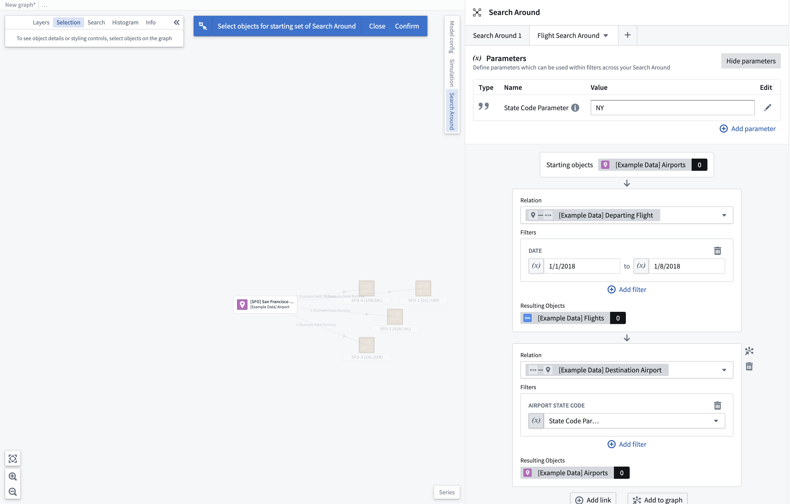

## 直方图筛选

一旦您构建了您的对象图形，您可以使用直方图筛选来探索和筛选图形。直方图显示所选对象的属性，并提供每个属性的总值。直方图中的选择将反映在图形中，为您的探索提供更多的细粒度。

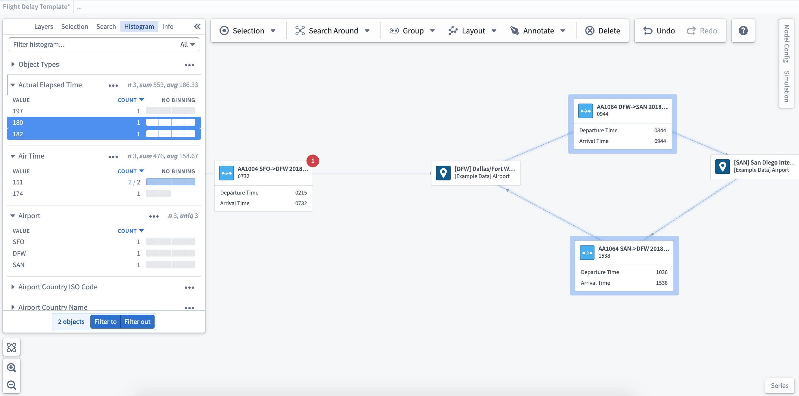
