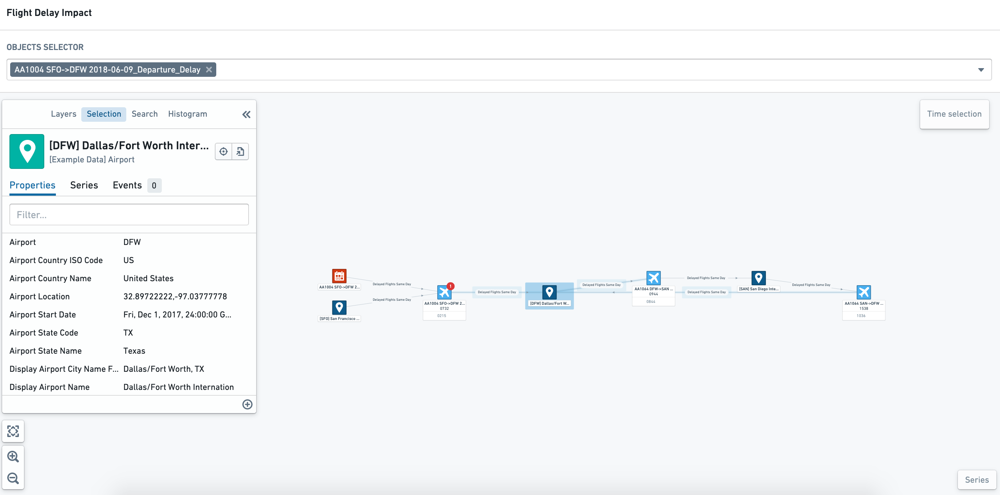
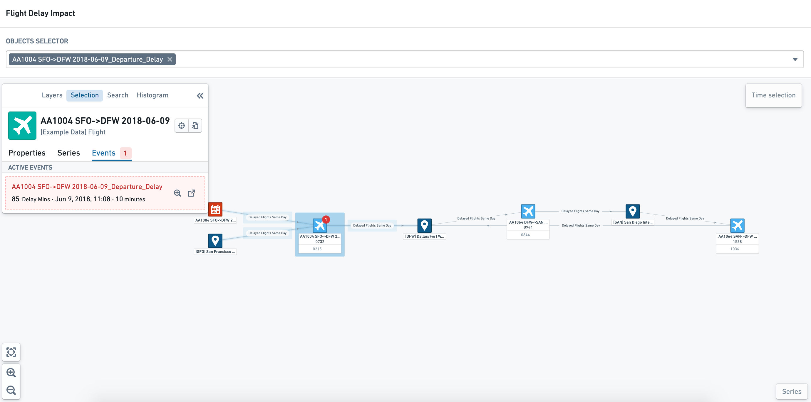
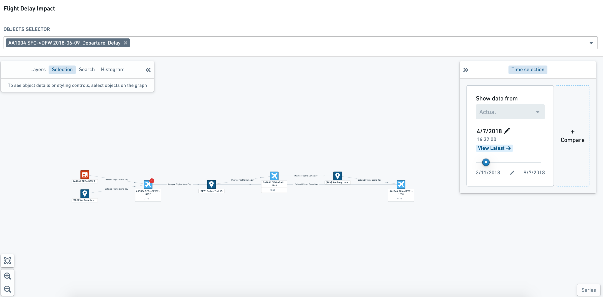
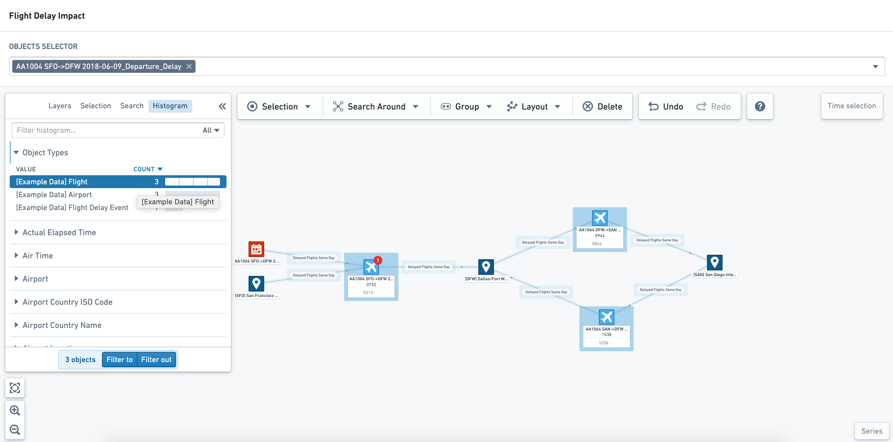
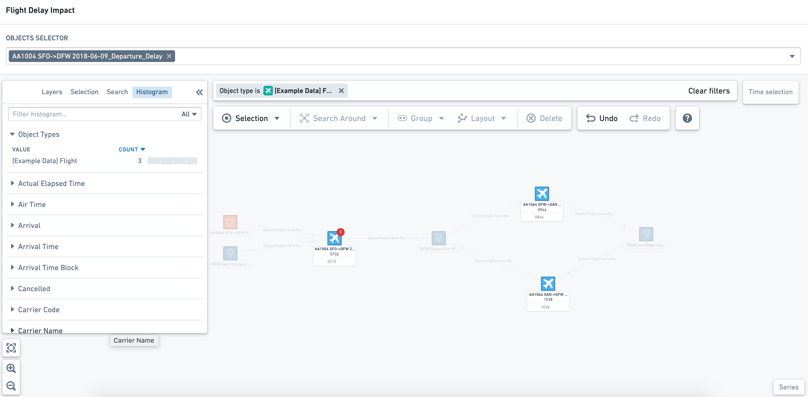
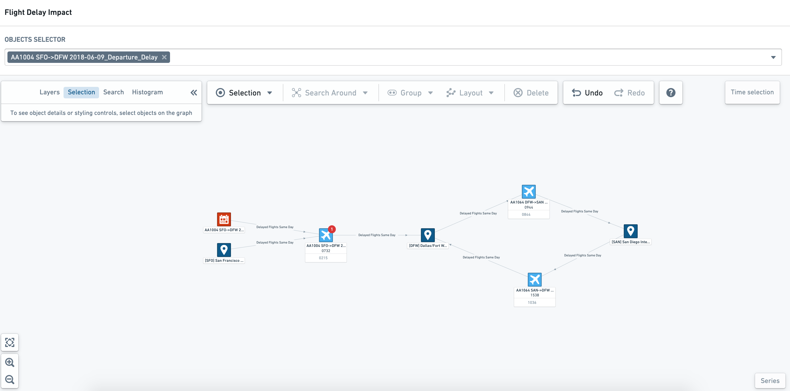
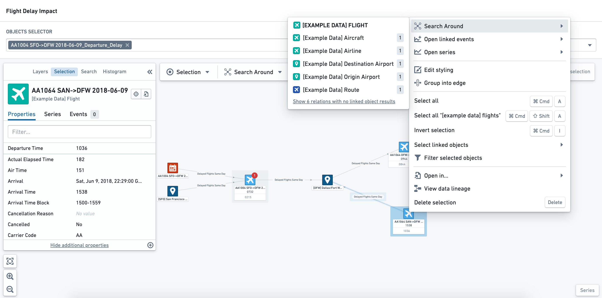
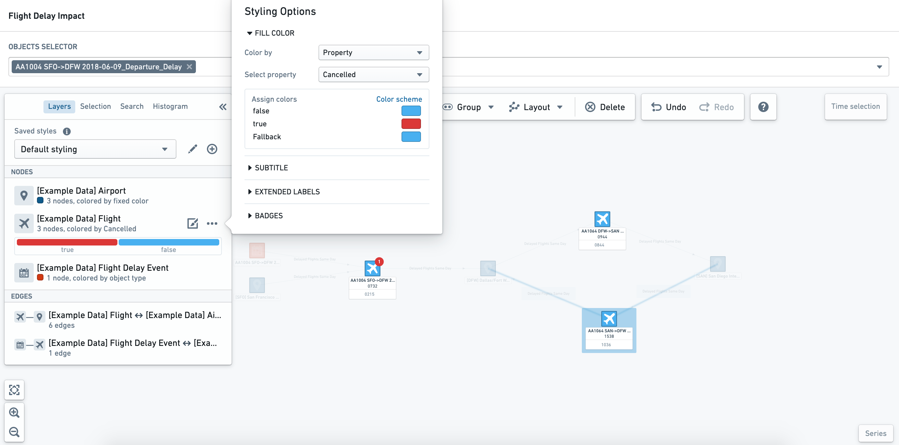

:::callout{theme="warning"}
注意：以下翻译的准确性尚未经过验证。这是使用 [AIP ↗](https://www.palantir.com/platforms/aip/) 从原始英文文本进行的机器翻译。
:::

# 探索现有图表

## Object探索

如果您在图表中选择一个感兴趣的Object，您将在侧边栏的**选择**标签中看到其属性。

Objects的节点标签中可能还会显示关键信息或指标。下面的示例显示了航班的出发和到达时间。

## 关联事件

如果一个Object有相关的事件，可以配置为在受影响的Object上显示为*徽章*。如果您点击一个具有相关事件的Object节点，可以在**Object选择**侧边栏的**事件**标签中查看详细信息。

### 了解当前状态和随时间变化

Objects可以根据Object类型、属性值、时间序列或事件进行样式化。在下面的示例中，应用了以下样式：

* 机场Objects被着色为深蓝色
* 航班被着色为浅蓝色，如果`取消状态`等于`True`，则显示为红色
* 航班延误事件被着色为红色
* 航班延误事件在**航班Object**节点上显示为红色徽章

使用时间选择面板，您可以“拖动”（拖动光标）查看，通过动态样式，属性如何变化。下面的截图显示了事件徽章仅在事件进行时出现（即在事件的开始和结束时间之间）。

### 筛选和探索Object属性

在只读模式下，您可以使用侧边栏中的**直方图**标签根据Object类型和属性筛选图表视图。

一旦您选择了感兴趣的Objects，可以选择**筛选至**或**筛选出**以将直方图选择应用于图表。图表画布顶部显示应用的筛选；您可以通过点击特定参数旁边的**x**符号移除单个Object筛选，或者选择**清除筛选**移除所有筛选。

## 探索Object关系

对于更具探索性的工作流程，您可能希望与图表视图互动，以了解更广泛的关系和不同的指标。在这些可编辑的Object图表视图中，您可以执行许多在完整Vertex应用程序中可用的操作，包括搜索周围、样式和设计更改。

:::callout{theme="neutral"}
在Workshop模块中对图表所做的更改不会更新用于生成图表的基础模板。如果您希望永久更改Workshop中的视图，您需要更新基础模板。
:::

在图表画布的顶部，您可以看到如下所示的附加探索工具栏。

### 探索关系

选择一个Object并右键点击打开**操作**菜单。此菜单允许您搜索周围以查找相关的Objects和事件，以向图表视图中添加其他节点。

### Object和边节点样式

一旦您选择了感兴趣的Object节点或边，您可以在侧边栏的**图层**标签中更新和更改样式。

:::callout
在Workshop模块中对样式所做的更改不会被持久化。但是，您可以在基础模板中配置多个*保存的样式*。
:::

