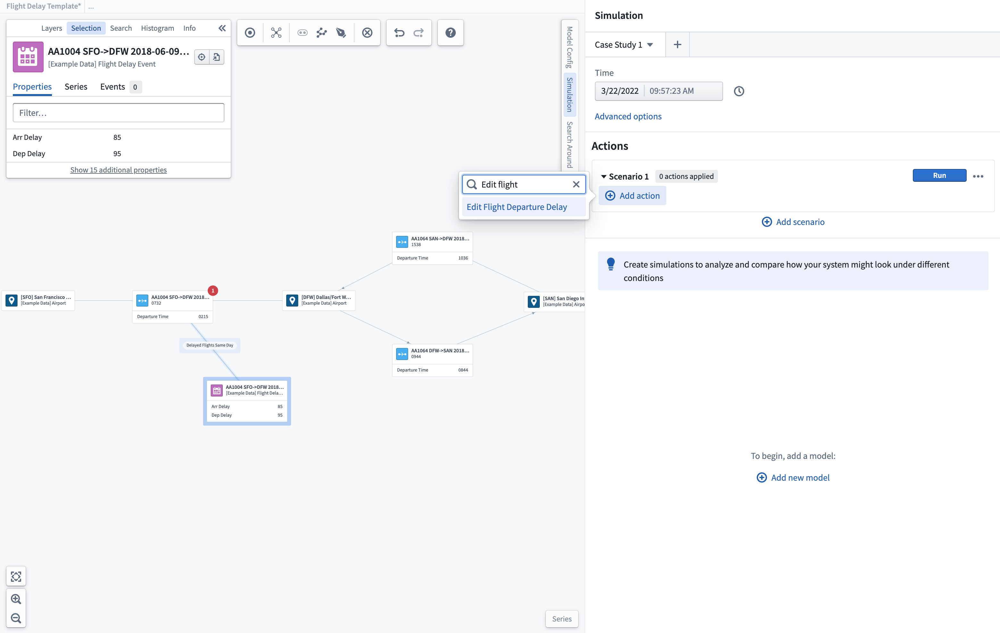
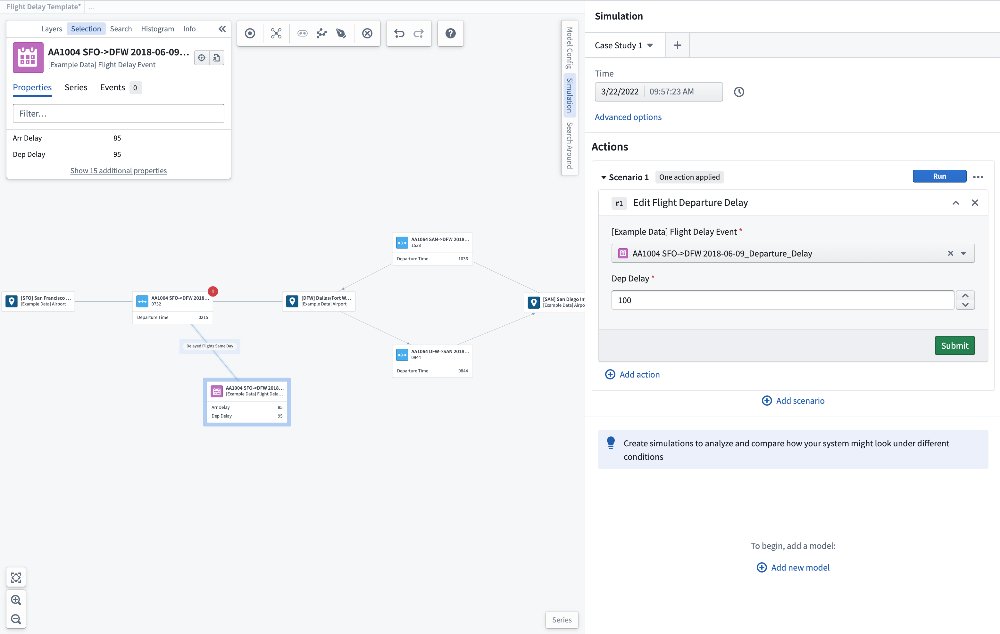
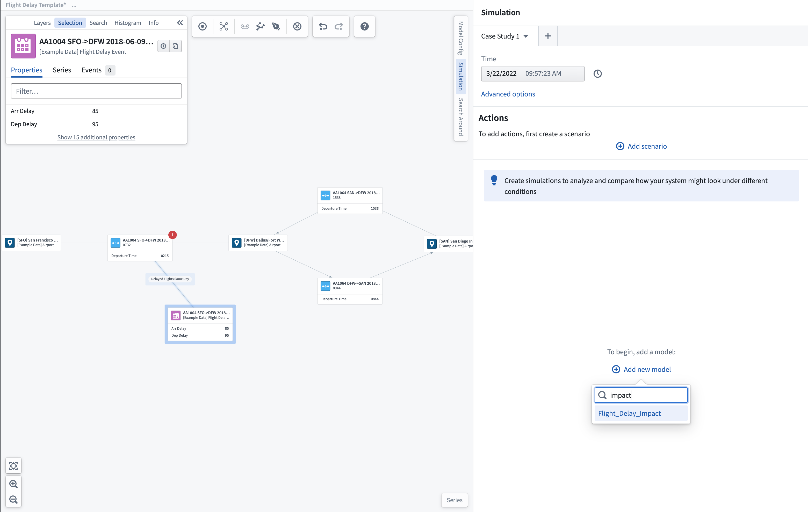
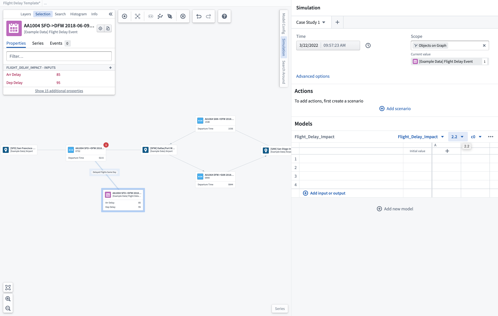
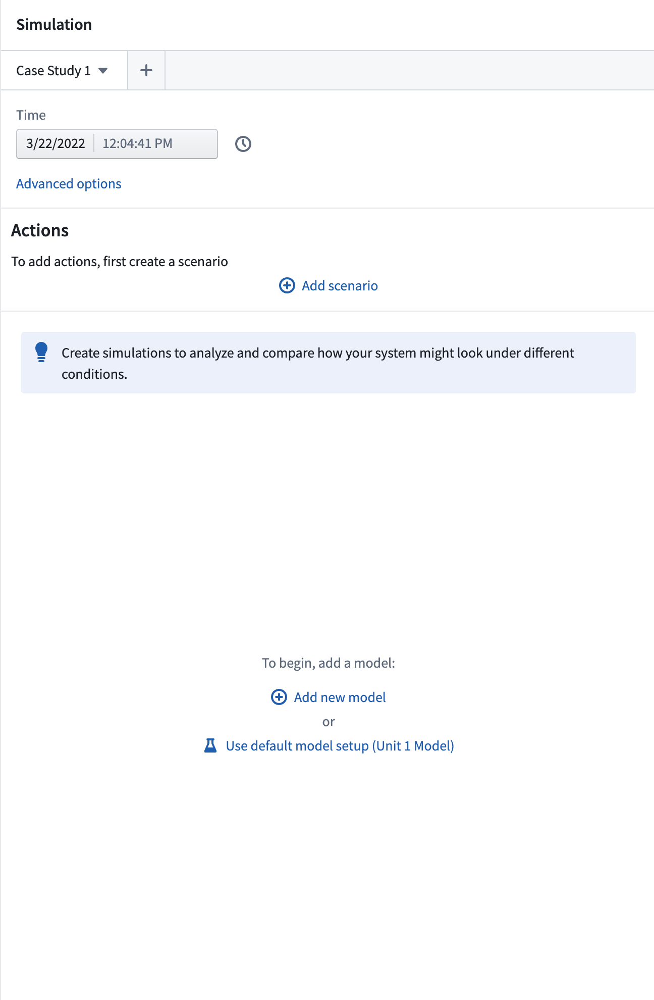
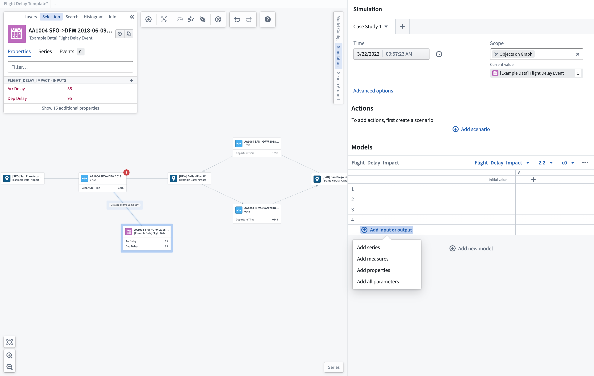
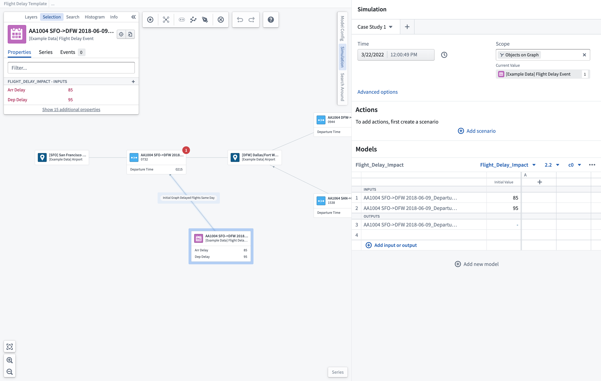
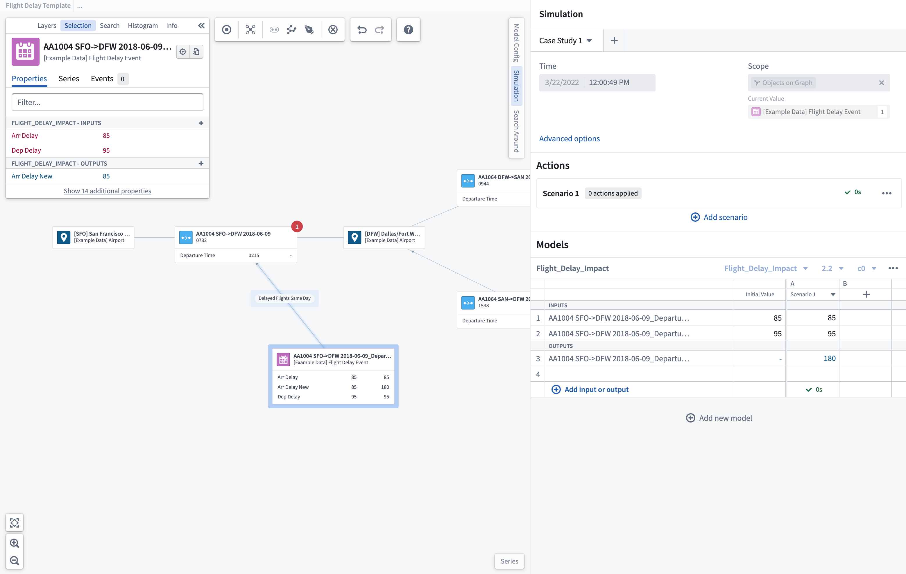
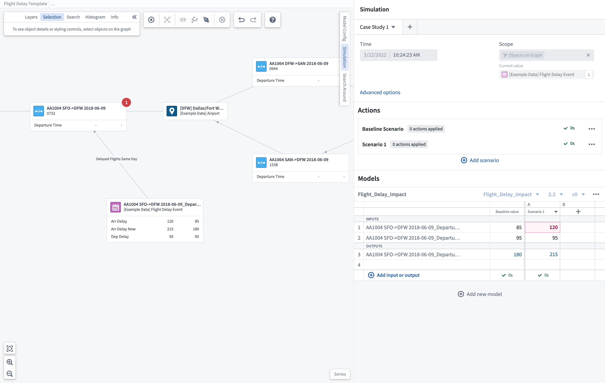
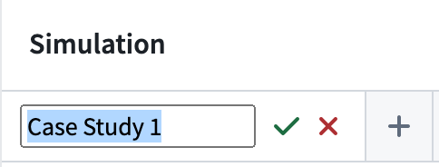

:::callout{theme="warning"}
注意：以下翻译的准确性尚未经过验证。这是使用 [AIP ↗](https://www.palantir.com/platforms/aip/) 从原始英文文本进行的机器翻译。
:::

# 入门指南

[场景](%E6%A6%82%E8%A7%88.md) 允许您通过询问系统的“如果...会怎样？”问题来了解不同条件或决策路径的影响。Vertex 利用在 Foundry 中编写、发布和编排的现有模型，提供一个界面来可视化系统中的建模交互，并选择性地覆盖关键参数，以了解可以采取的替代操作以达到最佳输出。

## 添加操作

您可以测试使用预配置的操作来修改Ontology中的对象，可能对您的本地和整体系统产生的影响。

### 选择操作

要开始添加操作，请首先选择 **添加场景** 按钮。这将创建一个新场景，您可以向其添加操作。您可以通过选择场景并选择 **添加操作** 按钮来展开场景部分。

在选择要添加的操作后，您必须更新操作的参数并选择 **提交** 以在场景中保存此操作。

然后，您可以运行此场景并查看您创建的操作的效果。

您还可以添加更多操作或继续添加模型到场景中，以进一步模拟对系统的影响。

## 选择模型

您可以从 Foundry 中已发布并绑定到Ontology的现有模型或函数中进行选择，使用[建模目标](https://www.palantir.com/docs/foundry/model-integration/objectives/)。在 Vertex 中，您可以创建一个场景案例研究，以调查和了解局部过程，并量化个体更改可能对本地和连接系统的影响。

### 新模型选择

要开始新的调查，您可以从任何已发布的模型中进行选择。选择 **添加新模型** 并搜索与您的过程相关的模型。

这将把所选模型添加到场景面板中，并允许您选择正确的模型和配置版本以开始新的案例研究。

### 默认模型选择

在探索现有系统或过程时，您可以选择从推荐的预配置默认模型中运行场景。

这将把相关模型添加到场景面板中，并允许您选择正确的模型和配置版本以开始新的案例研究。

[了解更多关于可以为您的场景配置的选项。](%E5%9C%BA%E6%99%AF%E9%80%89%E9%A1%B9.md)

## 选择输入/输出参数

您可以使用 **+ 添加输入或输出** 选项在场景表中添加要显示的参数。从这里，您可以选择将单个时间序列、对象属性或措施添加到您的场景中。这将打开一个搜索和选择框，其中包含为所选模型配置的输入/输出。您也可以默认选择 **添加所有参数**，这些参数已预配置。任何选择的参数将显示在场景表中；如果参数是输入，可以在运行场景前通过手动编辑场景表中的值来覆盖。

:::callout
一旦选择了模型，任何用作输入/输出参数的属性将显示在对象选择面板中。
:::

## 运行一个场景

添加参数后，当前参数的值将显示为输入，使用当前选择的时间来表示任何时间序列参数。选择 **运行** 将生成一个场景来计算基于显示的输入值的模型输出。一旦完成，场景将显示绿色勾号和生成输出所花费的时间。

## 搭建您的“如果...会怎样”案例研究

为了测试可能的解决方案，您可以搭建您的案例研究并迭代“如果...会怎样”场景。

通过选择要覆盖的参数并输入新的模拟输入来输入覆盖条件。这将突出显示覆盖的框。

运行具有覆盖值的场景将显示新计算的输出，以便与运行的基线场景进行比较。您可以继续添加不同的场景运行，以调查最佳输出。

模拟值将作为比较显示在添加到对象节点扩展标签的读数中。

完成一组案例研究后，您可以在场景面板顶部重命名此案例研究。您可能希望创建多个不同的案例研究，以调查同一系统中的不同条件。您也可以重命名单个场景，以更好地捕捉所涉及的操作。

## 链接模型

[了解如何配置链接模型。](%E9%85%8D%E7%BD%AE%E9%93%BE%E5%BC%8F%E6%A8%A1%E5%9E%8B.md)
