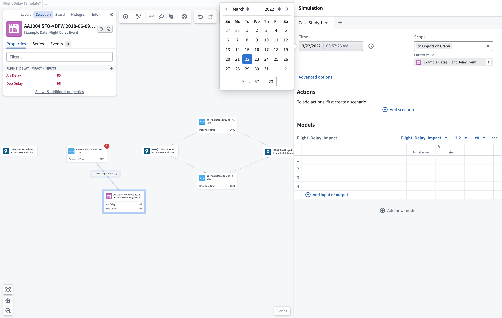
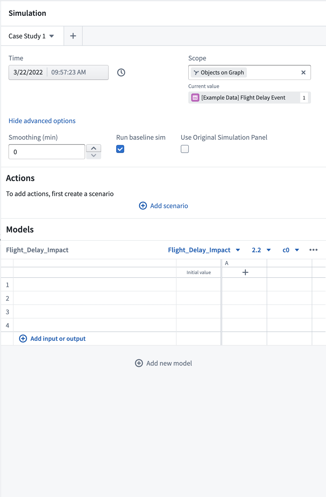
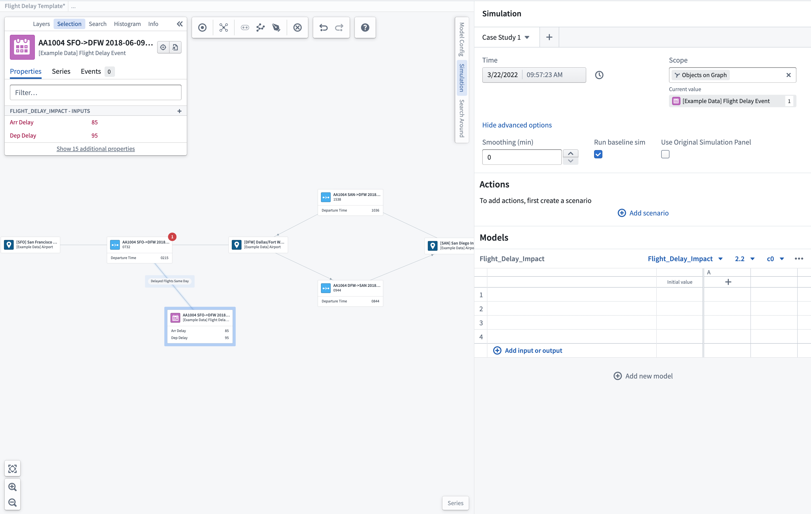
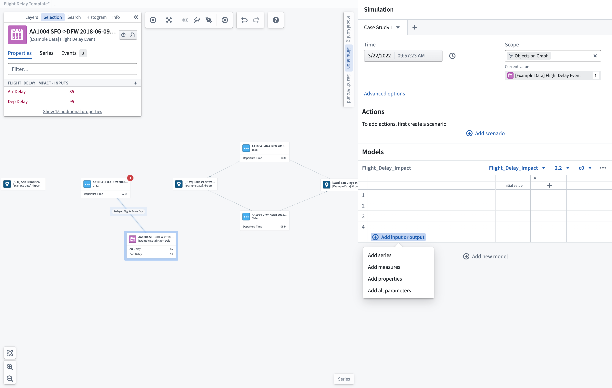
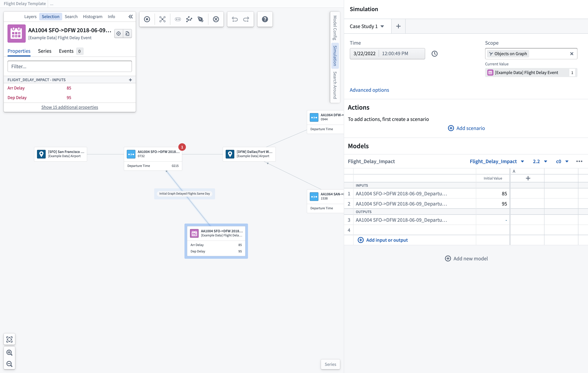

:::callout{theme="warning"}
注意：以下翻译的准确性尚未经过验证。这是使用 [AIP ↗](https://www.palantir.com/platforms/aip/) 从原始英文文本进行的机器翻译。
:::

# 场景选项

### 时间窗口选择

您可以指定运行场景的时间窗口。您应选择一个已知场景范围内Object数据的时间。

### 高级选项

您可以配置时间序列平滑，单位为分钟。

### 范围

对于基于Object的系统图，您可以选择将场景范围设置为仅图中显示的Object，以限制可用的输入/输出参数。

### 运行基线场景

您可以选择在运行包含操作或覆盖的场景时是否要运行一个额外的基线场景。此基线场景将运行您选择的模型而不包含任何操作或覆盖，为您提供一个基线以便与其他场景进行比较，从而更好地判断您的操作的影响。

## 选择输入/输出参数

您可以使用 **+ 添加输入或输出** 选项在场景表中添加您想要显示的参数。在这里，您可以选择将单个时间序列、Object属性或度量添加到您的场景中。此操作将打开一个搜索和选择框，显示所选模型的已配置输入/输出。您也可以默认选择**添加所有参数**，这些参数已预配置。选择的任何参数将在场景表中显示。如果参数是输入，您可以在运行场景之前通过手动编辑场景表中的值来覆盖它。

:::callout
一旦选择了模型，任何用作输入/输出参数的属性将显示在Object选择面板中。
:::

