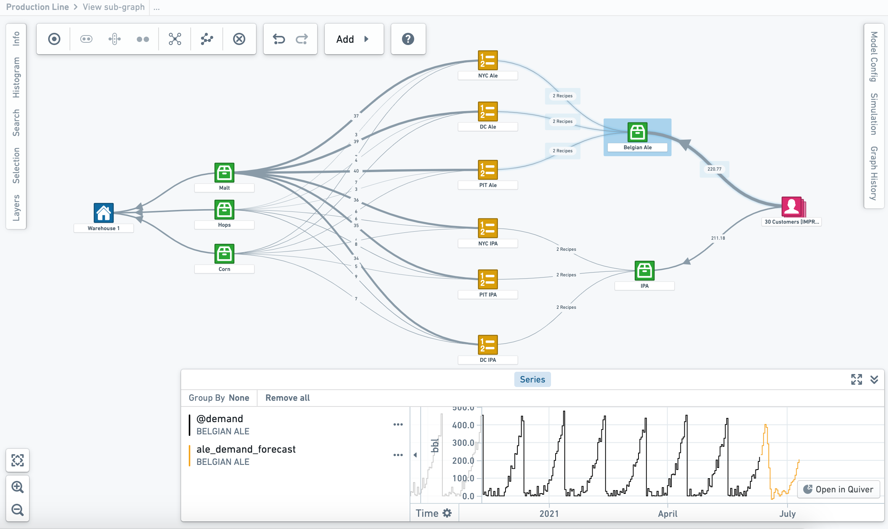

:::callout{theme="warning"}
注意：以下翻译的准确性尚未经过验证。这是使用 [AIP ↗](https://www.palantir.com/platforms/aip/) 从原始英文文本进行的机器翻译。
:::

# 概览

**Vertex** 允许您为现实世界的组织创建数字孪生，并在其中可视化和量化因果关系。使用 Vertex 工具包，您可以访问和探索由您的组织策划和发布的现有图表，或搭建新的系统图表。

Vertex 提供的工具包可以基于当前、预测或建议的条件，监控、模拟和优化操作决策，以最大化组织成果，实现数据驱动决策。

Vertex 可以帮助您：

* **带来透明度**，通过探索跨职能孤岛的整个网络的实时视图。
* **关注重要内容**，通过对重大风险和机会的集中警报以及它们如何影响目标来进行关注。
* **模拟未来**，通过结合分析和操作来找到您可以做出的最具影响力的更改。
* **学习和优化**，通过提高数据清晰度和模型准确性来了解什么有效，并朝着全局最优目标努力。

*此截图使用的是假想数据。*
