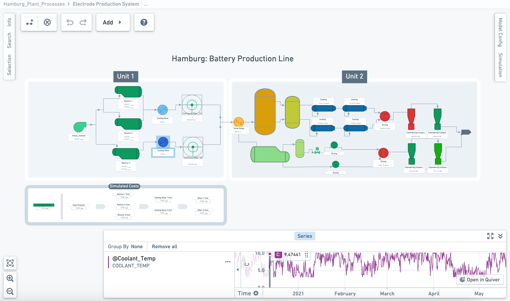
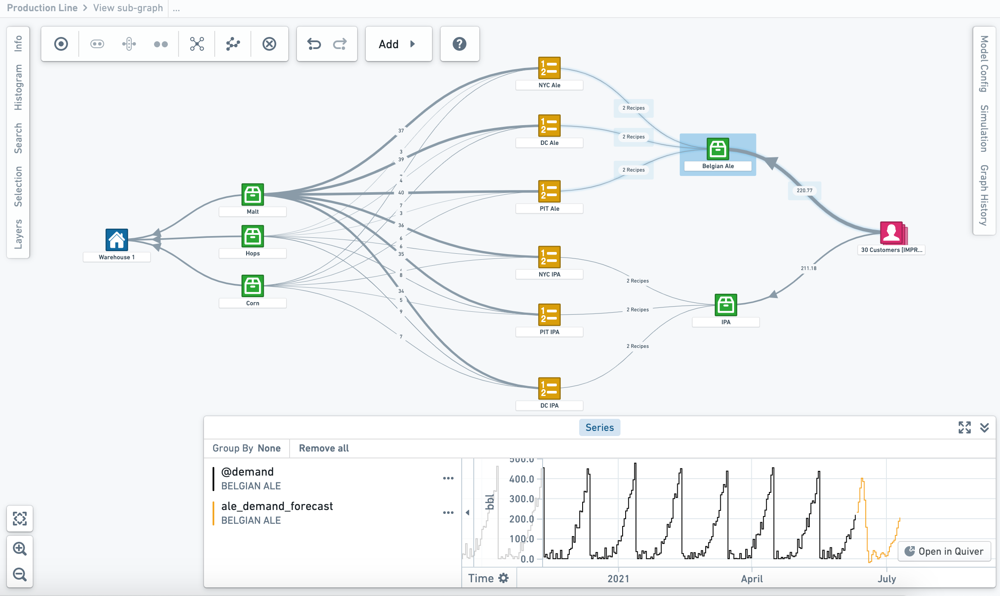

:::callout{theme="warning"}
注意：以下翻译的准确性尚未经过验证。这是使用 [AIP ↗](https://www.palantir.com/platforms/aip/) 从原始英文文本进行的机器翻译。
:::

# 示例应用案例

本页面描述了Vertex在组织中使用的几个示例。

## 点选式流程图绘制

:::callout{theme="warning" title="Beta"}
Vertex中的流程图绘制目前处于测试阶段，可能在所有注册中不可用。Palantir管理员可以通过内部配置启用此功能；这可能需要几天时间传播到您的注册。
:::

* 创建一个动态、集成的数字孪生体，允许您测试能够最大化组织成果的条件。
* 快速配置基于Object的系统图或生产流程图，适用于任何类型的工作流程，从材料处理和设备调试到生产和供应链管理。
* 利用建模Object和流程之间的预定义关系，直观显示整个系统中的材料流动和事件。
* 根据关键属性、指标或度量来配置和样式化您的Object图或流程图，以定制您的系统可视化。

**生产流程图：**

*此截图使用了示例数据。*

**系统图：**

*此截图使用了示例数据。*

## 仿真、动态分析和决策优化

Vertex允许您通过与Foundry中发布的任何模型、预测或业务逻辑集成来互动和审查您的数字孪生体。

* 在整个网络上运行“假设”分析和仿真，以了解和比较影响系统的决策、事件或潜在更改的含义。
* 配置和运行仿真，以应用真实世界的上下文，准确量化提议更改对建模世界的影响。
* 连接数字孪生体中的流程和系统，打破操作和数据孤岛，推动组织内新的多学科创新。
