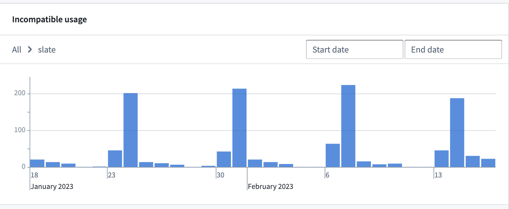
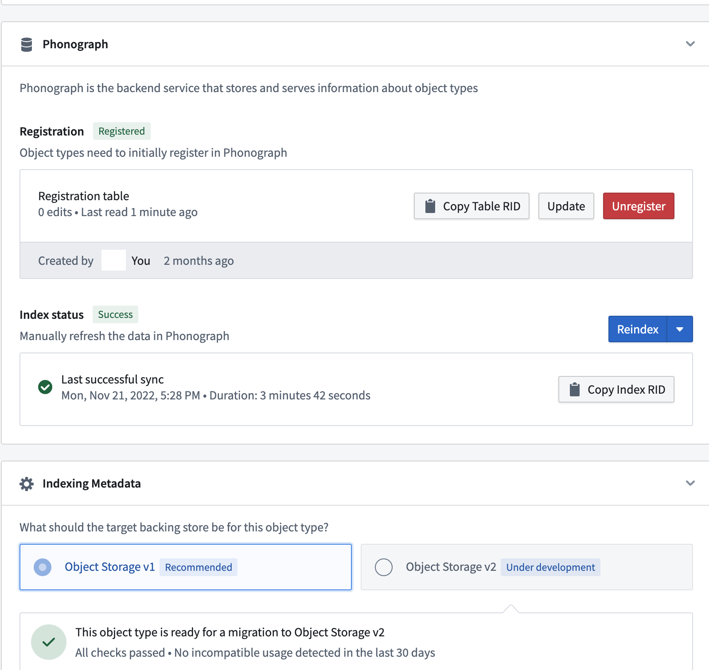
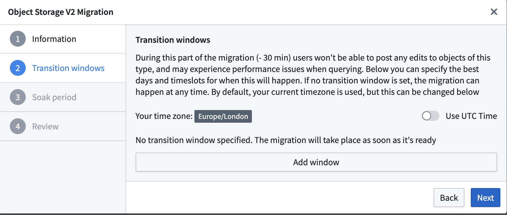
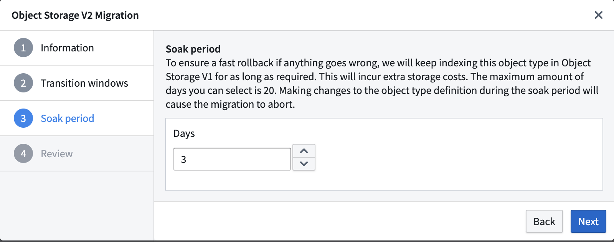
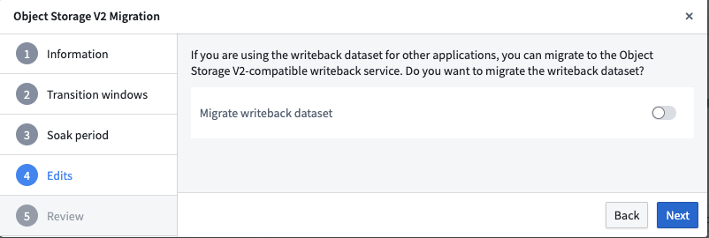
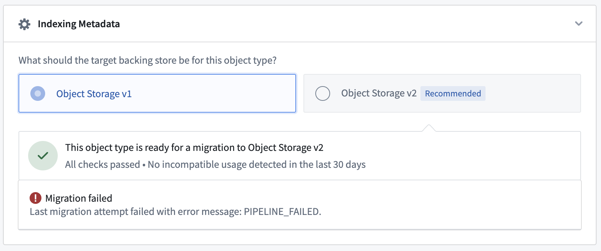
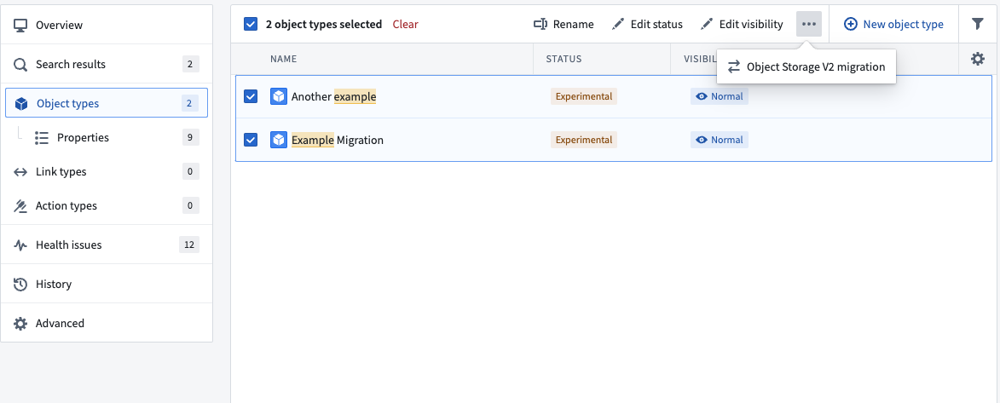

:::callout{theme="warning"}
注意：以下翻译的准确性尚未经过验证。这是使用 [AIP ↗](https://www.palantir.com/platforms/aip/) 从原始英文文本进行的机器翻译。
:::

# 从对象存储 V1 (Phonograph) 迁移到对象存储 V2

对象存储 V2 (OSv2) 的[改进](%E6%A6%82%E8%BF%B0.md)所需的架构更改需要将对象类型和多对多链接类型从对象存储 V1 (Phonograph) 通过合并表迁移到对象存储 V2 (OSv2)。

:::callout{theme="warning"}
目前迁移不是强制的，但建议进行迁移。Foundry 的 [Ontology 管理器](../../%E5%BA%94%E7%94%A8/%E6%9C%AC%E4%BD%93%E7%AE%A1%E7%90%86%E5%99%A8/%E6%A6%82%E8%BF%B0.md) 提供了一个集成框架，以实现对象类型和多对多链接类型的零停机迁移。
:::

Foundry Ontology 不要求一次性迁移所有对象类型和多对多链接类型。它将继续正常运行，其中一些对象类型位于对象存储 V1 (Phonograph)，而另一些位于对象存储 V2 (OSv2)。Foundry 的 [Ontology 管理器](../../%E5%BA%94%E7%94%A8/%E6%9C%AC%E4%BD%93%E7%AE%A1%E7%90%86%E5%99%A8/%E6%A6%82%E8%BF%B0.md) 也支持[批量迁移 Ontology 类型](#bulk-migrations)。

## 运行迁移前的考虑事项

### 迁移行为

* 对对象类型的 Ontology 定义的任何更改，如果会导致 [Funnel 替换管道](../%E5%AF%B9%E8%B1%A1%E7%B4%A2%E5%BC%95/Funnel%E6%89%B9%E5%A4%84%E7%90%86%E7%AE%A1%E9%81%93.md)，将中止任何正在进行的迁移。为了避免这种情况，请确保对象类型的架构在整个迁移过程中（包括浸泡期）保持稳定，并在启动迁移*之前*进行任何架构更改。
* 对象存储 V1 (Phonograph) 注册会同步更新在 Ontology 管理器中保存的任何更改。然而，Funnel 异步记录 Ontology 定义更改，因此在 Ontology 管理器中保存 Ontology 更改与 Funnel 检测到该更改之间会有延迟。因此，迁移事件如 `start` 或 `abort` 可能会在 Ontology 管理器中显示延迟几秒钟。
* 对象存储 V1 (Phonograph) 支持通过对象存储 V1 (Phonograph) 编辑 API 直接编辑对象和链接类型。这种交互已被弃用，并且与 OSv2 不兼容。在为具有用户编辑的对象类型启动迁移之前，确保您的[使用兼容](#incompatible-usage)。然后，在 Ontology 管理器中找到该对象类型，并导航到 **数据源** 标签。切换打开 `仅允许通过操作进行编辑` 以解除该对象类型的迁移阻碍。
* 用户编辑将在整个迁移期间（包括浸泡期）自动禁用，从迁移定义的那一刻起。迁移过程中无法发布新的用户编辑，但对象读取将保持不受干扰的可访问性。
* 迁移期间不会保留对象类型的编辑历史和归属。来自对象存储 V1 (Phonograph) 的每个对象实例的最新状态将被迁移到对象存储 V2。如果您没有使用 [操作日志](../../%E5%AE%9A%E4%B9%89%E6%9C%AC%E4%BD%93/%E5%8A%A8%E4%BD%9C%E7%B1%BB%E5%9E%8B/%E6%93%8D%E4%BD%9C%E6%97%A5%E5%BF%97.md) 对象类型来捕获编辑历史和归属，请联系您的 Palantir 代表以获得额外的帮助。

### 不兼容的使用

:::callout{theme="neutral"}
如果 **不兼容的使用** 视图不可访问，请联系您的 Palantir 代表以启用此功能。
:::

在对象存储 V2 中，某些交互被视为[重大更改](Object%20Storage%20v1%E4%B8%8EObject%20Storage%20v2%E4%B9%8B%E9%97%B4%E7%9A%84%E9%87%8D%E5%A4%A7%E5%8F%98%E6%9B%B4.md)，并且与对象存储 V2 不兼容。这种不兼容的使用会在 [Ontology 管理器](../../%E5%BA%94%E7%94%A8/%E6%9C%AC%E4%BD%93%E7%AE%A1%E7%90%86%E5%99%A8/%E6%A6%82%E8%BF%B0.md) 中被跟踪和报告。选择 **不兼容的使用** 警报将提供过去 30 天内所有不兼容使用的可视化，以帮助进行修复。

#### 非阻塞不兼容使用

一些不兼容使用，例如对对象存储 V1 (Phonograph) 端点的直接 API 调用，不会阻止启动到 OSv2 的迁移，但在对象类型迁移到 OSv2 后将失败。

您应该调查不兼容的使用并确定是否需要采取措施，例如将直接对象存储 V1 (Phonograph) 调用迁移到[对象集服务](%E6%A6%82%E8%BF%B0.md#object-set-service-oss)以进行对象查询/读取，[操作](%E6%A6%82%E8%BF%B0.md#actions)以进行对象编辑，以及[Ontology 元数据服务](%E6%A6%82%E8%BF%B0.md#ontology-metadata-service-oms)以获取对象类型的元数据信息。如果这些不兼容的使用不再相关或可以不产生后果地中断，您可以在不进行修复的情况下启动迁移。

#### 阻塞不兼容使用

OSv1 和 OSv2 之间的其他更改，例如未仅通过操作启用编辑，将在 Ontology 管理器中主动阻止迁移。

在这种情况下，您必须在开始迁移之前删除所有不兼容使用的情况。

#### 无不兼容使用

没有任何不兼容使用或重大更改的对象类型将在横幅中显示绿色勾号图标，以表明该对象类型已准备好迁移。

## 迁移实体

### 启动迁移

要启动迁移，请导航到您的对象类型或具有合并表的多对多链接类型的 **数据源** 标签，并转到 **索引元数据** 部分。如果对象类型符合迁移条件，您将能够选择对象存储 V2 单选按钮，打开选择迁移参数的向导。如果此部分不存在，您很可能正在处理一个强制所有对象类型和合并表链接类型使用对象存储 V2 的 Ontology。

:::callout{theme="neutral"}
Ontology 元数据服务跟踪由对象存储 V1 (Phonograph) 支持的对象类型的不兼容使用，并在尝试迁移具有不兼容使用的对象类型时触发警报。此外，您还必须确保对象类型架构不包含任何重大更改。
:::

### 过渡窗口

**过渡窗口** 选项允许您设置安全迁移的首选时间窗口；例如，您可能希望设置对象类型的应用案例活动最少的某一天和时间。请记住，迁移过程开始后，首次 Funnel 管道可能需要长达 30 分钟才能启动。如果迁移无法在第一个过渡窗口内完成，则对象集服务将等待下一个窗口开始从 OSv2 读取数据。

如果未设置过渡窗口，则迁移将在第一个 Funnel 管道成功后立即开始。

:::callout{theme="neutral"}
第一个同步到 OSv2 成功完成后，将计算出过渡窗口。这意味着如果首次同步在配置的过渡窗口中间完成，迁移不会将其视为可接受的过渡窗口，并将尝试下一个。
:::

### 浸泡期

如果您需要在迁移过程中回滚到对象存储 V1 (Phonograph)，可以在**浸泡期**内无停机进行。迁移框架将在整个浸泡期将对象存储 V1 (Phonograph) 索引与对象存储 V2 (OSv2) 同步更新。浸泡期可以按天设置，最长为14天，并且仅在迁移通过过渡窗口后开始。

在浸泡期间，Foundry Ontology 后端将自动将所有查询路由到 OSv2，任何对 OSv1 的请求将被拒绝。此时间段可以用于验证迁移后工作流程是否按预期工作。如果您在浸泡期间遇到任何问题，您可以[中止迁移](#aborting-the-migration)以立即切换回使用 OSv1 索引。

将浸泡期设置为 0 天将在 OSv2 索引准备就绪并激活过渡窗口后立即删除该对象类型的 OSv1 索引。在浸泡期结束后迁移回 OSv1 需要重新索引数据，可能会导致停机。

:::callout{theme="warning"}
请注意，对象类型将在浸泡期间在 OSv1 和 OSv2 中双重索引；这将产生额外的计算和存储使用量。如果您希望避免额外的资源使用，可以在配置迁移时将浸泡期设置为 0 天。
:::

### 迁移数据输出数据集

在对象存储 V1 (Phonograph) 中，[数据输出数据集](https://www.palantir.com/docs/foundry/slate/references-writeback/)是启用对象类型或具有合并表的多对多链接类型的用户编辑所必需的。对象存储 V2 用[物化数据集](../%E5%AF%B9%E8%B1%A1%E7%BC%96%E8%BE%91/%E7%89%A9%E5%8C%96.md#comparison-of-writeback-datasets-and-materialized-datasets)替代了数据输出数据集。对象存储 V2 不需要物化数据集来启用用户编辑。在 OSv2 中的非必填物化数据集中，您仅在下游使用需要时才需要创建物化。

对象和链接类型的数据输出数据集可以作为 OSv2 中的物化数据集进行迁移。物化数据集将保留相同的列，与现有下游管道保持兼容。此切换仅在您在其他应用程序中使用当前数据输出数据集时相关。用户编辑仍将迁移到 OSv2。

:::callout{theme="neutral"}
如果您选择不迁移数据输出数据集，该数据集本身不会被删除。相反，数据集将是静态的，并包含最后搭建时间的数据。
:::

:::callout{theme="warning"}
如果数据输出数据集包含未映射到任何对象类型属性的列，这些列将在迁移过程中被删除。
:::

### 中止迁移

如果在切换到对象存储 V2 后观察到性能下降或遇到错误，您可以在浸泡期间安全地中止正在进行的迁移，并恢复到 OSv1。迁移框架将确保在整个迁移过程中 OSv1 索引与任何新数据保持同步，并且不会有停机时间。

如果被迁移的对象类型有现有用户编辑，任何新的用户编辑将在迁移完成之前被禁用。

### 同步失败

您的对象类型可能在迁移过程中同步失败。如果出现这种情况，您将在对象类型 **数据源** 标签的 **索引元数据** 部分看到 `PIPELINE_FAILED` 出错。如果发生这种情况，请按照[调试漏斗批处理管道](../%E5%AF%B9%E8%B1%A1%E7%B4%A2%E5%BC%95/Funnel%E6%89%B9%E5%A4%84%E7%90%86%E7%AE%A1%E9%81%93.md#debug-a-pipeline)的说明进行调查和修复问题。

### 批量迁移

您可以通过导航到左侧导航栏中的 **对象类型** 部分并同时选择多个对象类型，使用相同的过渡窗口和浸泡时间配置批量运行迁移。该过程和设置向导与迁移单个对象类型时相同。我们建议逐步迁移，每次批量迁移少于 100 个实体，以防止意外的复杂性或出错。

对于仅启用 OSv2 的 Ontology，该向导不会出现在界面中。

