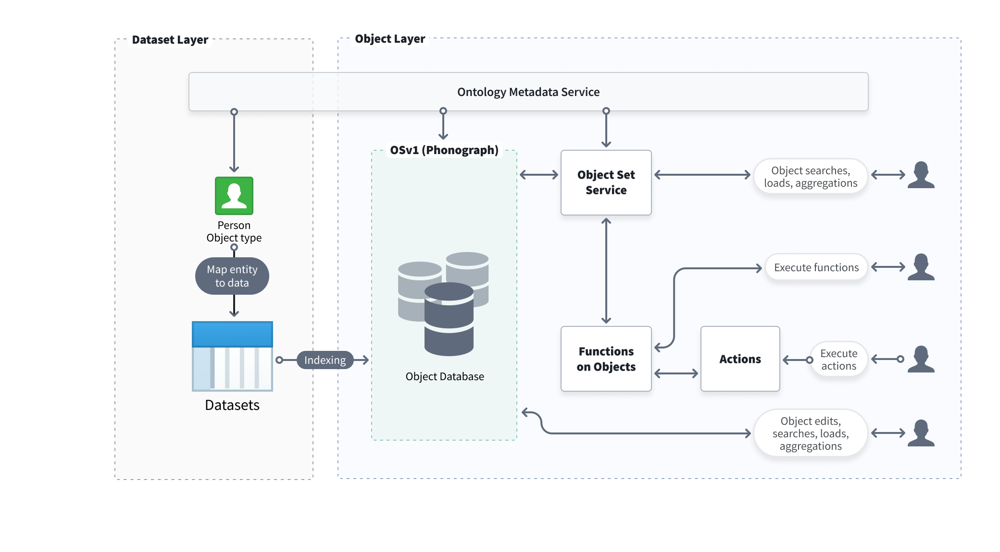
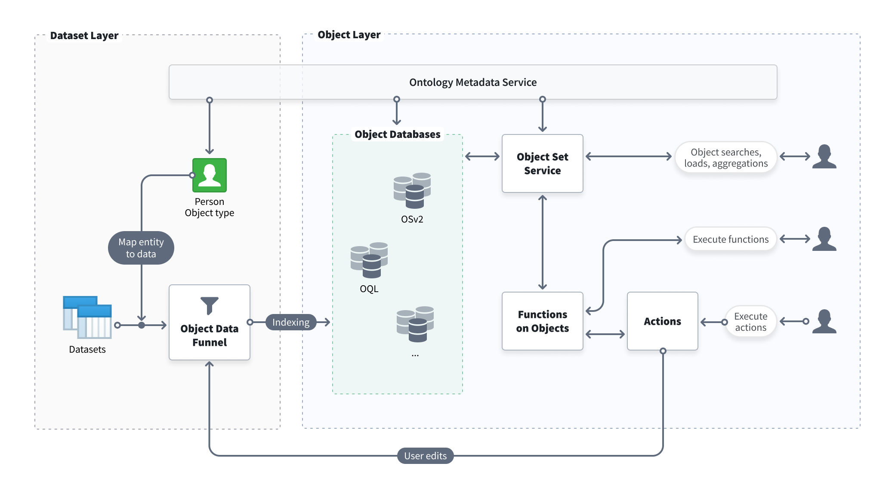

:::callout{theme="warning"}
注意：以下翻译的准确性尚未经过验证。这是使用 [AIP ↗](https://www.palantir.com/platforms/aip/) 从原始英文文本进行的机器翻译。
:::

# 概述

Foundry Ontology 是组织的操作层。Ontology 位于集成到 Foundry 中的数字资产（数据集和模型）之上，并将其连接到现实世界的对应物，从工厂、设备和产品等物理资产到客户订单或金融交易等概念。Ontology 充当组织的数字孪生体，包含启用各种应用案例所需的语义元素（对象、属性、链接）和动态元素（操作、函数、动态安全）。您可以在 [Ontology 文档](../../Ontology%E6%90%AD%E5%BB%BA.md) 中了解有关 Foundry Ontology 及其如何帮助做出更好决策的更多信息。

Foundry Ontology 由多个服务支持，这些服务共同协作以索引、存储、查询和操作 Ontology 中的对象。此页面提供了 Ontology 后端架构的高级概述。

## 功能组件和架构

Foundry 平台使用微服务架构，其中多个服务共同组成 Ontology 后端。Ontology 后端负责三个主要功能：

* **数据源管理** 以提供给 Ontology 并管理 Ontology 内的模式定义。
* **查询、搜索和聚合对象** 从 Ontology 中进行，并支持特定的筛选和权限管理。
* **写入 Ontology 的协调**，包括数据源的索引以及根据在 Foundry 中做出的决策或采取的操作对 Ontology 对象的编辑。

这些功能由组成 Ontology 后端的服务集体处理，以下是这些服务的概述：

* [Ontology 元数据服务 (OMS)](#ontology-metadata-service-oms)
* [对象数据库](#object-databases)
* [对象集服务 (OSS)](#object-set-service-oss)
* [操作](#actions)
* [对象数据漏斗](#object-data-funnel)
* [对象上的函数](#functions-on-objects)

### Ontology 元数据服务 (OMS)

Ontology 元数据服务 (OMS) 是定义存在的本体实体集的总体服务。此定义包括对象类型的元数据、描述对象类型之间任何关系的链接类型、可以以结构化和受控方式修改对象数据的操作类型等。

在 [Ontology 元数据文档](../../%E6%A0%B8%E5%BF%83%E6%A6%82%E5%BF%B5.md) 中了解有关 Foundry Ontology 核心概念的更多信息。

### 对象数据库

对象数据库是负责在 Ontology 中存储索引对象数据的服务，旨在为用户应用程序提供快速的数据查询和查询计算。除了存储索引数据外，对象数据库还负责索引、查询和协调用户编辑。

**对象存储 V1 (Phonograph)** 是 Foundry 的传统 Ontology 后端组件。**对象存储 V2** 是支持 Ontology 的下一代规范数据存储。有关这些服务的更多信息，请参见[下文](#evolution-of-the-ontology-backend)。

### 对象集服务 (OSS)

对象集服务 (OSS) 是负责从 Ontology 中读取服务的服务；OSS 允许其他 Foundry 服务和应用程序查询 Ontology 中的对象数据，支持搜索、筛选、聚合和加载对象。

#### 对象集

对象集是保存以供将来参考和在支持对象的 Foundry 应用程序中使用的现实世界实体列表。对象集保存为资源，以便与协作者轻松共享。

对象集可以通过定义（静态或动态）和对象后端中的当前状态（临时或永久）进行描述：

* **静态对象集：** 静态对象集保存为主键列表，无论输入数据发生任何变化，都会保持不变。

* **动态对象集：** 动态对象集保存为应用于创建对象集的筛选的表示形式。当新数据符合筛选条件时，对象集将更新。

* **临时对象集：** 临时对象集主要用于平台中将对象集从一个应用程序或服务传递到另一个应用程序或服务，并且只能由创建它们的用户访问。示例临时对象集 RID 将显示为 `ri.object-set.main.temporary-object-set.37d7e171-2d11-4fcd-b031-9a0863f6f744` 并在 24 小时内过期。

* **永久对象集：** 永久对象集存储在对象后端，以供将来在平台上参考和使用。

### 操作

操作服务负责在对象实例级别应用用户编辑到对象数据库。操作提供了一种结构化的方式来修改对象实例的属性值，并启用复杂的权限和条件以进行用户编辑。此外，操作还可以用于创建历史操作日志，以分析用户决策。

### 对象数据漏斗

对象数据漏斗（简称“漏斗”）是对象存储 V2 架构中的一个微服务，负责协调数据写入 Ontology。漏斗从 Foundry 数据源（如数据集、受限视图和流数据源）和用户编辑（通过操作）读取数据，并将这些数据索引到对象数据库中。漏斗还确保随着底层数据源的更新，索引数据保持最新。

### 对象上的函数

函数使代码作者能够编写可以在操作环境中快速执行的逻辑，例如设计用于支持决策过程的仪表盘和应用程序。

有关更多详细信息，请参见 [函数](../../%E5%AE%9A%E4%B9%89%E6%9C%AC%E4%BD%93/%E5%87%BD%E6%95%B0/%E6%A6%82%E8%BF%B0.md) 文档。

## Ontology 后端的演变

本节描述对象存储 V1 (Phonograph) 的传统架构和对象存储 V2 的更新架构。

### 对象存储 V1 (Phonograph) 架构

对象存储 V1 (Phonograph) 是 Foundry 的原始对象数据库，设计用于从广泛的潜在数据模型中索引和管理信息，同时维护 Foundry 的 Ontology 对象数据安全模型。除了索引和存储数据外，对象存储 V1 (Phonograph) 还跟踪用户生成的编辑应用，提供复杂的用户查询（包括搜索和聚合），并协调数据输出。

以下是描述对象存储 V1 (Phonograph) 架构的图表。

### 对象存储 V2 架构

随着 Foundry 获得更多功能并不断发展以满足 Palantir 客户的复杂操作需求和日益增长的规模，对象存储 V2 从根本上构建，以启用下一代 Ontology 驱动的应用案例和工作流。

具体而言，新架构分离了在对象存储 V1 (Phonograph) 中合并的关注维度，并在系统设计中解耦了职责；通过分离负责索引和查询数据的子系统，对象存储 V2 可以更轻松地横向扩展以满足未来的需求。

对象存储 V2 还通过 [对象数据漏斗](#object-data-funnel) 合并了 [操作](../../%E5%AE%9A%E4%B9%89%E6%9C%AC%E4%BD%93/%E5%8A%A8%E4%BD%9C%E7%B1%BB%E5%9E%8B/%E6%A6%82%E8%BF%B0.md) 等附加服务。

对象存储 V2 启用的新功能和能力包括：

* 通过增量对象索引（默认启用）显著提高 Ontology 数据索引性能，适用于所有对象类型。
* 对单一对象类型的对象实例进行数十亿级别的高索引吞吐量。
* 具有多数据源对象类型的更细粒度对象权限，包括列/属性级别权限。
* 提高用户编辑吞吐量，允许在单一操作中编辑超过 10,000 个对象。
* 降低用户编辑延迟并加快用户编辑的观察速度。
* 在对象类型定义中进行破坏性模式更改后，能够迁移现有用户编辑。
* 通过支持流数据源，实现低延迟数据索引到 Ontology。
* 支持每种对象类型最多 2000 个属性。
* 通过基于 Spark 的查询执行层，支持更大规模的搜索和更精确的聚合。
  * 默认情况下，搜索限制为 100,000 个对象。如果您的应用案例需要超过 100,000 个对象的大规模搜索，请联系 Palantir 支持团队以获取启用说明。

以下是描述对象存储 V2 如何支持 Ontology 的架构图。

