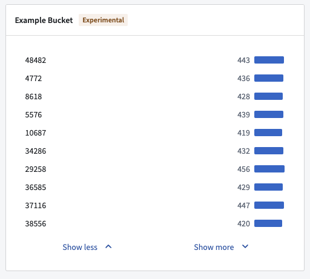
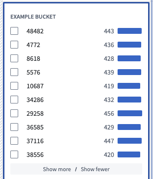
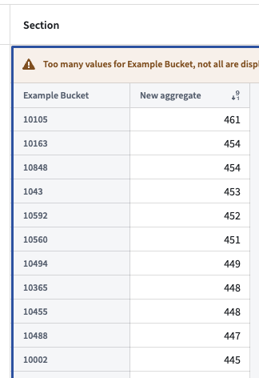
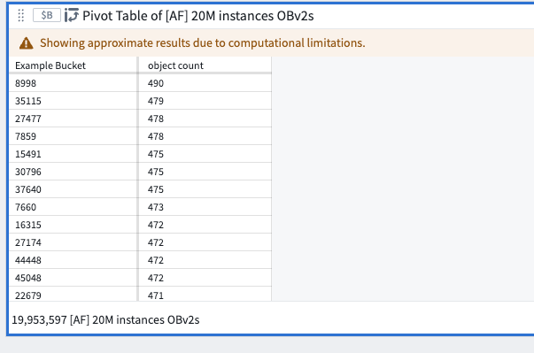
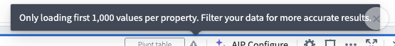
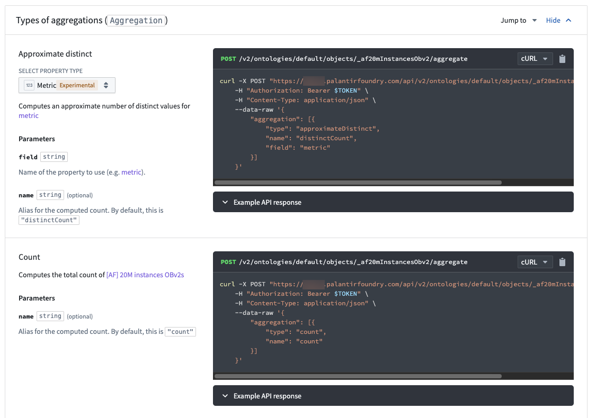

:::callout{theme="warning"}
注意：以下翻译的准确性尚未经过验证。这是使用 [AIP ↗](https://www.palantir.com/platforms/aip/) 从原始英文文本进行的机器翻译。
:::

# 聚合注意事项

在 Foundry 中，根据您处理的数据的复杂性和数量，应用程序可能无法显示完全准确的结果（也称为“非精确聚合”），这是由于高基数聚合的性质所致。

`object-set-service` API 包含以下与聚合准确性相关的字段，您可以在可用时使用这些字段来提高准确性：

* API 调用者可以在请求中添加 `AggregationExecutionMode` 并设置为 `PREFER_ACCURACY`。设置后，API 响应速度较慢，但提供更准确的结果，尽管不保证完全准确。
* 聚合响应包含一个 `AggregateResultAccuracy` 字段，以指示结果是否准确。

Foundry 中的每个产品在指示聚合可能不精确时都有略微不同的行为。请查看以下部分，了解非精确聚合在 Foundry 中可能如何表现，并在达到准确性时用户应考虑的事项。

如需更多指导，请联系 Palantir 客服支持。

## Object Explorer 和 Workshop

请考虑以下两个直方图截图，显示了一个包含 2000 万个对象的数据集的数据。第一个截图是导入到 Object Explorer 的数据集，第二个是 Workshop 中的 Workshop 筛选列表微件。





这些直方图是使用两次聚合请求构建的。第一个请求尝试按计数获取前 100 个桶，收到一个近似响应。第二个请求再次获取这同样的 100 个桶的计数，但附加地，仅筛选这些桶以确保计数的准确性。

虽然显示的计数是准确的，但第二个直方图在显示的桶不是实际按计数排列的前 100 个桶的意义上仍然不准确，因为第一个聚合响应并不准确。

Object Explorer 和 Workshop 向 OSS 的请求未指定 `AggregationExecutionMode`，OSS 默认设置为 `PREFER_SPEED`。

## Quiver 透视表和 Workshop 透视表

在 Quiver 和 Workshop 透视表中按计数降序排序列时，顶部的桶未按正确顺序显示。在这种情况下，非精确聚合可能通过以下出错信息之一来表征：

* “`column` 的值过多，未全部显示”
* “由于计算限制，显示近似结果”
* “每个属性仅加载前 1,000 个值。筛选您的数据以获得更准确的结果。”

在下面的例子中，`Example Bucket` 列未按预期降序排列。







这些并不是按计数排列的真正顶部桶，因为 Quiver 和 Workshop 在支持透视表的聚合请求中未指定排序。排序是在前端使用返回的桶完成的。

## Ontology SDK (OSDK)

OSDK 设置为 `PREFER_ACCURACY`，其有限的聚合复杂性意味着每个查询响应都将是 `ACCURATE`。



## 函数

函数始终使用 `PREFER_ACCURACY`，因此给定桶的值将是正确的。目前没有办法在函数调用期间同时 `groupBy` 和 `orderBy`。以下代码片段演示了在后端 `groupBy` 和在内存中排序的当前示例。

```typescript
    @Function()
    public async aggregateOnMoreBucketsThanAuthorized(): Promise<TwoDimensionalAggregation<string, Double>> {
        // 聚合和求和
        const aggregation = await Objects.search()._af20mInstancesObv2()
                 .groupBy(o => o.exampleBucket.topValues()) // 根据 exampleBucket 的 topValues 进行分组
                 .count() // 计数每个分组的数量

        aggregation.buckets.sort((b1, b2) => b2.value - b1.value); // 按值从大到小排序
        return aggregation;
    }
```

示例结果：

```json
{
  "buckets": [
    {
      "key": {
        "string": "10105", // 键名为字符串，值为"10105"
        "type": "string"   // 指定类型为字符串
      },
      "value": {
        "double": 461,     // 值为双精度浮点数461
        "type": "double"   // 指定类型为双精度浮点数
      }
    },
    {
      "key": {
        "string": "10163", // 键名为字符串，值为"10163"
        "type": "string"   // 指定类型为字符串
      },
      "value": {
        "double": 454,     // 值为双精度浮点数454
        "type": "double"   // 指定类型为双精度浮点数
      }
    },
    {
      "key": {
        "string": "10848", // 键名为字符串，值为"10848"
        "type": "string"   // 指定类型为字符串
      },
      "value": {
        "double": 454,     // 值为双精度浮点数454
        "type": "double"   // 指定类型为双精度浮点数
      }
    },
    ...
```

此代码段表示一个JSON对象，其中包含一个名为“buckets”的数组。每个数组元素是一个对象，包含一个“key”和一个“value”字段。“key”的值是一个字符串类型，“value”的值是双精度浮点数类型。
