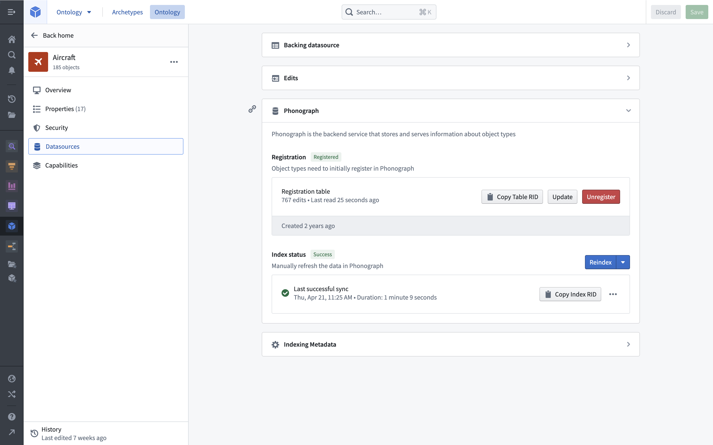
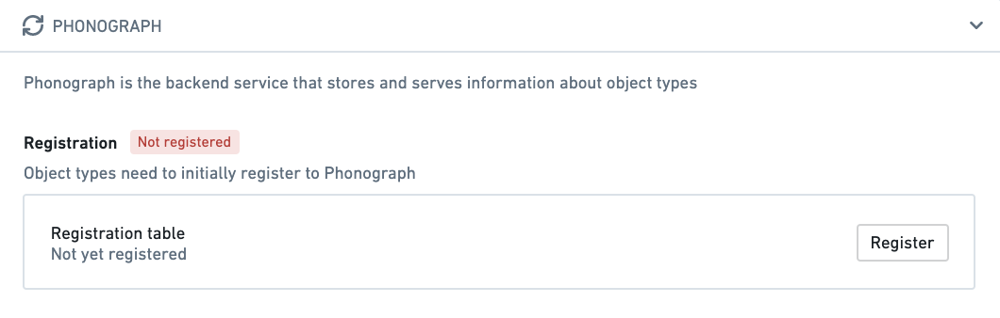
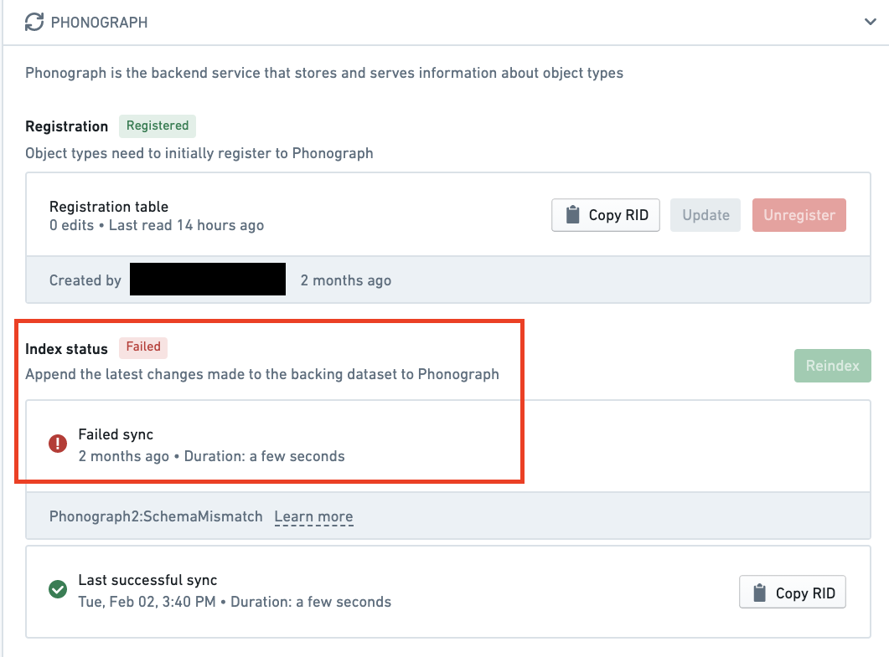

:::callout{theme="warning"}
注意：以下翻译的准确性尚未经过验证。这是使用 [AIP ↗](https://www.palantir.com/platforms/aip/) 从原始英文文本进行的机器翻译。
:::

# \[遗留] Object Storage v1 (Phonograph)

:::callout{theme="neutral"}
我们建议您使用Object Storage v2，这是一种下一代object数据库，而不是Object Storage v1 (Phonograph)。[了解有关Object Storage v2的更多信息。](../%E5%AF%B9%E8%B1%A1%E5%90%8E%E7%AB%AF/%E6%A6%82%E8%BF%B0.md)
:::

本页面提供了Ontology遗留支持存储Object Storage v1 (Phonograph)的概述。在较新的Ontology和那些已经完全迁移的Ontology中，Object Storage v2是唯一的选择。

## 目的

当数据源被添加为Ontology支持的数据源或在Ontology管理器中作为数据输出数据集时，数据源会被注册并索引到Phonograph中进行存储。当用户应用程序需要显示object支持数据时，会查询Phonograph，并显示结果。

## 注册

当支持数据源首次添加到object类型或链接类型时，数据源必须在Phonograph中注册。数据必须在Phonograph中注册后才能被用户应用程序查询或显示。

object类型或链接类型的**数据源**选项卡中的Phonograph部分显示支持数据源是否已成功在Phonograph中注册。如果object类型或链接类型的支持数据源未成功在Phonograph中注册，则在主页和搜索结果中，该object类型或链接类型的显示名称旁边将出现“未注册”的红色标签。

取消注册object类型或链接类型的支持数据源会阻止其数据出现在用户应用程序中，并删除用户数据编辑的历史记录（存储在Phonograph中）。要了解有关从Phonograph中取消注册支持数据源可能导致的潜在破坏性更改以及Ontology管理器中需要取消注册的操作的更多信息，请参阅[关于潜在破坏性更改的文档](../../%E5%AE%9A%E4%B9%89%E6%9C%AC%E4%BD%93/%E5%AF%B9%E8%B1%A1%E9%93%BE%E6%8E%A5%E7%B1%BB%E5%9E%8B/Object%20types/%E7%BC%96%E8%BE%91Object%E7%B1%BB%E5%9E%8B.md#potential-breaking-changes)。如果您的更改可能对编辑历史记录或用户应用程序产生破坏性影响，Ontology管理器将始终警告您。

## 索引状态

当对支持数据源中的数据进行更新或对object类型或链接类型的定义进行架构更改时，会开始同步，将更新的数据重新索引到Phonograph中。一旦同步完成（通常称为重新索引），更新后的数据和架构将出现在用户应用程序中。

object类型或链接类型的**数据源**选项卡中的Phonograph部分显示最后一次重新索引的启动状态。状态可以是`success`、`in progress`或`失败`。如果object类型或链接类型的支持数据源的最后一次重新索引失败，则在主页和搜索结果中，该object类型或链接类型的显示名称旁边将出现“失败”的红色标签。

您可以将鼠标悬停在或选择最后一次同步以获取更多详细信息，包括同步失败的原因。

## 增量和批量重新索引

在增量索引中，仅索引新的数据更新。Object Storage v1 (Phonograph)仅在数据源[事务类型](https://www.palantir.com/docs/foundry/data-integration/datasets/#transaction-types)为APPEND或UPDATE时增量索引新的数据源事务。对于SNAPSHOT事务，OSv1始终触发批量索引（其中所有object实例都被重新索引）。
