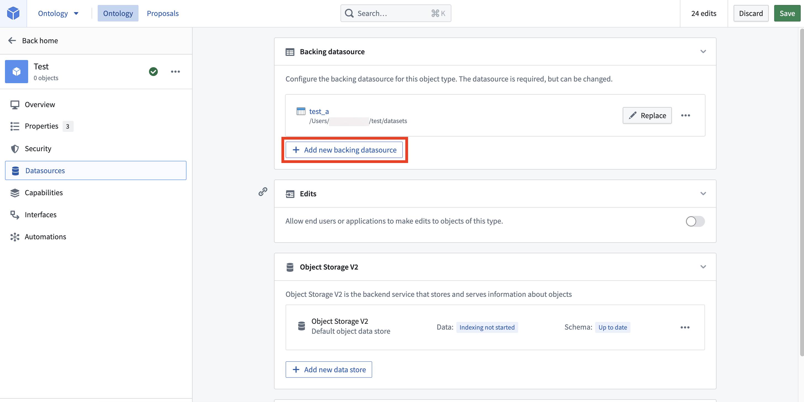
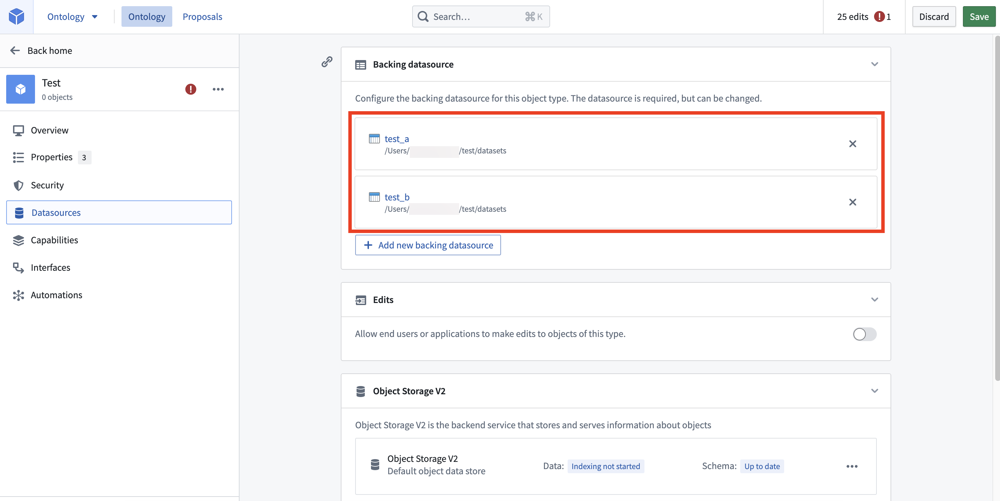

:::callout{theme="warning"}
注意：以下翻译的准确性尚未经过验证。这是使用 [AIP ↗](https://www.palantir.com/platforms/aip/) 从原始英文文本进行的机器翻译。
:::

# 多数据源Object类型（MDOs）

:::callout{theme="neutral"}
多数据源Object类型（MDOs）仅在Object Storage v2中可用。
:::

多数据源Object类型（MDO）由Ontology中的多个数据源支持。目前，数据源可以是[Foundry数据集](https://www.palantir.com/docs/foundry/data-integration/datasets/)或[受限视图](https://www.palantir.com/docs/foundry/security/restricted-views/)。

## 多数据源Object类型（MDOs）的类型

MDOs有两种不同的类别：

* **列式MDO:** 类似于合并MDO的应用案例，其中Object类型的不同属性子集可以从不同的数据源集成。列式MDOs可以用来支持需要列级访问控制的应用案例。
* **行式MDO:** 类似于并集MDO的应用案例，其中完整的Object（具有所有属性的Object）可以从共享相同架构的多个数据源集成。行式MDOs可以用来支持需要行级访问控制的应用案例。在Foundry中，[受限视图](%E9%85%8D%E7%BD%AE%E5%8F%97%E9%99%90%E8%A7%86%E5%9B%BE%E6%94%AF%E6%8C%81%E7%9A%84%E5%AF%B9%E8%B1%A1%E7%B1%BB%E5%9E%8B.md)为您可能使用行式MDOs的应用案例提供支持。行式MDOs本身不可用。

:::callout{theme="warning"}
Foundry仅支持列式MDOs，不支持行式MDOs。大多数行式MDO应用案例可以通过[受限视图](%E9%85%8D%E7%BD%AE%E5%8F%97%E9%99%90%E8%A7%86%E5%9B%BE%E6%94%AF%E6%8C%81%E7%9A%84%E5%AF%B9%E8%B1%A1%E7%B1%BB%E5%9E%8B.md)实现。如果您有无法通过受限视图启用的行式MDOs应用案例，请联系您的Palantir代表以获得帮助。
:::

## 配置多数据源Object类型

在Ontology Manager中使用Object Storage v2[创建Object类型](../../%E5%AE%9A%E4%B9%89%E6%9C%AC%E4%BD%93/%E5%AF%B9%E8%B1%A1%E9%93%BE%E6%8E%A5%E7%B1%BB%E5%9E%8B/Object%20types/%E5%88%9B%E5%BB%BA%20Object%20%E7%B1%BB%E5%9E%8B.md#create-a-new-object-type-manually)后，从左侧边栏导航到Object类型的**数据源**元数据部分。然后，选择**添加新的支持数据源**以选择数据集。

**映射主键**助手将出现，并提示您选择与Object类型主键匹配的列。一旦选择了列，多个支持的数据集将出现在**支持数据源**部分下。

从左侧边栏导航到**属性**元数据部分，为新添加的数据集添加新字段。

## 常见问题解答

### 多数据源Object类型是否可用于索引到Object Storage v1（Phonograph）的Object类型？

不可以。MDOs仅在Object Storage v2中支持，不适用于Object Storage v1（Phonograph）。

### 列式MDO和行式MDO是否都支持？

目前仅有列式MDO可用。如果您有无法通过受限视图启用的行式MDOs应用案例，请联系您的Palantir代表以获得帮助。

### 是否支持用户编辑和物化MDO？

是的，[用户编辑](../%E5%AF%B9%E8%B1%A1%E7%BC%96%E8%BE%91/Object%E7%BC%96%E8%BE%91%E5%92%8C%E7%89%A9%E5%8C%96.md)和[物化](../%E5%AF%B9%E8%B1%A1%E7%BC%96%E8%BE%91/%E7%89%A9%E5%8C%96.md)都支持MDO。

### 如果用户无法查看给定Object类型的一些输入数据源，会发生什么？用户体验会是怎样的？

如果用户缺少某些输入数据源的`只读`权限，从这些数据源映射的属性在向用户显示Object实例时将显示为`null`。然而，用户仍然可以查看该Object类型的架构（如查看属性名称），因为元数据访问是与输入数据源分开控制的。

[了解更多关于Ontology元数据权限的信息。](../../%E5%AE%9A%E4%B9%89%E6%9C%AC%E4%BD%93/%E6%9C%AC%E4%BD%93/%E6%9D%83%E9%99%90.md)

### 是否支持属性多重性？

属性多重性指的是多个输入数据源在列式MDO案例中提供重叠的列/属性。目前不支持属性多重性。这意味着一个Object类型的特定属性必须来自一个且仅一个输入数据源（主键属性除外，必须存在于每个输入数据源中以合并所有数据源）。

### 如果对应于受限视图策略的属性可以映射到多个共享相同策略的受限视图数据源，这是否被支持？

不支持；每个受限视图数据源应在Object类型上有单独的策略属性。这些属性中的一些可以在[Ontology Manager](../../%E5%BA%94%E7%94%A8/%E6%9C%AC%E4%BD%93%E7%AE%A1%E7%90%86%E5%99%A8/%E6%A6%82%E8%BF%B0.md#property-editor-view)中标记为隐藏，以避免干扰前端应用。

### MDOs与通过外键关系链接两个不同Object类型有什么区别？用户应如何在这些选项之间进行选择？

MDOs旨在提供一种用户友好的方式来配置与单一Object类型相同的设置，以搭建组织的数字孪生。多个Object类型之间的链接也可以用于用户理解和与数据交互的应用案例。注意，在多个Object类型之间查询和遍历链接是比在同一Object类型上筛选属性更昂贵的操作。

### 如果一个Object的两个列式数据源有不同的主键集，哪些Object会出现？

如果一个Object的两个列式数据源有不同的主键集，行为将类似于某些用户无法访问某些输入数据源的情况。在这些情况下，在某个数据源中不存在的主键将显示为从该特定输入数据源映射的属性为`null`。

### 一个Object类型可以有多少个数据源的限制？

Object类型最多可以有70个数据源。只有同步到Object存储的数据源才计入此限制，因此不包括媒体集或时间序列同步。
